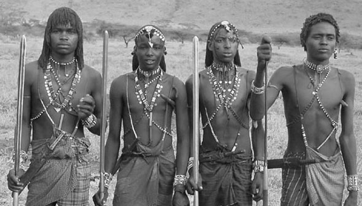
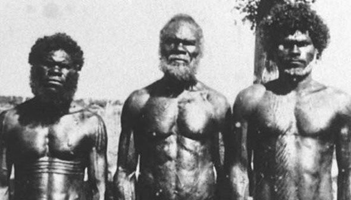
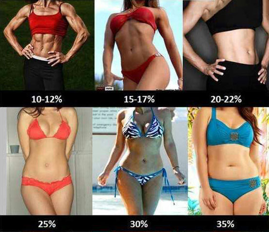
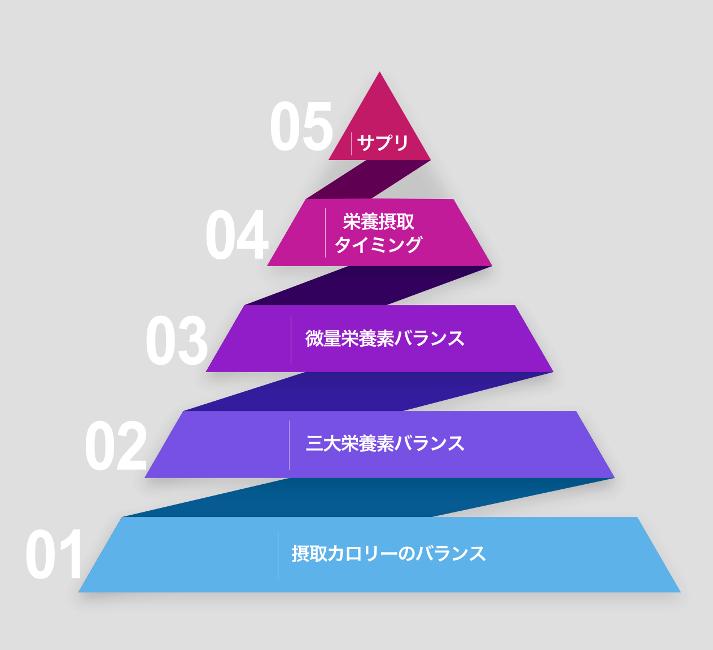

# 肉体作りのための食事入門#1「体づくりの重要ポイントピラミッド」

「**健康的な食事とは？**」って疑問の答えは「**カロリーの質に気を配りなはれ**」でほぼ終わってしまうのは「[パレオダイエットの教科書](https://amzn.to/2Pu2JSI)」にも書いたとおり。細かいことを言えばいくらでも言えるものの、基本的にカロリーの質にこだわっておけば、そんなに大きくは外さないんですよね。

---

が、これが「**見た目の良い体づくり**」とか「**筋肉を増やす**」ってのを目的にすると、また別の観点が必要になってきたりします。もうちょい意識してカロリーバランスを調整したり、栄養をとるタイミングをコントロールしたりと、ややめんどうな作業が必要になってくるんですよ。

考えてみると、「パレオな男」でもそこらへんの話をしっかりとしたことがなかったので、シリーズとしてまとめておこうと思います。

---

## **ざっくりした良い見た目の定義**

で、まずはこのシリーズで考える「見た目が良い体」のざっくりした定義を書いとくと、「**マサイ族とアボリジニの中間**」ぐらいを目指すイメージで考えてます。って意味がわからないので具体的な写真を紹介しますと、まずマサイ族はこんな感じ。

かなりしなやかな印象で良い感じですが、なかには「もうちょい筋肉が欲しいなー」ってケースもありましょう。そこでアボリジニのイメージはこちら。

かなりマスキュリンな印象ですね。もちろんこれ以上のバキバキさを目指してもいいんですが、その場合は結構メンテナンスが大変になってくるので、とりあえずはアボリジニを上限ぐらいに考えておくのがいいんじゃないかと。

一方でマサイ族ぐらいのスレンダーな肉体であれば、普通にカロリーの質に気を配るだけでもある程度は達成できたりはします。実際、私もカロリーの質だけに注力してたころはマサイ族的な体型でしたしね。そんなにめんどうなことを考えたくないなら、マサイ族ぐらいの体を目指すぞ！と考えておいてもいいでしょう（逆にわかりにくいかもですが 笑）。

ちなみに、女性の場合は狩猟採集民を参考にすると逆にわかりにくいってのがありまして（民族衣装がゆったりしててボディラインが見えないんで）、以下をご参照ください。

さすがに10〜12 ％レベルの体脂肪率になると体調を崩す可能性があるので、だいたい15〜22％のあいだを目指す感じになります。健康で魅力的なのは20％近辺で、ちょっと腹筋が割れてる感じが好みなら18％前後を目指すことになりますね。

## 体づくりを左右する要素の重要度ピラミッド

ということで、まずはこのシリーズのロードマップを見てみましょう。体づくりに欠かせないポイントは、以下の順番に重要性がわかれております。

当然、ピラミッドの最下段が一番大事で、上にいくに従って重要性は薄れていきます。最上段の「サプリ」なんかは、「あってもなくてもいいけど、うまく使えばちょっと便利かなー」ぐらいのイメージっすね。

いちおう、それぞれの概略も説明しておきましょう。

### 01. 摂取カロリーのバランス

体づくりにおいては、なにはともあれまずはカロリー摂取量がもっとも大事になります。結局のところ、筋肉の増加と体脂肪の減少を左右するのはカロリーなんで、適正レベルを見極めるのは超大事。

### 02. 三大栄養素のバランス

ここでは「タンパク質、脂質、炭水化物の摂取量はどんなふうに考えればいいのか？」って話と、さらに食物繊維のレベルなども考えていきます。「体づくり」というと「炭水化物を減らしてプロテインを飲めばいいんでしょ？」みたいに考えがちなので、そこらへんについても見ていきたいところ。

### 03. 微量栄養素のバランス

ビタミン、ミネラル、水分量などの問題はここであつかいます。健康の維持って視点からすると微量栄養素はめちゃくちゃ大事なんだけど、とにかく肉体の組成を変えたいってのが目的の場合は、重要度としてはレベル3ぐらいになりますね。

### 04. 栄養摂取タイミング

どのタイミングで食事をするか？ってポイントはここで取り扱います。1日単位でのカロリー配分、1週間単位でのカロリー配分など、意外といろいろ考えることがあるんですよね。

## 体づくりの下準備とか

というわけで、次回からは上記のポイントを掘り下げていくわけですが、その前に必要な下準備をしときましょう。

### 下準備1：トラッキングデバイス

このブロマガをお読みの方であれば記録の重要性は頭に叩き込まれているはず。「体づくり」でもトラッキングは超大事なんで、とりあえず以下のものを用意しておきましょう。

- **体重計**：基本中の基本ですね。いまは数万円もする体組成計なども売ってますが、別にAmazonで売ってる2000〜3000円ぐらいのもんでいいです。私も昔は高い体重計で体脂肪率とかを測ってましたけど、結局は「いまの技術力だと誤差がデカすぎて意味ないな‥…」って感じだったんで。とりあえず安物のデジタル体重計で十分。

- **クッキングスケール**：こちらも基本ですね。個人的には[タニタさんの商品](https://amzn.to/2PvtqGA)を使ってますけども、調理前の食材を計測できるんであればなんでもいいです。

- **食品データベース**：最終的には微量栄養素なんかも把握していかねばならないので、食品データベースも必要になってきます。ここらへんは「[MyFitnessPal](https://apps.apple.com/jp/app/myfitnesspal/id341232718)」や「[あすけん](https://apps.apple.com/jp/app/%E3%81%82%E3%81%99%E3%81%91%E3%82%93%E3%83%80%E3%82%A4%E3%82%A8%E3%83%83%E3%83%88-%E4%BD%93%E9%87%8D%E8%A8%98%E9%8C%B2%E3%81%A8%E3%82%AB%E3%83%AD%E3%83%AA%E3%83%BC%E7%AE%A1%E7%90%86%E3%82%A2%E3%83%97%E3%83%AA/id687287242)」「[カロミル](https://apps.apple.com/jp/app/%E3%82%AB%E3%83%AD%E3%83%9F%E3%83%AB-%E3%83%80%E3%82%A4%E3%82%A8%E3%83%83%E3%83%88-%E7%B3%96%E8%B3%AA%E5%88%B6%E9%99%90%E3%81%AA%E3%81%A9%E3%81%AE%E6%A0%84%E9%A4%8A%E7%AE%A1%E7%90%86/id963055562)」などをダウンロードして、インターフェースが好きなものを選べばいいでしょう。

### 下準備2：心がまえ

いちおう「体づくり」についての心がまえについても触れておきましょう。「とにかくがんばれ！」という精神論的な話じゃなくて、「体づくり」に挑む人たちがハマりがちなメンタルトラップのお話です。心がまえのせいで体づくりに失敗する人は意外なほど多いので、以下のポイントを押さえておくと吉であります。

- **「黒か白か思考」は捨てる**：何かを変えたい！と思ったときにハマりがちなのが、「黒か白か思考」であります。「これを食べるとカロリーオーバーだから絶対に食べない！」とか「1回でも決めたトレーニングをズラしたら死ぬ！」みたいな考え方ですね。黒か白かの罠にハマっちゃうケースはかなり多くて、特にこのブロマガの読者さんに多い「誠実性が高いタイプ」は結構おちいりがちかもしれません。
  が、このメンタリティは確実に敗北の道でして、例えばヴァーヘニンゲン大学の2015年論文([R](https://journals.sagepub.com/doi/10.1177/1359105315573440))でも、「きっちり決めた食事を貫く人よりも、柔軟な食事をしてる人の方が体重が減るよ！」って報告が出ております。最初は「黒か白か」のほうが効果が出やすいんですけど、長い目でみるとストレス増加の原因になっちゃうんで、失敗に終わりやすいんですよね。

- **「理想の食事」はないと思っておく**：上の「黒か白か思考」と似たポイントで、「見た目が良い体になるぞ！」と決めた瞬間から、「理想の食事をしなくては！」と思いすぎちゃう方が多いんですよ。ただ、そもそも個人が必要な栄養やカロリーのバランスってガンガン変わりまして、毎日の体重の増減、年齢の変化、活動レベルの変動、食材の測り方などによって違ってきちゃうんで、ある程度のどこで理想を妥協するしかないんですよね。
  が、かつて私が食事指導をしてたころは「糖質は100gまでだったのに105gも食べてしまった！」とか思い悩む方が結構いまして、まずはメンタルをもみほぐすことからスタートした記憶がございます。もともと理想的な食事は存在しないし、それを守るのも不可能なんで、はじめから捨てておいたほうが無難であります。

- **食事は「バラエティが大事」と肝に銘じておく**：近ごろはボディビルの世界などでも「クリーン・イーティング」みたいな言葉を聞くようになりました。できるだけ自然に近い食事をして加工食品は避けよう！みたいな考え方ですね。
  もちろんこの考え方は間違ってないんですが、ともすれば「あの食品は悪だ！」みたいなメンタリティにハマりがち。ちょっとでも悪そうな食品を省きまくった結果、いつも10種類の食材だけをローテーションしちゃうようなケースもよく見かけます。実際、「パレオな男」のほうにも「夫がパレオダイエットにハマりすぎて、私が作った夕食を食べてくれないんですが……」みたいなお悩みをいただくことがあったりしますからね。
  が、このメンタリティもまた敗北への道でして、基本的にはいろんな食材を幅広く食べておくほうが栄養バランスは満たしやすいし、特定の食品ばっかとることによる副作用も防ぎやすくなります（例えば、「海藻が体にいい！」と思っていつも食べてたら、体内にヒ素がたまったりとか）。事実、長寿大国だったころの沖縄の食事なんて、めちゃくちゃバラエティに富んでたそうですしね。

## **次回予告**

ってことで前置きは終わって、次回からは実践編。まずは最重要ポイントである「カロリー配分」の問題について見ていきましょう〜。
