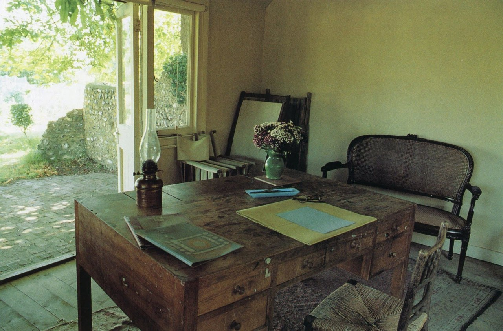
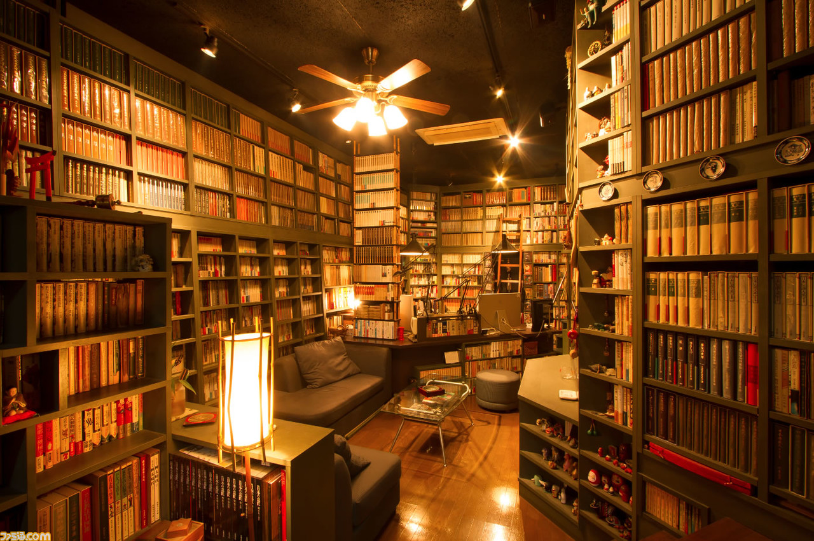
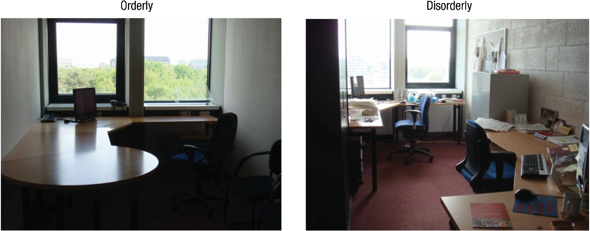
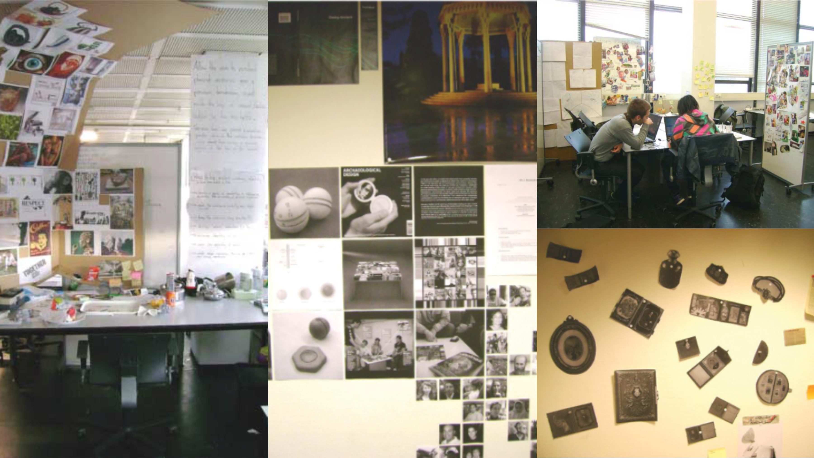

# 科学的に理想の仕事部屋を目指そう！#4「部屋の使い方編」

というわけで、科学的に理想の仕事部屋を目指していくシリーズの4回目です([#1](https://daigovideolab.jp/blog/1926268),[#2](https://daigovideolab.jp/blog/1927155),[#3](https://daigovideolab.jp/blog/1930448))。

---

このシリーズでは、「**生産性が上がりやすい部屋の条件とは？**」って問題についてデータをもとに考えていき、それに従って自分の仕事部屋も変えられたらいいなーってとこを目標にしてます。すべて取り入れる必要はないものの、部屋の模様替えにお困りの方は参考にしていただければと。

で、前回は「ベストな環境音や照明」について見てみましたんで、今回は「部屋の使い方」をチェックしていきます。いざ良い照明や家具の配置ができたあと、その部屋をどのように使っていくか？ってポイントですね。

## **1. 美しくあれ**

まず最初のポイントは、「**美的に美しい部屋にせよ！**」というものです。きちんと整理がされているとかではなく、主観的に「これは美しい！」と思えるような部屋作り＆使い方が大事だよーって話ですね。

これについては欲求段階説で有名なマズローの超古典的な研究([R](https://www.tandfonline.com/doi/abs/10.1080/00223980.1956.9713000))があって、チームは３パターンの部屋を用意したんですよ。

1. **美しい部屋**：大きなドレープのかかった窓、柔らかな照明、彫刻作品、座り心地の良い椅子、本などが置かれた見目麗しい部屋。マズロー自身のオフィスを使ったらしい。
2. **平凡な部屋**：きちんとしていて清潔だが、室内には仕事のものだけが置いてある部屋。
3. **醜い部屋**：汚れたグレーの壁、パイプチェアが2〜3脚、カバーが破損した照明、ブリキ缶の灰皿、モップ、古いのマットレスが無造作に散らばっている部屋。

そのうえで被験者を３つのうちひとつの部屋に誘導しつつ、作業中の心理状態や活力を採点してもらったんだそうな。すると、結果は「美しい部屋」がずば抜けていて、醜い部屋はもちろん平凡な部屋よりも激しく活力やモチベーションが上がったんだそうな。たんに普通の部屋を作っただけでは、生産性は上がりにくいってことですな（もちろん汚い部屋よりはマシですが）。

ただ、繰り返しますが、これはあくまで主観的な話なんで、自分の部屋作りに活かす際は自身の美的感覚に従ってください。例えば私などはヴァージニア・ウルフの書斎↓を「シンプルだけど自然物が多いし外は庭だし最高だぜ！」と思うわけですが、これを「地味だなー」と思う人もいるでしょうからね。

あと日本で言うと京極夏彦さんの書斎↓とか「いいなー」と思うわけですが、賃貸でこれをやるのは無理なんで、できる範囲で考えていきたいところです（笑

## **2. とはいえ乱雑でもあれ**

上では「汚い部屋は良くない」と書きましたが、実はあまりにも整理整頓されている部屋も良くなかったりします。このポイントについては2013年の研究([R](https://pubmed.ncbi.nlm.nih.gov/23907542/))が有名で、ミネソタ大学などのチームが34人の学生を集めて、2パターンの部屋で作業してもらったんですよ。

具体的に実験で使われた部屋はこんな感じです。ご覧のとおり、左が「超整った部屋」で右が「やや乱雑な部屋」ですね。

その後、被験者に「ピンポンボールの新しい用途を考え出してください」と指示したところ、部屋によって結果が大きく異なりまして、散らかった部屋でアイデアを練った被験者の方が創造的な答えを生み出す傾向があったんだそうな。

この現象についてチームは、

> 無秩序な環境は伝統からの脱却をうながし新たな洞察をもたらす。逆に秩序立った環境は慣習を奨励し、安全にふるまう思考をうながす。

とコメントしてまして、何か創造的なことがしたければ「プチ乱雑」が大事ってポイントが強調されてました。もちろん、「数字のチェック」とか「文字校正」みたいに安全性が重視されるタスクは整った部屋でやったほうがいいんだけど、基本的には「ちょっと乱雑な部屋」を目指して使うのがいいでしょうね。

## **3. 壁を使え**

続いてのポイントは「壁を使おう！」というもので、これはまず事例を見ていただいた方が早いでしょう。

こんな風に壁をワークスペースとして使っていくと、ガンガンに創造性が高まりやすくなるというんですな。

これはトゥウェンテ大学が行った2009年の調査([R](https://www.tandfonline.com/doi/abs/10.1080/14626268.2012.658522))から得られた知見で、研究チームは主にデザイナーのスタジオでインタビューと動画撮影を実施して、250時間をかけてエスノグラフィを行ったんですよ。その点で一般のRCTなどより精度は低いんですけど、一定の傾向を確認する参考にはなりましょう。

でもって、調査の結果、こんなことがわかりました。

- 優秀なデザイナーほど、オフィスの壁、掲示板、クリップボードなどを使い、壁面にスケッチやストーリーボード、ポストイットなどの情報で埋め尽くしていた

- 壁面を使って作業を行うと、アイデアがまとまりやすくなるだけでなく、インスピレーションを高める働きも得られる

ということで、壁面に作業スペースを作ってた人は、全体的に生産性が高い傾向があったらしい。うーん、確かに壁で書籍の構成を見渡せたら確かに便利かもとは思いますね。[ホワイトボードシート](https://amzn.to/2PEQHWt)でも導入してみるか…‥。

## **4. 香りをたくべし**

実はアロマと生産性の研究ってのはあんまなくて、全体的にはいまいち信頼できるデータが少ない分野だったりします。が、「パレオな男」でもたまに「[ラベンダーいいよ！](https://yuchrszk.blogspot.com/2020/07/blog-post_20.html)」みたいな話を書いているように、おもしろい知見はいくつか出てるんですよね。

現時点でどんなものがあるのかと言いますと、

- **ペパーミント**：1991年に行われた研究([R](http://67-20-110-78.unifiedlayer.com/wp-content/uploads/2014/04/Effects-of-Olfactory-Stimulation-on-Performance-and-Stress.pdf))によると、40人の男女のうち半分にペパーミントのエッセンシャルオイルを吸入させたところ、持続的な注意力が必要なタスク の成績が有意に改善した

- **ローズマリー**：144人の男女にローズマリーのエッセンシャルオイルで満たした部屋で認知タスクを行わせた研究([R](https://www.tandfonline.com/doi/abs/10.1080/00207450390161903))では、ローズマリーを吸入したグループは、記憶力と注意力の成績が有意に改善した。

- **ラベンダー**：36人の健康な男性を対象にしたテスト([R](http://chemse.oxfordjournals.org/content/30/8/683.full.pdf+html))では、1)コントロール群、2)休憩中にジャスミンの香りを嗅ぐ、3)休憩中にラベンダーの香りを嗅ぐという3パターンの介入を実践したところ、ラベンダーグループのみ、その後に行われた注意力テストの成績が向上した。

- **レモン/オレンジ**：28人の高齢者(うち17人がアルツハイマーの患者)を対象にしたテスト([R](https://onlinelibrary.wiley.com/doi/epdf/10.1111/j.1479-8301.2009.00299.x))では、朝にローズマリーとレモンのオイルを嗅がせ、夕方にラベンダーとオレンジのオイルを嗅がせたところ、有意に認知機能が改善した。

といったあたりですね。いまいちこれといったデータがないので、「この香りがおすすめ！」ってのは言いづらいんですけど、良い香りが気分を改善してくれるのは確実なんで、とりあえず好きな精油を使ってみちゃいかがかと。私も個人的に香りが好きって理由だけで「[青森のヒバ精油](https://amzn.to/31FhSpG)」を使ってたりしますし。

## **5. ときに立つべし**

これはすでに実践してる方も多いでしょうが、ステンディングデスクの使用も生産性向上にはそこそこの効果があります。有名なのはセントルイス大学の研究([R](https://journals.sagepub.com/doi/abs/%2010.1177/1948550614538463))で、214人の学生を3〜5人のグループにわけて、「30分で大学の募集ビデオを作ってください」と指示したんだそうな。

その際、作業部屋を2つの条件に分けまして、

1. 普通のオフィスチェアが配置されている
2. 部屋からイスが取り外されている

って感じでどちらかの部屋で作業をしてもらったところ、立ち作業を行ったグループには以下の傾向が確認されたんだそうな。

- 参加者の発言の活性化
- 自分のアイデアを他人と自由にシェアする行為
- 情報を精緻に取り扱う傾向の増加

というわけで、どうやら立ちながらの作業はクリエイティビティやモチベーションを高める働きがあるっぽいんですよね。近ごろはスタンディングデスクもだいぶ[手に入りやすくなりました](https://amzn.to/3kvJNRy)し、導入されていない方は検討されても良いのではないかと。

## 総合まとめ

ってことで本シリーズは今回で終了。最後に、ここまでお伝えしてきた「良い部屋」のポイントを総まとめにして終わりたいと思います。

1. 仕事場は「仕事をする」目的だけに限定する
2. 決まった時間に使う
3. パッと見で作業の目的が分かるようにする
4. アートを飾る
5. ノスタルジックなアイテムを飾る
6. 青色を導入する
7. 天井が高い物件を選ぶ
8. 窓から外がよく見える物件を選ぶ
9. 視覚的な情報量が多い家具や物件を選ぶ
10. 創造性が必要な仕事はノイズレベル70dbを目指す
11. 照明を太陽サイクルに合わせる
12. 創造的な作業をするときは150ルクスに
13. 室温は自分にとって最適なものを探る
14. 自分が「美しい」と思えるように使う
15. 適度な乱雑さを導入する
16. 壁面を作業場にする
17. アロマを導入する
18. スタンディングデスクを使う

以上18ポイント、私も今回のデータを参考にいろいろ模様替えでもしてみようかと思います。
