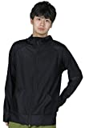
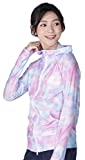
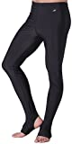
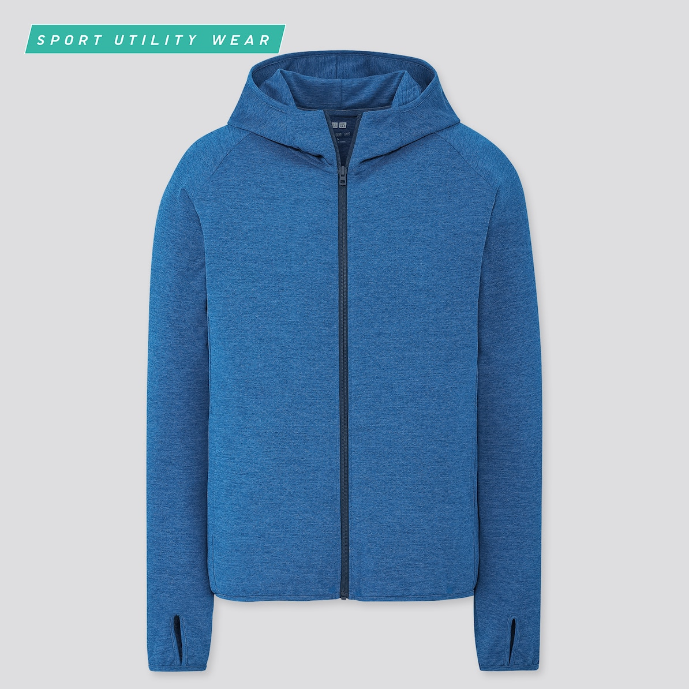
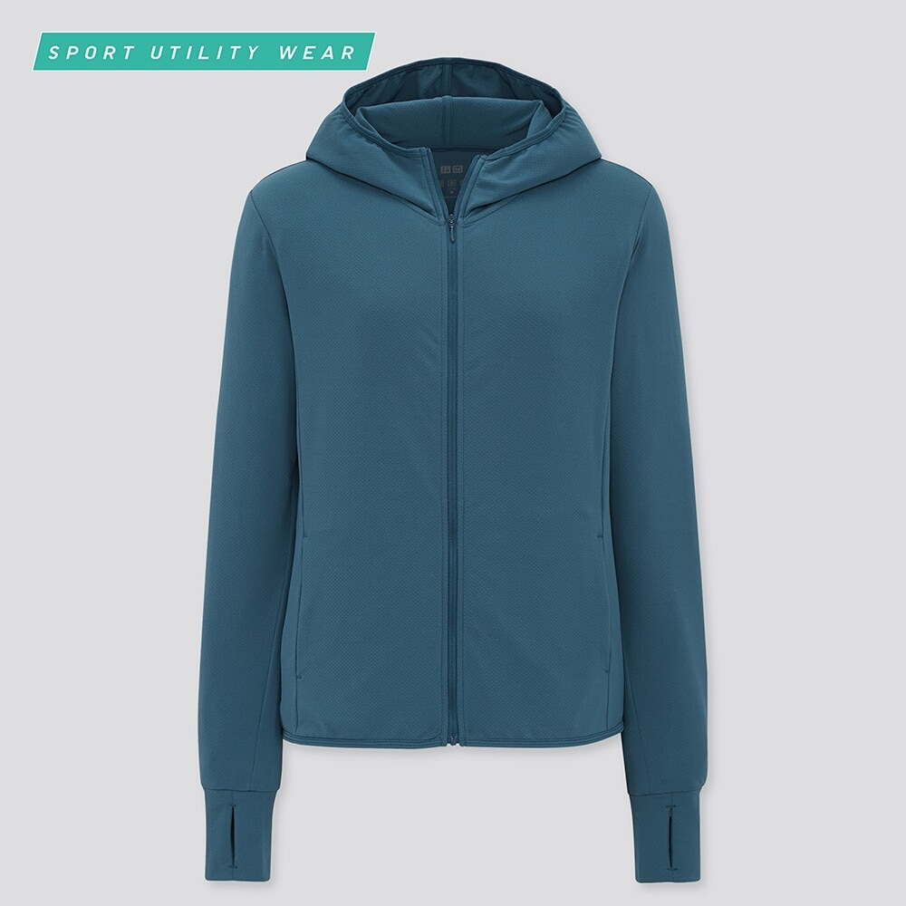
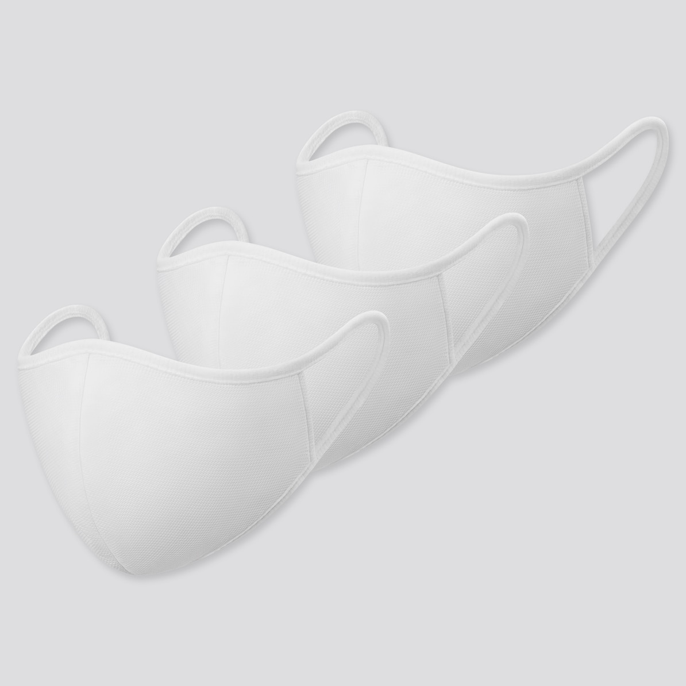
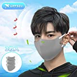
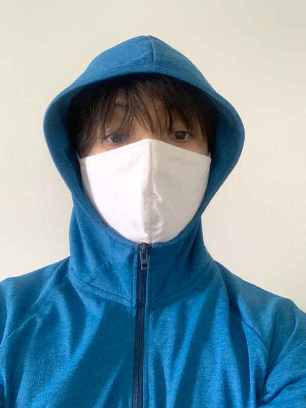

# 紫外線がハンパない！ということでUVカット系衣類の基本的なお話など

**紫外線がすごい！**ということで、緊急的に「衣服による日焼け止め」の話をしましょう。このブロマガでも日焼け止めの有効性はさんざん書いてきましたが、UVカット系の衣服については触れたことがなかったですからね。

---

## **UVカット系の衣服の良いとこと悪いとこ**

というのも、衣服による紫外線対策には結構なメリットがありまして、

- 2時間ごとの定期的な塗り直しがいらず、一度着れば大丈夫

- 日焼け止めをまんべんなく塗るのは難しい（日焼け止めが少なすぎてシミができてしまうケースも多い）

- 衣類は自然に広いスペクトルを持っており、UVBやUVAはもちろん可視光もブロックする（可視光は日焼け止めでブロックできない）

みたいなポイントはかなり大きいと思うわけです。特に「塗り直し問題」はかなりの人がつい忘れちゃうことが多いので、衣服で対処できるのはいいよなーと思う次第です。

が、もちろんUVカット系の衣服にも問題はありまして、

- 顔と手を衣類で保護するのが難しい（帽子でも拡散紫外線顔はブロックできない）

- ただでさえ暑い時期にさらに上着を重ねるのが辛い

ってのは難しいポイントです。特に紫外線対策は顔の保護を目的とする人が多いでしょうから、ここをうまくカバーできないと辛いですわな。個人的に暑がりなので、その点も厳しいとこではないかと。

## UPFってなんだろう？

ってことで、衣類でUVカットをする際の注意点を見ていきたいわけですが、まず押さえておくべきは「**UPF**」でしょう。UVカット系の衣服についてる紫外線のブロック率を示す数値で、日焼け止めで使われるSPFと似たものです。

例えば「UPF 40」って表記がある場合は、UVの50分の1が肌に到達するって意味になります。UPFの判断にはちゃんと標準化されたテストがあるんで、数値の信頼度はわりと高め。衣服で紫外線をブロックするなら、とりあえず**UPFが大きければ大きいほどいい**感じっすね。

その他、UPFについて押さえておきたいポイントとしては、以下のようになります。

- UVを防ぐための数値としては、SPFよりも役に立つ（UPFは紫外線がまっすぐ生地に当たった状態で測定されるけど、たいていの紫外線はいろんな角度から入り込むので、現実的なブロック量はSPFより大きくなるケースが多い）([R](https://academic.oup.com/rpd/article-abstract/91/1-3/255/1727860?redirectedFrom=PDF))

- 普通の夏服でもある程度のUVは防げるが、**一般的にはUPFが15以下**だと考えた方がいい([R](https://pubmed.ncbi.nlm.nih.gov/17803598/))

- 綿、麻、レーヨン、ビスコースなどの天然繊維はUPFが低い傾向があり、だいたい**UPFは5以下**（ウール、ナイロン、シルクはちょっとマシ）

- ポリエステルはUVBのブロック効果に優れ、綿の3～4倍のUPFを持っている（ただし暑い）

- 当然ながら、生地の繊維が太くて量が多いほどUPFも高くなる（なので、洗濯で衣服が縮んだ場合、繊維の密度が高くなるのでUPFも高くなる）([R](https://pubmed.ncbi.nlm.nih.gov/7746177/))

- こちらも当然ながら、重くて厚手の生地のほうがUPFは高くなる。例えば**デニムのUPFは1700**もあるが、夏用の綿Tシャツは5ぐらいしかない（つまり、**UPFの高さは暑さとのトレードオフになる**）

- 染料を多く使った服ほどUPFも高く、青い染料を使った生地はUPFが5.5倍になったとの報告もある([R](https://www.jaad.org/article/S0190-9622%2801%2946866-6/fulltext))（染料はベンゼン環をたくさん持ってるので、これが光を吸収する）。逆に漂白された生地はUVカット効果は最悪レベルに落ちる。もっとも、染料の効果は見ただけじゃわからないので、判断材料として使うには弱い

- UPFが高い服を着る際は、**ややゆったり目なものを選ぶのがベター**（そのぶん生地が多くなってUPFが上がるので）

つまり、衣類で紫外線をブロックするには、合成繊維を使っていて、編み込みの密度が濃くて、濃い色を使っており、できるだけ多くの肌を覆うようにデザインされたものがベスト。というと、究極的には全身デニムで行くのが最強なわけですが、さすがにそれだと死ぬので、UPF表記がされたプロダクトを選ぶしかないわけっすね（笑

## おすすめのプロダクトとか

以上をふまえたうえで、個人的に今季はいくつかのプロダクトを試してみましたんで、おすすめを紹介しておきます。

### ▼最強のUPFを求めるならラッシュガード系で

ラッシュガードといえば本来はアウトドア向け商品ですけど、そのぶんUV対策がしっかりしてるものが多いんで、普通にタウンユースで使うのもありでしょう。特にポンタペスとアイスパーダルはどちらもスキーウェアで名をはせたメーカーさんで、UPF50＋の良品を安く提供してて非常に良い感じです。

[
PONTAPES(ポンタペス) ラッシュガード](//af.moshimo.com/af/c/click?a_id=790466&p_id=170&pc_id=185&pl_id=4062&url=https%3A%2F%2Fwww.amazon.co.jp%2Fdp%2FB07BMVSZ7B)

[ICEPARDAL(アイスパーダル) ラッシュガード](//af.moshimo.com/af/c/click?a_id=790466&p_id=170&pc_id=185&pl_id=4062&url=https%3A%2F%2Fwww.amazon.co.jp%2Fdp%2FB06XHJ7DRK)

いずれもUPF50＋で、2000円もしない価格で手に入るのがいいですねー。フードがついてない商品も扱ってますけど、フードはマストなのでお気をつけください。

[
PONTAPES(ポンタペス) ラッシュガード](//af.moshimo.com/af/c/click?a_id=790466&p_id=170&pc_id=185&pl_id=4062&url=https%3A%2F%2Fwww.amazon.co.jp%2Fdp%2FB01D4J4V8A)

足もカバーしたい！という方は、普通にレギンスも売ってますんで合わせてどうぞ。とにかくUVカット効果については全く問題ない感じでした。

### ▼しかし、ユニクロも捨てがたい

ラッシュガードはちょっとアウトドア臭が強すぎていやだ！という方は、なんだかんだでユニクロがおすすめです。

[ドライEXUVカットフルジップパーカ](https://www.uniqlo.com/jp/ja/products/E422965-000/00?colorCode=COL64&sizeCode=SMA004)

[エアリズムUVカットメッシュパーカ](https://www.uniqlo.com/jp/ja/products/E431535-000/00?colorCode=COL55)

「ドライEXUVカットフルジップパーカ」もスポーツ系なんだけど、いつもながらノームコアなクセのないデザインなんで、日常でも違和感なく着られるんじゃないかと。

確認したらUPFは40だそうで、さすがにラッシュガードよりは低め。ただし、着くらべてみたところ「ドライEXUVカットフルジップパーカ」のほうが通気性がいい感じがありまして、ここらへんはやはりトレードオフがある感じがいたしますね。

### ▼UVカット系マスクも持っておきたい

上述のとおり衣服だけだと顔をカバーしづらいんで、プラスしてマスクも装備しておきたいところです。こちらもいくつか試してみましたんで、おすすめを紹介しときます。

[エアリズムマスク](https://www.uniqlo.com/jp/ja/products/E437784-000/00?colorCode=COL00&sizeCode=SMA003)

発売当初、めちゃくちゃ話題になった商品ですね。初代は「通気性が悪い！暑い！」などとさんざんな評価だったんですけど、近ごろ出た新バージョンはフィルター部分の空気の通りが改善されまして、だいぶいい仕上がりになってました。

UPFは40でUVブロック機能は十分。ちゃんとWHOのマスクガイドラインを守っていて、飛沫の拡散防止にもいい感じっすね。この機能が3枚990円なんだからすごいもんです。

[
夏用マスク 3枚入り ひんやり感 衛生的](//af.moshimo.com/af/c/click?a_id=790466&p_id=170&pc_id=185&pl_id=4062&url=https%3A%2F%2Fwww.amazon.co.jp%2Fdp%2FB08CX9RSCS)

「ユニクロマスクは高機能だけどデザインが……」という方には、Xingmengの冷感マスクも悪くないチョイスです。着用してみたところ冷感機能については「そうかなぁ？」って感触でしたけど、UPFが50＋なんでユニクロよりも上っすね。

構造を見る限り飛沫の拡散防止の機能はかなり弱いと思われますが、私みたいに自転車で表を走り回る際のUVプロテクト用としては良いのではないでしょうか。

## まとめ

というわけで、最近は外出の際は↓みたいな格好になってます。

怪しいおっさん以外の何者でもないんですが、この年になるとこれぐらいしとかないとヤバいもんで……。
