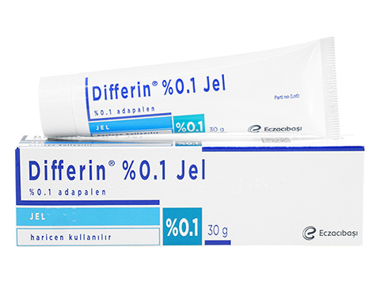
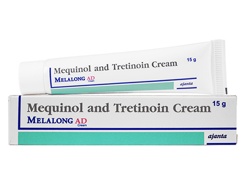
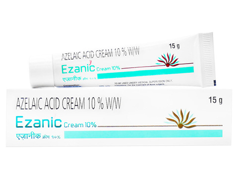
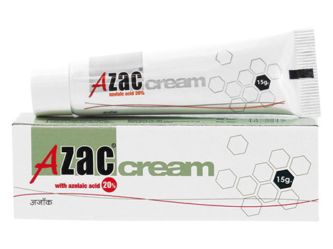
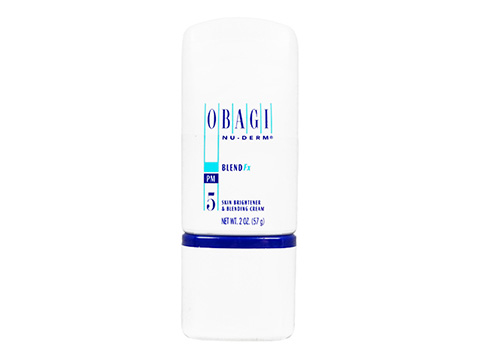
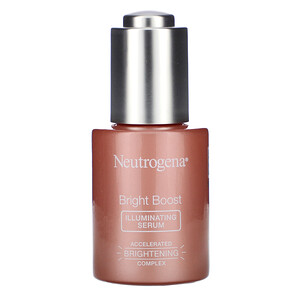
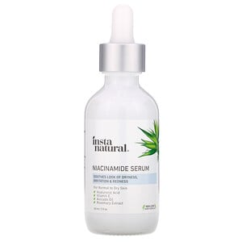
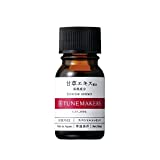

# ハイドロキノン＆レチノールは美肌に効くが副作用も怖い！ならば安全な代用品は他にないのか？ということで選んだ成分6選

こないだ「[美白効果を得るならハイドロキノンだ！](https://daigovideolab.jp/blog/1919115)」みたいな話を書いたとおり、現時点でお肌の色素沈着を減らしたいのであれば、

1. ハイドロキノン
2. [レチノール](https://daigovideolab.jp/blog/1876231)

が基本中の基本。研究データも豊富で、美白については2巨頭と言えましょう。

---

が、これらの成分は、どちらも作用がデカいぶんだけ副作用も強いのが難点であります。具体的には、

- 肌の赤み、かぶれ、敏感肌、一時的に紫外線に弱くなり塗った部分のシミが濃くなる

みたいな問題が存在しまして、かくいう私もレチノールを塗りすぎて肌がボロボロになった経験があります。あの時は肌がフレーク状に細かく剥がれ落ち続けて、「これはヤバい！」と思いましたね。

というわけで今回は、ハイドロキノン＆レチノールほど効果はないものの、そのぶんだけ安全に使えそうな美白成分について、ペンシルバニア大学の2011年レビュー([R](https://pubmed.ncbi.nlm.nih.gov/21623927/))をもとに考えていきたいと思います。このレビューは、色素沈着に使える成分の妥当性を、大量の先行研究をベースに考えたもので、美白について知るにはわりとうってつけなんですよ。

ちなみに、以下で取り上げていく成分は効果が低いとはいえ、複数の成分を組み合わせることで、副作用をできるだけ抑えつつ高い作用を得ることもできますんで、知っておいて損はないかと。

## **候補１ アダパレン**

アダパレンはビタミンAの類似体で、要はレチノールの低刺激バージョンみたいなもんです。海外ではニキビや紫外線ダメージの治療に使われていて、すでに一定の評価があると考えていいでしょう。色素沈着の治療用として他の成分と組み合わせて使うケースも多いっすね。

アダパレンが美肌に効く仕組みはレチノールと同じで、まずは皮膚のターンオーバーを増加させて、お肌へメラニンが移行するのをブロックする働きがメイン。さらには皮膚で生成されるチロシナーゼの量を減らして、メラニンを分散させる作用も持ってたりします。

ただ、刺激が低いとは言ってもレチノールと似たような問題は抱えていて、使い過ぎればターンオーバーのしすぎで逆にダメージが起きるケースもありますんで、くれぐれも用量を守ってお使いください。具体的なプロダクトとしては、「**[ディフェリン](https://alwys.net/contents/ard.php?id=OS011504&adwares=os001338)**」などが有名ですね。

▼**[ディフェリン0.1%](https://alwys.net/contents/ard.php?id=OS011504&adwares=os001338)**

## **候補２ メキノール（4-メトキシフェノール）**

メキノールはハイドロキノンの代替品としてよく使われる成分で、普通に処方されるぐらいなんでその効果はある程度まで保証されていると申せましょう。

といっても、メキノールがどうやって美白に効いてるのかはまだ完全にはわかってないんですが、一般的にはチロシンと同じように働いて、メラニン色素を作るチロシナーゼの能力を低下させているのでは？と考えられてます。ハイドロキノンと同じようなメカニズムですね。

メキノールのポイントとしては、

- 2％の濃度のメキノールは、美白の効果はハイドロキノンとそんなに変わらないが、ハイドロキノンよりも肌の刺激は低い

- 0.01％のトレチノインやアスコルビン酸と組み合わせると浸透力が高まる

ってのが重要なところです。効果が同じで刺激が低いならメキノールの方が断然いいのでは？って感じですけど、まだハイドロキノンよりも研究データが少ないので、現時点ではまだ断言できないところではありますね。

また刺激が低いとはいっても、一部のテストでは一時的に炎症＆色素沈着を起こすケースが報告されてますんで、あくまで少量からスタートしていただくといいでしょう。具体的なプロダクトとしては、「**[メラロングクリーム](https://alwys.net/contents/ard.php?id=OS011504&adwares=os026602)**」などが有名ですね。

▼[**メラロングクリーム15g**](https://alwys.net/contents/ard.php?id=OS011504&adwares=os026602)

## **候補３ アゼライン酸**

アゼライン酸も、メキノールと同じくハイドロキノンの代替品であり、多くの国ではニキビ治療薬として使われているケースが多め。チロシンと似た働きをしてチロシナーゼの活性をブロックして、異常なメラノサイトを抑制したり死滅させてくれます。

その効果はさすがにハイドロキノンよりもマイルドながら、アダパレンやトレチノインなどのレチノイド系と併用すると4％のハイドロキノンと同じぐらいの効果があるとか。さらに副作用も軽度な痛みと赤みがメインなので、**安全第一でいくならアゼライン酸を選ぶのもあり**かと。

通常、アゼライン酸は15～20％で効果が得られるとされてますが、肌が弱い方はまずは10％の「**[エザニッククリーム](https://alwys.net/contents/ard.php?id=OS011504&adwares=os021264)**」からどうぞ。それで問題がなければ20％の「[アザッククリーム](https://alwys.net/contents/ard.php?id=OS011504&adwares=os021131)」をどうぞ。

▼[**エザニッククリーム(Ezanic Cream)10%**](https://alwys.net/contents/ard.php?id=OS011504&adwares=os021264)

▼**[アゼライン酸20%クリーム(AzacCream)](https://alwys.net/contents/ard.php?id=OS011504&adwares=os021131)**

## **候補４ アルブチン**

アルブチンは美容クラスタでは有名な成分で、クマノミの葉やクランベリー、ブルーベリーの葉の抽出物に含まれております。構造がハイドロキノンによく似ていることから、「天然ハイドロキノン」などとも呼ばれてたり。

当然、美白に効くメカニズムもハイドロキノンと同じで、チロシンに擬態してメラニンの生成を遅らせる働きをします。といっても、美白剤としての効果はイマイチ未知数なところがあって、現時点で公表されている研究を見てると、「効果があった！」というものもあれば「効果なし！」としてる文献もあって、判断がいまいち難しいところです。

まぁいちおう体内での作用は確認されてるので、気になる方は「**[ブレンドFX](https://alwys.net/contents/ard.php?id=OS011504&adwares=os030703)**」などを使ってみてもいいかもしれません。今回取り上げた成分のなかでは、わりと信頼性は低めですかね。

▼**[ブレンドFX](https://alwys.net/contents/ard.php?id=OS011504&adwares=os030703)**

## **候補５**N-アセチルグルコサミン

N-アセチルグルコサミンは自然界や体内に存在する糖の一種で、ヒアルロン酸の前駆体です。チロシナーゼ酵素の産生を遅くする働きがあって、メラニンの合成そ遅くしてくれると言われてるんですよ。

多くの臨床テストでは、2％のN-アセチルグルコサミンで色素沈着が改善することが確認されてまして、下で取り上げるナイアシンアミドと併用することが多いっすね。たまに軽度から中等度の皮膚刺激が起きますが、全体的には安全性が高いので、他の成分と組み合わせてみるといい感じでしょう。具体的なプロダクトとしては、「[**ブライドブースト**](https://jp.iherb.com/pr/Neutrogena-Bright-Boost-Illuminating-Serum-1-0-fl-oz-30-ml/100044?rcode=IRO489)」などが有名ですね。

▼[**Neutrogena, Bright Boost, Illuminating Serum**](https://jp.iherb.com/pr/Neutrogena-Bright-Boost-Illuminating-Serum-1-0-fl-oz-30-ml/100044?rcode=IRO489)

## **候補６**ナイアシンアミド

ナイアシンアミドは、ニコチンアミドやビタミンB3とも呼ばれる成分で抗酸化物質の一種。ビタミンCなどと違って非常に安定性があるうえ、皮膚に色素が移行するのを抑制する働きも多くのデータで確認されてます。

美白効果はハイドロキノンに比べるとかなり低いんで、他の成分と併用するのが一般的ですが、なにせ「ちょっとした皮膚刺激」ぐらいしか副作用が確認されてないんで、例えばN-アセチルグルコサミンやアゼライン酸などと組み合わせてみるのはいいかも瀬しれません。

▼[**ナイアシンアミド美容液**](https://jp.iherb.com/pr/InstaNatural-Niacinamide-Serum-2-fl-oz-60-ml/77431?rcode=IRO489)

## **候補６****甘草エキス**

ご存じ甘草っていう植物から取られるエキスで、日本でも多くの化粧品に入ってますね。その場合は「グリチルリチン酸ジカリウム」「甘草由来成分」などのと表記されてるケースが多いはず。甘草にはグラブリジンとリリスチンっていう美白成分が入ってて、こいつが紫外線誘発性の色素沈着から肌を守ったり、チロシナーゼに作用してメラニンの生成を遅らせると考えられてるんですよ。

が、残念ながら甘草エキスのテストはまだこれといったデータがなくて、良い結果が得られた試験はかなり少なめ。理論上は美肌に効く可能性はあるものの、個人的には手放しでおすすめしかねる感じですね。とりあえず副作用はほとんど確認されてないので、ちょっと試してみるのはありだと思いますが。

▼**[TUNEMAKERS(チューンメーカーズ) 甘草エキス](//af.moshimo.com/af/c/click?a_id=790466&p_id=170&pc_id=185&pl_id=4062&url=https%3A%2F%2Fwww.amazon.co.jp%2Fdp%2FB07XFNF9MP)**

## まとめ

というわけで、ハイドロキノン＆レチノールの安全な代用品をまとめてみました。一応、上から効果が強い順に並んでますが、その分だけ副作用も大きくはなっちゃうんでご注意ください。

個人的には、メキノールとアゼライン酸は効果と副作用のバランスがいいんじゃないかなーと思ってますけど、とにかく人間の肌は千差万別なんで、いろいろお試しいただくしかないのが正直なところですかねぇ。
