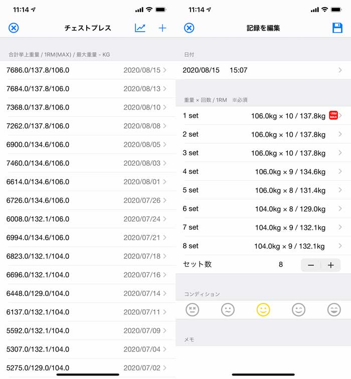

# 筋トレしてるのに効果が出ない！を突破する、良い子のための「デロード」入門

---

## **デロードってなんのこと？**

こないだ「**筋トレの効果が出にくくなった！**」って方の話を聞いてたら、「**あれ？それってデロードができてないのでは？**」と思いましたんで軽くまとめておこうかと。

デロードってのは「**あえて軽いトレーニングをして疲労の蓄積を軽減する**」って考え方のことで、これを定期的にやっとかないとトレーニングの効果が薄れていきがちなんですよ。もちろん、筋肉や筋力をつけるためにはトレーニングの強度と量を継続的に増やしていく必要があるんだけど、同時に少しずつ疲労も蓄積していっちゃうんで、定期的に回復をはさまないと肉体がすり切れちゃうんですよ。

オーバートレーニングの問題は何度も触れてきたので耳にタコかもですが、この罠にハマる人は意外なほど多くて、

1. デロードをせずに筋トレを続ける
2. 疲労がたまってパフォーマンスが下がる
3. 適切な筋トレができなくなる
4. トレーニングの効果が出ない！

みたいなケースはよく見受けられます。マジメな人ほどこの罠にはハマりやすいイメージっすね。

といっても、なんの計画もなしに軽めのトレーニングをしたら、それはそれで筋力の低下につながっちゃうのが難しいところ。ほどよく疲労が回復できるぐらいのデロードをしないと、逆効果になってしまうことも考えられるんですよ。

というわけで今回は、せっかくのトレーニング効果を無にしないための「正しいデロード」の考え方を見ていきます([R](https://content.sciendo.com/view/journals/hukin/49/1/article-p159.xml?language=en))。「なんか筋トレの効果が停滞してるなー」とか「なんか前より疲れやすくなったなー」などとお悩みの方は参考になされませ。

## **筋トレ初心者用のデロード**

まずは筋トレを始めてから半年も経っていない方が、トレーニングの停滞を感じた場合のデロードから見てみます。

「トレーニングの停滞」ってのは、要するに筋トレの記録が伸びなくなってきた状態のことでして、これは**日々の記録から判断してください**。私の場合は、現在は「[俺の筋トレ](https://apps.apple.com/jp/app/%E4%BF%BA%E3%81%AE%E7%AD%8B%E3%83%88%E3%83%AC-%E3%82%B7%E3%83%B3%E3%83%97%E3%83%AB%E3%81%AA%E7%AD%8B%E8%82%89%E3%83%88%E3%83%AC%E3%83%BC%E3%83%8B%E3%83%B3%E3%82%B0%E8%A8%98%E9%8C%B2%E7%AE%A1%E7%90%86/id1190451910)」っていう管理アプリを使ってまして、以下のような感じで日々のトレーニングを記録してます。

ただ、このアプリはApple Watchでの記録ができないので、最近は「[Strong Workout Tracker Gym Log](https://apps.apple.com/jp/app/strong-workout-tracker-gym-log/id464254577)」ってのに乗り換えようか思案中であります。余談ですが。

さて、日々の記録からいまいち記録が伸びないことに気づいたら、デロードを試してみるチャンス。具体的には、

- **「停滞が起きた！」と思ったら、ウェイトの重量を10%減らす！**

ってのが基本的なガイドラインになります。どうにも記録が伸びないと思ったら、いったん10％ほど軽いバーベルなどを使って、またそこからジワジワと負荷を上げ直すわけですね。負荷の正しい上げ方がわからない方は、「[『プログレッシブ・オーバーロード』のガイドライン](https://daigovideolab.jp/blog/1859692)」を参考にしてください。

具体的には、例えば「50kgで8回3セット」のベンチプレスをやってた人がいたとしましょう。その場合は、

1. 1日目は50kgで8回3セットのベンチプレスをしたから、2日目は52.5kgでやってみよう！
2. 2日目は52.5kgで8回3セットベンチプレスにしたから、3日目は55kgでやってみよう！
3. あれ？55kgだと8回3セットはできなかったぞ？とりあえず4日目も55kgでやってみよう（停滞の疑い）
4. あ、4日目も55kg8回3セットはできなかったな……（おそらく停滞）
5. あ、5日目も55kg8回3セットはできなかったな……（ほぼ停滞確定）
6. じゃあ6日目は55kgから10％減らして49.5kgでやってみよう！（**デロード**）
7. 6日目は49.5kgで8回3セットに成功したから、次は52kgでやってみよう！（以下、繰り返し）

みたいになります。停滞の判断基準にこれといったものはないんですが、とりあえず**2〜3回のセッションで記録が伸びなかったらデロードを試す**ぐらいにお考えいただければと思います。

で、ここでよくあるのが「また同じ場所で停滞した！」って問題です。上の例で言うならば、52kgまでデロードして再スタートしたら、再び55kgのところで停滞が起きちゃうパターンですね。

このようなケースで考えられることとしては、

- **筋トレの疲労以外に問題がある**：睡眠とか食生活とか仕事のストレスのせいで記録が伸びていないかもしれないので、チェックしてみる

- **初心者レベルを脱したのかも**：初心者レベルを乗り越えると、たんに重量を減らしただけでは効果がないケースもあります。その場合は、以下の「中上級者向けデロード」を試してみてください

といったあたりでしょう。特に日々のストレスのせいで記録が伸びなくなってしまうケースはよくあるんで、くれぐれもご注意いただきたいところです。

## **筋トレ中上級者用のデロード**

続いて、筋トレ歴が1年以上を超えており、定期的に週3〜5のトレーニングをしている人に向けたデロードです。中上級者の場合は、たんに重量を10％減らしただけじゃ疲労が回復しないケースがよくありますんで、また別のアプローチが必要になってくるんですよ。

この場合はどう考えるかと言いますと、

- ****1週間のボリュームを50％下げる！****

ってのが基本のガイドラインになります。ボリュームってのは[以前のブロマガ](https://daigovideolab.jp/blog/1852111)にも書きましたが、

- ボリューム＝重量 x 回数 （レップ数） x セット数

のことでして、現時点で1セット10回のスクワットを100kgのウェイトを使って3セットやってるなら、

- 100kg x 10回 x 3セット＝ 3,000kg

ってのがボリュームです。ボリュームの把握は上で紹介した「[俺の筋トレ](https://apps.apple.com/jp/app/%E4%BF%BA%E3%81%AE%E7%AD%8B%E3%83%88%E3%83%AC-%E3%82%B7%E3%83%B3%E3%83%97%E3%83%AB%E3%81%AA%E7%AD%8B%E8%82%89%E3%83%88%E3%83%AC%E3%83%BC%E3%83%8B%E3%83%B3%E3%82%B0%E8%A8%98%E9%8C%B2%E7%AE%A1%E7%90%86/id1190451910)」が便利で、セットごとの重量と回数を入力していくと自動で最終的なボリュームを計算してくれますんで。

つまり、「100kg x 10回 x 3セット＝ 3,000kg」でトレーニングをしている人が「いまいち記録が伸びないなー」と思ったら、次の週は「1,500kg」までボリュームを下げてみればOK。ボリュームの下げ方としては、

- **回数を減らす**：100kg x 5回 x 3セット＝ 1,500kg
- **重量を減らす**：50kg x 10回 x 3セット＝ 1,500kg

というパターンが考えられますが、これにはそれぞれメリットとデメリットがありますんで、好きな方をお使いください。

具体的にどのようなメリットとデメリットがあるのかと言いますと、以下のような感じです。

-
  - **回数を減らした場合**：デロード前と同じ重量を使うので、肉体の回復は遅れがち。その一方で、以前と同じ重量のままなので、もとのボリュームに戻しやすい

- **重量を減らした場合：**ピークの負荷が大きく減るので、関節や靭帯などのダメージが回復しやすくなる。その一方で、軽い重量に体が慣れてしまうので、もとのボリュームに戻すときに苦労する

というわけで、関節に痛みがあったりする人は、どちらかと言えば重量を減らしてデロードを行うのがおすすめ。逆にデロードによる筋力の低下を防いで、少しでも効率を上げたいような方は回数を減らすと良いでしょう。私はそこまで効率重視ではないので、重量を減らす方を採用してます。メンタル的にもそっちの方が楽なんで。

## その他の注意点

デロードの基本がわかったところで、最後にいくつかの注意点を並べておきましょう。デロードを行う際は、以下のポイントに気をつけてください。

- **デロードタイミングの問題**：フィットネスの世界では、「月に1週はデロードにする！」とか「4週間おきにデロードの週をもうける！」みたいに決めておくパターンも使われるんですが、これも良い面と悪い面があるのでご注意ください。
  というのも、デロードのタイミングを事前に決めておくと、本当は体が疲れてないのに無駄に筋肉を休めちゃうケースも多いんですよね。一方で「停滞が起きたらデロードする！」って考え方にも難しいものがありまして、特に関節の痛みって事前にうまく評価できないケースがあるんですよ。
  なので、個人的にはいちおう「4週間おきにデロードする！」と決めた上で、いざデロードの週になったら記録の伸びや疲労感を意識してチェックしてみる手法を取ってます。これは絶対の正解がないので、折衷していくしかない感じっすね。

- **パーツごとにデロードするのもあり**：肉体の疲労はつねに全身に訪れるわけではなく、足は問題ないけど腕はガタガタだなーと思うケースは珍しくないわけです。遺伝によっても各パーツの回復度は変わるんで、「あれ？なんか腕だけ記録が伸びないな？」と思った時は、腕だけをでローしていただいて構いません。

- **中上級者のデロードは基本1週間でOK**：もちろん個人のダメージレベルによって回復スピードは異なるものの、よほど関節に痛みがあるような条件でない限り、デロードの期間は1週間で問題ないはず。たいていのデータを見ても、これぐらいで疲労が抜けるって傾向は出てますんで。

そんなわけで、正しいデロードの考え方は以上です。くり返しになりますが、疲労感を定期的に抜くのは筋肉発達の基本ですので、停滞にお悩みの方はお試しをー。
