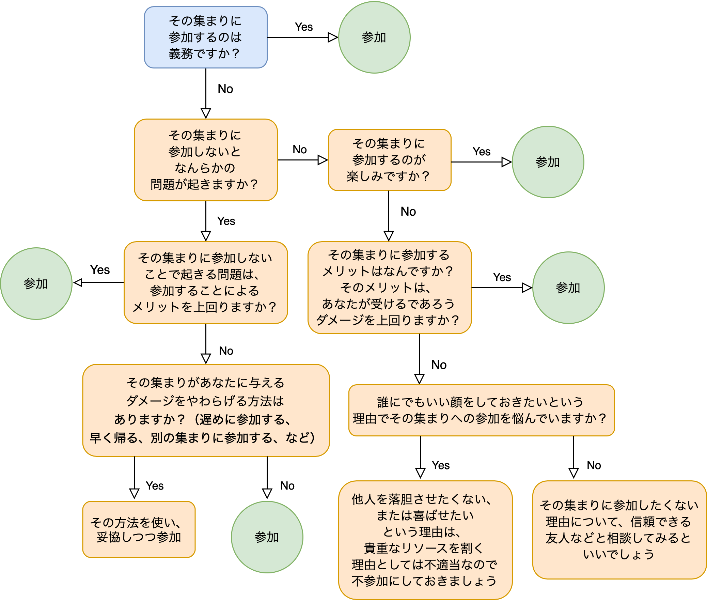

# 【超小ネタ】内向人間のための社交決定フローチャート

---

データ整理をしていたら、5、6年前ぐらいにフラー神学大学の心理学研究科の先生方に簡単なインタビューをさせてもらったときに作ったデータが出てきまして、これがちょっとおもしろかったので載せときます。

これが何かと言うと、「**内向人間のための社交決定フローチャート**」みたいな感じです。いわば、内向的な人が「この飲み会とか集まりって参加すべきかなぁ……」と決定する時に使うためのデシジョン・ツリーっすね。

私のようなド内向の方ならご理解いただけるかと思いますが、「人づきあいが嫌いなわけじゃないんだけど、大勢の集まりに参加するといろいろメンタルが削られる」みたいな事態にハマりがちなんですよ。私の場合は、大昔に初対面だけの人が集まる忘年会に参加したときなどは、それから2日ほど寝込んだことがありまして、実に難儀しました（泣

が、かといって完全に大勢の集まりを断つのも難しいので、内向人間は「この会合に出るべきか？出ざるべきか？」みたいな問題に悩まされるケースが少なくないはず。そこでフラー神学大学の先生方が、「こんな感じで決めていけばいいのでは？」と提案してくれた流れをまとめたのが以下のチャートになんですよ。

まぁあくまでなんとなくのノリで作ったものなんで、学問的な厳密性があるわけじゃないんですけども、「この集まりに参加した方がいいのかな……」とか悩みがちなご同輩には参考になるんじゃないでしょうか（笑
