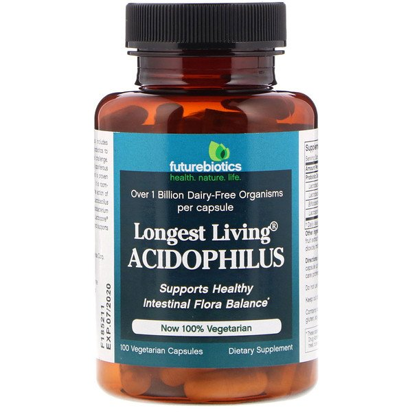
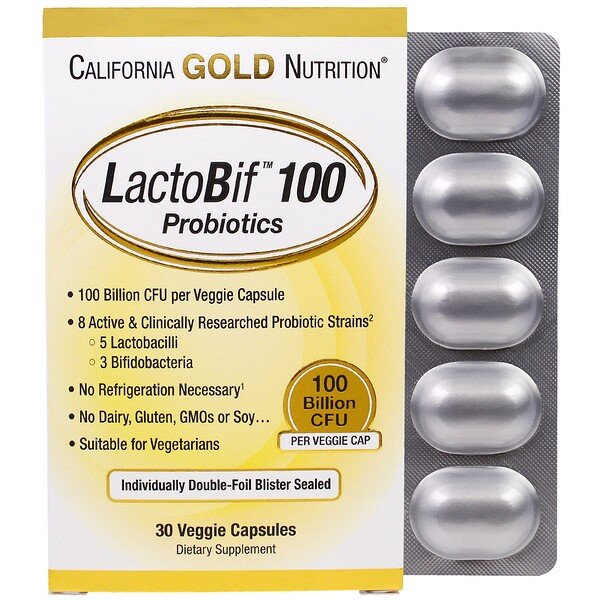
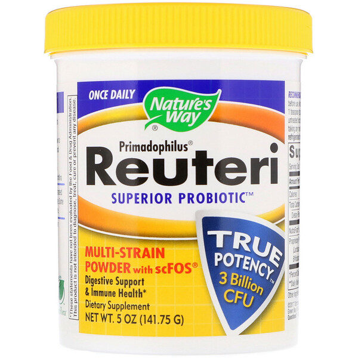
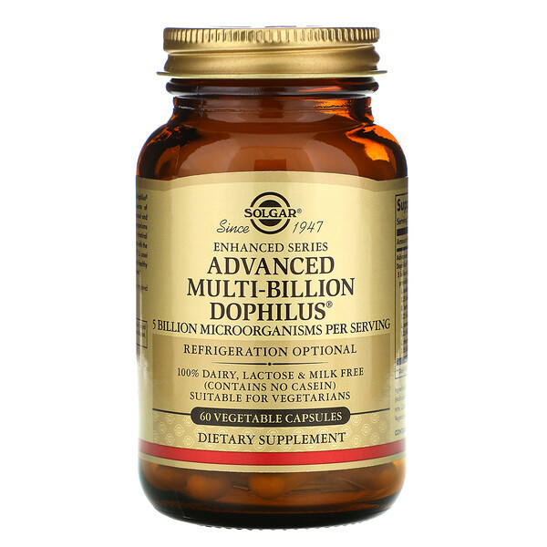

# 【腸内環境】症状別に効きそうなプロバイオティクスをまとめてみたぞー

ということで、久々に「**症状別に効きそうなプロバイオティクス**」のお話です。ご存じのとおりひとくちにプロバイオティクスと言っても無数の種類がありまして、どうもそれぞれ機能が違うみたいなんですよね。

---

なので、今回は「アレルギー用」とか「免疫用」などの用途ごとに効きそうなものをまとめていきます。「パレオな男」でも似たような話をまとめたことがあったんですが、なんせこの世界は日進月歩でして、「いまだともうちょい違うセレクションになるなー」って感じなんですよ。

なので、今回取りあげる菌もファイナルアンサーってわけではなく、今後も改訂されていくはずなんで、その点はご了承ください。とりあえず「現時点で言えそうな結論はこんな感じかなー」ってことで。

## **免疫系の正常化に効きそうな菌とか**

まずは免疫系の改善に役立ちそうな菌から見ていきましょう。2017年のレビュー([R](https://www.ncbi.nlm.nih.gov/pmc/articles/PMC5636929/))によりますと、

- 保育園に通う1歳から6歳までの子どもたちに**ラクトバチルス・ラムノーススGG**をふくむミルクや、HOWARU([R](https://www.dupontnutritionandbiosciences.com/product-range/probiotics/howaru-premium-probiotics/howaru-protect-probiotics.html))の**アシドフィルス****菌**を飲んでもらったら、肺感染症の発症が少なく、重症化率も低かった

- いくつかの研究では、**アシドフィルス菌とビフィズス菌**を一緒に飲むと、発熱や咳、鼻水などの症状が軽減され、子どもに必要な抗生物質の量が減ったと報告されている

- インフルエンザの予防接種を受ける3週間前に**ビフィズス菌BB536**を飲み、注射のあとさらに14週間飲み続けた場合はインフルにかかる率が下がる

みたいになってまして、全体的には**ビフィズス菌BB536**や**ラクトバチルス・ラムノーススGG**がいいのかなーってとこですね。ビフィズス菌BB536は、森永が[機能性食品として販売](https://amzn.to/2GTmTo6)してますね。

また、個人的には、アシドフィルス、ラムノーススの２つは非常によく耳にしまして、試すのもいいんじゃないかと思ってたりします。クトバチルス・ラムノサス単体のサプリってのはほとんどないので、現時点ではiHerbで扱ってる以下の商品をおすすめしときます。サードパーティの検査も受けてるし、品質的には問題ないでしょう。

▼**[California Gold Nutrition, LactoBif](https://jp.iherb.com/pr/California-Gold-Nutrition-LactoBif-Probiotics-100-Billion-CFU-30-Veggie-Capsules/69435?rcode=IRO489)**

## **謎のお腹の不調に効きそうな菌とか**

IBSに代表される謎のお腹の不調は本当にイヤなもので、イライラはするし急な痛みに襲われるし、そのくせこれといった対策はないしで、QOLが大きく下がっちゃうんですよね。

この問題につきましては、2019年にもそこそこ良い研究([R](https://pubmed.ncbi.nlm.nih.gov/29508268/))が発表されまして、

- サッカロマイセス・ブラウディ
- ビフィドバクテリウム・ラクティス
-
- ラクトバチルス・プランタルム

の4種を組み合わせたプロバイオティクスを飲んだグループは、IBSの症状が73％も改善したそうな（ただし、小腸細菌過剰増殖がない場合は症状には変化がない）。

また別の系統的レビュー([R](https://www.ncbi.nlm.nih.gov/pmc/articles/PMC6769995/))でも、「ラクトバチルス・アシドフィルスは有望かも？」みたいな結論でして、ここらへんを中心に試してみるのが良さそうです。

▼**[FutureBiotics](https://jp.iherb.com/pr/FutureBiotics-Longest-Living-Acidophilus-100-Vegetarian-Capsules/22580?rcode=IRO489)**

## **不安に効きそうな菌とか**

「腸と脳はつながっている！ゆえに、人間の感情にも影響を与える！」ってのはすでに何度も書いている話。腸と脳は迷走神経を通じてつながってるんで、腸が改善すればメンタルも健全になる可能性は高いわけです。

また、腸内細菌のいくつかの株は神経伝達物質を産生することもわかってまして、食物繊維を与えられた人のストレスホルモン（コルチゾール）が低下し、意識がネガティブからポジティブな刺激に向かいやすくなるってな話もあったりします。キムチやザワークラウトといった発酵食品の摂取量が多いほど[不安の発生率が低い](https://yuchrszk.blogspot.com/2014/03/blog-post_6750.html)なんてデータもありますし、腸からメンタルを改善していく経路はありではないかと。

で、メンタルに効きそうな菌ですが、いまんとこ有望なのは、

- **ラクトバチルス・ラムノースス**

です、乳酸菌の一種で、トクホ認定されてる「[ヨーグルトおなかへGG!](https://amzn.to/33MFgE7) 」なんかにも入ってますね。

といっても、ラクトバチルス・ラムノーススの研究はいまんとこはマウス実験([R](https://www.ncbi.nlm.nih.gov/pubmed/29924822))がメイン。とりあえず、このデータではラクトバチルス・ラムノーススを投与されたマウスは不安に似た行動が減ってますし、ヒトを対象にでもまぁまぁな効果は出てますんで、試す価値はあるでしょう。

こちらも、試す場合は以下のプロダクトをおすすめしておきます。

▼**[California Gold Nutrition, LactoBif](https://jp.iherb.com/pr/California-Gold-Nutrition-LactoBif-Probiotics-100-Billion-CFU-30-Veggie-Capsules/69435?rcode=IRO489)**

## **リーキーガットに効きそうな菌とか**

リーキーガットのヤバさについては、皆さますでにご承知のとおりです。腸の細胞をつなぐ部分に穴が開いて、そこから体内に毒素がどんどん入り込んじゃう現象ですね。

これは改善が難しい問題で、運動、睡眠、食事のすべてを端から改善してかにゃいかんのですが、最近はあるタイプのプロバイオティクスが効くんじゃない？と言われてたりします。例えば、

- ラクトバチルス・ラムノーススとロイテリを飲んだ子供達は、リーキーガットが改善し、皮膚炎の症状も改善した([R](https://pubmed.ncbi.nlm.nih.gov/15520759/))

- 同じくラクトバチルス・ラムノーススを急性胃腸炎の子供に飲んでもらったところ、腸のバリアが改善した([R](https://pubmed.ncbi.nlm.nih.gov/24501384/))

みたいなデータがありまして、またもラクトバチルス・ラムノーススが出てきましたね。

また、もうひとつ名前が出てるロイテリ菌も口内環境の改善に役立つことが知られてまして、リーキーガットの疑いがあるなら試す価値がありましょう。その場合は以下のプロダクトがおすすめです。

▼**[Nature's Way, Primadophilus、Reuteri Superior Probiotic](https://jp.iherb.com/pr/Nature-s-Way-Primadophilus-Reuteri-Superior-Probiotic-Multi-Strain-Powder-with-scFOS-5-oz-141-75-g/4676?gclid=Cj0KCQjw2or8BRCNARIsAC_ppyalxldYGB0RlXTPPrDcNthRH2QxhNCv0EKb964WmP95miXXS4qqVPwaAtU5EALw_wcB&gclsrc=aw.ds&rcode=IRO489)**

## **アレルギーに効きそうな菌とか**

腸が悪ければ当然アレルギーも悪化するわけで、近年はますますプロバイオティクスに注目が集まっております。こちらも「これがベストだ！」と言えるほどデータがたまってないんだけど、

- **ラクトバチルス・パラカセイ**

には見込みがありそうな気がしております。日本だとキリンが熱心に研究を進めててる([R](https://health.kirin.co.jp/kw/index.html))乳酸菌の一種っすね。

具体的なデータとしましては、

- ラクトバチルス・パラカセイを4週間飲んだ成人グループは花粉症が改善し、鼻づまりや鼻のかゆみが軽減された([R](https://pubmed.ncbi.nlm.nih.gov/21395878/))

- 子供を対象にしたテスト([R](https://pubmed.ncbi.nlm.nih.gov/24269033/))でも、ラクトバチルス・パラカセイを飲んだ子供は花粉症が改善し、目のかゆみが楽になった

などの報告が出ております。まぁアレルギーはめちゃくちゃ複雑な現象なんで、今後のテストでひっくり返る可能性も十分あるんですけど、とりあえず私のようなアレルギー体質な方はお試しください。おすすめはソルガーの商品で、パラカセイの他に、ラムノーススやアシドフィルスも入っててよろしいのではないでしょうか。

▼[**Solgar, Advanced Multi-Billion Dophilus**](https://jp.iherb.com/pr/Solgar-Advanced-Multi-Billion-Dophilus-60-Vegetable-Capsules/14215?rcode=IRO489)

## **まとめ**

ということでいろいろ書きましたが、あらためて、

- ラクトバチルス・パラカセイ
- ラクトバチルス・アシドフィルス
- ラクトバチルス・ラムノスース
- ビフィドバクテリウム・ビフィダム

あたりは優秀っぽいなーとか思いましたね。最近は便通に問題を感じてないのでプロバイオティクスはとってなかったんですけど、ソルガーのやつとか試そうかなぁなんて気になりましたねぇ。
