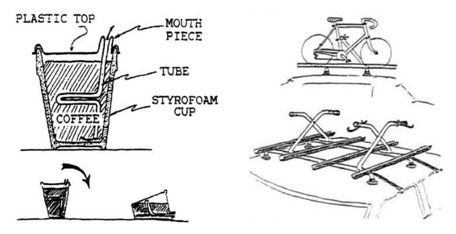

# 【発想法系の小ネタ】良いアイデアが出ない！を打ち破る72のデザイン・ヒューリスティック

良いアイデアが出ない！ってのは誰にでもあることで、私も本を数行書くごとに「ここから先の展開がわからん！」みたいな悩みにぶつかってたりします。

---

アイデアが出ない理由はいろいろありますが、なかでも多いのが「**以前に成功した発想にこだわっちゃう**」ってパターンでしょう。リムリック大学によるデータ([R](https://lib.dr.iastate.edu/industrialdesign_pubs/17/))も、この「**発想が制限されちゃう問題と、その解決法**」について調べてくれてて非常に有用でした。わりと即戦力なデータだったので、ブロマガで紹介しとこうかと。

これは120人の男女を対象にしたテストで、まずはみんなに2つのお題を出してます。

1. こぼれないコーヒーカップを考えてください
2. 車に自転車を積むためのラックを考えてください

どっちも新たな工業デザインを考えるように指定されたわけですね。この時、全体を2つのグループに分けまして、半分の参加者には、

- 解答例をいくつか与えられる
- デザイン・ヒューリスティックを与えられる

ってなサポートを付け加えたんだそうな。解答例ってのは↓みたいなやつで、研究者が考えた事例を提示するパターンです。

もうひとつのデザイン・ヒューリスティックは「**オズボーンのチェックリスト**」みたいなやつで、「他の使い道は？」とか「他のアイデアを流用できないか？」といった質問集を使うパターンです。こちらも定番の発想法ですね。

すると、両グループの結果は大きく違ってまして、

- サポートを与えられなかったグループは、最初のアイデアを出す段階で行き詰ってしまい、創造性が低いまま終わってしまった

- 一方で、サポートを与えられたグループは、**最初のアイデアに固執する割合が低くなり**、より多くのアイデアを生み出せるようになった（デザイン・ヒューリスティックを使った場合は、**72% から 28%への減少**）

といった感じだったそうな。これはなかなか良い数値っすねー。

研究チームいわく、

> これらの知見は、自分自身の固定観念を認識することが、創造的な結果を生み出すうえで欠かせないメタ認知スキルである可能性が高い。

ということで、「うおー、アイデアに詰まった！」や「マンネリな発想しか出ない！」みたいなときは、今回の実験を参考にしてみちゃいかがかと思うわけです。

具体的に、今回の実験で使われたデザイン・ヒューリスティックは以下のようになります。

1. 段階を増やす
2. 動きを増やす
3. 自然の特徴を増やす
4. 既存のプロダクトに何かを足す
5. 動きの観点から機能を調整する
6. 特定のユーザーに向けて機能を調整する
7. 構成要素を中心にそろえる
8. ユーザーに組み立てさせる
9. ユーザーにカスタマイズさせる
10. ユーザーに再構成させる
11. ユーザーに方向を設定させる
12. 生き生きと動かす
13. 既存のメカニズムを新たな方法で使う
14. 独立して機能する部品をつなげる
15. ユーザーを製品に参加させる
16. 曲げる
17. ユーザーのコミュニティを作る
18. アクセスの方法を変える
19. 柔軟性を変える
20. 配置を変える
21. 製品寿命を変える
22. 表面の特性を変える
23. 区分けする
24. 別の文脈に当てはめる
25. 2Dから3Dに変える
26. メイン機能を二次的な機能に変える
27. 覆う、または包む
28. サービスを作る
29. システムを作る
30. 連続した表面を分割する
31. 上げる、または下げる
32. 広げる、またはつぶす
33. 内側をむき出しにする
34. 表面を拡張する
35. 平らにする
36. 折る
37. 空洞にする
38. 機能にヒエラルキーをつける
39. 環境情報を取り入れる
40. ユーザーのインプットを取り入れる
41. レイヤーを増やす
42. 接着可能、または剥離可能な部品を増やす
43. 多機能にする
44. リサイクル可能にする
45. 表面を結合する
46. 自然の仕組みをまねる
47. 整列させる
48. 入れ子状にする
49. オプション部品を作る
50. ユーザーに感覚的なフィードバックを伝える
51. 再構成する
52. 関節部の設計を変える
53. 素材を減らす
54. くり返す
55. パッケージを別の目的に使う
56. 転がす
57. 回転させる
58. サイズを大きくする、または小さくする
59. 機能を分割する
60. 単純化する
61. すべらせる
62. 積む
63. 特定の機能を達成するために、別の方法を使う
64. 機能を合成する
65. はめ込む
66. ねじる
67. ひとまとめにする
68. 部品を配置する共通のパーツを作る
69. つながった素材を使う
70. 違うエネルギー源を使う
71. 人力エネルギーを使う
72. ひとつの機能のために複数の部品を使う
73. パッケージを部品のひとつに使う
74. 他の目的に使える、またはリサイクルできそうな素材を使う
75. 内部スペースを活用する
76. 反対の面を活用する
77. 機能の違いを視覚的にわかりやすくする

まぁこれは工業デザインに特化した内容なんで、より別ジャンルのアイデアを生み出したい方は。

- ブライアン・イーノの「[オブリーク・ストラテジーズ](https://apps.apple.com/us/app/oblique-strategies-all-four/id902143877)」（英語オンリー）

- 「[智慧カード](https://amzn.to/2HtDzDd)」（ロシア初のアイデア発想術「TRIZ」をベースにしたアイテム）

あたりを使ってみても良いかと思います。さっそく私も、この後の書籍執筆で使ってみようかと。
