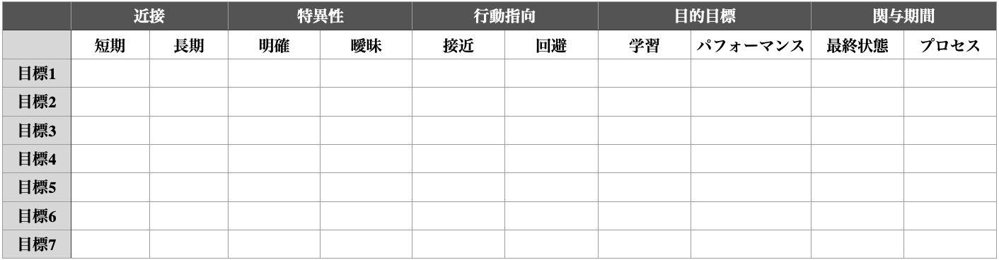
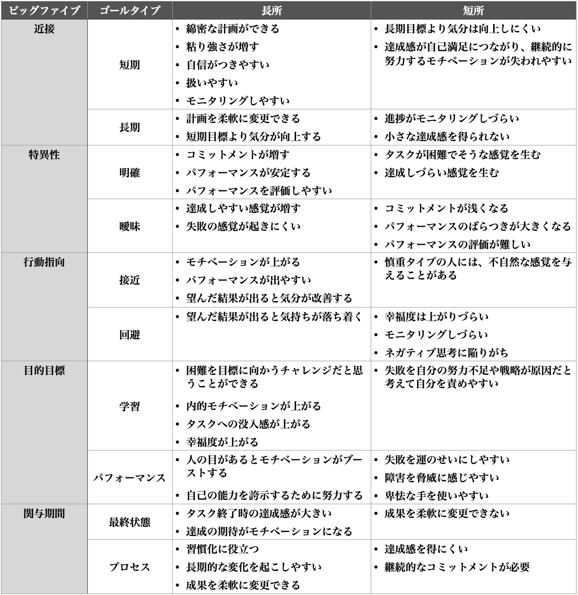

# カリフォルニア大学が推奨する30の人生改善テクニック#30「アドバンス目標分析」

---

## **前回の振り返り**

というわけで、「**カリフォルニア大学が推奨する人生改善テクニック**」の続きでーす([#1](https://daigovideolab.jp/blog/1885240),[#2](https://daigovideolab.jp/blog/1890991),[#3](https://daigovideolab.jp/blog/1894318),[#4](https://daigovideolab.jp/blog/1897391),[#5](https://daigovideolab.jp/blog/1899454),[#6](https://daigovideolab.jp/blog/1899455),[#7](https://daigovideolab.jp/blog/1902161),[#8](https://daigovideolab.jp/blog/1903327),[#9](https://daigovideolab.jp/blog/1907839),[#10](https://daigovideolab.jp/blog/1913542),[#11](https://daigovideolab.jp/blog/1913140),[#12](https://daigovideolab.jp/blog/1915970),[#13](https://daigovideolab.jp/blog/1918518),[#14](https://daigovideolab.jp/blog/1921751),[#15](https://daigovideolab.jp/blog/1924582),[#16](https://daigovideolab.jp/blog/1926847),[#17](https://daigovideolab.jp/blog/1930449),[#18](https://daigovideolab.jp/blog/1931574),[#19](https://daigovideolab.jp/blog/1935409),[#20](https://daigovideolab.jp/blog/1936080),[#21](https://daigovideolab.jp/blog/1937465),[#22](https://daigovideolab.jp/blog/1940603),[#23](https://daigovideolab.jp/blog/1943251),[#24](https://daigovideolab.jp/blog/1945782),[#25](https://daigovideolab.jp/blog/1948032),[#26](https://daigovideolab.jp/blog/1951231),[#27](https://daigovideolab.jp/blog/1953316),[#28](https://daigovideolab.jp/blog/1956049),[#29](https://daigovideolab.jp/blog/1958532))。

これはUCLAが運営してるグレーターグッド([R](https://ggsc.berkeley.edu/))が提唱する「幸福度アップに効く30の技法」を週イチで紹介していくシリーズで、**皆さまにも参加してもらいつつ**進めてきましたが、ついに最終回です。

[前回](https://daigovideolab.jp/blog/1956049)は「賢者スケール」って技法を紹介しまして、皆さんにご自分の賢者レベルを判定してもらいました。このテストで判定できる能力は、いずれも現代を生き抜くために欠かせない内容になってますんで、意識して高めていくといいんじゃないでしょうか。

では、みなさまからいただいたご報告ですが、その前に、

> Taikouさん「質問3の評価が4.他者への共感と6.アドバイス力と重複し、質問23の評価項目が無いのですが…
> 質問3は他社への共感、質問23はアドバイス力ですかね？つまり、他者へのアドバイス力＝1、4、7、23？」

というわけでご指摘のとおりです！すいません！現在は修正されておりますので！

で、おもだったところをピックアップしていきますと、

> 空ノ宮さん「共感能力は高いほうだと思ってたんですが相対的には一番低かったです。」
>
> オニギリ ジョーさん「2点以下の項目をピックアップしてみたら、大体人間関係と意思決定に関するものでした」
>
> Xeonさん「感情に振り回されている状態だが、洞察はできているようだ。」
>
> 野上恭平さん「僕の弱点は、感情をコントロール出来ない点です。」

といった感じで、やはり自分に足りない能力への洞察が深まった方が多かったですね。自己分析ツールはいろいろありますが（ビッグファイブとか）、個人的にも今回の「賢者スケール」はお気に入りであります。

> Renaさん「毎日ヨガや瞑想を行なっているので、内容や時間帯などを工夫して、より自分に合った方法を模索し感情コントロールを鍛えていきたいと思います。」
>
> こころのままにさん「神経症的傾向が強いのかもしれないので、マインドフルネス瞑想で改善していこうと思います。」
>
> K.N.さん「やはり筆記開示を続けつつ呼吸をすぐに整えるように意識していきます。」
>
> ミスタさん「ネガティブな感情に巻き込まれそうになった時のif thenルールを作ってみます。」

点数をもとに今後の改善法をコメントしてくれた方も多くてうれしい感じでした。というか、みなさん私より賢者レベルが高い方が多くて、私もがんばっていかねばなーとか痛感しましたね。今回もありがとうございます！

## **第30週：アドバンス目標分析**

30週目にあたる最後の技法は「**アドバンス目標分析**」です。アドバンスの名前どおりゴール設定法の上級バージョンになります。ここまで29パターンの「幸福度アップ」手法を紹介してきましたが、お好きなテクニックを今後に活かし、大きな目標を達成するための役に立てていただければと。

では、この手法がなんで「アドバンスド」なのかと言うと、一般的に使われる**目標設定に欠かせない「ビッグファイブ」**を全て考慮しているからです。具体的には、

1. **近接性**：短期的な目標はわりと達成しやすいが、長期的な目標は投資とコミットメントを必要とする
2. **特異性**：目標には明確に定義したほうが達成しやすい
3. **行動指向**：接近目標（「試験に合格」とか）と回避目標（「試験に落ちない」とか）によって達成率は異なる
4. **目的目標**：学習目標（特定のスキルや知識の獲得を目的にした目標）とパフォーマンス目標（他者からの肯定的な評価を求める目標）によって達成率は異なる
5. **関与期間**：最終状態目標（一度達成したら追加の行動を必要としない目標）とプロセス目標（継続的な行動が必要な目標）によって達成率は異なる

という5つです。まー、このブロマガをお読みの方であれば「はいはい。あれね」って感じの5つじゃないでしょうか。初耳だという方は、この5つを覚えていただくだけでも何かと便利でしょう。

「アドバンス目標分析」では、この5つをすべて使って、目標の達成率をガンガンに高めていきます。要素が多いぶんだけ手間も増えるんですけど、いわば 目標設定の「オールスター打線」みたいな手法なんで、やり方を知っておくだけでもよろしいのではないでしょうか。では、具体的に見ていきましょう。

### ステップ1：目標をリストアップする

あなたがいま追求しているゴールを最大7つまでリストアップしてください。来週のレポートを終わらせるみたいな小さな目標でもいいし、スペイン語を学ぶみたいな大きな目標でも、達成を目指しているものであれば何でも構いません。

### ステップ２：目標の分析

ステップ１で作成した目標のリストを、上でみた「目標設定のビッグファイブ」に従って分類します。再び説明しておくと、以下のようになります。

で、この表を見つつ「自分の目標にもっとも当てはまるのはどれだろう？」と考えてみてください。短期か長期か？接近か回避か？学習かパフォーマンスか？といったあたりを、以下のような表にチェックするといいでしょう（当てはまるとこに◯をつける）。

もちろん、なかには白黒はっきりしない目標もあると思うんで、その時は空欄にしといてくださいませ。

### ステップ3: 目標の評価

当然ながら、それぞれの目標のタイプには利点と欠点がありまして、以下のようになってます。

この表を参考にしつつ、それぞれの目標について「もっと改善できるとこないかなー？各目標の長所だけいいとこ取りできないかなー？」などと考えてみてください。ここらへんに絶対の正解はないですけど、それぞれの長所と短所を押さえておけば、「この目標はモニタリングが大事だから短期に落とし込んだ方がいいよな…‥」みたいな判断はつきやすいんじゃないでしょうか。

というわけで、長らくやってまいりましたシリーズもこれで終了です。いままで見てきた29の技法から好きなものをひとつだけ選び、今回の「アドバンス目標分析」で分析していただくといいんじゃないでしょうか。もちろん、この分析法は、**普通に仕事のパフォーマンス改善にも使い勝手がいい**ので、合わせてお試しください。では、長いシリーズにお付き合いくださりありがとうございましたー。
