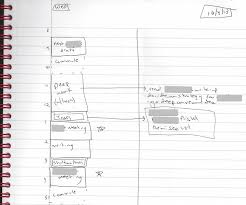
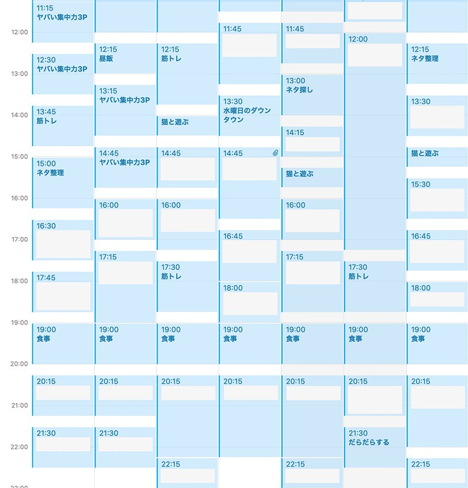

# 数あるライフハックから効果ナンバーワンに輝いた「タイムボクシング」を極めよう！

ということで、長らくやってまいりました 「**生産性アップテクニック・ランキングトップ100**」([#1](https://daigovideolab.jp/blog/1966326),[#2](https://daigovideolab.jp/blog/1967365),[#3](https://daigovideolab.jp/blog/1968404),[#4](https://daigovideolab.jp/blog/1969136),[#5](https://daigovideolab.jp/blog/1971118),[#6](https://daigovideolab.jp/blog/1972126),[#7](https://daigovideolab.jp/blog/1973528))も最終回。今回は、数あるライフハックから「**生産性がもっとも上がる**」と評価された「タイムボクシング」の手法を、徹底的にご説明します。

---

## **タイムボクシングってどんなことをするの？**

タイムボクシングって耳なれないかもしれませんが、実は誰でも一度はやったことがあるような作業です。タイムボクシングを推奨する学者でもっとも有名なのは「[DEEP WORK 大事なことに集中する](https://amzn.to/378ALVW)」のカル・ニューポートさんで、この手法についてこんなことを言っておられます。

> 周囲の人間から「なぜそんな詳細なレベルの計画をわざわざ立てるのか？」と聞かれることがある。
>
> 私の答えは簡単だ。****タイムボクシングを使って週40時間を働くと、何も考えずに週60時間以上の仕事をしたのと同じ量の生産性が得られる****からだ。

もちろんこれは博士の個人的な見積もりなんで一般化はできないものの、タイムボクシングの考え方についてはいくつかの傍証([R](https://amzn.to/3gBBNgs))がありまして、効果が高いのは間違いなかろうと思っております。

で、具体的にタイムボクシングがどんなことをするのかと言いますと、ニューポート博士の事例は↓のような感じです。

うーん、シンプル。要するに、その日のうちにすべきことを、時間ごとのブロックに区切っただけです。

ちなみに、私もタイムボクシングはずっと愛用してて、Macのカレンダーを使って、↓みたいに朝から晩までの流れをすべてブロック化してます。ご覧のとおり、「猫と遊ぶ」や「水曜日のダウンタウンを見る」のような娯楽までブロック化して組み込んでるわけですね。

なんでわざわざこんなことをしてるかと言うと、**通常のToDoリストはフリーダムすぎて**、何をどうしていいか脳がパニくるからです。一例として、私がタイムボクシングを使わずに作業をしたら、↓のような１日になるでしょう。

その日にすべきことは把握してるものの、時間をブロック化してないせいで、書籍を書いたかと思えば数分後にはブログを書き、ちょっと煮詰まったらSNSをやってみたりと、時間の使い方がカオス状態であります。

つまり、普通のToDoリストを使うと時間の使い方がマルチタスク化しやすく、そのたびに脳の切り替えにエネルギーが浪費され、生産性はダダ下がりしていくわけっすね。よく「**ToDoリストの41％は未完了のまま残されてしまう**」なんてデータ([R](https://app.idonethis.com/docs/The-Busy-Persons-Guide-to-the-Done-List.pdf))が引き合いに出されますけど、それもむべなるかなって感じ。

## **タイムボクシングの手順**

タイムボクシングのやり方はとても単純で、だいたい私は以下のステップでやってます。

### 1.リストの作成

まずは週の頭に、その週にやらなければならないことのリストを作成。仕事や家族との約束、運動の目標、食事の時間など、すべてリストアップしてください（私のように「映画を見る」とか「本を読む」といった趣味もリストアップしとくと、さらにタイムボクシングがはかどっていい感じです）。

### 2.優先順位を決める

リストができたら、その週に最優先しなきゃならない作業に星をつけていきましょう。この最優先タスクは1日に2～3件ぐらいが目安で、私のケースでは「書籍の執筆」「論文リサーチ」「ブログ書き」がだいたい1日の三大タスクっすね。

経験上、**最優先タスクが３つを超えるとだいたいスケジューリングが破綻する**し、タスクを達成できないストレスがたまるいっぽうになるんでお気をつけください。

### 3.時間をブロック化する

続いて、「1日にどのくらいの時間があるか？」「リストの各タスクにどのくらいの時間を確保したいか？」を考えてカレンダーに入力していきます。というと、まじめな人ほど「このタスクにどれぐらいかかるかわからない……」みたいに思っちゃうんですけど、最初のうちは予定どおりにタスクが進むはずもないんで、あくまで「これはただの青写真でしかないのだ！」と自分に言い聞かせながら計画してください。

かく言う私も、当初のころは「ブログは30分ぐらいだろう」とか思ってましたが、だいたい２週間ほどで「それはさすがに無理がある」と判断して、いまは一本45分ぐらいに落ち着いてます。

といっても慣れないうちはとまどうでしょうから、ブロック化の定番例を以下に挙げときます。これをカスタマイズするような感じで組み替えていただければ幸いです。

- 7:30～8:00 朝のルーチン
- 8:00～10:30分 優先プロジェクト1
- 10:30分～11:00 休憩
- 11:00～12:30 優先プロジェクト1
- 12:30分～13:00 昼食
- 13:00～15:30 優先プロジェクト2
- 15:30分～16:30 休憩／優先プロジェクトが予定どおりいかなかったら、これ以降の予定を組み替えるか、明日に回すことを考える
- 16:30～18:00 夕食／運動
- 18:00～19:00 優先プロジェクト3
- 19:00～21:00 フリータイム／メール対応・ソーシャルメディアのチェックなど
- 21:00～22:00 夜のルーチン

まぁ世の中には週ごとに仕事ががらりと変わる人もいるので、あくまで以上はシンプルな下書きとして、随時組み替えていただければと思う次第です。

### 4.ひたすら決めたとおりにやる

あとはブロック化した時間帯に粛々と作業を行うのみです。というと、「その場で自由にやることを決めるほうがやる気も出るのでは？」みたいに言う方もいるんですけど、実際にはガチガチに時間を決めちゃったほうが確実に生産性は上がります。

というのも、せんじつめれば**「自由」ってのは「何をしていいかわからない」ってのと同義**なんで、かなり脳のリソースを食っちゃう状態なんですよ。「今日は完全に休みだから好きに過ごすぞ！」と思ってたら、なにもやる気が起きずにダラダラ過ごしちゃうことは誰にでもありましょうが、これは「自由」のめんどくささに脳が脅えてモチベーションを下げちゃうせいで起きる現象だったりします。

また、ご存じの方も多いでしょうが、我々の祖先である狩猟最終民の暮らしもかなり構造化されてまして、だいたいいつも同じ時間に起きて狩りに出かけ、同じ時間に食事をして団らんしてるんですよ。その点で、私たちの脳内にも、おそらく「構造化した暮らしの方がモチベが上がる仕組み」が備わっててもおかしくはなかろう、と。

## **タイムボクシングのメリットとは？**

最後にタイムボクシングのメリットもいくつかあげておきましょう。タイムボクシングが有効な理由は、以下の3つです。

### 1.シャローワークが減る

シャローワークはニューポート先生の造語で、要は「長期的な目標を達成するためには重要ではないが、緊急性が高くて忙しい仕事」のことです。事務処理とかメール返信とかそんなやつっすね。

シャローワークが難しいのは、**なにもしないと際限なく時間を浪費しがち**なとこで、具体的に時間を割り当てないとひたすら作業時間が伸びていくんですよ。しかし、ここでシャローワークをタイムボックス化すると、その仕事にどれだけの時間を割くかを明確に制限できるし、似たようなタスクをまとめてグループ化することで仕事の切り替えにかかる脳のコストを削減できるわけっすね。

### 2.時間管理がうまくなる

人間の脳ってそもそも時間の見積もりが甘くなるようにできてて、将来の自分を過剰に信頼しがち。ところが、タイムボクシングをしばらくやってると、そんなバイアスが粉々に打ち砕かれますんで、「時間を守れないなー」みたいな方もぜひお試しください。

### 3.完璧主義が克服される

個人的には、これが１番のメリットかなーと思っております。書籍の執筆みたいな大きいタスクに取り組むと、どうしても「もっと良い構成があるのでは？」とか「もっといいデータを探してからのほうが……」といった気持ちが起きがちで、そのまま何もせず30分ぐらいすぎるケースがザラなんすよね。

が、タイムボクシングをしてると、ガンガンにリミットが迫ってくるんで「とりあえずできることからやるぞ！」ってメンタルになりやすいんですよ。私の場合、タイムボクシングを使わないと本は書けないだろうなぁ……とかいつも思うわけです。

## まとめ

ってことでランキング第1位「タイムボクシング」の細かい手法でした。こんだけシンプルな手法でデカい効果が得られるならやっとくほうがいいっすな。最初はめんどいんですが、慣れると手放せなくなりますんでかなりおすすめです。
