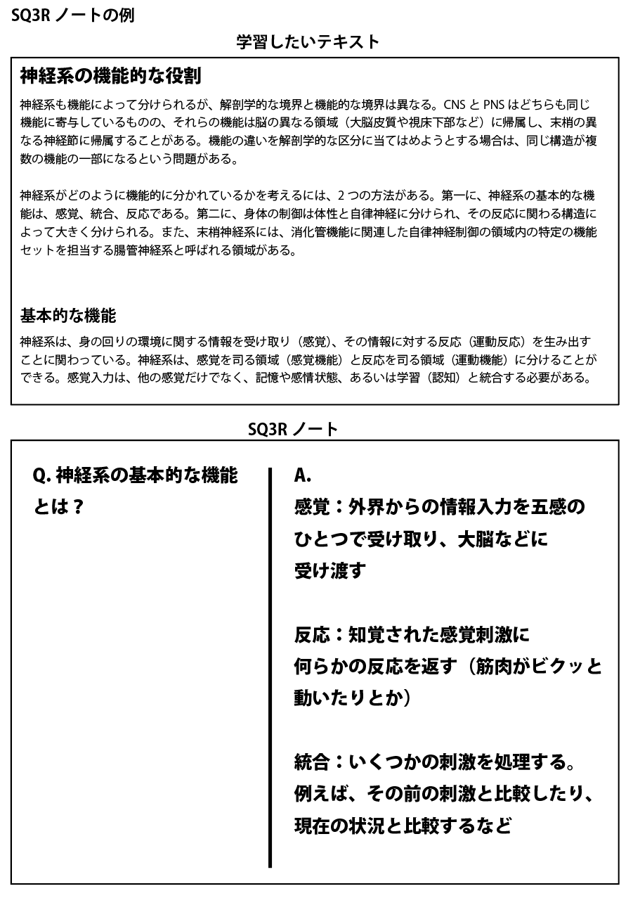

# 最強の学習テクニック「検索練習」再入門#3「検索ノート＆SQ3Rノート」

**最強の学習テクニック**である「検索練習」を再入門するシリーズの２回目です([#1](https://daigovideolab.jp/blog/1982765),[#2](https://daigovideolab.jp/blog/1983124))。

[第1回目](https://daigovideolab.jp/blog/1982765)では「**検索練習は世間で言うよりも効果がすごい！**」って話をしまして、さらに[第2回目](https://daigovideolab.jp/blog/1983124)は、基本的な実践法としてブレインダンプとトゥーシングスってのをお伝えしました。とにかく**検索練習は脳のOSを底上げするぐらいのパワーがあります**んで、日頃から意識しておくとよいかと思うわけです。

ということで今回もその続きで、**検索練習の基本的な実践法**をいつくか見ていきます。今回のネタ元もアガーウォール博士の仕事([R](https://scholar.google.com/citations?user=tzAC6hMAAAAJ&hl=en))をベースにしておりますのでー。

---

## **検索練習 参の型「検索ノート」**

検索練習の実践に役立つテクニックの3つめは「**検索ノート**」 です。こちらもアガーウォール博士が提唱するテクニックで、その名のとおり、ノートを取る際に検索練習の要素を入れるわけっすね。

その方法は非常に簡単で、

1. いつものように参考書を勉強をするが、その時点ではいっさいメモは取らない
2. ある程度まで勉強が進んだら参考書を閉じる
3. いま勉強したなかで重要なことを思い出しながらノートにまとめる
4. ノートを書き終わったら、参考書を開いて間違ってないかチェック

みたいな感じです。非常にシンプルですね。

私もこの手法はたまに使ってて、おもに**本を書く前の資料まとめの段階**で実践することが多いです。資料まとめの段階でこれをやっとくと情報の筋道が頭に入るんで、後から「あのデータってどこにあったっけ？」みたいなことが起きにくくなるんですよ（まぁ最近は老化のせいで物忘れも増えましたが……）。

アガーウォール博士いわく、この手法はアメリカの一部の高校が取り入れてて、

1. 教師が普通に授業をするが、そのあいだ生徒にはメモを取らせない
2. しばらくしてノートを取る時間を与え、さっきまで教師が言ってたことを思い出しながらまとめる
3. 生徒がノートを取ったら、再び先生が重要なポイントを話して、「どんな情報が大事だったか」のフィードバックを与える

ってステップで授業を行ってるそうな。確かにこのやり方で授業をやってくれたら、普通より集中力と記憶力が上がりそうな気がしますねぇ……。うらやましい。

ちなみに、私が検索ノートを行うときは[トラベラーズノート](https://amzn.to/3sk29ZN)に手書きしてますけど、アガーウォール博士はインデックスカードやマインドマップソフトなんかも推奨してますんで、自分が好きなものをお使いいただければと思う次第です。

## **検索練習 肆の型「SQ3Rノート」**

4つめの「**SQ3R**」 ってのは、ご存じの方も多いかもしれません。教育哲学者のフランシス・P・ロビンソンが提唱した手法で、70年以上の歴史を持つ古典的な学習テクニックです。

実は「SQ3R」 にはもともと記憶を想起する要素がふくまれていて、検索練習の用途にも使えるんですよね。さすが世界中の大学や高校で使われてきたテクニックだけのことはありますね。

で、「SQ3R」は5つのステップの頭文字を取ったもので、

1. Survey（調査）：学びたい教科書や参考書をざっとチェックする
2. Question（質問）：そのテキストに関する疑問を考える
3. Read（読解）：実際にテキストを熟読していく
4. Recite（暗唱）：先に考えた疑問の答えを考える
5. Review（確認）：最後に要点をまとめて終了

みたいになります。段階が多いぶんだけ今まで紹介してきた手法より難易度は高いんですけど、どのステップも学習＆調査の基本みたいなとこがあるので、知識として知っておくだけでも役に立つでしょう。

### ステップ１ Survey（調査）

最初のステップでは、学習したいテキストの内容をおおまかに把握します。ここでは本文をじっくりと読むのではなく、以下のようなポイントをざっくり確認すればOK。

- タイトル
- 大見出し
- 文中の太字の部分
- 地図やイラスト
- 要約文（要約がないときは、本文の最初の2〜3行に目を通す）

**このステップにかける時間は2〜5分程度**です。だらだら時間をかけると集中力が下がっちゃうので、あらかじめ「５分で調査する」と決めてタイマーをセットしておくといいでしょう。

例えば、「今日は教科書の『戦後日本の発展』を勉強するぞ」と決めた場合は、「マッカーサー」や「極東国際軍事裁判」といった太字の部分、北方領土や沖縄の地図、「高度経済成長」などの見出し、ケネディの写真などをざっとながめるだけで構いません。決して熟読はせず、ざっと見ておくだけにとどめましょう。

とても簡単なステップながら、事前にこのような作業をしておくと、次のメリットが得られます。

- これから学ぶことについて、おおまかな全体像が得られる
- そのテキストのなかで何が重要なのかを判断できる
- すでに知っていることと情報を結びつけることができる

逆に、なにも調査せずに取りかかると、頭のなかに見取り図ができていないせいでテキストのどこを重点的に読めばいいのかがわからないんですよ。

そのせいで本筋とはあまり関係のない情報に注意がそれちゃって、「カー、クーラー、カラーテレビが新３種の神器と呼ばれた」のような重要度の低い知識が脳に定着しかねなかったりします。

### ステップ２ Question（質問）

続いて、ステップ1でチェックしたタイトルや大見出しを見返しながら、「このテキストからどんな情報を得るべきか？」を考えて、その答えを質問形式で並べていきます。ここがSQ3Rにおける検索練習の部分ですね。

一例として、「戦後日本の発展」について質問を作るときは、以下のようなものが考えられるでしょう。

- 戦後に日本が失った土地は？
- 占領下の日本で行われた改革の内容とは？
- ＧＨＱは何を目標としていたのか？

良い質問が思い浮かばないときは、テキストの大見出しを疑問の形にしてみてください。例えば「冷戦のはじまり」といった大見出しがあったら「冷戦がはじまった原因とは？」や「冷戦のはじまりからどう推移したのか？」などの質問に変え、「日本の社会復帰」がタイトルなら、「日本の社会復帰はどのようになされたか？」といった疑問文にしてみるわけっすね。

このステップは、次のメリットを得るために行います。

- 学習に取り組む集中力をアップさせる
- 質問の答えを探すことで、学ぶ対象への興味をかき立てる

質問を作ることで脳が学習へのモチベーションを取り戻し、そのおかげで知識の定着率も上がるわけですね。実際やってみると、クイズにするだけで一気にやる気が出て驚いたりするんですよね。

### ３ Read（読解）

ステップ３まで進んだら、ようやく本文を読む作業に取りかかります。

ここでもっとも大事なのは、ステップ２で作った質問の答えを探しながら読むこと。すべての文章を精読するのではなく、あくまで「質問の答えはどこに書いてあるのか？」と考えながら、細かい文章は読み飛ばすぐらいの気持ちで取り組んでください。

このステップでは、まだノートに何かを書き込む必要はないので、質問の答えを探しながらどんどん読み進めていきましょう。

このステップに慣れると、次のメリットが得られます。

- 情報に優先順位をつけるのが上手くなる
- 読書のスピードが速くなる

短時間で成果を得るためには、自分にとって重要 な情報を見極め、その情報を優先して探し出すスキルが必要なんで、この「読解」ステップは、大量の情報から本当に役立つものを選ぶスキルを養うトレーニングになるわけっすね。

### ステップ４ Recite（暗唱）

さきほど探した「質問の答え」を、実際にノートに書き出すステップです。このステップのポイントは、何も見ずに「質問の答え」を思い出し、その答えを自分の言葉でノートに書き出さねばならないところ。これまた検索練習の基本っすね。

もし答えを思い出せなかったら、質問の下に「×」など記録しておき、再びステップ３にもどってください。その過程で新たな疑問が出てきたら、必要に応じて質問を追加してもＯＫです。

例えば、さきほど例に挙げた「ＧＨＱは何を目標としていたのか？」という質問には、「とにかく日本にはもう戦争をさせないのが目標。そのために日本政府から国民に命令を出させた」のように、質問の答えを端的な文章でまとめればOK。ここで「なぜＧＨＱは政府経由で命令したのか？」との疑問がわいたら、最初の質問に書き足して、再び答えを探しましょう。

このステップに慣れると、次のメリットが得られます。

- 質問に答える作業のおかげで、ただテキストを覚えるよりも集中力が高まる
- 自分の言葉で内容を整理しなおすことで長期記憶への定着が高まる
- 自分がどれぐらいテキストを理解できているかをチェックできる

一番大事なのは最後のポイントで、学習の効率を高めるためには「いま私はどれぐらいテキストを理解しているか？」の把握が欠かせないですからね。自分の現在位置が分からなければ、改善の対策を立てようがないんで

### ステップ５ Review（確認）

最後に、ここまでのステップで書き出した質問と答えを再チェックします。ざっとノートの内容を読み直しながら、質問の答えを暗唱できるかどうかを確かめてください。もし答えを忘れていたら、再びテキストを読み直して構いません。

このステップの狙いは、再確認を行うことで情報を整理し、さらに長期記憶への定着をうながすことです。5〜10分ぐらいで良いので、必ず実行してください。

ってことで、SQ3Rのやり方は以上です。検索練習としての効果はもちろん読書法としても優れてるんで、「本を読んでも内容が頭に残らないなぁ…」みたいなお悩みをお持ちの方もお試しください。私の場合は、さすがにすべての本でSQ3Rをやるわけにもいかないので、仕事の資料を読み込むときに使うぐらいですが。

まぁそこまで重要じゃない本を読むときは、質問と暗唱のステップをやっとくだけでも記憶の定着度がだいぶ違うんで、ぜひお試しください。

## **次回予告**

ってことで、2回続けて「検索練習」の基本的な実践法を見てみました。このシリーズはまだ続きまして、次回からは、検索練習の効果をさらにブーストさせるためのテクニックなどを見ていきます。「ここを押さえておかないと、検索練習は意味が出にくくなるよ！」みたいなポイントですね。ではまた！
