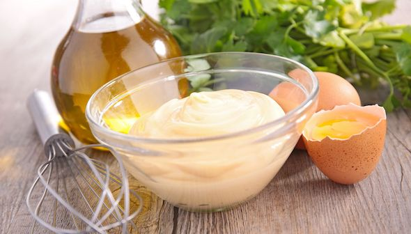
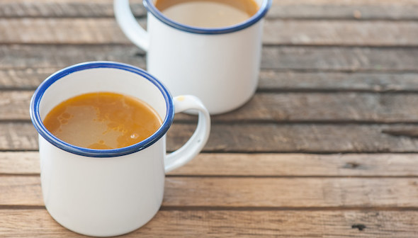
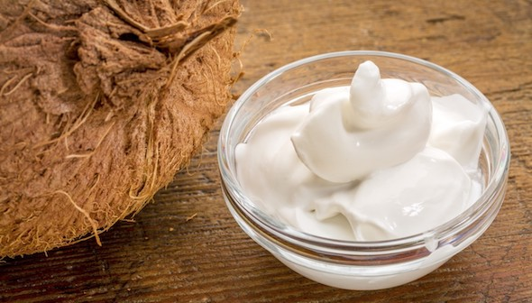
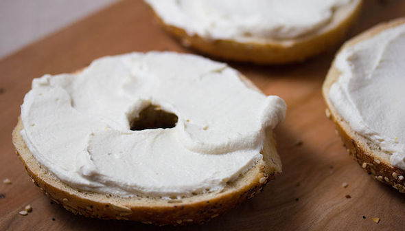

# 腸内環境フィックス大全 #21「腸内環境改善レシピ：ベーシック編」

## ****

「**腸内環境フィックス大全**」の21回目です! ([#1](https://daigovideolab.jp/blog/1972560),[#2](https://daigovideolab.jp/blog/1977451) ,[#3](https://daigovideolab.jp/blog/1977762),[#4](https://daigovideolab.jp/blog/1978742),[#5](https://daigovideolab.jp/blog/1981349),[#6](https://daigovideolab.jp/blog/1982150),[#7](https://daigovideolab.jp/blog/1983986),[#8](https://daigovideolab.jp/blog/1985204),[#9](https://daigovideolab.jp/blog/1986091),[#10](https://daigovideolab.jp/blog/1987807),[#11](https://daigovideolab.jp/blog/1989447),[#12](https://daigovideolab.jp/blog/1991296),[#13](https://daigovideolab.jp/blog/1992656),[#14](https://daigovideolab.jp/blog/1992969),[#15](https://daigovideolab.jp/blog/1995329),[#16](https://daigovideolab.jp/blog/1997084),[#17](https://daigovideolab.jp/blog/1997359),[#18](https://daigovideolab.jp/blog/1999270),[#19](https://daigovideolab.jp/blog/1999526),[#20](https://daigovideolab.jp/blog/2001569))

---

前回までで腸内に良い食事のガイドラインは終わりまして、今回からは超実践編。「**実際に何を食べるか？**」って事例がいくつかあった方が便利だと思いますんで、具体的な調理例をお伝えしておきます。

料理編の1回目は「ベーシック系」と題しまして、他の料理の調味料や付け合わせとして使えそうな基本的なメニューを5つほどお伝えします。いずれも腸内細菌に良い食材をうまく取り込めるようにデザインしてますんで、ぜひお試しください。

ブレンダーとかヨーグルトメーカーとかが出てきちゃうんで、「作りたいけど機材がない……」みたいなケースもあるでしょうが、その場合は次回の「**定番レシピ編**」をお待ちくださいませー。

## **ザワークラウト
**

言わずと知れたプロバイオティクス料理の最高峰。別に店で買ってもいいけど、簡単なんで自宅で作るのもよし。

- **準備時間**：20〜60分
- **調理時間**：5日〜5週間以上
- **量**：30食分

### 材料

- キャベツ 大1玉または小1玉
- シーソルト 大さじ5（正確にはキャベツの重さの2～3％）

### 作り方

1. キャベツの外側の葉を数枚むいて脇に置いておく。
2. フードプロセッサー、スライサー、包丁などを使って、できるだけ薄くスライスする。
3. キャベツを大きなボウルに入れ、塩を振りかける。
4. キャベツをもみこんで塩を十分に行き渡らせ、しおれてくるまでもみこむ。
5. 清潔なガラス瓶の容器に、しおれたキャベツを一握りずつ詰めていく。
6. すべてのキャベツを容器に入れたら、その上から、ステップ1で取っておいたキャベツの葉をのせてフタをする（キャベツ全体を水分に浸すための処置）。キャベツが水に浸っていない場合は、上からギュッと押す。
7. チーズクロス、コーヒーフィルター、リネンタオル、ペーパータオルなどで容器を覆い、ゴムバンドで固定。漬物容器を使ってる場合は普通にフタをする。
8. 次の24時間は、キャベツが完全に水に浸ってるかをチェック。水面がキャベツ上から少なくとも2センチ上にない場合は、小さじ1杯の塩を1カップの水に溶かしたものを注ぎ足しましょう。
9. うまくいけば5日ぐらいでザワークラウトが完成しますが、5ヶ月間発酵させることもできます（その場合は定期的に水分量をチェックして、必要に応じて塩水を補充しましょう）

## マヨネーズ

良質なオイルで腸内細菌を満たすためのマヨネーズ。野菜用に使うもよし、ポテサラに使うもよし。

- **準備時間**：5分
- **量**：1カップ分

### 材料

- [エクストラバージンオリーブオイル](https://amzn.to/3t6oqtK) 1/2カップ
- [アボカドオイル](https://jp.iherb.com/pr/Primal-Kitchen-Avocado-Oil-16-9-fl-oz-500-ml/76929?rcode=IRO489) 1/2カップ
- レモン汁 大さじ1
- [アップルサイダービネガー](https://jp.iherb.com/pr/Dynamic-Health-Laboratories-Organic-Raw-Apple-Cider-Vinegar-with-Mother-16-fl-oz-473-ml/85639?rcode=IRO489) 小さじ11/2
- [ディジョンマスタード](https://amzn.to/2OHbNpP) 大さじ1
- 卵黄 大2個

### 作り方

1. 計量カップにアボカドオイルとオリーブオイルを入れて混ぜ合わせる。
2. レモン汁、ビネガー、マスタード、卵黄をフードプロセッサーかブレンダーに入れ、クリーミーになるまで15秒ほど混ぜる。
3. ブレンダーまたはフードプロセッサーが動いているところに、少しずつオイルを垂らしていく（3分ぐらいかける）。オイルどんどんなじんできたら完成。冷蔵庫に保存し、5日以内に使用してください。

## **ボーンストック**

あらゆる料理の味付けに使えるうえ、腸内に良いアミノ酸を大量にふくむ。とりあえず作っておくと吉。

- **準備時間**：10分
- **調理時間**：4時間～5日
- **量**：8食分

### チキンストック

- 鶏肉の骨750〜1500g
- [アップルサイダービネガー](https://jp.iherb.com/pr/Dynamic-Health-Laboratories-Organic-Raw-Apple-Cider-Vinegar-with-Mother-16-fl-oz-473-ml/85639?rcode=IRO489) 大さじ1
- 玉ねぎ（中くらいの大きさ）2個
- にんじんは 4～5本
- セロリ 6～8本
- にんにく 6～8片
- ローリエ 3枚
- シーソルト 小さじ1

玉ねぎは根元を切り落として4分の1に切る。

にんじんは半分に切った

セロリは3等分

### ビーフまたはポークストック

- ビーフまたはポークの骨750〜1500g
- [アップルサイダービネガー](https://jp.iherb.com/pr/Dynamic-Health-Laboratories-Organic-Raw-Apple-Cider-Vinegar-with-Mother-16-fl-oz-473-ml/85639?rcode=IRO489) 大さじ1
- 玉ねぎ（中くらいの大きさ）2個
- にんじんは 4～5本
- セロリ 6～8本
- にんにく 6～8片
- ローリエ 3枚
- シーソルト 小さじ1

### 作り方

1. 大きな鍋（または圧力鍋やスロークッカー）に骨、水、ビネガーを入れて強火で沸騰させ、火を弱めて煮る。または圧力鍋で高圧調理するか、またはスロークッカーで弱火にする
2. 最初の1時間は表面に出てきたアクを取り除きます（圧力鍋を使用している場合は、このステップは不要）
3. フタをして24～48時間（圧力鍋では6～12時間、スロークッカーでは2～5日）煮込む。定期的にかき混ぜて水位を確認し、必要に応じて水を追加して、材料が2～5センチの水で覆われた状態を保つ。
4. 残りの材料を加えてさらに4～6時間（圧力鍋では1～2時間、スロークッカーでは6～8時間）煮込む。
5. 骨と野菜をこして捨てる（野菜は食べてもOK）。ストックは冷蔵庫で5日間、冷凍庫で6ヶ月間保存可能。

## **ココナッツミルクヨーグルト
**

そのまま食べてもデザートとして使えるし、さらには他の料理の材料としても使える。

- **準備時間**：5分
- **調理時間**：インキュベート＋冷却時間
- **量**：3/4カップ

### 材料

- [フルファットココナッツミルク](https://amzn.to/3qtvUFf) 400ml
- ゼラチン 小さじ1杯半
- 蜂蜜 小さじ2杯
- [乳酸菌ベースのプロバイオティクスカプセル](https://jp.iherb.com/pr/California-Gold-Nutrition-LactoBif-Probiotics-5-Billion-CFU-60-Veggie-Capsules/64006?rcode=IRO489)150億～200億CFU

### 作り方

1. 殺菌した耐熱ガラス容器にココナッツミルクを入れて電子レンジで温めるか、鍋に入れてコンロで温める。
2. ミルクの表面にゼラチンを振りかけ、ゼラチンが膨らむ（または液を吸う）まで2～3分待ってからゼラチンをかき混ぜる。
3. ココナッツミルクを電子レンジまたはコンロで50℃に加熱する。
4. 徹底的にかき混ぜてゼラチンを溶かす。
5. ミルクを40℃まで冷やす（それ以上の温度でも構わないが、プロバイオティクスを入れる場合は40℃以下が無難）
6. プロバイオティクスカプセルを開けてミルクに振りかけ、よくかき混ぜる。
7. はちみつを混ぜてかき混ぜる。
8. 殺菌したジャーに注ぎ、[ヨーグルトメーカー](https://amzn.to/2N35HzL)で約12時間インキュベート（ヨーグルトが酸っぱすぎる場合は、次回からインキュベート時間を短くし、酸味が足りない場合はもっと長い時間インキュベートするとよし）。
9. ゼラチンが固まるまでヨーグルトを冷蔵庫で冷やして完成（2～3時間）。

## **カシュー クリームチーズ
**

こちらも普段の食事の付け合わせとして使ってもいいし、他の料理にも使える便利なアイテム。

- **準備時間**：15分
- **調理時間**：インキュベーション＋冷却時間
- **量**：3/4カップ

### 材料

- 生のカシューナッツ 2 カップ
- シーソルト 小さじ1
- [乳酸菌ベースのプロバイオティクスカプセル](https://jp.iherb.com/pr/California-Gold-Nutrition-LactoBif-Probiotics-5-Billion-CFU-60-Veggie-Capsules/64006?rcode=IRO489)150億～200億CFU
- ろ過水

1. ガラスのボウルにカシューナッツを入れて全体を水で覆い、一晩浸します。
2. ヨーグルトメーカーの瓶、またはカシュークリームチーズを作るのに使う瓶を徹底的に洗浄または殺菌する。
3. ボウルの水分を捨てて、残ったカシューナッツに小さじ1/2の塩を入れ、ブレンダーかフードプロセッサーにかけます。必要に応じて水分を追加しつつ、完全に滑らかになるまでブレンドしましょう。
4. プロバイオティクスカプセルを開いて、中身をカシューナッツのピューレに追加。
5. カシューナッツを[ヨーグルトメーカー](https://amzn.to/2N35HzL)にかけて16〜18時間インキュベートする。残りの塩を追加しよくかき混ぜる。
6. キッチンペーパーなどを使い、できるだけカシュークリームチーズの水分を絞り出す。

## **次回予告**

というわけで、腸内環境に良い食事のベーシック編は以上です。次回は「定番レシピ編」と銘打ちまして、鶏肉や魚を使った腸内環境の改善メニューを見ていきましょう。ではまたー。
