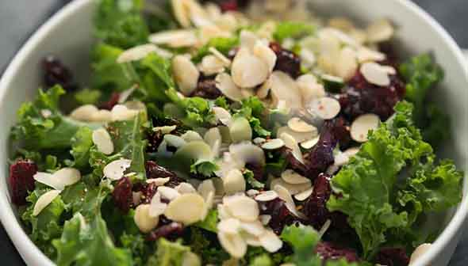
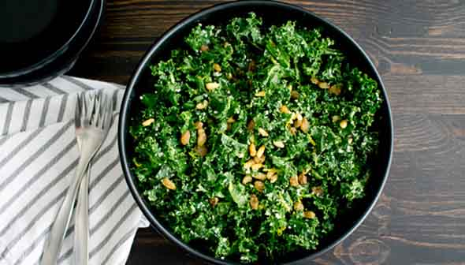
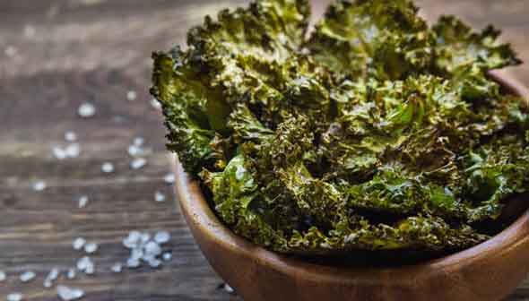
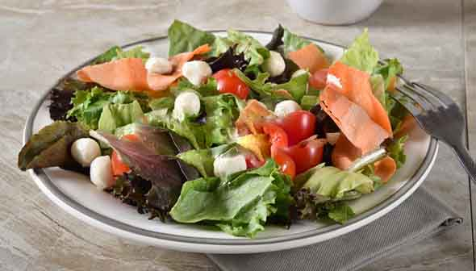
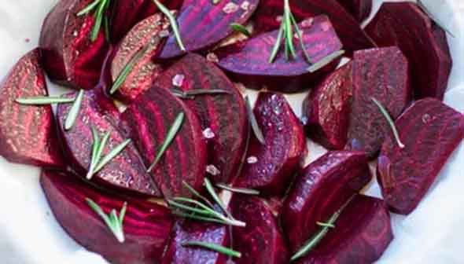
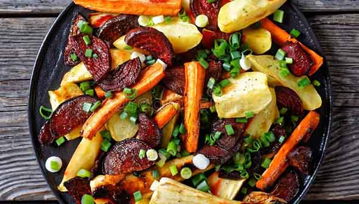

# 腸内環境フィックス大全 #23「腸内環境改善レシピ：野菜をたくさん食べようぜ編」

## ****

「**腸内環境フィックス大全**」の23回目です! ([#1](https://daigovideolab.jp/blog/1972560),[#2](https://daigovideolab.jp/blog/1977451) ,[#3](https://daigovideolab.jp/blog/1977762),[#4](https://daigovideolab.jp/blog/1978742),[#5](https://daigovideolab.jp/blog/1981349),[#6](https://daigovideolab.jp/blog/1982150),[#7](https://daigovideolab.jp/blog/1983986),[#8](https://daigovideolab.jp/blog/1985204),[#9](https://daigovideolab.jp/blog/1986091),[#10](https://daigovideolab.jp/blog/1987807),[#11](https://daigovideolab.jp/blog/1989447),[#12](https://daigovideolab.jp/blog/1991296),[#13](https://daigovideolab.jp/blog/1992656),[#14](https://daigovideolab.jp/blog/1992969),[#15](https://daigovideolab.jp/blog/1995329),[#16](https://daigovideolab.jp/blog/1997084),[#17](https://daigovideolab.jp/blog/1997359),[#18](https://daigovideolab.jp/blog/1999270),[#19](https://daigovideolab.jp/blog/1999526),[#20](https://daigovideolab.jp/blog/2001569),[#21](https://daigovideolab.jp/blog/2002853),[#22](https://daigovideolab.jp/blog/2003723))

---

前回は「**腸内環境に良い定番の料理**」を紹介してましたんで、今回は「**腸に良い野菜をいかに増やすか？編**」です。これまでのシリーズで何度もご説明してきたとおり、腸内環境を改善するには野菜の摂取を増やすのが一番。なかでも良質な食物繊維をふくむ食材をメインに使いつつ、いかに腸に優しい脂肪分を取るかが最優先になっていきます。

ってことで、いくつか見てみましょうー。

## **野菜ディップ
**

まずは基本中の基本である「ディップ」です。とりあえずディップさえ作っておけば、大量の生野菜をボリボリ食えますので、非常におすすめであります。

- **準備時間**：10分
- **調理時間**：なし
- **量**：6人分

### **材料**

- 生野菜 6カップ（ブロッコリー、カリフラワー、にんじん、セロリ、トマト、マッシュルーム、ラディッシュ、キュウリ、ズッキーニなど）
- [マヨネーズ](https://daigovideolab.jp/blog/2002853) 1/4カップ
- [ココナッツミルクヨーグルト](https://daigovideolab.jp/blog/2002853) 1/4カップ（作るのが面倒なら市販のヨーグルトでもOK）
- [ガーリックペースト](https://amzn.to/2OPl7Zv) 小さじ1/2
- レモン汁 小さじ1/2
- 塩 小さじ1/4
- オレガノ 小さじ1/4
- タイム 小さじ3
- 赤玉ねぎ 大さじ2（みじん切り）
- パセリ 大さじ1（みじん切り）
- コリアンダー 大さじ1 （みじん切り）



### 作り方

1. 野菜ディップに適した形にカットする。
2. 小さなボウルに、マヨネーズ、ヨーグルト、ガーリックペースト、レモン汁、塩を入れてディップを作る。
3. 乾燥オレガノとタイムを手のひらでこすり合わせて粉状にし、ディップに混ぜる。
4. タマネギ、パセリ、コリアンダーを加えて混ぜ合わせたら完成。残ったディップは冷蔵庫で1週間ほど保存可。

## **ケールとほうれん草のホットサラダ**

葉物野菜はすべて腸内環境に良いのですが、なかでも使えるツートップがケールとほうれん草。このふたつは多めにとっておいた方が腸を改善しやすいんで、いくつか食べ方を用意しとくと吉。

- **準備時間**：5分
- **調理時間**：7分
- **量**：2〜4人分

### 材料

- エキストラバージンオリーブオイル 大さじ1杯半
- ケール 2カップ（みじん切り）
- ほうれん草 3カップ
- スライスアーモンド 大さじ2
- ドライクランベリー 1/4カップ（あってもなくても可）
- 水 大さじ1～2



### 作り方

1. フライパンにオリーブオイルを入れて中火で加熱。
2. ケールと水（大さじ1）を加え、かき混ぜながらケールが柔らかくなるまで3～4分加熱。
3. クランベリーを加えて、さらに2～3分加熱。
4. ほうれん草を加える。ケールが固まってきたら、水をもう大さじ1杯加える。ケールとほうれん草を混ぜながら、ほうれん草がしんなりするまで加熱。
5. アーモンドを混ぜて完成。

## **シンプル・****ケールサラダ**

名前のとおり超シンプルなケールサラダです。とりあえずオリーブオイルと適当なドライベリーを混ぜておけば、何でも野菜は食えちゃう説。

- **準備時間**：10分
- **調理時間**：なし
- **量**：3～4人分

### 材料

- ケール 1束
- エクストラバージンオリーブオイル 大さじ2
- ドライクランベリー 1/3カップ
- 松の実 1/4カップ

### 作り方

1. ケールを1～2cmの大きさにちぎり、かたい茎を取り除く
2. 大きめのボウルにオリーブオイルを振りかけ、手でマッサージするようにして完全にコーティングする
3. ドライクランベリーと松の実を散らして完成

## **ケールチップス**

野菜の水分を飛ばしてチップスにしちゃうのも、良い方法のひとつ。ここではケールを使ってますが、いろんな野菜でチップスが作れますんでお試しください。

- **準備時間**：5分
- **調理時間**：20分
- **量**：2～4人分

### 材料

- ケール 8カップ
- エキストラバージンオリーブオイル 大さじ2
- 塩 小さじ1/4

### 作り方

1. オーブンを135℃に予熱する。
2. ケールを1.5～2.5cmの大きさにちぎり、かたい茎を取り除く
3. ケールを洗って乾かし、フタつきの大きなボウルに入れる
4. ケールにオイルをかけ、フタをしまたボウルを振ってケールにオイルをなじませる（ボウルの中でかき混ぜてもOK）
5. ベーキングシートにケールを広げて塩を振りかける
6. カリカリになるまでケールを焼く（20〜30分）

## **ガーデンサラダ**

いかにケールやほうれん草が良いとは言っても、そればっかだとさすがに食物繊維とポリフェノールが偏るので、定期的にいろんな野菜も取り入れておくのが吉。

- **準備時間**：15分
- **調理時間**：なし
- **量**：6～8人分

### 材料

- エキストラバージンオリーブオイル 大さじ6
- リンゴ酢 1/4カップ
- 乾燥オレガノ 小さじ4
- 乾燥ローズマリー 小さじ1/4
- 乾燥タイム 小さじ1/4
- にんにく 1片 （みじん切り）
- コショウ 小さじ1/8
- サラダ菜12～16カップ（レタス、ほうれん草、ケール、ルッコラ、マイクログリーンなど、いろんな葉物野菜を使うほど腸に良い影響が出る）
- その他の野菜（大根、ネギ、赤タマネギ、キュウリ、トマト、ピーマン、ニンジン、ビート、セロリ、湯通ししたアスパラガス、エンドウ豆、マッシュルームなど）4カップ
- 好きなハーブ バジル、パセリ、コリアンダーなど

### 作り方

1. 大きめのサラダボウルにサラダ菜、刻んだ野菜、ハーブを入れてよく混ぜる
2. オリーブオイル、リンゴ酢、オレガノ、ローズマリー、タイム、コショウをミキサーで混ぜてピューレ状にし、そこにハーブとニンニクを入れてなじませてドレッシングを作る（このドレッシングは自然に分離するので、食べる直前に振って混ぜて使う）

## **ローストビーツ**

ベリー類と並んで、ビーツもまた優良なポリフェノールが詰め込まれたナイス食材。スープで煮込むのもアリですが、ローストにすると一気に食いやすくなるんで押さえておきましょう。

- **準備時間**：10分
- **調理時間**：45～60分
- **量**：4～6人分

### 材料

- ビーツ 中6～8個（4等分にする）
- バルサミコ酢 大さじ2
- エキストラバージンオリーブオイル 大さじ1
- シーソルト 小さじ1/4
- コショウ 小さじ1/8

### 作り方

1. オーブンを180℃に予熱する
2. ボウルにビーツ、酢、オリーブオイル、塩を入れて混ぜ合わせる
3. アルミホイルを板に敷き、その上にビーツを敷く
4. ビーツが柔らかくなるまで、45分から1時間ぐらい焼く（ビーツの大きさによって調理時間は結構変わる）

## **ローストベジタブル**

野菜も生でばかり食べてると、フィトケミカルの吸収率に偏りが出たりしますので、熱を加えた野菜も適宜食べておいてくださいませ。

- **準備時間**：15分
- **調理時間**：15分
- **量**：3～4人分

### 材料

- パプリカ 小1個（2.5センチ角にカットする）
- 赤タマネギ 中1/4個（2.5センチ角にカットする）
- マッシュルーム 100g（厚切りにする）
- エンドウ豆 3/4カップ
- ズッキーニ 小1本（0.5〜1センチの厚さの輪切りにする）
- にんにく 2片（みじん切り）
- バルサミコ酢 小さじ2
- バジル 生 1/4カップ
- くるみ 3/4カップ
- エキストラバージンオリーブオイル 大さじ1
- シーソルト 小さじ1/4

### 作り方

1. オーブンを200℃に予熱する。
2. パプリカ、玉ねぎ、マッシュルームをオリーブオイルと塩で炒める
3. オーブンで野菜を10分間焼く
4. エンドウ、ズッキーニ、ニンニクをベーキングシートに加えてかき混ぜ、そこにクルミを乗せる。クルミがトーストされるまでさらに加熱
5. 最後にバルサミコ酢をかけて、バジルを散らして完成
