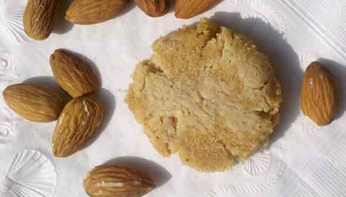
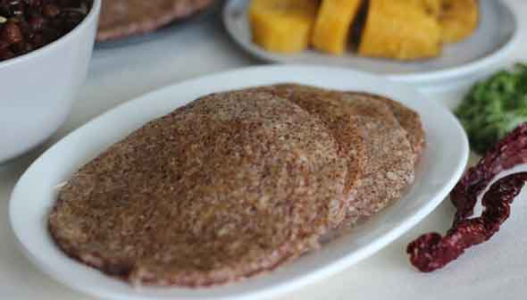
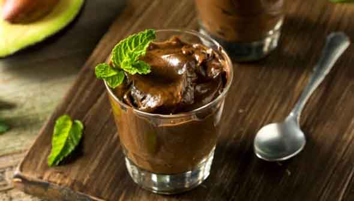
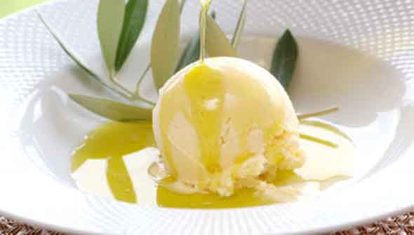

# 腸内環境フィックス大全 #24「腸内環境改善レシピ：禁断のデザート編」

## 

「**腸内環境フィックス大全**」の24回目です! ([#1](https://daigovideolab.jp/blog/1972560),[#2](https://daigovideolab.jp/blog/1977451) ,[#3](https://daigovideolab.jp/blog/1977762),[#4](https://daigovideolab.jp/blog/1978742),[#5](https://daigovideolab.jp/blog/1981349),[#6](https://daigovideolab.jp/blog/1982150),[#7](https://daigovideolab.jp/blog/1983986),[#8](https://daigovideolab.jp/blog/1985204),[#9](https://daigovideolab.jp/blog/1986091),[#10](https://daigovideolab.jp/blog/1987807),[#11](https://daigovideolab.jp/blog/1989447),[#12](https://daigovideolab.jp/blog/1991296),[#13](https://daigovideolab.jp/blog/1992656),[#14](https://daigovideolab.jp/blog/1992969),[#15](https://daigovideolab.jp/blog/1995329),[#16](https://daigovideolab.jp/blog/1997084),[#17](https://daigovideolab.jp/blog/1997359),[#18](https://daigovideolab.jp/blog/1999270),[#19](https://daigovideolab.jp/blog/1999526),[#20](https://daigovideolab.jp/blog/2001569),[#21](https://daigovideolab.jp/blog/2002853),[#22](https://daigovideolab.jp/blog/2003723),[#23](https://daigovideolab.jp/blog/2006873))

---

前回は「**野菜をたくさん食べるための****料理**」を紹介してましたんで、今回はちょっと目先を変えて「**腸に良いデザート編**」です。もちろん、甘味が欲しい時はフルーツを食べるのがベターですが、それだけじゃ物足りない！って方も多いでしょう。そんな方は、以下のレシピを参考に、いくつか試していただくといい感じです。

ってことで、いくつか見てみましょうー。

## **アーモンドクッキー**

ご存じのとおり、アーモンドは良質な食物繊維の塊。ここに、さらにキャッサバ粉で食物繊維を増量すると、1食分でかなりの食物繊維が取れたりします。

- **準備時間**：15分
- **調理時間**：10分
- **量**：12個

### **材料**

- グラスフェッドバター 1/2カップ（1スティック）
- オーガニックのきび砂糖またはメープルシュガー 2/3カップ
- バニラ 小さじ1.5
- [アーモンドエクストラクト](https://amzn.to/3u6Yz5c) 小さじ1.5
- [アーモンド粉](https://jp.iherb.com/pr/Bob-s-Red-Mill-Natural-Almond-Flour-Super-Fine-16-oz-453-g/103994?rcode=IRO489) 1.5カップ
- [キャッサバ粉](https://jp.iherb.com/pr/Edward-Sons-Let-s-Do-Organic-Organic-Cassava-Flour-14-oz-396-g/95363?rcode=IRO489) 1/4カップ
- [アーモンドスライス](https://amzn.to/3dl0Zq3) 1/2カップ＋大さじ3
- シーソルト 小さじ1.5
- 重曹 小さじ0.25〜0.5



### 作り方

1.
  1. オーブンを180℃に予熱。天板にクッキングシートを敷く
  2. 中サイズのボウルにバター、きび砂糖、バニラ、アーモンドエクストラ九とを入れ、なめらかになるまでよく混ぜ合わせる
  3. さらに、アーモンド粉、キャッサバ粉、塩、重曹を加え、生地になるように混ぜり。そこにスライスしたアーモンド1/2カップを加え、完全に混ぜ合わる
  4. 生地を2.5センチの大きさに丸め、準備したベーキングシートの上にセット。少し平らにして、残りのスライスアーモンド（大さじ3）を上から振りかけ、くっつくように軽く押す
  5. クッキーが茶色になるまで10分間焼いたら、オーブンから取り出して10分以上冷やす

## **プランテンパンケーキ**

プランテンはレジスタントスターチが豊富で、腸内環境を改善するにはかなり優秀な食材のひとつ。パンケーキの素材としてかなり優秀だったりします。お好みのタンパク質と新鮮なフルーツを添えてお召し上がりください。

- **準備時間**：5分
- **調理時間**：10分
- **量**：8枚

### **材料**

- グリーンプランテン（大）2個（刻んで21⁄ 2～3カップにしておく）
- 卵（大）4個（プランテンが大きい場合は、卵を1個追加）
- バニラエッセンス 小さじ2
- エキストラバージンココナッツオイル 大さじ3
- シーソルト 小さじ1/8
- 重曹 小さじ1/2

### 作り方

1. プランテンの皮をむき、卵と一緒にミキサーに入れて滑らかな生地になるように混ぜる
2. 残りの材料をミキサーに入れ、さらに1分間混ぜる
3. ココナッツオイル大さじ1をフライパンに入れて中火で加熱。好みの大きさになるまでパンケーキの生地をフライパンに流し込みます。片面を4～5分焼き、表面が乾いて小さな泡が出てくるまで待つ（通常のパンケーキと同じ）
4. 裏面を1.5～2分焼く

## **チョコレート・アボカド・プディング**

アボカドは優良な油と食物繊維をふくみ、ここにダークチョコレートのポリフェノールで腸内細菌を癒す作戦。めちゃくちゃ簡単に作れるんで、こってりしたデザートが欲しい時にどうぞ。ハイカロリーになっちゃうんで常食はおすすめしませんが……。

- **準備時間**：20分+冷蔵時間
- **調理時間**：なし
- **量**：6人分

### **材料**

- 完熟したアボカド 4個（約900g）
- お湯 1/4カップ（必要に応じて追加）
- メープルシロップ 1/4カップ
- バニラ 小さじ2
- シーソルト 小さじ1/4
- ダークチョコレート（溶かしたもの）90g
- カカオパウダー 1/3カップ

### 作り方

1. 皮をむいたアボカド、水、メープルシロップ、バニラ、塩をブレンダーに入れる。必要に応じて大さじ1杯ずつ水を加え、なめらかになるまで混ぜる
2. カカオと溶かしたチョコレートを加えて混ぜる。混ぜるのが難しい場合は、大さじ1杯ずつ水を加える
3. 容器にプリンを入れて冷蔵庫で4時間以上冷やしてから食べる

## **オートミール・クッキー**

オートミールも腸内細菌が好む食物繊維が豊富。さらに、ここにキャッサバ粉を追加して、より腸内を喜ばせるレシピになっております。

- **準備時間**：20分
- **調理時間**：15分
- **量**：3ダース

### **材料**

- エキストラバージンオリーブオイル 1/2カップ
- エキストラバージンココナッツオイル 1/2カップ
- 重曹 小さじ1/2
- シーソルト 小さじ1/2
- ナツメグ 小さじ1/4
- [オートミール](https://jp.iherb.com/pr/Bob-s-Red-Mill-Old-Fashioned-Rolled-Oats-Whole-Grain-Gluten-Free-32-oz-907-g/89516?rcode=IRO489) 3カップ
- チョコレートチップ（レーズンでも代用可）1カップ
- [マスコバド糖](https://amzn.to/2Pi8OoG)、ダークブラウンのサトウキビ糖、またはメープルシュガー 1.5カップ
- 卵（大） 2個
- [キャッサバ粉](https://jp.iherb.com/pr/Edward-Sons-Let-s-Do-Organic-Organic-Cassava-Flour-14-oz-396-g/95363?rcode=IRO489) 11/3カップ

### 作り方

1. オーブンを180℃に予熱
2. 大きなボウルにオリーブオイル、ココナッツオイル、砂糖、卵を入れて泡立てる
3. キャッサバ粉、ベーキングソーダ、塩、ナツメグを加えてかき混ぜ、厚めの生地を作る
4. オートミール、チョコレートチップの順にかき混ぜ、完全に混ぜ合わせる
5. 生地を直径約4センチの大きさに丸め、手で平らにして厚さ1.5センチぐらいにする
6. 底面が薄茶色になるまで12～15分焼く。天板の上で5分ほど冷まして完成。密閉容器に入れて室温で1週間ほど保存可能

## **オリーブオイル・アイス**

ココナッツミルクとオリーブオイルは、どちらも良質な脂質とポリフェノールをふくむため、腸内環境の改善には役立つはず。

- **準備時間**：10分
- **調理時間**：20分＋冷却時間
- **量**：3カップ

### 材料

- フルファットココナッツミルク 1缶（380ml）
- 卵黄（大） 3個
- 高品質エキストラバージンオリーブオイル 2/3カップ
- 蜂蜜 1⁄3カップ
- バニラエッセンス 小さじ1/2
- シーソルト 小さじ1/4
- バルサミコ酢（オプション）

### 作り方

1. ココナッツミルクを中弱火でよくかき混ぜつつ、沸騰寸前まで加熱する（煮立たせないように注意）
2. 卵黄を耐熱性の容器に入れてかき混ぜながら、お玉一杯分の熱いココナッツミルクを卵黄に加えてテンパリングしてかき混ぜる
3. テンパリングした卵黄を中火にかけ、沸騰させないようにかき混ぜながら、とろみがつくまで6～8分加熱する 沸騰すると卵が固まっちゃうので注意。もし固まりそうになったら、すぐに火からおろしてミキサーで滑らかになるまで撹拌するとよい
4. 火から下ろし、ボウルまたは計量カップに注いで室温まで冷まし、残りの材料を加えて1分ほど混ぜ合わせる
