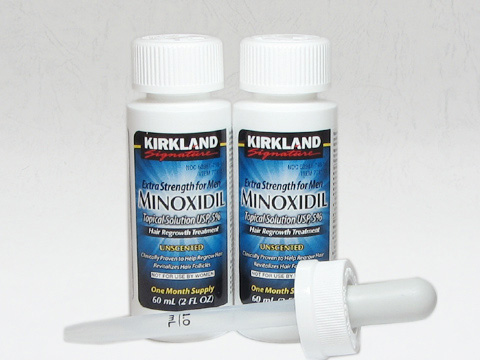
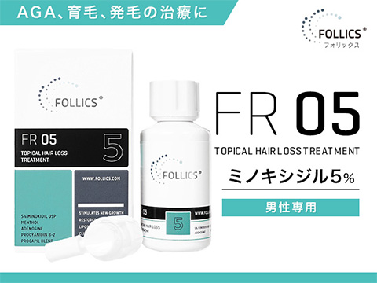
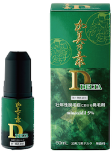
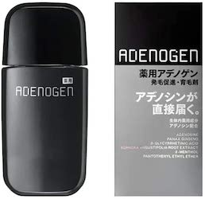
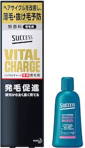

# 本当に使う価値がある「発毛＆育毛剤」トップ5

というわけで、今回は育毛剤＆発毛剤のお話です。

---

## **発毛＆育毛について信頼できるソースはどこにある？**

育毛剤＆発毛剤に関しては、ちょっと検索しただけでも山のようなソースが見つかるはず。その大半は「センブリ」やら「幹細胞」やら得体の知れない名前が多く、判断に困っちゃう方は少なくないでしょう。

そこで、現時点において、日本語で読める育毛ソースとして最も優秀なのが「[男性型および女性型脱毛症診療ガイドライン. 2017年版](https://www.dermatol.or.jp/uploads/uploads/files/AGA_GL2017.pdf)」であります。これは、日本皮膚科学会が育毛に関する近年のソースを調査したもので、証拠のレベルによって**推奨成分をランクづけ**してくれてるんですよ。「髪が薄くなってきた……」とお悩みなら、とりあえずこれを読んでおけば事足りるでしょう。

結論から言うと、ガイドラインでは育毛成分を以下のようにランキングしてます。

- 推奨度A（強くおすすめ）＝ミノキシジル
- 推奨度B（普通におすすめ）＝アデノシン
- 推奨度C1（使ってもいいかも）＝カルプロニウム塩化物、t-フラバノン、サイトプリン・ペンタデカン、ケトコナゾール

1位はご存じミノキシジルで、日本では「リアップ」が有名っすね。国内で唯一「発毛剤」と呼ぶことを許された成分で、**ほかのものとは格が違う**わけです（それ以外の成分は「育毛剤」扱いになる）。

続くアデノシンは、育毛剤のなかでは十分に根拠がある成分で、0.75％アデノシン配合ローションであれば、**5％ミノキシジルと同じ効果があるかも？**と考えられております。そう考えるとアデノシンも悪くないチョイスですね。

その他、推奨度Cの成分については、上のふたつよりも「値段が安いことが多い」のがウリなんで、**「あれ？ちょっと抜け毛が増えた？」ぐらいの場面で使う**のが吉。ミノキシジルと違って副作用も出にくいので、「まずは弱いものから試したい」と言う方にもいいでしょう。

## **推奨の発毛＆育毛剤トップ5**

というわけで、以上をふまえたうえで、現時点で手に入る発毛剤＆育毛剤のベストを見ていきましょう。

### 1位 [カークランド(Kirkland)5％](https://alwys.net/contents/ard.php?id=OS011504&adwares=os004634)

まず1位は、オリーブオイルでもおなじみのカークランドから出ているミノキシジルです。こいつがすばらしいのは何といっても価格でして、**60日分の成分量でなんと3,271円から**。比較対象として、同じくミノキシジル5％配合の「[スカルプD メディカルミノキ5](https://amzn.to/2R4U7ps)」が30日分で7,800円ですから、カークランドのすごさがお分かりいただけるでしょう。

ちなみに、国内のミノキシジル系商品は、いずれも漢方などの成分を配合してお得感を出してるんですけど、ぶっちゃけどれも根拠がないケースがほとんどなので買わない方が無難です。ミノキシジルが5％入ってれば効果に大差はないので、**困ったら価格で選んじゃって**構いません。

### 2位 [フォリックスFR05ローション\[ミノキシジル5％\]](https://alwys.net/contents/ard.php?id=OS011504&adwares=os023789)

続くフォリックスFR05は、ミノキシジル5％にアデノシンを加えた商品。1ヶ月分が4,075円で、やはり国内の商品と比較するとかなりお安くなっております。

まぁミノキシジルとアデノシンを併用したからといって**効果が高まる保証はない**ので、そこだけはご注意ください。ミノキシジルだけではいまいち効果が確認できないなーって時に使うといいかも知れません。

### 3位 [加美乃素デルタ](https://kaminomoto.co.jp/delta_ec/?utm_source=ad&utm_medium=ppc&gclid=CjwKCAjw7J6EBhBDEiwA5UUM2lx3r9IzUiIaR2D5PHn_IGqne-tW-kL-1LNpwCWTojw_JG7lUaMhnRoCmgEQAvD_BwE)

「**カークランドは安いけど海外輸入がめんどい……**」という方は、「[加美乃素デルタ](https://kaminomoto.co.jp/delta_ec/?utm_source=ad&utm_medium=ppc&gclid=CjwKCAjw7J6EBhBDEiwA5UUM2lx3r9IzUiIaR2D5PHn_IGqne-tW-kL-1LNpwCWTojw_JG7lUaMhnRoCmgEQAvD_BwE)」をどうぞ。1ヶ月分で4950円でして、カークランドよりだいぶ割高になりますが、**国内メーカーの製品としては最安値**です。ミノキシジル5％配合なんで、先発のリアップと比べても効果に違いはないでしょう。

### 4位 [薬用アデノゲンEX](https://amzn.to/3u0Gkir)

ミノキシジルだと肌が荒れてしまう人は、推奨度Bのアデノシンをお使いください。「薬用アデノゲンEX」はアデノシン配合の商品で、お値段は1ヶ月あたり5,578円。やっぱミノキシジル系と比べて割高なのが難点ですねぇ……。

とはいえ、これでも国内のアデノシン系商品のなかでは割安なほうなんで、気になる方はお試しください。

### 5位 [サクセス バイタル チャージ](https://amzn.to/3t1yOlU)

「[サクセスバイタルチャージ](https://amzn.to/3t1yOlU)」は、推奨度Cの「t-フラバノン」が主成分の育毛剤です。お値段は1ヶ月あたり2,355円で、数ある育毛剤のなかではかなり割安なほうでしょう。推奨度Cなのでミノキシジルほどの効果は望めないものの、「ちょっと抜け毛が気になる……」ぐらいの人が、予防用に使うならアリじゃないでしょうか。

## **まとめ**

そんなわけで、今回は日本皮膚科学会のガイドラインをもとに、優良な育毛＆発毛アイテムを見てみました。もし私の身に脱毛が起きたら、おそらくカークランドを使うでしょうが、脱毛については遺伝の要素も大きいので、ぜひいろいろお試しください。
