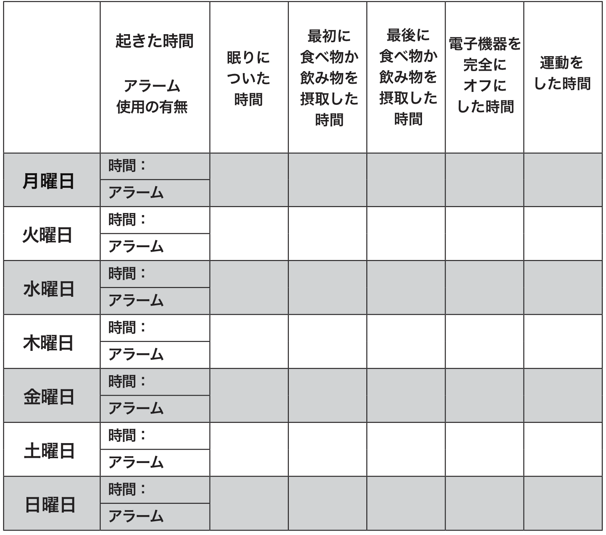

# ソーク研究所の「体内時計チェック」をやってみよう！「体内時計フィックス#2」

「**体内時計フィックス**」の続きです！([#1](https://daigovideolab.jp/blog/2046166))

---

[シリーズ第1回](https://daigovideolab.jp/blog/2046166)では「**いかに体内時計が人間の健康とメンタルを左右するか？**」を押さえたうえで、「**現時点でどれぐらい体内時計に優しい生活ができているか？**」ってとこを見てみました。かく言う私も、仕事が忙しいときはつい夜遅くまでモニタを見続けねばならないことがよくあるので、大きなことは言えないわけですが……。

そこで今回は、前回のチェックをさらに掘り下げて、「**いまの生活で具体的にどこを治すべきなのか？**」を判断する方法を見てみましょう。

今回の手法は**チェックテストというよりも「追跡調査」**でして、具体的には次の1週間ほど以下の表に記録を行なっていただければOKです。6つの質問に1週間ほど答え続けることで、自分の1日のリズムと修正すべき点を大まかに把握することができるはずであります。

この調査法はソーク研究所（1963年創設された生物医学系の研究所）の研究がネタ元([R](https://www.salk.edu/scientist/satchidananda-panda/))で、この機関は昔から「理想的な体内リズムを確立するには？」って調査を多くやってたんですよ。

もちろん、理想的なリズムをすぐ日常生活に取り入れるのは難しいでしょうが、いまの生活のどこが間違っているのかを理解するだけでも大きな一歩。追跡調査表を使う際の注意点を以下にまとめておくので、「**自分はどうだろう？**」と考えつつ実践してみてください。

### 記録ポイント1．起きた時間とアラーム使用の有無

「**体内時計の調整に最も重要なことは何か？**」って疑問は判断が難しく、重要度を比べたデータも存在しないのが現状であります。しかし、とりあえずどんな専門家でも認めるのは**「いつどのように目を覚ましたか？」の重要性**でしょう。

その理由を簡単に申し上げますと、まず私たちが目を覚ますと目から入った光が網膜のメラノプシンを活性化して[視交叉上核](https://ja.wikipedia.org/wiki/%E8%A6%96%E4%BA%A4%E5%8F%89%E4%B8%8A%E6%A0%B8)（SCN）に朝を伝え、自動的に全身の機能をONにしてくれます。しかし、この時にSCNの準備ができていないと、脳が「まだ夜なんだろうな……」と思い込んでしまい、**目覚まし時計がないと目を覚ますことができなくなっちゃう**んですよ。

つまり、ここでの理想を言うならば、

- **目覚まし時計に頼らず、SCNが朝だと認識した後で自然に目が覚める**

って感じになります。そのため、上の表に記入する際には、たんに何時に起きたかだけでなく、目覚まし時計が必要だったかどうかも記入してもらう必要があるんですな。

ちなみに、大昔の環境ってのは、

- 夜明けになると明るい光が現れて気温が上昇する

- 鳥や動物の鳴き声などが発生して脳に朝を伝える

といったいろんな要因にあふれてまして、そのおかげでSCNの働きが正常化しやすかったんですよね。

一方で現代では、二重窓に遮光カーテン、エアコンといった環境のせいで、**朝の自然な音、光、温度のシグナルがほとんどなくなってる**のはご存じのとおり。しかし、だからといって遮光カーテンなどがないと就寝時の環境が乱れてしまうので、これが難しいところなんですが……。

### 記録ポイント2．いつ眠りにつくのか？

このエリアには、ベッドで完全に目を閉じた時間を記入します。照明を消し、メールやメッセージ、SNSをチェックし終わり、寝床で目を閉じてた時間です。もし寝床の中で何分か眠れないままだったとしても、そこは考慮しなくて構いません。

### 記録ポイント3．最初の食事時間

光を浴びると脳内の時計が同期するように、私たちが口にする最初の食事も体内時計に「一日の始まり」を告げる重要ポイントです。

ここで言う「食事」ってのは、「****水以外に食べたり飲んだりしたもの****」すべてを意味してまして、たとえ朝食を抜く生活をしていたとしても、コーヒーや緑茶を飲んだ場合は、その時間から記録してください。

そもそもヒトの体は、ちょっとしたカロリーを口に入れるとすぐに変化が起き始め、胃は食べ物の消化を期待して胃液を分泌し始めるし、ホルモン、酵素、遺伝子などが次々に働き始めて、胃と脳の時計をリセットするんですよ。

なので、コーヒー1杯でもシリアル1杯でもなんでも、1日で何らかのものを口にした時間は記録しておくと便利です。要するに、胃や肝臓、筋肉、脳などが「断食の期間が終わった」と認識するものを記録するわけっすな。

### 記録ポイント4．最後の食事時間

ヒトの脳が夜間の休息で若返るように、代謝器官も休息を取る必要があります。１日の最後の食事や飲み物は、私たちの体に「ゆっくり休んでOK！」と準備をさせる合図になります。

このようなメッセージを脳と体が受け取るまでには2〜3時間かかりまして、**最後の食事からある程度の時間をかけないと、人体は修復と若返りのモードに入ることができない**とお考えください。

と言うわけで、その日の最後の一口（水と薬以外）を摂取した時間を書き出してみましょう。多くの研究によりますと、たいていの人は「最後の食事はだいたい一緒だろう」と思い込みやすいが、実際には平日や週末でまったく別のスケジュールになることが多いと報告されております。記録を取らないと、自分がどんなパターンで食事をしてるかって、意外とわからないものなんですよね。

### 記録ポイント5 ．電子機器をオフった時間

**電子機器の光が体内時計を乱す！**みたいな話は「[最高の体調](https://amzn.to/3mP16AB)」でも強調したとおり。なんせ古代の暮らしに電子機器がなかったし、わずか50年前を見ても、ほとんどのテレビはゴールデンタイムの後で放送を終えてたレベルですからね。体内時計が電子機器に適応できてないのは当たり前でしょう。

実際、近年の研究では、デジタル機器の電源をすべてオフにしてから、脳が完全にリラックスするまでは数十分はかかるとされてたりします。電子機器のスクリーンをオフにすることは、脳への光の入力をすべてオフにすることを意味しまして、それが体内時計のスイッチも切り替えてくれるんですよね。

### 記録ポイント6 ．運動した時間

運動がどこまで体内時計に影響するかってのはまだ議論があるものの、エクササイズをした時間や激しい運動が、体内時計や睡眠の質を左右するのは間違いないところ。睡眠と食事よりは重要度が落ちるものの、何時に運動したかも記録しとくといいでしょう。

## **記録をどうチェックするか**

1週間の記録を終えたら、あなたは自分の体内時計システムについて、かなり理解が深まったかと思います。

もちろん、すべての人に効く魔法のスケジューリングなど存在しないものの、記録した情報をもとに「どこから変えていくか？」を決めることは可能でしょう。たとえ小さな変化であっても、健康レベルや生産性アップに大きな効果がありますので。

で、実際の記録をどう使うかってところですが、おおむね以下のようなガイドラインになります。

- 記録した6つの時間が****1週間のあいだに±2時間以上変化していれば**、まだあなたの体内時計は改善の余地がある**と言えます。月曜は23時に寝てたのに、週末は1時に寝た場合などですね。
- 1日の総睡眠時間を計算して、7時間以上寝ているのに「起床から20分すぎた後でもまだ眠いな……」と感じる場合は、睡眠の質が低下している可能性があります。7日のうちたった2日の睡眠不足でも、すべての努力が水の泡になりかねないのでご注意ください。
- 胃腸が働いている時間の合計も見てみましょう。どの曜日でもいいので、1日の最初の食事と最後の食事をチェックして、**胃腸が食べ物を処理していない時間帯（つまり空腹状態の時間）**を見てください。もし、この数値が12以上であればOKであります 。
  要するに、1日のうちに8〜11時間以内にすべての食事を済ませられるといいよーって話で、このブロマガをお読みの方にはおなじみですね。
- 最後の食事と就寝時間を比較して、その差が3時間以上であるかどうかもチェックしてください。こんなちょっとしたことを調整するだけでも健康レベルは大きく変わったりしますんで。

## **次回予告**

ってことで、今回は「自分の体内時計がどれだけ乱れているか？」ってあたりをチェックしてみました。このデータをもとに、次回からは体内時計フィックスの各論に入っていきましょうー。
