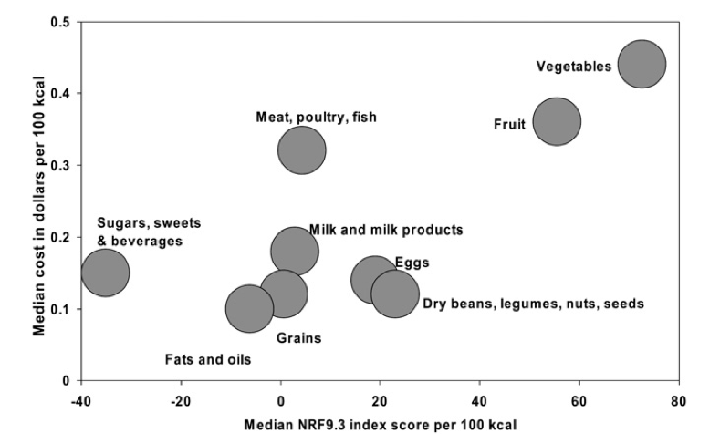

# 「最強の食品はどれだ？」選手権 #1 「なぜ現代人のほとんどが栄養不足なのか？そして、なぜマルチビタミンは駄目なのか？」

「**本当に健康的な食事をしたいなら****カロリーの質が重要だ！**」ってのは何度も書いていることです。世の中にはいろんな食事法があるけれど、もっとも重要なのは総カロリーのなかにどれぐらいの栄養素が詰まってるか？って観点なわけですね。

が、ここまでカロリーの質については、おおまかなガイドラインしか書いてなかったので、このシリーズでは、

- もっとも栄養面ですばらしい食品はなにか？

- 栄養価が高い食品をランキング化するとどうなるか？

- 栄養価が高い食品をいかに実生活で活かしていくか？

といったあたりを見ていきましょう。いわば「カロリーの質」って考え方の実践編ですね。

---

## **なぜ流行りの食事法を続けると栄養不足になるのか？**

で、上記の目標を達成するに当たり、まずは世の中で流行っている食事法の問題点を見ておきましょう。というのも、従来の健康食ってのは、特定の栄養素ばっかりに焦点を当ててるケースが多いし、栄養科学を単純化しすぎたりデータを完全に無視してるケースもあったりしますからね。にも関わらず、そういう食事法を続けていると普通に栄養不足が発生し、下手すりゃ慢性疾患のリスクが高まり、仕事のパフォーマンスもダダ下がりする可能性がめちゃあるんですよ。

具体的に、有名な食事法の欠点を見てみると、

- **菜食主義者やベジタリアン**：ビタミンA、ビタミンB3、ビタミンB9、ビタミンB12、カルシウム、クロム、銅、ヨウ素、鉄、マグネシウム、マンガン、亜鉛、オメガ3脂肪酸が不足しがち。
- **低炭水化物食**：ビタミンB2、ビタミンB5、ビタミンB6、ビタミンB9、ビタミンD、ビタミンE、ビオチン、コリン、カルシウム、クロム、ヨウ素、鉄、マグネシウム、モリブデン、カリウム、亜鉛、食物繊維が不足しがち。
- **低脂肪食**：ビタミンA、ビタミンD、ビタミンE、ビタミンK、カルシウム、オメガ3系脂肪が不足しがち。

- **カロリー制限**：ビタミンA、ビタミンB1、ビタミンB2、ビタミンB3、ビタミンC、ビタミンE、カルシウム、鉄、マグネシウム、カリウム、亜鉛が不足しがち。
- **グルテンフリー食**：ビタミンD、ビタミンB3、ビタミンB9、ビタミンB12、鉄、マグネシウム、カルシウム、亜鉛、食物繊維が不足しがち。
- **ケトジェニックダイエット**：ビタミンA、ビタミンB2、ビタミンB5、ビタミンB6、ビタミンB9、ビタミンE、ビタミンD、ビタミンK、ビオチン、コリン、カルシウム、クロム、コリン、ヨウ素、鉄、マグネシウム、モリブデン、カリウム、セレン、亜鉛、食物繊維が不足しがち。

- **各国政府の食生活ガイドライン**：ビタミンA、ビタミンD、ビタミンE、ビタミンK、カルシウム、ヨウ素、マグネシウム、カリウム、亜鉛、オメガ3脂肪酸が足りなくなる傾向がある。

といったあたりがあります。まぁここらへんの問題については、意識してカロリーの質を上げていけばリカバーは可能なものの、**ある程度の知識がないでそのままやってると栄養不足にハマりかねない**ってのは知っておきたいところです。

事実、現代では「カロリーは足りているけど栄養が足りない！」ってのは一般的な現象でして、ある研究者は、**先進国で暮らす人たち90％が少なくとも1つの重要な栄養素が足りていない**と推測してたりします(R)。日本人で言うと、多くの人はカルシウム、ビタミンAやB1、食物繊維などがすべての年代で推奨量を摂取できておらず、年代別にみてみると、

- 7～19歳は、B2、ナイアシン、B6、C、マグネシウム、鉄などが足りない。
- 成人、さらにビタミンE、カリウム、亜鉛なども足りない（男女とも30歳代が最も栄養素が不足しやすい）。

- 全世代は1日当たりのタンパク質が不足している。

みたいな傾向が出てたりします。このブロマガをお読みの方は健康意識が高いはずですけど、特殊なダイエットをしている場合には栄養不足の可能性が十分あるとお考えください。よしんば食事からの栄養が足りてるとしても、慢性的なストレスがある場合は、ビタミンC、マグネシウム、カルシウム、鉄、亜鉛、ビタミンB3などが足りなくなったりしますしね。

ちなみに、各国政府の食生活ガイドラインで栄養不足が起きるのを不思議に思った人もいそうですが、これはどの国も全粒穀物のメリットを強調しすぎるのが原因のひとつ。全粒穀物が悪いとは言わないものの、現代ではまだまだ全粒穀物をほめたたえすぎる傾向がありまして、そのぶんだけ重要な栄養素が足りなくなりがちなんですよ。

しかし、実際には最新のNRF指数（科学者が栄養価の高い食品を判断するために用いるスコア）を見てみると、全粒穀物は、肉、魚、卵、豆類、ナッツなどに比べて、100キロカロリーあたりの栄養素が少なく、野菜や果物に比べたらはるかに少ないことがわかっています([R](https://pubmed.ncbi.nlm.nih.gov/20368382/))。なにせ野菜や果物には、穀物に比べて最大10倍のビタミンやミネラルが含まれてますし、食物繊維も同程度で、糖分はほんのわずかしか含まれてないですからね。

ご存じのとおり、カロリーが高くても栄養素が少ない食品は「カロリーの質」の理念とは正反対。なので、穀物のように栄養価の低い食品を増やせば、それだけ栄養が足りないのにエネルギー過多になりやすいんですよ。これまた困った問題ですなぁ。

## **なぜマルチビタミンは無意味なのか？**

そうなると、「マルチビタミンで補えばいいのでは？」って気分になる人もいるかもですが、マルチビタミンに意味がないのは「パレオな男」でも何度か書いたとおりです。簡単にまとめておくと、

- 2013年に行われた重要なメタ分析([R](https://pubmed.ncbi.nlm.nih.gov/23255568/))によると、マルチビタミンは全死亡率には全く影響せず、心血管の病気に関する死亡率にも影響しない

- 2018年のメタ分析([R](https://www.ahajournals.org/doi/full/10.1161/CIRCOUTCOMES.117.004224))では、マルチビタミンとマルチミネラルのサプリメントは、冠動脈疾患や脳卒中などの心血管疾患の発生率に全く効果がない

みたいなのがあります。いずれもメタ分析としては割と精度が高めでして、どうにもおすすめできない状態なんですよ。

では、なぜマルチビタミンで健康状態が改善されないのかといいますと、

1. **マルチビタミンに含まれるビタミンやミネラルの吸収率が低い**：様々な状況下でのサプリの正確な生物学的利用能を測定する研究はまだ必要がらが、マルチビタミンの栄養素ってのはほとんど体の外に捨ててられてると可能性が高かったりします。
2. **栄養素のあいだでバッティングが起きている**：たとえば、亜鉛を大量に摂取すると鉄や銅の吸収が低下するし、ビタミンCは鉄の吸収を高め、フラボノイドはビタミンCの吸収率を高め、ビタミンDはカルシウム、リン、マグネシウムの吸収率を高め、ビタミンKやカロテノイドなどの脂溶性の栄養素と脂肪を同時に摂取すると吸収率が高まる。ビタミンやミネラルのサプリでこれらの影響を考慮しているものはほとんど存在しない。
3. **マルチビタミンの錠剤は腸内で溶けづらい**：ある研究では、マルチビタミンが腸内で溶けるのに4〜6時間かかるとも考えられてまして、これはあまりにも長すぎるんですよ。マルチビタミンの栄養素を効率的に吸収するためには、20〜30分以内に錠剤を完全に溶かして、小腸で体内にビタミンやミネラルが運ばれる必要があるもんで。

ってあたりが大きな原因だと思われます。事実、2019年に行われた研究(では、食品から摂取した栄養素とサプリメントから摂取した栄養素を比べると、

- 十分な量のビタミンA、ビタミンK、マグネシウム、亜鉛、銅を食品から摂取すると、全死亡率と心血管疾患に関連する死亡率が低下する。ただし、サプリメントから同じ量を摂取しても意味がない
- また、食品ではなくサプリメントでカルシウムを摂取すると、がんによる死亡率が増加。シュウ酸カルシウムの腎臓結石リスクも上がった

といった報告もありまして、これまた困った問題であります。さらに別の問題点をあげると、

- 多くのマルチビタミンには400IUから1,000IUのビタミンDが含まれているが、この量ではほとんどのビタミンD不足を補うことはできない（通常、医師はビタミンD3が不足している場合、1日に2,000IUから5,000IUのビタミンD3の摂取を勧める）

- マルチビタミンのサプリは、一般的に必須ビタミン・ミネラルに特化しており、食物繊維などのプレバイオティクス、重要な非タンパク性アミノ酸やペプチド、オメガ3脂肪酸、植物性栄養素などは含まれていない

なんてのもありまして、やっぱサプリではどうにもならんよなーってのが結論になっちゃうんですよね。

## **次回予告**

ってことで、前置きは終了。次回は、「**それじゃあ本当に栄養が高い食材とはなんなのか？**」っていう具体論に進んでいきましょうー。ではまた！
