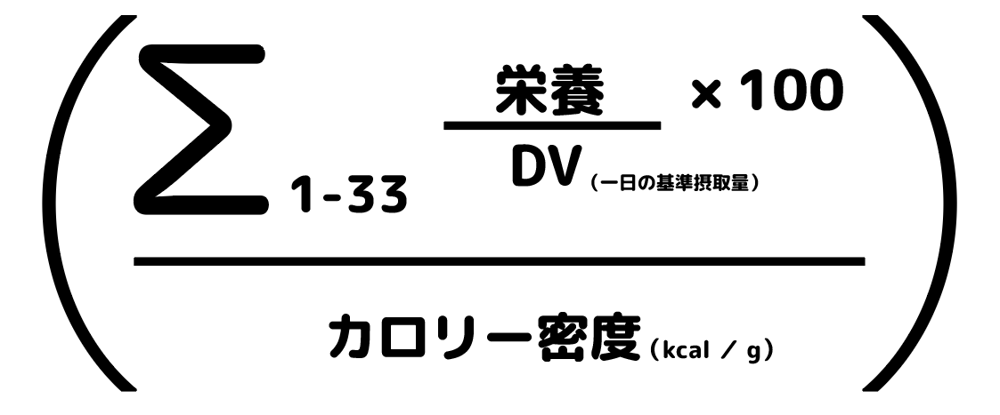

# 「最強の食品はどれだ？」選手権 #2 「栄養価が高い食品のトップ100」

「**最強の食品はどれだ？**」選手権の続きです！([#1](https://daigovideolab.jp/blog/2068888)) 「カロリーの質が大事だ！」ってのは昔から言ってることですが、このシリーズでは、

- じゃあ結局のところカロリーの質が高い食品ってなんなのか？

- カロリーの質が高い生活をどう実践するか？

ってのをまとめていく内容になります。ブログのほうでは「葉物野菜はカロリーの質が高いよー」みたいにざっくりしたことしか言ってないので、さらに具体的な食品を煮詰めていったほうが役に立つでしょう。

---

## **カロリーの質はどう計算すべきか？**

まず前提として 「カロリーの質ってどう判断すればいいの？」ってのを見ておきましょう。ブログのほうでは「総カロリーあたりの栄養が多い食品はカロリーの質が高いよ」という解像度の低めな説明をしてますけど、もうちょいくわしく判断の基準を押さえておいたほうがいいですからね。

で、**実はこの問題についてはまだ完璧な基準があるわけじゃなくて**、科学者たちは約50年ぐらい前からカロリーの質を定量化するための方法を模索し続けてるんですよ。そもそもカロリー質って概念は1970年代に生まれたものなんですが、「じゃあどれがカロリーの質が高い食品なのさ？」って問題を判断する正式な基準についてはずっと議論が続いてるんですな。

それでは、現時点でどのような判断基準があるのかと言いますと、

- Nutrient for Calorie (NFC)
- Calorie for Nutrient (CFN)
- Nutritious Food Index (NFI)
- Naturally Nutrient Rich (NNR)

などがあります（別に覚えなくてもいいです）。これらのスコアはどれも食品のカロリーあたりの栄養の量を数値化してるんですけど、それぞれに大きな問題を抱えてまして、

- 過去の指標は、ビタミンやミネラルなどの重要な栄養素ではなく、脂肪や糖分を問題視する傾向が強かった（そのせいで、ナッツ、オリーブ、アボカドなどの脂肪が多い食品が「不健康」だと判断されやすかった）

- それぞれの指標によって「どの栄養をふくむか？」がバラバラで、食物繊維がふくまれてなかったり、ビタミンB7やKが入ってなかったり、亜鉛やマグネシウムが入ってなかったりする。判断基準によってふくまれる栄養素の数が5〜23種類にわかれていて、かなりバラバラ

みたいになってるんですよ。栄養の定義があいまいだったり、栄養成分のデータが不完全だったり、特定の栄養素の比重が偏ってたりして、どうにも判断が難しい状況だったんですよね。

## **カロリーの質スコアがベストな理由**

ってことで、ここ数年で「**これがベストじゃないの？**」と言われるようになったのが、「**カロリーの質スコア**」(Quality Calorie Score)ってやつです。これはハーバード大学などが使われるスコア([R](https://www.hsph.harvard.edu/nutritionsource/healthy-weight/best-diet-quality-counts/))で、食品のカロリーあたりに含まれる栄養素の総量を、1日あたりの必要量（DV）と比べて数値化したものです。

現時点でもっとも偏りが少ない判断法だと言われてまして、以下のような感じで算出します（こちらも別に覚えなくていいですが）。

ここで使われる食品のデータはアメリカのFood Central Database([R](https://fdc.nal.usda.gov))を使い、ここに掲載されていないデータについては、できるだけ科学論文やPhenol Explorerなどのデータベースから取得。複数の論文で栄養素の量が報告されている場合は、入手可能なすべてのデータの平均値から1標準偏差以上離れていない最も高い値を採用しております。

さらに「**カロリーの質スコア**」は、数ある指標のなかでも数多くの栄養素を判断の材料にしてまして、以下の33種類を採用しております。

1. タンパク質
2. 食物繊維
3. カルシウム
4. 銅
5. 鉄
6. マグネシウム
7. マンガン
8. リン
9. カリウム
10. セレン
11. 亜鉛
12. ビタミン A
13. ビタミンB1
14. ビタミンB2
15. ビタミンB3
16. ビタミンB5
17. ビタミンB6
18. ビタミンB7
19. ビタミンB9
20. ビタミンB12
21. ビタミンC
22. ビタミンE
23. ビタミンD
24. ビタミンK
25. コリン
26. 一価不飽和脂肪
27. リノール酸
28. ALA
29. EPA
30. DHA
31. カロテノイド
32. 植物ステロール
33. ポリフェノール

ここまで幅広い栄養素を取り込んでる判断基準はほかになく、その点でも非常に信頼がおける基準と言えるんじゃないでしょうか。

## **栄養価が高い食品のトップ100**

では、「**カロリーの質スコア**」で上位にランキングした食品のトップ100を見てみましょう。ざっくりした判断基準としては、

- スコアが2000より上の食品は、栄養価がめちゃくちゃ高いスーパーフードと判断してOK！

- スコアが500から2000の間の食品は、高栄養食品と判断してOK！

- スコアが100から499の間の食品は中程度の栄養食品と判断

- スコアが100未満の食品は栄養レベルが激低なので食べなくてもOK（食べちゃいけないってわけじゃないので注意）

みたいになります。この基準をふまえたうえで、**栄養価が高い食品のトップ100**は以下のようになります。

1. クレソン 9481
2. カラシナ 8819
3. コーヒー 7683
4. カラードグリーン 6329
5. スイスチャード 5841
6. パセリ 5127
7. 羊のレバー 4793
8. チンゲンサイ 4729
9. シイタケ 4198
10. ケール 4162
11. 牛のレバー 4032
12. ルッコラ 3855
13. ほうれん草 3760
14. ブロッコリー 3647
15. 紅茶（ブラック） 3584
16. マイタケ 3570
17. 羊の腎臓 3429
18. ラディッシュ 3416
19. バジル 3112
20. 緑茶 2987
21. ブラウンマッシュルーム 2836
22. ホワイトマッシュルーム 2496
23. 豚のレバー 2475
24. ヒラタケ 2460
25. 芽キャベツ 2454
26. コリアンダー 2411
27. 牛の腎臓 2399
28. ポルトベロマッシュルーム 2382
29. エンダイブ 2375
30. 鶏レバー 2361
31. サニーレタス 2333
32. キャベツ 2307
33. 赤キャベツ 2271
34. カユミの花 2213
35. 牡蠣 2142
36. コールラビ 2011
37. ザワークラウト 1968
38. ルタバガ 1959
39. チャイブ 1923
40. レタス 1869
41. サラダ菜 1743
42. ロメインレタス 1733
43. チコリー 1719
44. カブ 1706
45. ルバーブ 1639
46. エンドウ豆 1401
47. 鶏モツ 1398
48. シナモン 1337
49. サバ 1330
50. 豚の腎臓 1330
51. ムール貝 1323
52. 赤ピーマン 1260
53. サツマイモの葉 1191
54. 牛の心臓 1156
55. 春タマネギ 1137
56. 子羊の心臓 1074
57. ココア（無糖） 1049
58. 緑ピーマン 1048
59. アスパラガス 1020
60. ニシン 1002
61. カニ 973
62. 二枚貝 926
63. マグロ 919
64. アーティチョーク 898
65. 梨 888
66. タケノコ 860
67. 夏かぼちゃ 834
68. わかめ 813
69. イカ 812
70. サーモン 811
71. もやし 803
72. アルファルファ 774
73. カボチャ 741
74. 鶏ハツ 735
75. セロリ 726
76. アイスバーグレタス 717
77. ライチ 713
78. ブラジリアンナッツ 706
79. トマト 701
80. ブラックベリー 700
81. ターメリック 687
82. 鱒 684
83. イチゴ 677
84. ジンジャー 665
85. イワシ（オイル缶詰） 660
86. トマティーヨ 652
87. ケルプ 620
88. グリーンビーンズ 601
89. ニンジン 599
90. 豚の心臓 595
91. フェンネル 569
92. ガーリック 568
93. カツオ 537
94. バターナッツ 520
95. サツマイモ 506
96. キウイ・ゴールデン 486
97. オヒョウ 478
98. エビ 470
99. オレンジ 464
100. レンティル 464

ってことで、全体的に見ればアブラナ科の野菜、葉物野菜、マッシュルーム、フレッシュハーブが最もカロリーに見合った栄養を提供し、次に果物、豆類、香辛料、種子、そしてナッツ類が続く感じすね。逆に穀物は植物の中で最もカロリーの質が低くナッツや種子に次ぐぐらいの位置なわけです。もちろんこのリストが完璧だとは言いませんが、「**カロリーの質が高い食事**」を送るためにはめちゃくちゃ役に立つんじゃないでしょうか。

## **次回予告**

ってことで今回は「栄養価が高い食品のトップ100」を見てみました。次回もその続きで、「カロリーの質が高い食品を使って、十分な栄養素を摂取するためどう食べればいいか？」を考えてみましょう。ではまた！
