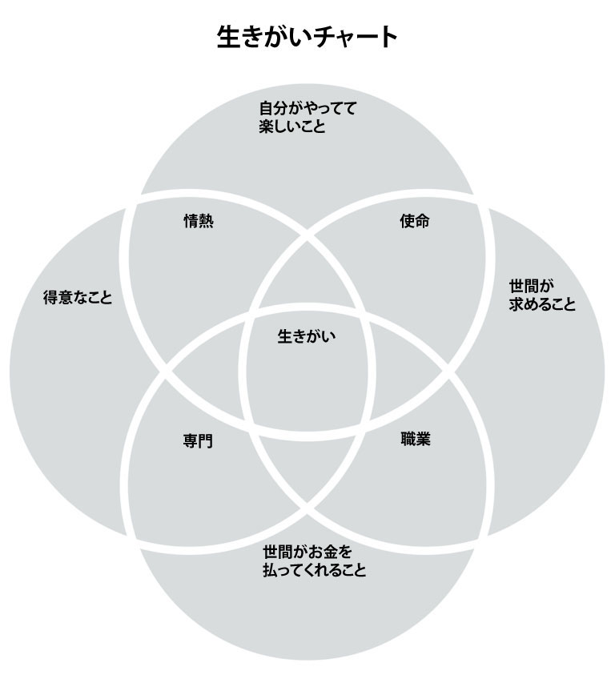

# 人生をより有意義にしまくる「生きがいチャート」で自分の価値観をガッツリ掘り下げよう

「[最高の体調オンラインプログラム](https://www.bestcondition.jp)」で取り上げた「**イキガイ法**」が評判良かったんで、大量の補足をつけたうえで増補改訂版としてこちらでも紹介することにしました。

---

これは、名前のとおり日本語の「生きがい」をもとにした手法で、「[最高の体調](https://amzn.to/3IAVpOE)」でおなじみの自分なりの価値を掘り下げる手法として開発され、近ごろは欧米の心理療法などでも取り上げられているテクニックです。そもそも日本の文化がベースになった方法なので、欧米生まれのテクニックより使いやすいんじゃないでしょうか。

欧米で「生きがい」が注目されはじめた理由は簡単で、ここ十数年に行われた多くの研究により「生きがい」のメリットが何度も確認されてきたからです。いくつか事例をあげると、生きがいをたくさん持った人ほど、

- メンタルが強く、心理的肉体的なストレスが大きい状況でも不安になりにくい（[R](https://psycnet.apa.org/record/2013-13984-005)）
- 免疫機能が改善し寿命も延びるケースが多い（[R](https://www.scirp.org/%28S%28351jmbntvnsjt1aadkposzje%29%29/reference/referencespapers.aspx?referenceid=255558)）
- 逆境から立ち直るレジリエンスの能力が高い（[R](https://www.scirp.org/%28S%28i43dyn45teexjx455qlt3d2q%29%29/reference/ReferencesPapers.aspx?ReferenceID=408696)）
- フロー体験を味わいやすく、幸福度も高い（[R](https://keio.pure.elsevier.com/en/publications/relationships-between-flow-experience-ikigai-and-sense-of-coheren)）

といった広い効果が確認されているんですよ。ちなみに、これらの研究で「生きがい」をどのように定義しているのかと言いますと、以下の要素が組み合わさったものだと考えられています（[R](https://amzn.to/3tSZfOV)）。

- 情熱＝自分が楽しめること
- 使命＝世界が必要としていること
- 天職＝自分が苦にならずできる得意なこと
- 職業＝世間からお金をもらえること

この４つのポイントが重なったところに、人間の「生きがい」が生まれるんだとされているわけですね。それでは、自分なりの「生きがい」を見つけるにはどうすればいいのか？ってことで、具体的な方法を見てみましょう。

### **ステップ1：「生きがい」の意味を理解する**

日本の文化では、人生をより有意義なものにするには、自分の「生きがい」を見つけることが大事だと考えられているのはご存じのとおり。**欧米では「生きがい」を「存在する理由」と訳しまし**て、これがあることで逆境や困難、苦しみに直面しても生きる理由になるんですな。

自分の「生きがい」を見つけるためには、

- 自分が楽しめること
- 世の中が必要としていること
- 自分がお金をもらえること
- 自分が得意なこと

の４つを明確にする必要があり、これらの要素が交わったところに「生きがい」が発生すると考えられております。また、「生きがい」はいろんなところから探すことができまして、人間関係、仕事、宗教、趣味など、あらゆる対象から意味を見出すことができたりします。

### **ステップ2：「生きがいチャート」に記入する**

生きがいの意味がわかったところでステップ２．「イキガイ法」は、下の「生きがいチャート」に記入する形で進めていきます。

ここから、あなたの「生きがい」に関する質問を並べていきますので、それぞれの質問について数分ほど考えてみて、思いついた言葉やフレーズ、アイデアを「生きがいチャート」の該当欄に書き込んでください。この4つの質問に関するあなたの答えが重なったところが、あなたの「生きがい」だと判断できます。それでは、それぞれのサークルの質問を見ていきましょう。

**サークル 1. 「自分が愛してやまないことはなんですか？」**
「自分がやってて楽しいこと」のサークルには、あなたが心から楽しめるものごとを書き込みます。あなたが純粋に楽しいと感じるものは何でしょうか？ 仕事、家族、ボランティア、趣味など、人生のあらゆる場面で自分の好きなことを思い浮かべてみてください。科学、ガーデニング、旅行など、どんなものでも構わないので、思いついた答えを、生きがいチャートの「自分の好きなこと」欄に記入しましょう。

いまいち答えが思いつかないときは、以下の質問の答えを考えてみてください。

- 飽きのこないものは何だろうか？
- あなたを笑顔にするものといえば？
- 一番幸せを感じるのはいつ？
- あなたが最も大切にしている5つのことは？
- 時間を忘れてやってしまうことは？
- 元気をもらったなーと思えることは？
- あなたが一緒に過ごすのが好きな人は？
- 子供の頃、何をするのが好きでしたか？
- もし経済的に安定していたら、自分の時間を何に使いますか？
- 飽きのこない活動、人、場所はありますか？
- 時間を忘れてしまうような活動はありますか？
- あなたの人生のどのような側面が、あなたを生き生きとしたエネルギーに満ちたものにしますか？
- 情熱を感じるのは何ですか？
- あなたの価値観はどのようなもので、それを毎日どのように使っていますか？
- あなたはなにに美しさを感じますか？
- 何かひとつのことで一番になれるとしたら、それは何ですか？
- 思わず話題にしたくなるようなことは何ですか？
- お金がもらえなくてもやり続けられることは何ですか？
- お金を稼ぐことを心配しなくてもいいとしたら、あなたは自分の時間を使って何をしますか？
- 「完璧な週末」があったとしたら、どのようなものですか？
- 何時間でも話し続けられそうなことは？

**サークル2. 「世界から必要とされているものは何ですか？」**
人間は社会的な動物なので、「私は他の誰に必要とされているのか？」を理解できると、自分はの世の中の役に立っている、価値がある、目的を持っていると感じられたりします。

そこで、このサークルでは「世界から必要とされているものは何ですか？」という質問について考え、「あなたが世界に何を与えることができるか？」を探してみてください。話が大きすぎて何も思いつかないかもしれませんが、その場合は視点を一歩引いて、自分の友人や家族、身近なコミュニティから何かを必要された経験を考えてみるといいでしょう。

ここで書き込むものは、具体的な製品やサービス、あるいは個人を助けるという単純なものなど、何でも構いません。思いついた答えを、生きがいチャートの「世界が求めること」欄に記入してください。

いまいち答えが思いつかないときは、以下の質問の答えを考えてみてください。

- あなたの身近な人々は何を必要としていますか？
- あなたが変えたいと思っているシステムはありますか？
- あなたは、どのようにして周囲の人々に貢献できますか？
- あなたが持っているスキルのうち、需要の高いものを3つ考えてみてください
- あなたは世界にどのような変化をもたらしたいですか？
- あなたができること、提供できるものは何ですか？それは他の人に意味をもたらすものですか？
- 大勢の人にメッセージを伝えることができるとしたら、あなたはどんなメッセージを伝えたいですか？
- あなたはどのように人を助けますか？
- あなたは人に何を教えることができますか？
- あなたは人生においてどのような貢献をしたいですか？
- 社会のどのような問題を解決したいと思いますか？
- あなたのコミュニティや世界全体のどのような問題が、あなたの感情を揺さぶりますか？
- あなたの仕事は10年後にも通用するだろうか？
- 世界に欠けていると思うものは何ですか？
- あなたはどのようにして地域社会にもっと参加できますか？

**サークル3.「何に対してお金がもらえるの？」**
いかに世間から求められることをしようが、そこにお金が発生しなければ長く続けることはできません。お金がないと日々の暮らしの基盤ができませんからね。

そこで、この質問では、自分の過去の職歴を振り返って以下の質問に答えてみてください。

- いまの仕事で何が得意だったのか？
- 前職では何が得意だったか？
- アルバイトや仕事でほめられたことはないか？
- 特に仕事で得意なことはなんだったろうか？

あなたが持っているスキルの中で、お金が発生しそうなあなたのスキルや能力を考えてみてください。答えを思いついたら、あなたの生きがいチャートの「世間がお金を払ってくれること」の欄に記入しましょう。

いまいち答えが思いつかないときは、以下の質問の答えを考えてみてください。

- これまでに何に対してお金をもらったことがありますか？
- 今の仕事をしていなかったら、何をしていましたか？
- 人々が必要としていて、喜んでお金を払うものはなんですか？
- その仕事をすることで、今の自分が必要な収入を得ることができますか？
- その仕事で長期的に良い生活ができますか？
- あなたが提供するものに人々は喜んでお金を払いますか？
- あなたの競合はどのようなものですか？ニッチな分野を見つけられるか？
- どのような仕事、ポジション、またはタスクに興味がありますか？
- あなたはその仕事ですでに十分な生活をしていますか？

**サークル4. 「あなたの得意なことは何ですか？」**
最後に自分自身を評価し、あなたが何を得意としているかを特定してみましょう。自分のスキルや強み、自分が得意とするすべてのことについて、時間をかけて考えてみてください。お金が発生するかどうかは考えず、とにかく自分の得意とするものをピックアップします。

答えを思いついたら、あなたの生きがいチャートの「得意なこと」の欄に記入してください。いまいち答えが思いつかないときは、以下の質問の答えを考えてみてください。

- どんなスキルの練習に時間を費やしていますか？
- 人から助けを求められることは？
- 賞を取ったことはありますか？
- 履歴書にはどんなことを書いていますか？
- 得意になりたいことはありますか？
- これまでに100時間以上の練習や学習をしたことがあるのはどんな活動ですか？
- もし何かを教えなければならないとしたら、あなたは何を教えますか？
- あなたにとって自然なスキルや才能は何ですか？
- あなたが努力していないときでも得意なことは何ですか？
- あなたが自分自身について良いと感じるのは何ですか？
- 他の人はあなたのどんなところを褒めますか？
- あなたが誇りに思っている成果は何ですか？
- この分野のスキルをさらに伸ばすことにワクワクしますか？
- 現在の仕事のどの部分が簡単に思い浮かびますか？
- あなたの社会的サークル、職場、またはコミュニティでは、どのような活動をするときに他人よりも優れていますか？

### **ステップ3： 重複する回答を見つける**

このステップでは、さきほど書き込んだ「生きがいチャート」を見て、重なり合った回答がないかを考えてください。

たとえば、あなたが「自分の楽しめること」に「教えることが好き」と書き込み、同時に「世界が求めること」に「知識を伝えたら喜ばれた」と書き込んだなら、両者は重なり合っていると判断できるでしょう。このように、4つの円の中で、それぞれの答えが類似している点を探してください。

そして、2つ以上の円に当てはまる答えが見つかったら、「使命」「職業」「専門」「情熱」という円が重なったエリアに回答を移動させてください。たとえば、「自分の好きなこと」と「世界が求めること」の2つに当てはまる回答があった場合、その回答を「使命」のエリアに記入します。ここまでの作業を何度もくり返し、もし4つの円すべてに当てはまる回答があったら、「生きがいチャート」の中央に記入しましょう。ここに書き込んだ回答こそが、あなたがより充実した意味のある人生を送るための鍵になります。

ちなみに、「生きがいチャート」では、それぞれの円が重なったエリアを、「使命」「職業」「専門」「情熱」の４つに分類していますが、この重複エリアは、より詳しくは以下のような意味になります。

**1. 自分の情熱＝自分が楽しめること＋得意なこと**
「楽しめること」と「得意なこと」に重なりがあれば、あなたは「情熱」を持っていることになります。この2つのカテゴリーに当てはまる活動は、

- 満足感を得られるかもしれないが、世の中に貢献できていないと感じられてしまう
- 情熱を持って取り組むが、金銭的な報酬が得られないので長期的に持続できない

という傾向があります。

**2.自分の使命＝自分が楽しめること＋世界が必要としていること**

「自分が楽しめること」の中に「世界が必要としていること」にも該当する項目があれば、あなたは「自分の使命」を見つけたことになります。この2つのカテゴリーに当てはまる活動は、

- 喜びと充実感を感じることができるが、収入や経済的な安定性がない

という傾向があります。

**3.自分の職業＝自分がお金をもらえること＋世の中が必要としていること**
「自分がお金になること」の中に「世界が必要としていること」の中にも含まれている項目があれば、あなたは「自分の職業」を見つけたことになります。この2つのカテゴリーに当てはまる活動は、

- 世の中に良い影響を与えられて収入も得られるが、自分のやっていることに愛着が生まれないと空虚で満たされない気持ちになりやすい

という傾向があります。

**4.自分の専門＝自分が得意なこと＋自分がお金をもらえること**
「得意なこと」の中に「お金になること」が含まれていれば、あなたは「自分の専門」を見つけたことになります。この2つのカテゴリーに当てはまる活動は、

- 達成感は得られやすいが、世の中に必要とされていないと感じて自分の仕事や努力がつまらないものに感じられる

という傾向があります。

### **ステップ4： 生きがいが見つからない問題を考える**

で、「イキガイ法」を試してみると、多くの人は「生きがいが見つからなかった！」って問題んいつき上がるはず。ところどころに円が重なるものは見つかったけど、**４つの円をすべて満たすようなものが出てこない**ケースですね。

この場合は、当然ながら、「自分の「生きがい」に欠けている部分を埋めるにはどうしたらいいか？」を考える必要が出てきます。具体的には、ステップ２で自分が挙げた回答をじっくり見つつ、２〜３つの円に当てはまる活動をすべてピックアップし、以下のように考えを進めてください。

**1. 「自分が楽しいこと」が足りない場合**
その活動が「楽しいこと」を満たしていないときは、以下の質問について考えてみましょう。

- この活動のどの部分が嫌いなのだろう？ その理由はなんだろうか？
- この活動をもっと楽しくする方法はないだろうか？ 例えば、誰かと一緒に行ったり、他の人に任せたりして対処できないだろうか？
- この活動の良い点を3つ挙げるとしたらどうなるだろうか？
- この活動で少しでも楽しいと感じられるところはないだろうか？ その楽しさを拡大できないだろうか？
- この活動のどのような側面に興味が持てるだろうか？ もっと知りたいと思えような分野はあるだろうか？
- この活動はどのような点であなたにメリットがあるだろうか？
- この活動は、あなたが人として成長し、発展するのにどのように役立つだろうか？
- この活動をすることで、あなたはどのようなスキルを身につけるだろうか？

**2. 「自分の得意なこと」が足りない場合**
その活動が「得意なこと」を満たしていないときは、以下の質問について考えてみましょう。

- 自分がこの活動に向いていないと思うのはなぜだろうか？
- 自分の設定した基準が高すぎる可能性はないだろうか？
- この活動には、どのようなスキルが最も役に立つだろうか？
- この活動に必要なスキルを私は持っているだろうか？ もし持っているなら、そのスキルをさらに向上させるために何ができるだろうか？ もし持っていないなら、そのスキルを学ぶためにどのような行動をとれるだろうか？
- この活動が得意な人たちは、どのようなスキルや強みを持っているだろうか？ 私は、これらのスキルのうちどれを持っていますか？
- この活動について、良いメンターになってくれる人はいないだろうか？

**3. 「世間がお金を払ってくれること」が足りない場合**
その活動が「お金を払ってくれること」を満たしていないときは、以下の質問について考えてみましょう。

- この活動でお金をもらうことは、私にとって重要だろうか？
- いまこの活動でお金をもらっていない主な理由は何だろうか？ 収入を得るために、どのようにしてこれらの障害に取り組めるだろうか？
- 私はこの活動に十分なスキルを持っているだろうか？ もしそうでなければ、人々が私にお金を払いたいと思うようになるために、どのようにパフォーマンスを向上させることができるだろうか？
- 他の人たちは、この活動や関連する活動でどのようにお金を稼いでいるだろうか？
- 似たような活動で収入が得られるものはないだろうか？
- 現在の仕事と並行して、どのような方法でこの活動から収入を得ることができるだろうか？ （たとえば、芸術作品を作るのが好きな人は、オンラインショップを開くとか）
- あなたが楽しめることから利益を得られる方法を3つ考えたらどうなるだろうか？

**4. 「世間が求めること」が足りない場合**
その活動が「世間の求めること」を満たしていないときは、以下の質問について考えてみましょう。

- 私の活動やテーマが、他の人にとって価値のあるものにする方法はあるだろうか？
- 私の活動やテーマを、世界に貢献できるような方法で適用することはできるだろうか？
- 私の身近な人々（友人、家族、仲間）は何を必要としているだろうか？ この活動を使って、どのように彼らのニーズに応えられるだろうか？
- この活動を他の人と共有するために、どのような方法があるだろうか？ たとえば、この活動について定期的にブログを書いてみるなど、なんでもとらわれずに考えてみる
- この活動は、あなたの周りの人やオンラインで教えることができるだろうか？
- この活動で、あなたの周りの人々に貢献するにはどうすればいいだろうか？

というわけで、もし生きがいが見つからなかったら、以上の質問を駆使してあなたなりの答えを探していただければと思います。ではまた！
