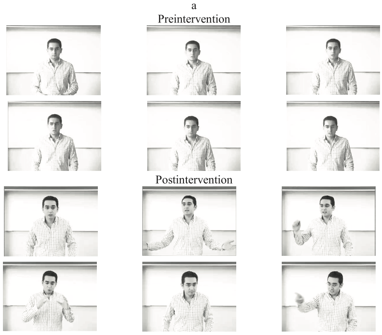

# 「カリスマ性は鍛えられるのだ！」ってことで12のポイントを見てみましょう

「**カリスマ性は鍛えられるのだ！**」ってデータが非常に有用だったので、ブロマガに要点をまとめておきましょう。

---

これはローザンヌ大学ビジネス経済学部のジョン・アントナキス先生などの調査([R](https://journals.aom.org/doi/10.5465/amle.2010.0012),[R](https://amzn.to/3g0DxjU))で、研究チームはこんなことを言っておられます。

> カリスマ性は生まれつきのものではなく**習得可能なスキル**であり、むしろ古代から実践されてきた一連のスキルでもある。私たちが開発した「カリスマ的リーダーシップ戦術」（CLT）と呼ぶトレーニングを受けた人は、他人の目から見て、より影響力があり、信頼感があり、「リーダーらしい」人になることができた。

とのこと。この研究は、40人のマネージャーと約90人のMBA学生に、「カリスマ的リーダーシップ戦術（CLT）」を教えた場合の効果を検証したもので、みんなにトレーニングを受けてもらった後で、

- マネージャーは、従業員を鼓舞するスピーチを行ってもらう
- MBA学生は、116人の聴衆がいる教室で政治的なスピーチを行ってもらう

ってテストを行ったんだそうな。その後、すべての聴衆に、スピーカーへの信頼度、能力、好感度などを尋ねたところ、

- CLTを使った学生やマネージャーは、**以前のスピーチに比べて評価が60％もアップした**

って結果だったと言うんですよ。こりゃあなかなかの改善率じゃないでしょうか。

ちなみに研究チームは、「カリスマ」を以下のように定義しております。

> カリスマ性とは、価値観や感情に根ざしたものであり、アリストテレスが「ロゴス」「エトス」「パトス」と呼ぶものに近い。つまり、人を説得するためには、力強く理にかなったレトリックを使い、個人的・道徳的な信頼性を確立し、そしてフォロワーの感情や情熱を喚起しなければならない。
>
> この3つがうまくできれば、フォロワーの希望や理想を引き出し、目的意識を持たせ、大きなことを成し遂げることができる。

とのこと。論理性、信頼性、情熱があわさったときにカリスマ性が生まれるんだ、と。言うまでもなく、「人を動かす」スキルってのは、企業のリーダーをやってる人だけでなく誰にとっても役立つものなので、トレーニングで改善できるならすばらしいことですな。

で、研究チームは、カリスマ性の改善に欠かせない要素を12個にまとめてまして、具体的にはこんな感じです。

## **カリスマ性アップに欠かせない12の要素**

### **1. メタファー**

「競合他社を屈服させた」「軌道修正しなければならない」といった比喩には、リスナーがこちらのメッセージを理解し、共感し、記憶するのを助けてくれる働きがあったりします。

たとえばマーティン・ルーサー・キング・ジュニアは比喩の達人で、「私には夢がある」という超有名な演説の中では、アメリカの憲法を「すべての人に生命、自由、幸福の追求という不可侵の権利を保証する約束手形だ」とたとえ、アメリカは黒人に「資金不足」と書かれた「不良債権」を渡していたと指摘。ダメな小切手をわたされるのがヤバいことは誰でもすぐ理解できるので、このメッセージは明確で、心に残りやすくなっているわけですな。

メタファーは、仕事上のあらゆる場面で効果を発揮し、あるマネージャーは「役員会からこのプロジェクトを聞いたとき、私は最愛の妻が子供を授かったかのように感じた。しかし大きく違うのは、準備期間が9カ月ではなく4カ月ということだ」と紹介。「このプロジェクトはすばらしいが締切がすごい」ってポイントを、すぐに部下たちに理解させたそうな。

### **2. ストーリー**

ストーリーやエピソードは、メッセージをより魅力的にし、**聞き手と話し手がつながったような感覚**をもたらす。たとえば、ビル・ゲイツがハーバード大学で行ったスピーチでは、

> 私の母は......人のためにもっと何かをしなければならないと私に訴え続けました。私の結婚式の数日前には、母が主催するブライダルイベントがあり、メリンダに宛てた結婚に関する手紙を朗読してくれました。当時、母は癌という重い病気を患っていましたが、母はもう一度自分のメッセージを伝える機会があると考え、手紙の最後に「多くを与えられた人からは、多くが期待される」と書いていました。

みたいなエピソードで聞き手の共感を誘い、名スピーチとして語り継がれているそうな。

ちなみに、研究チームが収集した事例では、あるマネージャーが厳しいプロジェクトに立ち向かう際に、

> この話を聞いていると、数年前にチームでアイガー山に登ったときに直面した困難を思い出します。悪天候に見舞われ、死んでもおかしくない状況でした。でも、みんなで協力してなんとか生き延びました。そして、最初は不可能と思われたことを可能にしたのです。今日、私たちは経済的な嵐の中にいますが、みんなで力を合わせれば、この状況を好転させ、成功させることができるのです。

ってエピソードトークで部下のやる気を高めたケースが紹介されておりました。アメリカっぽいぜ……。

### **3.コントラスト**

なんらかの対比を行うことで自分の立場を明確にする手法で、劇的な効果をもたらすことがある。一番有名なのはケネディの演説で、

> 米国民の同胞の皆さん、あなたの国があなたのために何ができるかを問わないでほしい。 あなたがあなたの国のために何ができるかを問うてほしい。

ってのは対比の定番中の定番と申せましょう。博士いわく「**対比は最も簡単に使える戦術の一つだ**」ってことなんで、まずはコントラストを日常的な会話に取り入れてみるのがスタートとしては良さそうですね。

ちなみに、研究チームが収集した事例では、あるマネージャーが直属の部下に話しかける際に、

> あなたは、もっと攻撃的になるべきなのに、守備を固めすぎているように思います。私がメディカル部門のリーダーをお願いしたのは、タイミングが最高だったからではありません。あなたが顧客の命を救う手助けができると信じているからです。

みたいな語り方をすることで、メンバーのやる気を高めたそうな。これもアメリカっぽいぜ……。

### **4.レトリカル・クエスチョン**

レトリカル・クエスチョンは「差別に賛成する人などいるだろうか？」みたいに、相手からの答えを要求しない質問のことです。反語ってやつですね。

連発するとかなり陳腐な印象になっちゃうんで注意が必要ですけど、カリスマ性のあるリーダーはレトリカル・クエスチョンを使い倒す傾向があるんだそうな。研究チームが収集した事例では、あるマネージャーが失敗した部下に使ったフレーズが紹介されておりました。

> で、君はこれからどうしたいの？ 会社に戻って反省し続けるの？ それとも自分の能力を発揮したいの？

当然、反省し続けたい人などいないはずなので、**これを言われた部下は反射的に「能力を発揮したい」という答えが脳内にわき上がり、そのおかげでモチベーション出る**わけっすね。「会社で反省」と「能力を発揮」って２つの対比にもなってますね。

### **5. 3パートリスト**

「収益を黒字化するために必要なことが3つあります」みたいに、要点を３つにしぼって伝える手法。こりゃド定番ですな。

研究チームが収集した事例では、ある中間管理職の女性が会議で使ったフレーズが挙げられてまして、

> 私たちは市場で最高の製品を作り、最高のチームを持っているのに、販売目標を達成できなかった。しかし、3つのポイントを押さえれば、この状況を好転させることができます。まず、何が正しかったのかを振り返ること。次にどこが間違っていたのかを確認すること。そして最後に取締役会を納得させる計画を立てることです。

ってな感じです。**3部構成ってのは人間の脳にめちゃくちゃ優しい**ので、受け手も飲み込みやすくなるわけっすね。

### **6. 道徳的な信念の表現**

私たちがやってることは道徳的に正しいのだ！と主張するパターン。研究チームはチャーチルが第二次大戦で行ったスピーチの例をあげてまして、

> これはイギリス国家全体の勝利だ。我々は、この古代より続く島で、暴君に対して初めて剣を抜いた。灯りが消え、爆弾が落ちてきても、この国のすべての男性、女性、子供は、闘争をやめなかった。

って感じで自国側のモラルをアピールして国民から絶賛されたそうな。確かに戦時下では効果バツグンでしょうな。

また、もうひとつの事例としては、あるマネージャーが従業員に伝えた言葉も紹介されてまして、

> いまの物流の混乱の代償を誰が払うと思いますか？ その大小を払うのは、私たちが養うべき子どもたちです。この事態が続けば、子供たちは空腹のままベッドに入り、夜を越せないかもしれません。お金だけの問題でなく、こんなことは間違っているのです。

って感じになってました。ネットでも道徳的な信念を訴えるメッセージは拡散されやすい傾向がありまして、やはり人間はモラルに敏感な生き物なんでしょうな。

### **7.グループの感情を言い換える**

あなたが語りかけるグループが抱いているだろう感情を、自分の言葉で伝え直してやる手法です。研究チームが収集した事例では、あるシニアディレクターが、プロジェクトの失敗で落ち込むグループに向かってこう言ったそうな。

> 皆さんの心中は察しがつきます。私も同じですから。みんな失望し、やる気を失っています。眠れない夜を過ごしたという人もいれば、そのせいでチームや家庭に不安が走った人もいます。個人的には、私の人生は退屈で味気ないものになりました。
>
> みんながどれだけ努力してきたかはわかります。しかし、このような状態が長く続くことはありません。私には計画があります。

という感じで、相手の感情を言葉に変換して言い直すわけですね。これは仕事だけでなく一般的なコミュニティーでも有効な手法で、個人的にもよく使いますね。

### **8. 高い目標設定を伝える**

「自分には高い目標があるのだ！」ってのを伝えて、聞き手に自分の情熱をアピールする手法です。たとえば、シャープの町田勝彦さんは、まだテレビがブラウン管しかない時代に、「2005年までに、日本で販売するテレビはすべて液晶にする！」と常識外れなことを言って社員の士気を高めたんだそうな。いわゆる**ストレッチ目標**ってやつですね。

まぁストレッチ目標については賛否両論ありまして、うまくいけば社員のモチベーション上がるんだけど、一方では多くの企業がストレッチ目標に失敗してるのも事実なんですよね。これは、高すぎる目標のせいで社員が「こいつは不正でもしないと無理だ」って気持ちになり、負のモチベーションが上がりやすくなるのが原因とされております。また、ダニエル・カーネマン先生などの研究では、業績が悪くて失敗が続いてる人ほどストレッチ目標を立てがちってバイアスもあるようで、注意するに越したことはないですな。

なので、個人的にストレッチ目標は作ってないんですけど、「カリスマ性があるように見せる」って点ではやはり、ストレッチ目標は効果的なんでしょうなぁ……。

### **9. 自信****も伝える**

ストレッチ目標はカリスマ性の改善には有効ながら、それだけだと「またバカなことを言ってる」ぐらいに思われて終わるので、同時に「この目標は実際に達成できるのだ！」という自信も伝えていくのが大きなポイント。

上に出てきたシャープの町田さんは、「このプロジェクトは会社の最重要プロジェクトだ！」と位置づけたうえで、液晶とテレビの開発部門に明確な作業の道筋も示したんだそうな。確かに、これぐらいやってくれないとモチベーションは上がらないでしょうね。

ちなみに、研究チームが収集した事例では、あるマネージャーが失敗したチームに話しかける際に、

> 社長が出した期限は大変なものだ。他のチームであれば、膝を抱えて震えるのも無理はないが、我々はただのチームではない。私は、君たちがこの難題に立ち向かえると信じている。3ヵ月後にはプロトタイプを製造し、そのために必要なことをピックアップすれば不可能ではない。

って感じで自信を伝えて成功に導いたそうな。まぁリーダーが弱気だったら誰でも辛いですもんね。

### **10. 声の抑揚**

ここから下の３つは「話す内容」ではなくて、話す際のボディランゲージに焦点を当ててます。まず重要なのは抑揚で、カリスマ性が高い人は、ここぞというときには小声で聞き手の集中力を高め、最大のポイントでは大声に切り替える作業を自然にこなしているとのこと。

それと同時に、カリスマ性がある人は、自分の悲しみ、喜び、興奮、驚きなどの感情が声に表れてなきゃいけないそうで、ここらへんは[桂枝雀さん](https://www.youtube.com/watch?v=1bg2cEDuZLc)みたいな落語名人の話し方が参考になるでしょうな。

### **11. 豊かな表情**

表情はメッセージを強化するのに役立つので、つねに相手とのアイコンタクトを心がけ、話の内容にそくした表情を浮かべるのが吉であります。これもまた[立川志の輔さん](https://www.youtube.com/watch?v=31ac9GdG17Y)みたいな名人は参考になりますな。

### **12.力強いジェスチャー**

最後のジェスチャーってのは、拳を握ったり、腕を振ったり、指を差したり、机を叩いたりすることで、自信、力強さ、信頼感を強調するやり方です。ヒトラーの演説のような……というと語弊がありそうなので、この実験でカリスマ性トレーニングを受けた男性の変化を下に貼っておきましょう。上段がトレーニング前の話し方で、下段がトレーニング後だそうで、こりゃあ歴然としてますな。上の男性より下の男性のほうが、圧倒的に

## **まとめ**

ってことで、「カリスマ性があるなー」と思われる人に特有の12パターンの話し方でした。私の場合は、日ごろからメタファーとストーリー、コントラストの３つは意識してるんですけど、それ以外はさっぱりなんで、もうちょい取り入れるか……とあらためて思ったことでした（ストレッチ目標とかは、

あと、これらの要素をトレーニングする際は、一気にすべてを取り込もうとせずに「今日はジェスチャーを意識するぞ！」みたいに１つずつ練習するようにしたほうがよござんしょう。次のニコ生配信とかあで急に私のジェスチャー大きくなってたら、「ああ、そういうことなんだな……」と思っていただければ。
