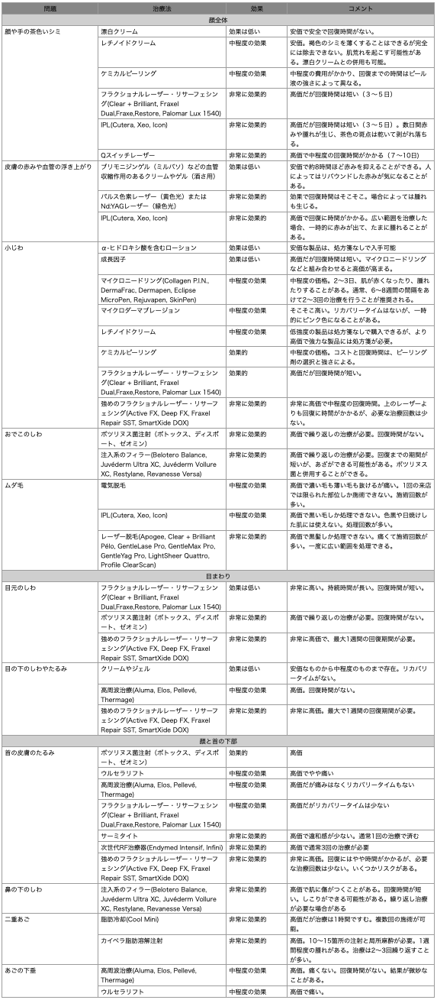

# エステで使われる美容治療ってどこまで効果があるの？をハーバード医科大の先生に聞いてみよう

いろんなご質問を受けていると、「それはレーザーじゃないと無理でしょう」とか「食生活の改善やサプリじゃどうにもなぁ」と思うケースがよくあるわけです。いったん定着しちゃったシミとか皮膚のたるみとか、そういったケースですね。

---

こういった美容系の問題については、残念ながら食事や睡眠や運動だけじゃどうにもならないところではあります。もちろん見た目のを保つためには健康的な生活が欠かせないものの、いったん色素やらたるみが発生したら、どうしても外科的な処置が必要になっちゃうんですよね。

近年ではレーザー治療やフィラーなどの技術が発達したおかげで、細かいシワを消したり、アゴのラインを引き締めたり、色素沈着やシミを薄くしたりすることができるようになってますんで。フェイスリフトなどの外科手術に比べれば効果はそれほど大きくないものの、そのぶん副作用は少ないし、最小限のダウンタイムで適度な効果を得ることができるようになってますんで。

が、ここらへんの技術については、明確な数値とともに効果が解説されるケースが少ないので、「どれを選べばいいんだ……」って気分になっちゃうのはいたしかたないところ。そこで今回は、ハーバードメディカルスクールが2020年に行ったレビュー([R](https://www.goodreads.com/book/show/28095380-skin-care-and-repair))をベースに、「**レーザーやらボトックスやらはどれぐらい効果があるのか？どれを選ぶべきなのか？**」ってのをまとめていきます。

ここで紹介する技術は、大きく分けて4つのカテゴリーに分類されまして、

1. シワを伸ばしたり埋めたりする注射系の治療
2. 小じわ、シミ、肌の変色などを改善するスキンリサーフェシング技術
3. 特に目の周り、あご、ネックラインなどの肌を滑らかにし、調子を整えるスキンタイトニングやリフティング施術
4. LEDなどの光を使って肌の調子を整えるトリートメント

みたいになります。これらの技術についてハーバードの先生方がまとめた上で、データをもとに効果レベルなどをチェックしてくれたわけですね。

ちなみに、このタイプの美容治療は何歳からやるべきかって問題もありますが、ハーバードのチームは以下のような提案をしておられました。

- 美容治療を何歳から始めるべきかというポイントに厳密なルールはないが、多くの皮膚科医は、ボツリヌス菌のような神経調節系の治療は20歳から30歳の間に始めるべきだと考えている。眉間にできるシワやカラスの足跡は顔の表情が原因なので、表情筋の動きを弱めておく治療には意味がある

- 中年期以降は、顔のしわやくぼみをふっくらさせるために軟組織フィラーを試すのも悪くない。フィラーを使えば使うほど、再注入の必要性が低くなる傾向がある

- フェイスリフトについては、人生の後半に大きなフェイスリフトをするよりも、中年期から小規模なフェイスリフト（レーザーとか）を何度も受けることを推奨している

- レーザーや熱を使った治療についても、ある研究では3回の広帯域光治療を行うことで、加齢した肌の遺伝子発現が変化し、若い肌に近い状態になることがわかっている。そのため、肌の変化が明らかになる30代、40代から始めるのがよい

ということで、もはや46歳になってる私としては、そろそろレーザーとかやっといたほうがいいんだろうか……とかあらためて思ったことでした。

では、以下にハーバードの先生方が選んだ「効果的な治療法とそうでない治療法」を表でだだーっと紹介していきます。ボトックスやレーザー治療をお考えの方は、ぜひご参考になされませ。
とりあえず表を画像で貼っておきますが、[PDF版をDropboxに置いておく](https://www.dropbox.com/s/nkwjd4058wg1jad/skincare.pdf?dl=0)のでこちらもどうぞ。

