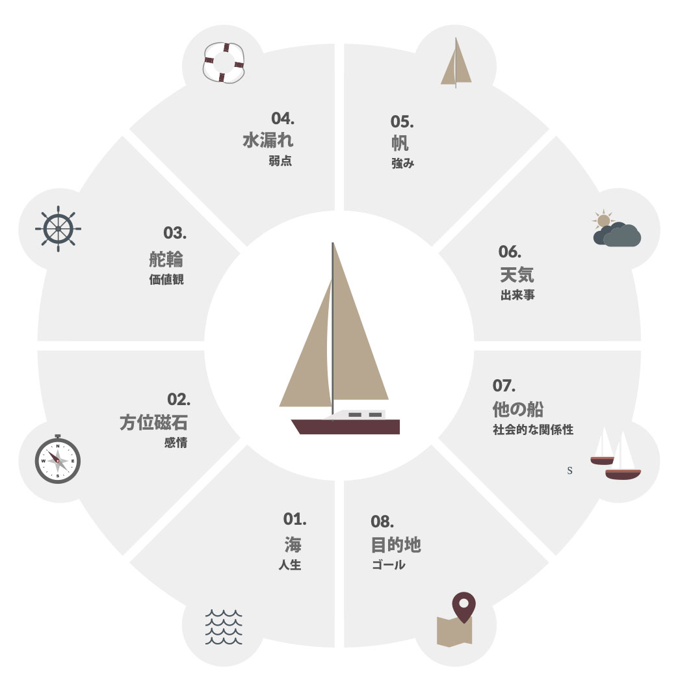

# 「強み」活用大全＃2「あなたという人間は、あなたの「強み」や「弱点」では決まらない」

「****「強み」活用大全****」の続きでーす([#1](https://daigovideolab.jp/blog/2081692))。

---

このシリーズは、**あなたが持つ「強み」を活かす方法を掘り下げる内容**になっております。「強みを活かそう」とはよく言うものの、類書などを読んでみると、**意外と「そもそも強みとはなんぞや？」ってとこを掘り下げたものが少ない**ので、ここらへんを押さえておくと「ストレングスファインダー」などの効果も出やすくなるはずであります。

## **帆船のメタファーで「強み」とは何かを理解する**

で、このシリーズでは、「強み」を理解するためにマストリヒト大学などの先生方が考案した「**帆船のメタファー**」を紹介していて、前回は1〜4までの要素を見てみました。このメタファーを使うと、**人間の複雑な心理の構成要素をわりと簡単に理解できる**んで、人生のトラブルへの効果的な対処法を見つけやすくなるんですよね。

今回はその続きで、5〜8の要素をチェックしていきましょう。

### 05. 帆（強み）

ヨットの帆は「個人の強み」を表す要素です。ポジティブ心理学における「強み」ってのは、その人にとって本物だと感じられ、活力となるような考え方、行動のパターンを指しております。

これをヨットに例えると**「強み」ってのは船の帆**のようなもので、もしこいつがなかったら船は風をキャッチできず、どこにも行かずに水に浮かんだままになっちゃいますからね。

帆があるからこそ船は目的の方向に進むことができるわけで、これを「強み」があるからこそ人生がうまくいく様子に例えてるんですな。つまり、自分の強みを活かしている状態ってのは、**帆が風を受けて船が全力疾走しているようなもの**ってことです。

### 06. 天気（出来事）

「出来事」は、個人に起こる外部のライフイベントを意味します。愛する人を失ったり、交通渋滞に巻き込まれたり、宝くじが当たったりといったイベントが良い例です。

ヨットに例えれば、人生の出来事は天気のようなもので、帆に風が吹いて自分の力を最大限に発揮できることもあれば、風も波も起きないせいで自分の力を十分に発揮できないこともあります。さらには、風や雨のせいで自分の好きな方向に進み続けることができないこともあるでしょう。

一般に、**これらの出来事はコントロールできない**ことが多いんだけど、その対処の仕方によっては幸福度に重大な影響を与えるってところも、ライフイベントは天気に似てますね。

### 07. 他の船（社会的な関係）

海に浮かぶ「他の船」は、私たちを取り巻く人々を表します。これらの船はソーシャルネットワークの比喩でして、私たちの行動が家族や友人の影響を受けやすいのはご存じのとおりです。

例えば、舵輪を操作して別の道に進もうと決めたときに、他の船からのサポートを受けられれば、新しいチャレンジへの意欲も湧きやすいでしょう。一方で、その方向を批判されて、自信喪失や恐怖心を抱くこともあるでしょう。

また、場合によっては、嵐のような悪天候（ネガティブなライフイベント）が起きた時に他の船が手助けをしてくれて、自分の旅の目的地（ゴール）を思い出させてくれることもあったりします。長い航海を単独で進むのは難しいので、どうしても「他の船」の存在は欠かせないものになりますね。

### 08. 目的地

最後の「目的地」は人生の具体的なゴールを意味します。価値観（舵輪）はヨットの大まかな方向性を表すのに対して、ゴールはヨットの具体的な到達地点を意味します。

一般に、**目標設定は価値観を具体化するための重要なプロセス**でして、「創造性」のように抽象的な価値観を実践するのに役立ちます。さらに、個人的に意味のある目標を達成することで、自信や自己効力感を高めることもできますね。

## あなたという人間は、あなたの「強み」や「弱点」では決まらない

ってことで、帆船のメタファーを使って「あなたの人生を構成する8つの要素」を見てみました。いずれも個人の幸福に影響を与える重要な要素なんですが、ここで必ず押さえておきたいのは、

- 帆船の要素は**「個人を定義するものではない****」**よー

ってところです。もっと簡単に言えば「その人がどういう人か？」っていう本質の部分は、その人が抱く感情で決まるわけじゃないし、その人の弱点でも決まらないし、強みでも人間関係でも決まらないってことですね。会社の肩書きとか貯金の額で、その人の人間性を決められないのと同じことです。

では、「あなた」という人間を本当に定義するものは何かってのを、帆船のメタファーで例えますと、

- **帆船を操作する船長**

ってことになります。船長は自分の意志でハンドルを回すことができるし、ヨットの水漏れに気づいて対処ができますからね。

つまり、あなたという人間は「弱点」や「強み」や「到達した目的地」で決まるのではなく、その「弱点への対処」「強みをどう使うかの選択」「どの目的地に向かうかを決めた決断」などで決まるわけですね。ひとことでまとめちゃえば「**人間は選択の集合体である**」みたいな感じです。

もう少しメタファーを広げてみると、例えば、

- 「自分の船は水漏れがヒドいから何の価値もないのだ！」と思っている船長

がいたとしましょう。いったん船長がこう思っちゃったら、過去の旅がどれほど素晴らしくて、どれだけ強い帆（強み）を持っていたところで、航海はうまく進まないですわな。

当然ながら、この例は、多くの人がハマりがちな「弱点との関係性」を示しております。自分の弱点にこだわりすぎるあまり、自分の船が持つ他の利点を使えなくなってしまう状態っすね。

ここでめちゃくちゃ大事なのは、**私たちの幸福度を左右するのは個人の弱点ではなく、その弱点との関係性である**ってことでしょう。「弱点」にせよ「強み」にせよ、当人の幸福感は関係性で決まるんですよね。ここもまた、自分の「強み」を活かす際の重要ポイントなので、ぜひ押さえておいてくださいませ。

## あなたはあなたの「強み」や「弱点」では決まらない

で、こうなると「**船長と帆船との関係は何で決まるのか？**」ってとこが気になるわけですが、ここにはざっくり4つの重要なポイントが存在します。

1. 注意
2. 思考
3. 動機
4. 行動

以上４つは、あなたの弱点、強み、人生、価値観などに対するあなたの関係性を左右するもので、「****あなたという人間を決める要素****」と言えます。ここもまた超重要なので、ひとつひとつ説明しておきましょう。

### 01.注意

「注意」ってのは、船長がヨットの特定の要素に集中する能力のことです。アメリカを代表する心理学者のウィリアム・ジェームズが、『心理学原理』の中で「**私の経験とは、私が注意を払うことに同意したものである**」と書いているとおり、人間の経験ってのは、私たちが自分自身や周囲の環境にどのように注意を払うかによって大きく左右されるんですよね。

ここで重要なのは、「注意」が2つの要素から構成されているところで、

1. **船長が特定の要素にどれだけ注意を払っているか？**：例えば、船長が目的地に注意を払うのは当然ですけど、いつも前だけを向いていて目的地だけにしか注意を払っていなかったたら、途中で天気が変わったり、新たな水漏れが発生しても気付けなかったりしますね。特定の要素にばかり注意を向けていたら、人生の他の側面を見逃すことになりがちなんですよ。
2. **船長は特定の要素にどのように注意を払っているか？**：ひとくちに「注意を向ける」と言ってもいろんな方法がありまして、一点にただ注意を向ける方法もあれば、散漫な注意もあるだろうし、穏やかに注意を向けているケースも存在するでしょう。

って区別は念頭に置いておきたいところです。当然ながら「帆」にばかり注意を向けていたら「天気」との関係はわからないし、「舵輪」で進む方向が本当に正しいのかもチェックできないですからね。「**あなたの人生はあなたが注意を向けたものの合計である**」ってのは、押さえておきたいポイントです。

### 02．思考

船長の「思考」は、ヨットの様々な要素についてどう考えるかを表しております。

例えば、「水漏れをカバーする方法はあるか？」「帆をどのように使えば風をつかめるか？」「コンパスからのフィードバックをどう使うか？」といった問題について、どのように考えるかってところです。

船長が持つ「思考」ってのは、もちろん現実をちゃんと反映していることもあるし、逆に現実を見ずにゆがんでいることもあるしで、船長の行動や言動を無意識のうちに強く左右する働きを持っております。

ここで重要なのは、**船長の「思考そのもの」が問題ってことではなくて**、

- 船長が特定の思考を真実だと認識している
- そして、その思考を真実だと思うことで幸福感が左右されている

ってことに気づけないことが多いってところです。これはなかなか厄介なポイントですが、シリーズの後半で対策は見ていきたいと思っております。

### 03．動機

船長の「動機」は、船のさまざまな要素に対するモチベーションの方向性を表しております。

- 船長が選んだ目的地がなぜ重要なのか？
- なぜ船の水漏れはまだ修正しなくても良いのか？
- 船長は帆を使うことでどのようなメリットを得ているのか？

といった感じで、船長が自らの航海に抱くモチベーションの方向性を調べることで、船が進む方向性の精度を確かめることができるんですよね。

### 04．行動

船長の「行動」は、ヨットの構成要素との直接的な関わり方を表しています。例えば、

- 船の水漏れにはどのように対処するのか？
- 船長は舵輪をどちらに回すのか？
- 船長は帆を使って正しい方向に航海するか？

みたいなポイントで、具体的にあなたが取った行動は、すべて「あなたという人間を決める要素」となります。

## 次回予告

ってことで、ボートのメタファーを構成する要素をひととおり見てみました。こうして改めて見ると、いろんな心理学の理論がうまくひとつの比喩に落とし込まれていて、なかなか使い勝手が良いなーとか思うわけです。

なによりも「**人生の構成要素ではあなた自身は決まらない。あなたを決めるのは、注意、思考、動機、行動の４つである**」ってのは、「強み」を考える上で非常に重要なポイントなので、ぜひ押さえておきましょう。

ってことで次回は**いよいよ実践編**。このメタファーを実際にあなたの人生に応用して、具体的に「強み」を活かす方法を見ていきましょう。
