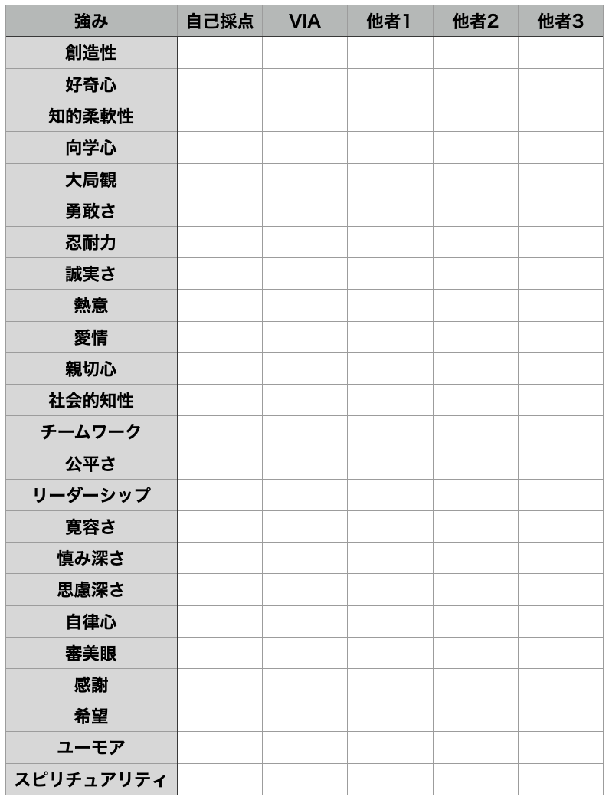

# 「強み」活用大全＃５「VIAテストを最大限に使いこなしてみようぜ」

「****「強み」活用大全****」の続きでーす([#1](https://daigovideolab.jp/blog/2081692),[#2,](https://daigovideolab.jp/blog/2081965)[#3](https://daigovideolab.jp/blog/2084585),[#4](https://daigovideolab.jp/blog/2086681))。

---

このシリーズは、**あなたが持つ「強み」を活かす方法を掘り下げる内容**になっております。「強みを活かそう」とはよく言うものの、類書などを読んでみると、**意外と「そもそも強みとはなんぞや？」ってとこを掘り下げたものが少ない**ので、ここらへんを押さえておくと「ストレングスファインダー」などの効果も出やすくなるはずであります。

いちおうここまでの話をおさらいしておくと、

- 人生の諸条件は「帆船のメタファー」を使うと判断しやすくなるし、自分の強みを活かすための指針になりやすい

- しかし、ほとんどの人は自分の「強み」を特定するのがわりと苦手だったりする

- VIAやストレングスファインダーも使えるが、これも人間の「強み」の一部分でしかなかったりする

みたいな感じになります。「強みを活かそうぜ！」ってアドバイスはよく聞くものの、たいていの人は自分の強みを探すのが難しく、意識して深掘りしていかないといかんよーってことですね。

で、[前回](https://daigovideolab.jp/blog/2086681)は「**強みラベル**」って手法についてお伝えしましたんで、今回はその続きとして、「自分の強みを見つける方法」をいくつかご紹介しましょうー。

## VIAを周囲の人に聞いてみるのがなんだかんだで最強説

さて、自分の「強み」を見つけるもう一つの方法として推奨したいのが、「**VIAを周囲の人に尋ねてみる**」ってやり方です。ピーターソン博士とセリグマン博士が生み出した「VIA-IS」の強み分類を使い、周囲の人に「私ってどれが強いと思います？」と尋ねてみるわけっすね。

[前回](https://daigovideolab.jp/blog/2086681)もお伝えした通り、「強み」を診断するテストはいくつもありますが、なかでも「VIA」はちゃんと実証研究([R](https://amzn.to/3DbcFbF))が行われているのが利点。セリグマンやその他の研究によりますと、

- 誰ても5つぐらいの「大きな強み」を持っており、それを使うことで人生の満足度が上がったような感情がともなうと報告されている

- 多くの人は「トップ5の強みを発揮したい！」という強い衝動を持っていることも示唆されている

- 自分の特徴的な強みを使うことは、その人の心理的な幸福と活力([R](https://psycnet.apa.org/record/2007-19806-004))や生活の質（[R](https://worlddatabaseofhappiness-archive.eur.nl/common/desc_study.php?studyid=16361)）にプラスの影響を与えることが研究により示されている

って傾向が何度か示されてたりするんですよ。もちろん、[既出](https://daigovideolab.jp/blog/2086681)のとおりVIAが提唱する24の強みは、決して人間の潜在的な強みの完全なリストではなく、一説には**人間の強みをガチで分類したら何千もの種類がありそう**だとも言われてるんですが、それでも やはり「**VIAは使えるよなー**」と思うわけです。個人的には「ストレングスファインダー」を使うなら、まずはこっちが先かなー、と。

もっとも、VIAってのはオンラインテストだけだと結果が心もとないところもありまんで、一部の専門家などは「オンラインテストだけじゃなくて他人にも意見を聞いてみたほうがいいよー」と指摘しておられます。具体的には、以下のようなシートを使っていくといいでしょう。

シートの使い方は簡単で、一番左に「自分はこれが強みなんじゃないかなー」と思えるものをチェック。その隣に、実際にVIAのオンラインテストの結果をチェックし、さらに続いて、あなたのことをよく知る知人に「僕の強みで当てはまるのってなんだと思います？」と尋ねて、その答えをメモっていくわけです。その上で、最終的にもっともチェックが多くついた項目は、あなたの本当の「強み」である可能性が高いと判断できますんで。

なんでわざわざ他人の意見を求めるのかと言いますと、なんだかんだで「**第三者の意見が一番信用できるから**」です。このブロマガをお読みの方であれば、「自己診断がいかにあてにならないか」ってのはご存じでしょう。「[科学的な適職](https://amzn.to/3JLPpne)」にも書いたとおり、自分の判断はバイアスにまみれて間違いがちなんで、結局は他人の判断をあおぐのが一番精度が高くなるんですよ。誰でも自分のことはわからないけど、他人のことは客観的に見られますからね。

これは自分の強みについてはも当てはまる話で、自分がどんな特徴を持っているのかは他人に尋ねるのが一番。あなたをよく知る人に協力を頼んで、最低でも２人ぐらいに「どう思います？」と聞いてみてください。いろんな自己診断テストはありますが、結局はこいつが一番精度が高かったりしますんで。

ちなみに、もしその友人が嫌がらなければ、前回紹介した「[強みラベル](https://daigovideolab.jp/blog/2086681)」について聞いてみるのもいいでしょう。200以上あるので、普通は嫌がられると思いますが（笑

念のため、VIAが分類した「強み」の説明を軽く紹介しておきましょう。

- **創造性**： 物事を概念化や抽象化し、実行するための斬新で生産的な方法を考えることができる。

- **好奇心**： いろいろな経験に対して継続的に興味を持ち、探求し、発見する。

- **知的柔軟性**：物事をあらゆる角度から検討し、公平に評価することができる。すべての証拠を公正に扱う。

- **向学心**：新しい技術、話題、知識を、独学あるいは形式的に習得すること。

- **大局観**：他者に賢明な助言ができる。自分にとっても他者にとっても納得のいく世界観を持てる。

- **勇敢さ**：脅威・試練・困難・苦痛などにひるまない。反対にあっても正しいことをきちんと言う。嫌われても信念に従って行動する。

- **忍耐力**：始めたことを最後までやり遂げる;障害にあっても粘り強く行動し続ける。物事を完遂する;やり遂げることに喜びを見出す。

- **誠実さ**：真実を語り、自分自身を偽らずに誠実に語る。自分の感情や行動に責任を持つ。

- **熱意**：わくわくしながらエネルギーを持って生きる。物事を中途半端やいい加減にやらない。

- **愛情**：他者との緊密な関係、特に互いに共感しあったり思いやったりする関係を大切にする。

- **親切心**：他者に親切にし、よいことをしてあげる。他者を助けて面倒をみてあげる。

- **社会的知性**：他者や自身の動機や感情を意識し、異なる状況下でも適切なふるまい方がわかる。他者がどうすれば動くのかを知っている。

- **チームワーク**：グループのメンバーとしてうまく立ち振る舞い、自分なりの役割を果たす。

- **公平さ**：公平や正義の概念をもとに人を同じように扱う。私情を交えずに他者を判断する。

- **リーダーシップ**：自分のグループが目標を達成できるように励まし、グループ内の人間関係を向上させるように指導する。

- **寛容さ**：過ちを犯した人を許し、やり直すチャンスを与える。他人に復讐しない。

- **慎み深さ**：自慢をせず、自分のスキルや功績が自ずと明らかになるのを待つ。自ら脚光を浴びようとせず、自分が他者より特別だと考えない。

- **思慮深さ**：注意深く選択し、無駄なリスクをとらない。あとで後悔するようなことを言わない。

- **自律心**：自分の感情と行動をコントロールできる。規律が正しい行動を取れる。

- **審美眼**：自然、芸術、科学、日々の経験など、あらゆるものに美しさや素晴らしさを見出す。

- **感謝**：日々の暮らしで起こったよい出来事に目を向けて感謝する。

- **希望**：未来には良いことがあると期待して、それを達成するよう努力する。

- **ユーモア**：笑ったりからかったりすることを好み、ものごとの良い面を見る。

- **スピリチュアリティ（哲学）**：自分を超えたより大きな社会的な目的や、自然・宇宙などの意味について一貫した信念を持つ。有意義な人生について深く考える。

### **強みを示す追加の質問**

また、VIAを使う際は、以下の質問も役に立つはずであります。これらの質問はマストリヒト大学の心理学部などが臨床で使っている質問で、自分で自分に質問してもらってもいいし、友人などに尋ねるのもいいでしょう（「君から見て、僕の天職はなんだと思う？」とか「君から見て、私は何をしている時に生き生きしてる？」みたいな感じで）。

1. 私は何をするのが好きだろうか？
2. どのような活動で充実感を感じるだろうか？
3. 私の人生にポジティブなエネルギーをもたらしてくれるものは何だろうか？
4. どのようなときに、私は完全に仕事に取り組んでいると感じるだろうか？
5. 私が情熱を注いでいることを3つ挙げたらなんだろうか？
6. 上記3つの項目について、私が情熱を感じる理由は何だろうか？
7. 私の天職は何だろうか？
8. 私がゴール達成よりもその過程を楽しめるのはどのような時だろうか？
9. 私はどんな時に自分を律することができるだろうか？
10. 私はどんな時にクリエイティブになるだろうか？
11. 心が安らぐ場所はどこだろうか？
12. 私が穏やかで生産的だと感じるのはどんな時だろうか？
13. 人生でやるべきことをやっていると感じるのはどんなときだろうか？
14. 私が完全に夢中になれるのはどんな活動だろうか？
15. 時間を忘れてしまうのはどんなときだろうか？
16. 早くまたやりたいと思う活動は何だろうか？
17. 望んだ結果が出やすいのはどんなときだろうか？
18. 明晰さ、落ち着き、創造性、成功の感覚を与えてくれるのは、どのような活動だろうか？
19. どのような活動に取り組むと、フローの感覚を味わえるだろうか？
20. 「ゾーン」にいるような感覚を味わうのはどんなときだろうか？
21. 子供のころにやっていたことで、今でもやっていること、おそらくもっと上手にできることは何だろうか？
22. 私が興奮するのはどんな活動だろうか？
23. 私が「本当の自分」だと感じるのはどんなときだろうか？
24. 私が自然に注目するのはどんなことだろうか？
25. 私が最小限の努力で素早く習得したものは何だろうか？
26. 私はどんなときにやる気を感じるだろうか？
27. ToDoリストに入れたいが、なかなか手が回らない項目はどれだろうか？
28. 私がこれから楽しみにしていることは何だろうか？

## **次回予告**

ってことで、今回はVIAをちゃんと使って「強み」を掘り下げる方法でした。次回もさらに「強みの探索法」をいくつか見ていき、さらにそれを実生活で活かす方法を紹介しましょうー。
