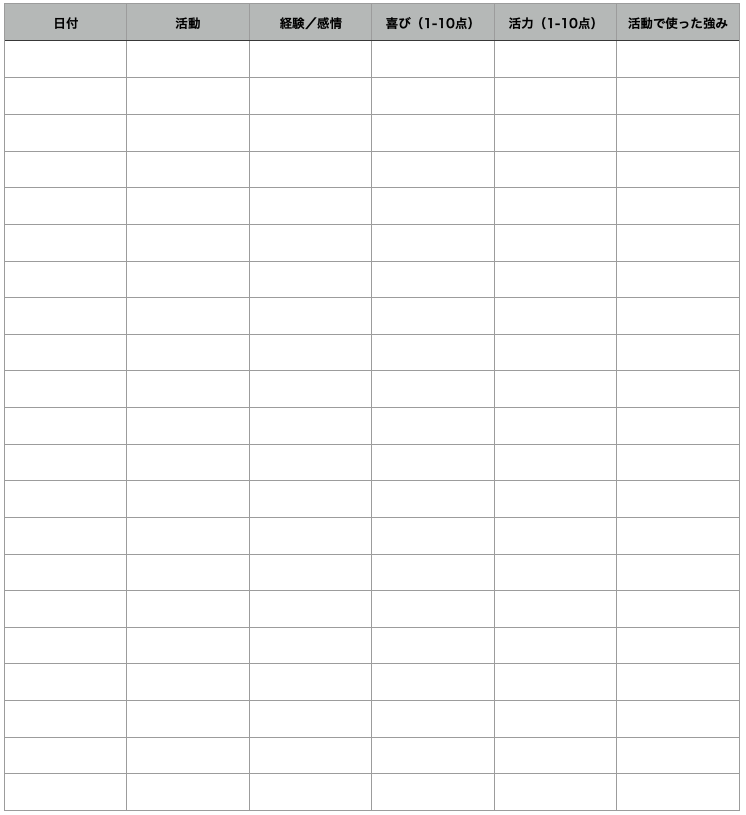

# 「強み」活用大全＃6「デイリー・ストレングスで自分の強みを深堀りしようぜ！」

「****「強み」活用大全****」の続きでーす([#1](https://daigovideolab.jp/blog/2081692),[#2,](https://daigovideolab.jp/blog/2081965)[#3](https://daigovideolab.jp/blog/2084585),[#4](https://daigovideolab.jp/blog/2086681),[#5](https://daigovideolab.jp/blog/2087892))。

---

このシリーズは、**あなたが持つ「強み」を活かす方法を掘り下げる内容**になっております。「強みを活かそう」とはよく言うものの、類書などを読んでみると、**意外と「そもそも強みとはなんぞや？」ってとこを掘り下げたものが少ない**ので、ここらへんを押さえておくと「ストレングスファインダー」などの効果も出やすくなるはずであります。

というわけで、前回は「[VIAテストを最大限に使いこなしてみようぜ](https://daigovideolab.jp/blog/2087892)」って話をしましたが、今回はその続きとして「**自分の強みを深堀りする方法**」を見ていきましょうー。

## デイリー・ストレングス

「人が変わるために必要なことは、その人自身の意識を変えることである」と言ったのは、ポジティブ心理学の祖父ことアブラハム・マズロー先生ですが、この言葉のとおり、**個人の「強み」を開発するためには、自己検証、内省、自己発見のプロセス**が欠かせなかったりします。私たちが自分の強みを知り、それを伸ばすためには、自分の内面に目を向けて内省的になる必要があるんですよね。

ってことで、このエクササイズは、「強み」の観点から自己認識を高めるために設計されたものです。日々の内省を促進することによって自分の強みに関する知識を増やすのが最終目的でして、「[insight(インサイト)――いまの自分を正しく知り、仕事と人生を劇的に変える自己認識の力](https://amzn.to/35Iji8X)」とかが好きな人にはよろしいのではないでしょうか。

デイリー・ストレングスの実践法を簡単に申し上げますと、「**日々の暮らしのなかで自分の強みを見つけよう！**」って感じでして、具体的には以下のようになります。

1. 1日のうちランダムに3回、携帯電話のアラームを設定する。設定する時間は、自分が起きているタイミングならいつでもOK。
2. アラームが鳴ったら、 以下のフォーマットにアラームが鳴った日付を記録し、そのときに行っていた活動を簡潔に記入する（**例**：「ゲーム中」「書類作り中」など。「マーケティング・プレゼンテーションで好評を得たので嬉しかった」みたいにだらだらとは書かない）
3. 活動中に経験したこと感情や経験を書く。経験や感情を書き出すときは、できるだけ具体的に書くのがポイント（**例**：「新しいマーケティングキャンペーンをよどみなく発表して、幸せと達成感を感じた」「妹の誕生日を忘れていたことに気づき、憂鬱な気分になった」など。「家族と公園に行って楽しかった」「妹が怒っていてかわいそうだった 」のように曖昧な文章は避ける）
4. その活動をどれぐらい楽しめたかを10点満点で記録する。
5. その活動でどれぐらい活力を得たのかを10点満点で記録する。
6. 活動中に使用した可能性のある「強み」考えて記入してください（「喜び」と「活力」が7点以上になった活動だけでOK）

ってことで、「デイリー・ストレングス」の方法は以上です。強み系のエクササイズとしてはわりと手軽でよろしいのではないでしょうか。実践の期間としては、最低でも2週間は続けていただきたいところです。データが集まれば集まるほど「強み」は発達しやすくなりますんで、ぜひ続けてみていただければと。

## **レッド＆グリーン・エクササイズ**

強み研究で有名なアレックス・リンレイ博士（[R](https://amzn.to/3DL3i2P)）によると、「強み」ってのは、

> 特定の行動、考え方、感じ方に対する既存の能力で、使用者に活力を与え、最適な機能、開発、パフォーマンスを可能にするもの。

とされております。要するに、すごーく端的に言ってしまうと、

- 「強み」のもっとも重要な特徴は、**強みとは活力を与えるものである**

ってことです。「強み」を生かした活動ってのは、本人が楽しくなるし、エネルギーレベルが上がったように感じられるしで、そのおかげで高いパフォーマンスを達成できるようになるんだ、ってことですね。つまり、「エネルギーが高まった！」って経験は、そこにあなたの「強み」が眠っているサインと考えられるわけですね。

さらに、自分で感じられるエネルギーの量は、自分の「弱み」に関する情報も提供してくれるのがすばらしいところ。こちらもリンリー博士の研究([R](https://psycnet.apa.org/record/2012-24003-014))によると、

> 弱みとは、あなたが苦手とすること、また元気が出ない、消耗してしまうと感じること。弱点を利用すると、否定的な感情、意欲の減退、やる気の欠如につながる。

って感じです。つまり、**活力とかエネルギーに気を配れば、自分の「強み」と「弱み」を徹底的に把握する**ことができるわけっすね。

というわけで、「レッド＆グリーン・エクササイズ」では、自分の長所と短所への意識を高めるために、以下のようなステップで記録を続けていきます。

### **ステップ1：導入**

あらためて繰り返すと、「強み」の特徴は「エネルギー」です。私たちは、「強み」を発揮すると元気が出て、なにかに没頭し、楽しむことができているように感じられます。

これに対し、「弱み」は私たちを疲弊させる傾向がありまして、「弱み」を活かして活動するとネガティブな気分が増したり、やる気がなくなったり、モチベーションが下がったりするんですよ。弱点に依存した活動は、私たちのエネルギーレベルを消耗しているように感じさるのでお気をつけください。

というわけで、このエクササイズでは、自分の強みを生かし、エネルギーを与えてくれる活動を「グリーン・アクティビティ 」と呼びます。これには、以下のような活動が当てはまります。

- 純粋に楽しいと思えること
- 元気が出る
- 時間を忘れさせる
- 楽しみである
- ストレスや疲労がある状態でも、うまくできる

あと、自分の弱点に依存し、エネルギーを消耗するような活動は「レッド・アクティビティ」と呼びまして、以下のような活動が当てはまります。

- 好きではない
- 消耗が激しい
- 時間が経つのが遅い
- 楽しみでない
- うまくやるために多くの努力と自制心が必要

### **ステップ2：レッドとグリーンの瞬間を記録する**

これから1週間、毎日「グリーン」と「レッド」の瞬間を記録してください。記録の際はスマホのメモアプリなどを使ってもらえればOKでして、

1. 適当なメモアプリに、「グリーン」と「レッド」のリストを作る
2. テンションが上がる活動をしたら「グリーン」のリストに簡単に記入する（**例**：「友人との会話」「楽器練習」「動画制作」など）
3. テンションが下がる活動をしたら「レッド」のリストに簡単に記入する（グリーンと同じぐらい簡潔な言葉でまとめる）
4. その活動でどれぐらいエネルギーが高まったか、あるいはどれぐらいエネルギーが減ったかを記入し、活動ごとのエネルギーレベルを判断する（**例**：多くのエネルギーを必要としたら「ーー」、若干のエネルギーが必要なら「ー」、どっちでもないなら「0」、プラスのエネルギーを与えてくれたなら「＋」、多くの肯定的なエネルギーを与えてくれたなら「＋＋」を記入する）

### **ステップ3：強みの振り返り**

記録を終えたら、自分の答えをよく吟味してみましょう。具体的には、このなかから**あなたが最も元気が出る活動を5つ選び**、「自分のグリーン・アクティビティ・ベスト5」を作ってください。

でもって、ベスト5を作ったら、それぞれの活動のなかであなたが「こんな強みを使ってるんじゃないかな〜」と思えるものを考えて書き出します。例えば「友人との会話」がグリーンなら「コミュ力」や「傾聴力」が強みかもしれないし、「楽器練習」がグリーンなら「スキル習得」が強みかもしれないしって感じですね。

### **ステップ4：弱みの振り返り**

次に、弱みについても同じことを行ってください。このなかから**あなたが最も元気が減る活動を5つ選び**、「自分のレッド・アクティビティ・ワースト5」を作りましょう。

でもって、ワースト5を作ったら、それぞれの活動のなかであなたが「こんな弱みがあるせいじゃないかな〜」と思えるものを考えて書き出します。例えば「友人との会話」がレッドなら「コミュニケーション」が弱みかもしれないし、「楽器練習」がレッドなら「スキル習得」が弱みかもしれないしって感じですね。

### **ステップ5：評価**

でにって、最後にすべてのエクササイズを振り返り、以下のポイントを考えてみましょう。

1. どうしたらもっと自分の強みを活かせるだろうか？
2. もっとエネルギーが増えるような活動はできないだろうか？
3. エネルギーを消耗するような状況に効果的に対処するには、どうしたらよいだろうか？

例えば、エネルギーを消耗するような作業部分を誰かに任せたり、その仕事を「これは自分の長期目標のためだから」と考えることでリフレーミングできないか、みたいに考える感じですね。

## 次回予告

ということで、強みエクササイズは以上です。いろいろな手段を紹介してますが、どれが良いかってのは個人の資質の問題などもありますんで、いろいろと試してみていただければ幸いです。個人的には、日ごろから「デイリー・ストレングス」を紙に書かずに頭の中でまわしてる感じなんですが、実践の際は紙に書き出すほうがおすすめです。
