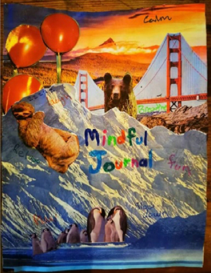

# NHSが激賞する「28日間マインドフルネス・チャレンジ　第1週」

こないだの[質疑応答](https://www.nicovideo.jp/watch/so40663164)で、「**[カリフォルニア大学が推奨する30の人生改善テクニック](https://daigovideolab.jp/blog/1962721)みたいなのをまたやってください！**」みたいなご注文をいただきました。なんでも、定期的に仲間と集まって30の技法を実践しているそうで、さすがガチ勢はモチベーションが高くてすばらしいですね。

---

というわけで、このブロマガのガチ勢に向けて、今回はNHSが提唱する「**28日間マインドフルネス・チャレンジ**」をご紹介しましょう([R](https://www.nhs.uk))。NHSはイギリスの「国民保健サービス」のことで、世界の数ある健康系機関のなかでもアメリカのCDCなどと並ぶ権威を持つ組織っすね。

私のブログでは、よく「根拠に基づく医療」の代表的な機関として「コクラン共同計画」って名前がよく出てきますが、これは実はNHSの下部組織で、とにかくエビデンスベースの精度が高い知見ばかりを世に発信しててくれているんですよ。ありがたいですなぁ。

でもって、マインドフルネスの効果についてはNHSも認めるところで、調査チームは以下のようにコメントしています。

> マインドフルネスはと、いま目の前に起こっていることに注意を払い続けることです。この定義には、あなたの感覚や思考、周囲の変化に気づくことも含まれます。マインドフルでいることができれば、あなたは他の人とよりうまく付き合えるようになり、より幸せになることがわかっています。

NHSがここまで断定するケースは珍しくて、それぐらいマインドフルネスを「人生を変える技法」として認めているわけですな。

ってことで、NHSが提唱する「28日間マインドフルネス・チャレンジ」の具体的なやり方を見ていきましょう。こいつは全4回のシリーズになりまして、1日1ミッションをクリアしていくように構成されてるのが特徴。28日すべてのミッションをクリアすれば、ストレスの大幅な減少はもちろん、少しのトラブルにも負けないしなやかなメンタルが手に入るはずであります。

初回である今回は、まずは初日から7日めまでのミッションをお送りします。

### **1日目： 3×3ブリージング**

静かで居心地の良い場所に背筋を伸ばして座りましょう。目を閉じてもいいし、目を半分だけ開いても構いません。その状態を保ちながら、以下の手順で呼吸を行います。

1. 5〜6秒をかけて鼻からゆっくりと息を吸います
2. 3秒だけ息を止めます
3. 7〜8秒かけて口からゆっくりと息を吐き出します
4. 再び3秒だけ息を止めます
5. ステップ1〜4までの呼吸を全部で3回繰り返します

以上が3×3ブリージングの全行程です。この呼吸法を、朝、昼、晩の3回行えば1日目のミッションはクリアです。このエクササイズにより、まずは呼吸の力で体が落ち着く感覚を実感しましょう。

### **2日目： コラージュ・タイム**

このチャレンジでは、定期的に「独自のアートを作りましょう」といった指示が出されます。自分の好きなように物を作る作業は、自尊心を高めたり、気分の改善に役立つことがわかっているからです。

そこで、まず2日目のお題は「コラージュ」です。適当な本や雑誌、写真を切り抜いてノートやコピー用紙に貼り付け、適当なコラージュ作品を作ってみてください。もちろん、スマホやPCのアプリでコラージュをしても構いません。

あまり深く考えても仕方ないので、所要時間は10分までです。この作業に正解も不正解もないので、直感を頼りにピンときた写真やイラストを組み合わせてみましょう。最低でも作品を1枚作ったらミッションクリアです。

一例として、NHSのスタッフが作った作例を下に貼っておきます。

こんな感じで、なんどもいいから好きなように表現してもらえればOK。この作業については正解も不正解もないんで、好きなものを組み合わせて自分の理想を描いてもいいし、ダークな画像を組み合わせて自分のダークサイドを表現してもいいし、そこはおまかせします。

### **3日目： フィーリング・サーチ**

仕事や学校について考えてみてください。この時、あなたの中にどのような感情または感覚が生まれたでしょうか？ その気持ちがどのようなものかを、素早く紙に書き出してみてください。

- その感情や感覚を好きなのか？ 心地よいものか？ それとも嫌なものなのか？
- その感情や感覚は、あなたの体のどこに現れて、どのように感じられるのか？

思いつくままに2〜3つの文章で書き出します。例えば、「緊張で胃のあたりがざわざわする」や「胸のあたりがすっと軽くなる」のようにシンプルな説明で構いません。

書き終わったら、そのような感覚が生まれる理由はなんだろう？と軽く考えてみてください。ここでは明確な答えが浮かばなくてもOKです。このエクササイズが終わったら、3日目のミッションはクリアです。

### **4日目： 3クエスチョン**

手帳や日記に、以下の質問の答えを書いてみましょう。

- 最近の休日に、何か良いことはありましたか？ それはどのようなことでしたか？
- あなたの家族または友人が行ったことで、良かったことは何ですか? それはどのようなことでしたか？
- 最近失敗したことはなんですか？

すべての答えを端的に書いたら、4日目のミッションはクリアです。

### **5日目：ミッション・ポッシブル**

次に職場または学校に行く日の計画を立てましょう。具体的には以下の質問について考えてみてください。

- 職場や教室に入るとき、自分はどのように感じるだろうか？
- 自分は誰に会うことを期待しているだろうか？
- もし不安や心配といったネガティブな感情がわいたら、誰に話しかけるだろうか？

以上の答え書き留めれば、5日目のミッションはクリアです。

### **6日目：ライト・メディテーション**

夜に寝る前に、ベッドの上で以下の瞑想を行いましょう。

1. ひたすらゆっくり呼吸をし、鼻から４〜5秒息を吸い、8〜10秒かけて口から息を吐き出します。呼吸をするたびに体から力が抜けるイメージを思い浮かべます。これを10回ほど続けましょう。
2. 自分の足に意識を向け、息を吸いながら自分の足にある緊張感やコリを探します。続いて、息を吐きながらすべての緊張とコリが口から吐き出されるイメージを思い浮かべます。
3. 自分の尻に意識を向け、息を吸いながら自分の尻にある緊張感やコリを探します。続いて、息を吐きながらすべての緊張とコリが口から吐き出されるイメージを思い浮かべます。
4. 自分の腹に意識を向け、息を吸いながら自分の腹にある緊張感やコリを探します。続いて、息を吐きながらすべての緊張とコリが口から吐き出されるイメージを思い浮かべます。
5. 自分の腕に意識を向け、息を吸いながら自分の腕にある緊張感やコリを探します。続いて、息を吐きながらすべての緊張とコリが口から吐き出されるイメージを思い浮かべます。
6. 自分の喉と首に意識を向け、息を吸いながら自分の喉と首にある緊張感やコリを探します。続いて、息を吐きながらすべての緊張とコリが口から吐き出されるイメージを思い浮かべます。
7. 自分の額・目・アゴに意識を向け、息を吸いながら自分の額・目・アゴにある緊張感やコリを探します。続いて、息を吐きながらすべての緊張とコリが口から吐き出されるイメージを思い浮かべます。

すべてを実行すれば、6日目のミッションはクリアです。ここで眠気が起きたら、そのまま眠ってしまってもOK。すべてをこなすには大体10分ぐらいかかるでしょう。

### **7日目：フレンド・ミッション**

次に会うのが楽しみな人をひとり選びます。友達でも職場の同僚でも誰でも構いません。ひとりを選んだら、以下の答えについて考えてみましょう。

- その人と会うのが楽しみなのはなぜだろう？
- その人が特別である理由はなんだろうか？

思いついた答えを紙に書き出したら、7日目のミッションはクリアです。

ってことで、第1週のミッションは以上です！次回は2週目を見てみましょうー。
