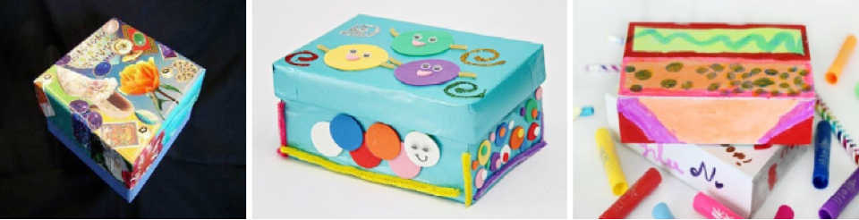

# NHSが激賞する「28日間マインドフルネス・チャレンジ　第2週」

「NHSが激賞する28日間マインドフルネス・チャレンジ」の続きでーす([#1](https://daigovideolab.jp/blog/2106077))。このシリーズでは、NHSが提唱する「28日間マインドフルネス・チャレンジ」をご紹介してまして、1日1つずつのミッションをこなしつつ、4週間にわたって「自分に適したマインドフルネスの技法はなにか？」を深堀りしていく内容になってます。

---

マインドフルネスというと誰でも瞑想が第一に思い浮かぶでしょうが、実際にはマインドフルネスの技法ってのは無限にありまして、瞑想じゃなくとも十分に「いまここ」の感覚を手に入れることは可能なんですよね。なかには瞑想よりもアートのほうがしっくり来る人もいるでしょうし、また別の人は呼吸法のほうがよかったりするだろうしで、ここらへんはいろいろ試して自分にぴったりなものを見つけるのがいいでしょう。

その点で、この「28日間マインドフルネス・チャレンジ」は、世にあるマインドフルネス技法の見本市みたいになってますんで、毎日ひとつずつこなしていけば、どれかは自分の感覚にピタリとくるんじゃないでしょうか。ぜひ「こりゃあやりやすいな！」と思われるようなものを選んでみてください。

### **8日目： スクエアブレス**

スクエアブレスは、数ある呼吸法のなかでも「神経系の働きをちょうど良いレベルに保つ」と考えられている手法のひとつ。やり方はとても簡単で、

1. 3〜6秒をかけて鼻から息を吸う
2. 3〜6秒だけ息を止める
3. 3〜6秒をかけて口から息を吐く
4. 3〜6秒だけ息を止める

これを1セットとして、最低でも3セット行えばミッションクリアです。もちろん、やる気があれば3セットより多くやっても構いません。自分の気分にどんな変化が出たかを意識しながら行いましょう。

### **9日目： マインドフル・ボックス**

マインドフル・ボックスは、写真のように「自分が好きなように飾った箱」を作ってみるだけのエクササイズです。「これがマインドフルの訓練になるの？」と思われそうですが、何らかの創造性を発揮する作業ってのは、それだけで”いまここ”に意識を向かわせる働きを持ってたりします。瞑想みたいにじっとするタイプの練習が苦手な人には良いのではないかと。

なんでもいいので、ひとつの箱を作り上げたらミッション・クリアです。

### **10日目：インタビュアー・エクササイズ**

誰でもいいので、適当な相手にインタビューをしてみるエクササイズです。友人でも家族でも同僚でもいいので、任意の相手に以下のような質問をしてみてください。

- 自分に最高の自信があって、使いきれないほどの大金を持っていたとしたら、どんなことをしますか？

- 自分が死んでしまったあと、葬式に集まった人たちにどんな会話をして欲しいですか？

質問を投げかけたら、相手の話へ徹底的に耳を傾け、話を中断しないように心がけてください。これが、いわゆるマインドフル・リスニングの訓練になります。相手の答えを最後まで聞き終えたらミッション・クリアです。

### **11日目：ワードクラウド**

ワードクラウドとは、上のように単語が集まって「雲」のような形になった図形のこと。ここ1週間を振り返って、あなたが抱いた気持ちや頭に浮かんだ言葉をワードクラウドにしてみましょう。言葉の大きさや色は、その感情を感じた頻度や強さに応じて大きくしてください。

めちゃくちゃ強い感情だったり、何回も頭に浮かぶ思考だった場合は、それに応じて大きくします。逆に時々しか感じなかったり、長く続かないなら小さくしましょう。このエクササイズを何度か行うと、自分の感情や気分を正確に識別できるようになり、くわしい原因やコントロール法を見つけられるようになるんですよ。

ちなみに、ネット上にはワードウラウドを作るジェネレーター（[http://wordcloudjp.com](http://wordcloudjp.com)）もありますんで、こちらを使ってもOK。何かひとつワードクラウドを作ったら、ミッション・クリアです。

### **12日目： 3クエスチョンズ**

紙でもPCでもいいので、寝る前に次の３つの質問の答えを考えてみててください。

- 今日は、何か良いことがあっただろうか？
- 今日、友人や知人がした何か良いことをしただろうか？
- 今日、何か楽しいことはあっただろうか？

非常にシンプルな質問ですが、これはポジティブ心理学で使われる定番の手法。何度か続ければ確実にストレスは減りますが、とりあえず今回は1回だけ答えればミッション・クリアです。

### **13日目 筋弛緩トレーニング**

このトレーニングは、ご存じの方も多いでしょう。筋弛緩トレーニングはリラクゼーションの超基本。瞑想法のひとつとしても使えますし、夜に寝床に入ってもなかなか眠れいないようなときにも使える幅広いテクニックです。いったんやり方を覚えておくと、緊張したときにすぐリラクゼーションに入れるため、練習しておいて損はないっすね。筋弛緩トレーニングは、以下の手順で行います。

1. おでこにギュッと力を入れ、10秒で抜きます
2. 目つぶって力を入れ、10秒で抜きます
3. ほっぺたを限界まで膨らませて、10秒で抜きます
4. 奥歯にグッと力を入れ、10秒で抜きます
5. 肩を思い切りすくめて、10秒で抜きます
6. 手をギュッと握りしめて、10秒で抜きます
7. 肩甲骨に思い切り力いいれ、10秒で抜きます
8. 太ももに思い切り力いいれ、10秒で抜きます
9. つま先に思い切り力いいれ、10秒で抜きます

すべてを終えると、全身から力みが消え、リラックス感に包まれているはず。このリラックス感を味わうことができたらミッションクリアです。

### **14日目 五感瞑想**

その名のとおり、五感を駆使して行う瞑想法です。上の筋弛緩法よりも手軽にできるため、何か急な不安に襲われたり、気持ちがふさいでしまったりといった場面で、応急処置のように使うことが可能です。いざという時のために、トレーニングしておきましょう。

1. まず、いま目に見えるものを5つピッアップします。周りを見わたして、普段気づかないものを選んでみてください。
2. 触覚で感じることができるものを4つピックアップします。服の肌触り、テーブルの表面の滑らかさなど、いま感じていることに意識を向けましょう。
3. 耳で聞くことができるものを3つピックアップします。外を走る車のエンジン音、鳥のさえずりなど、普段気づかないものを選んでみてください。
4. 鼻で嗅ぐことができるものを2つピックアップします。室内の香り、外の松の木の匂い、調理中の食べ物の匂いを嗅いでみましょう。
5. 最後に、いま味わうことができるものを1つピックアップします。飲み物を口にしたり、ガムを噛んでみたりと、なんらかの味に意識を向けましょう。

すべてを終えると、なんとなく不安や心配の感情がさっきよりもやわらぎ、すっきりした気分が生まれているはず。その感覚を味わうことができたらミッションクリアです。

ってことで、今回は「28日間マインドフルネス・チャレンジ」の2週目を見てみました。次回は3週目です！
