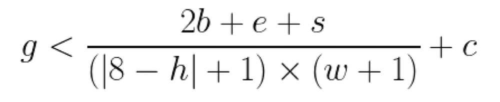

# 【速報】天才数学者「最高の朝を迎えるための公式を作ってやったぞ」

---

「**最高の朝を迎えるための公式を作ったぞ！**」って話([R](https://www.facebook.com/Dr-Anne-Marie-Imafidon-MBE-296354021227490/videos/744055986676818))がおもしろかったんでメモっておきます。

これは、シリアルで有名なケロッグ社が、数学者のアン・マリー・イマフィドン博士に依頼して行われた研究のひとつ。博士は英国科学協会の代表で、17歳でオックスフォード大学の修士号を取得した天才であります。

ここで博士にどんな依頼がなされたのかと言いますと、以下のような感じです。

- 私たちの「朝の目覚め」や「朝の元気」に影響を与える要因を研究する

- その結果をもとに、**「最高の朝」を毎日実現するための科学的な計算式**を作り上げる

「最高の朝を公式化する」と聞けば、なにやらいかがわしい感じもするわけですが、リサーチの規模はわりと真面目なものです。具体的には、2,000人のイギリス人にインタビューを行い、全員に「どんなことをやった日の朝に、あなたは最高に調子が良いですか？」を聞きまくり、そこから最高の朝に共通する習慣を数学的に割り出したんだそうな。

ちなみに、ケロッグがこのような研究を行ったのは、「英国の平均的な成人は週に2回、不機嫌な気分で目を覚増し、生涯で不機嫌な朝を迎える回数は生涯で合計8,881回になる」って調査報告が出たからだそうです。朝を不機嫌に過ごす人が多いのは、世界共通なんですねぇ。

では、はじめに博士が編み出した数式を見てみましょう。

って、なんのこっちゃわからんですが、それぞれの項目は以下のような意味になります。

- s＝朝のシャワーに費やした時間（分）
- e＝朝に運動した時間（分）
- b＝朝食を食べるのに費やした時間（分）
- h＝睡眠時間（時間）
- w＝目が覚めた時間と午前7時12分との差（時間）
- c＝その他の「身支度」のために費やした時間（ニュースを見る、瞑想をするなど)（分）
- g = 37 （イギリス人の平均的な身支度時間（分））

ということで、これでもいまいち分かりにくいかもですが、例えば、

- 朝のシャワーに10分
- 朝に軽い運動を10分
- 朝食15分（朝を抜いている人は、お茶やコーヒーを飲む時間）
- 睡眠は7時間半
- 朝7時に起きる
- その他の身支度に10分

みたいな人がいたとしましょう。この場合は、

- s＝10
- e＝10
- h＝7.5
- b＝15
- w＝朝7時起床と午前7時12分の差は12分なので、12÷60で「0.2」
- c＝10分

みたいになります。というわけで、これを計算してみると、「37.777」ぐらいの答えになりまして、ギリギリ37よりは大きいことがわかるわけですね。この数値が大きくなるほど「朝の状態は良い！」と判断できるんですな。

つまり、この研究においては、

- 「胃のなかに何かを入れる時間」「シャワー「運動」「その他のルーチン活動」という4種類のアクティビティを、最適な朝型生活を送るために欠かせない要素だと判断している。

- また、この研究では「8時間」をベストな睡眠時間に設定し、それと同時に「午前7時12分」をよい起床時間だと考えている。

ってことですね。この調査によれば、「最高の朝を迎えました！」と答えた人たちの多くは**「6時44分」が理想的な起床時間**であり、**シャワーには10分**をかけ、さらに**朝食には18分**、**運動には21分**を費やすのが最もよいとの結果だったそうな。

イマフィドン博士いわく、

> この式は、1日を正しくスタートさせるための素晴らしいツールだ。
>
> ただし、1日の始まりは人によってバラバラであり、誰もが同じ習慣によって同じ効果を得られるわけではない。
>
> とはいえ、最高の朝に必要なさまざまな要素を組み合わせることが、『正しい寝起き』の鍵となるのは間違いないだろう。「いつも機嫌が悪いまま起きてしまう」という人が多いのは、この組み合わせが間違っているのかもしれない。

とのこと。

もちろん、これはイギリスの生活に特化した式だし、査読論文でもないし、企業の委託研究に過ぎないので、**あくまで参考程度**にとらえていただければとは思います。

しかし、もしいまあなたが「朝の目覚めが悪いな……」とか思っていたら、この公式を参考にしつつ、最高の朝に必要な変数をいろいろといじってみて様子を確かめるのもいいかもしれません。
