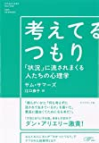
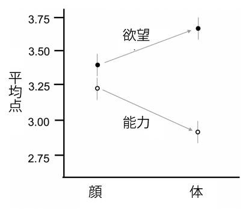

# パレオな男から削除されたヤバいエントリのサルベージ集#1

何度か書いてますが、「パレオな男」はグーグル様の広告費で運営されてまして、これが途切れると持続が不可能になるわけです。

が、グーグル様は過激な表現に厳しいので、いままでにブログから削除されてしまったエントリがいくつかあるんですよ。そのなかには、いまから見ても「役に立つなー」ってのもありまして、死蔵させておくのももったいないんですよね。

というわけで、今回は、「パレオな男」から削除されちゃったエントリから、使えそうなものや勉強になるものをサルベージして再掲しておきます。

---

## **「恋愛」の成功率を大きく左右する５つの状況**

タフツ大学のサム・ソマーズが書いた「考えてるつもり」は、人間がいかに状況に流されやすいかを解説したおもしろい一冊。なかでも「恋愛」の成功に関しては、もっとも状況の力が大きく関係しているそうな。具体的に恋愛を左右する要素は、以下の５つであります。

[考えてるつもり ――「状況」に流されまくる人たちの心理学](https://af.moshimo.com/af/c/click?a_id=790466&p_id=170&pc_id=185&pl_id=4062&s_v=b5Rz2P0601xu&url=http%3A%2F%2Fwww.amazon.co.jp%2Fexec%2Fobidos%2FASIN%2F4478015945%2Fref%3Dnosim)

posted with

[カエレバ](http://kaereba.com/)

サム・サマーズ ダイヤモンド社 2013-04-26

[Amazon](https://af.moshimo.com/af/c/click?a_id=790466&p_id=170&pc_id=185&pl_id=4062&s_v=b5Rz2P0601xu&url=http%3A%2F%2Fwww.amazon.co.jp%2Fgp%2Fsearch%3Fkeywords%3D%25E8%2580%2583%25E3%2581%2588%25E3%2581%25A6%25E3%2582%258B%25E3%2581%25A4%25E3%2582%2582%25E3%2582%258A%2520%25E2%2580%2595%25E2%2580%2595%25E3%2580%258C%25E7%258A%25B6%25E6%25B3%2581%25E3%2580%258D%25E3%2581%25AB%25E6%25B5%2581%25E3%2581%2595%25E3%2582%258C%25E3%2581%25BE%25E3%2581%258F%25E3%2582%258B%25E4%25BA%25BA%25E3%2581%259F%25E3%2581%25A1%25E3%2581%25AE%25E5%25BF%2583%25E7%2590%2586%25E5%25AD%25A6%26__mk_ja_JP%3D%25E3%2582%25AB%25E3%2582%25BF%25E3%2582%25AB%25E3%2583%258A)

[楽天市場](https://af.moshimo.com/af/c/click?a_id=790466&p_id=54&pc_id=54&pl_id=616&s_v=b5Rz2P0601xu&url=http%3A%2F%2Fsearch.rakuten.co.jp%2Fsearch%2Fmall%2F%25E8%2580%2583%25E3%2581%2588%25E3%2581%25A6%25E3%2582%258B%25E3%2581%25A4%25E3%2582%2582%25E3%2582%258A%2520%25E2%2580%2595%25E2%2580%2595%25E3%2580%258C%25E7%258A%25B6%25E6%25B3%2581%25E3%2580%258D%25E3%2581%25AB%25E6%25B5%2581%25E3%2581%2595%25E3%2582%258C%25E3%2581%25BE%25E3%2581%258F%25E3%2582%258B%25E4%25BA%25BA%25E3%2581%259F%25E3%2581%25A1%25E3%2581%25AE%25E5%25BF%2583%25E7%2590%2586%25E5%25AD%25A6%2F-%2Ff.1-p.1-s.1-sf.0-st.A-v.2%3Fx%3D0)

### **１・距離**

まず恋愛で大事なのが「距離」。近所に住んでいればいるほど、親密になる確率は上がっていくものらしい。身近な人と仲良くなるのは当たり前のようですが、その影響力は想像以上にデカいようで、ある実験によれば、

> アパートメントの２つの世帯を分ける距離はわずか５．８メートル。たったのそれだけ。そして約６メートル離れるごとに、２つの世帯が親しくなる可能性はほぼ半減していた。

とのこと。また、アメリカで行われた調査では、どの州の街を調べても、

**家が近ければ近いほど結婚率が高い傾向**

があり、婚約中のカップルの半数以上は１６ブロック以内に住んでいたそうな。

### **２・見覚え**

次に大事なのが「見覚え」。ひんぱんに顔を合わせる回数が多いほど、相手に対して魅力を感じてしまうわけですね。

たとえば、ピッツバーグ大学の実験では、

> 実際はクラスに登録していない３人の女性に、ほかの学生と一緒に大きな講義室に座ってもらった。１学期を通して、１人目の女性には講義室に５回座ってもらう。２人目は１０回。３人目は１５回。彼女たちはただじっと座り、１００人を超える学生の誰ともひと言の会話も交わさない。

って状況がセッティングされまして、その後でクラスの学生に、女性たちの魅力度を判定してもらったところ、講義室に姿を見せた回数が多ければ多いほど「魅力を感じる」と答える回数が上がったそうな。

### **３・相互利益**

「相互利益」は、相手から恩を受けたときに、つい好意を感じてしまう現象のこと。実際、バーで見知らぬ女性に酒をおごると、デートの約束を取り付ける確率が上がるってデータがあるらしい。べつの実験でも、

> ６０名の被験者を対象にパーティを開き、初対面の相手と会話をしてもらった。その後、被験者は別の部屋に案内され、交流した相手が書いたという触れ込みの偽アンケートを見せられた。そのなかには、被験者に対してよい印象を持たなかったという回答があれば、楽しい会話だったとの回答もある。
>
> そして、再び同じ相手と会話をしてもらったところ、相手が自分に好意的だと思った被験者のほうが、自分のプライベートについて多くを語り、積極的に会話に参加したのだった。

との結果が出たらしい。要は、自分が好意を持っていることを伝えるだけでも、相手との関係が進展する確率がグンと上がるってわけですね。

### **４・障害**

障害があるほど相手に魅力を感じしまう、「ロミオとジュリエット現象」のこと。バージニア大学のダン・ウェグナー教授の実験では、男女のペアを何組も集めてトランプで遊ばせ、同時にテーブルの下で足をからめていちゃつくように指示したんだそうな。

その際、彼らを２つのグループにわけて、一方には「テーブルの下でいちゃついていることは他のプレイヤーにはい知られていない」と伝え、もう一方には「他のプレイヤーもいちゃつきを知っている」と教えたらしい。すると、**秘密のいちゃつきを演じたペアは、より相手に対して魅力を感じた**んだとか。

とにかく、なんらかの秘密を共有するか、２人の間に障害を作るといいわけですね。

### **５・類似性**

同じ趣味を持つ相手に魅力を感じるのはよく聞く話ですが、心理学的な調査でもこの現象を裏づけるデータが出ているらしい。同じバンドが好きだったり、笑いのツボが同じだったりといった要素のほかにも、

- 人生に対する考え方
- 生い立ち
- 経歴
- 年齢
- 収入
- 教育水準
- ルックスのレベル

といった共通点を持つ相手にも、魅力を感じる確率は高くなるそうな。世間で言うほど、正反対の相手にひかれることは少ないみたいですね。

###### まとめ

そんなわけで、人間の恋愛感情は、思ったよりも周囲の環境に影響されている模様。しかし、実際にソマーズ教授がアンケートを取ったところ、**たいていの学生は「顔・お尻・知性」の３つで相手への好意が決まっている**と答えたそうで、状況の影響にはまったく気づいてなかったとか（笑）。気をつけたいもんです。

## **露出度の違いで相手の評価はどう変わるか？**

昔から「

**薄着の女性はモノとして見られやすい**

」と言った考え方がありますな。おもにフェミニズムの世界で言われてきたことで、それが男の問題点なのだ、みたいな。

これが事実かどうかは判断が難しいところですが、近ごろチェックした論文([R](http://psycnet.apa.org/doiLanding?doi=10.1037%2Fa0025883))では、別の考え方が出てておもしろかったです。

これはメリーランド大学の研究で、6つの実験から構成されております。だいたいどんなデザインだったかと言いますと、まず参加者たちに以下のような写真を見せたわけです。 顔だけの写真と、肌の露出が多い上半身の2パターンですね。

その上で、写真を見た際に、この人物への評価がどう変わるかをチェックしたんですな。具体的には、以下の2ポイントを調べたみたい。

1. **能力**：セルフコントロール能力とか計画力とか
2. **欲望**：楽しみを感じるのが好きかとか、空腹に強いか弱いか、とか

で、結果はグラフのようになりました。

いやー、わかりやすいですね。顔だけを見たときは差がなかったのに、体を見たとたんにグンと違いが出ております。簡単に言えば、

**露出が多いと「欲望に忠実で能力が低い人間だ！」と見られやすい**

わけですな。

また、この傾向には男女差がなかったようで、女性でも露出が多い男を見ると「無能だ！」と感じちゃうらしい。この点では男女平等。

研究者いわく、

> この研究は、「私たちは露出が多い人をモノとして見てしまう」という仮説に疑問を投げかけるものだ。今回の結果からみれば、服を着ていない人は、決して心のない生き物だとは見なされていない。その代わりに、人格が違う人としてとらえられるのだ。

とのこと。肌を出してる人を見ても、別に相手をモノとして見るわけじゃなくて、単にキャラの違いとして判断されるだけなんだ、と。言われてみればそうですわな。

で、この実験でおもしろいのは、別に実際に肌を露出してなくても同じ現象が起きるとこでしょうな。なんでも、同じように服を着ている人でも、たとえば「**その人の身体的な魅力を探してください**」と指示されただけでも、相手のことを「能力が低い」と思っちゃう傾向があったらしい。

つまり、実際に服を着てるかよりも、**相手がこちらの体に注目するかどうか**で判断が決まっちゃうわけっすね。なかなか難しいもんです。

さらに研究者いわく、

> こちらの体に意識を向けさせると、たんに能力が低いと思われてしまうだけでなく、衝動的で感情的な人間だと思われてしまうようにもなる。この現象は、キャリアの形成には逆効果に働くかもしれない。
>
> しかし、体への集中には、感受性が高くで感情が豊かだと思わせる側面もある。これは恋愛などには有利な特質かもしれない。

ってことでして、露出にも一長一短があることを強調しておられました。

ざっくりまとめると、

- 有能に見られたかったら体から意識を逸らさせるといい！

- 人間味にあふれたキャラに思われたければ体を意識させよう！

みたいなとこでしょうか。つまりは、

- 切れ者に見せたければ中肉中背を目指し（肥満でもガリガリでも肉体に意識が向くので）、ややゆったりめの服を着る

- 愛されキャラを目指すなら体のラインがわかるような服を着る

といった使い分けになるんでしょうかねぇ。このへんは推測ですけど、私のような半端なマッチョはどう判断されるのかが気になるところです（笑）

## **男のテストステロンレベルは握手でわかるという話**

言わずもがな、テストステロンは男性らしさを決めるホルモン。これが多いとヒゲが濃くなったり筋肉がつきやすくなったりするわけですけども、ある研究(

[R](http://www.ehbonline.org/article/S1090-5138%2807%2900066-9/abstract)

)によれば、

**男のテストステロンレベルは握手の強さでわかる**

らしい。

これはオールバニー大学の実験でして、82人の男子学生の握手の強さを計測したあと、過去の性体験やイジメ経験を答えてもらったんですね。すると、**握手が強い学生のほうが、初体験の時期が早く、性的パートナーの数が多くて、過去に弱い者いじめをしていた確率が高かった**らしい。なんかイヤな奴ですね（笑）。

研究者いわく、

> 手を握る力は、健康のレベルを計る良い指標であり、身体の障害、病気、死亡率の高さとは負の相関がある。これは遺伝的な要素がつよく、**手を握る力が強いほどテストステロンのレベルが高く、体脂肪も低い傾向がある**。

とのこと。また、この現象は女性には見られなかったそうな。まぁ原始時代には握力が強いほど生存に有利だったでしょうから、結果として握力の強い男ほど男性ホルモンがバリバリでモテるように進化したのは理解できる話です。ちなみに、わたしの握手は手を軽く添えるレベルのソフトタッチでして、この論文には非常に納得しました（笑）。

## **金のない男ほど巨乳が好きであることが科学的にあきらかに**

「

**貧しい男ほど巨乳が好きだ！**

」というオモシロ論文(

[R](http://www.plosone.org/article/info%3Adoi%2F10.1371%2Fjournal.pone.0057623)

)が出てきたのでメモしときます。

これは、ウエストミンスター大学のビレン・スワミ博士が行った実験で、まず266人の男性被験者を「低所得者」「中流」「高所得者」の３グループにわけまして。続いて、彼らに胸のサイズが異なる女性たちの動画（顔は同じ）を見て、それぞれの魅力度を判定してもらった、と。

すると、

**金のない男性ほど、胸の大きな女性を「魅力的だ！」と思う傾向が強かった**

というんですな。この現象が起きる理由をざっくり言うと、

1. 大きな胸には脂肪が多い
2. 脂肪は生存のために必要な資源
3. 貧しい男は資源がないので、無意識に不安を抱く
4. 大きな胸を見ると安心する
5. 巨乳好き！

ってな心の仕組みが、進化の過程で発達してきたからだそうな。

また、この論文では、もう１つ「腹が減った男」と「満腹の男」をくらべる実験も行われてまして、やはり

**腹が減った男のほうが巨乳を好む傾向があった**

みたい。これも、やはり

**巨乳が資源の象徴として働いている**

のが原因と考えられております。

そんなわけで、バストの好みと所得の関係についての研究でした。「発展途上国では太った女性がモテる」みたいな話と似ていて、ちょっと面白いっすね。あと「巨乳好き＝IQ低い」説の研究をご存じの方がいたら、教えてくださいませ。

## **知性が低い人ほどスピリチュアルに走りがち！という研究結果**

「**知性が低い人ほどスピリチュアル系の格言が大好き！**」([R](https://www.google.co.jp/url?sa=t&rct=j&q=&esrc=s&source=web&cd=1&cad=rja&uact=8&ved=0ahUKEwiLk7_6mcvJAhUiXqYKHQLUAE8QFgggMAA&url=http%3A%2F%2Fjournal.sjdm.org%2F15%2F15923a%2Fjdm15923a.pdf&usg=AFQjCNFmnO-tiqhs_hQ6EF7HCbfHUOxshg&sig2=8A3-1QAVKr1MxjHEx328LQ&bvm=bv.109332125,d.dGY))って論文が面白いです。

これはウォータールー大学の研究で、スピリチュアルと知性の関係について調べたもの。研究者が実験を思いついたのは、「**スピリチュアルの迷言ジェネレーター**」([R](http://sebpearce.com/bullshit/))ってサイトを見つけたからだそうな。

これはスピ系の人が言いそうなセリフを自動で作ってくれるサイトで、ちょっと試してみただけでも、

- 共感の力とは、我々にとって癒やしの可能性である。
- 「存在」とは、信念の御者である。
- 統制のとれた探究心は、抽象的な美につながるドアである。
- 人間の「知識」は、光子の加速度的な広がりに由来する。

といった言葉が生成されました。どれも格言ぽいだけで、何の意味もありません。

実験にあたって研究者は約800名の参加者を集めまして、全員に本当の名言とスピ系の迷言を見せて、「これは素晴らしい！」と思った言葉に点数をつけてもらったんですね。

本当の名言というのは、

- 川の流れは、自らの力によって岩を砕くのではない。たゆまぬ忍耐によって、岩を砕くのだ。

みたいなやつ。わかりやすいですねぇ。

いっぽうでスピ系の迷言というのは、

- 自然とは、自動調節される覚醒のエコシステムである。

みたいなやつ。スピ系の大御所として有名なディーパック・チョプラ博士が実際に言ったセリフだそうです。わけわからんですな。

そのうえで全員に思考力テストをおこなったところ、

- **27％の人はスピ系の迷言と実際の名言を見分けられなかった**

- 迷言にダマされやすい人は、信仰心が高く陰謀論を信じるケースが多い

- 迷言にダマされない人は、言語的な知性と流動的知性が高い

- 迷言にダマされた人たちは、「新生児には定期的に注意を向けましょう」みたいな普通のアドバイスにまで高い点数をつけた

といった結果が出たんですね。[言語的な知性](http://yuchrszk.blogspot.com/2014/12/blog-post_49.html)は言葉を使った表現力のことで、流動的知性は論理的にものごとを考える能力のこと。つまり、スピリチュアルに引きつけられる人は知性が低いのかもしれないんだ、と。

研究者いわく、

> 今回の結果により、スピ系のデタラメにダマされやすい人が一定数いることがわかった。たんなる懐疑主義だけでは、迷言を見抜くには物足りない。ばく然としたデタラメを見抜く洞察力が必要なのだ。
>
> スピ系のデタラメに影響を受けやすい人たちは、ものごとを深く考えようとせず、数字や言語、流動的知性などの認知機能も低い。また、哲学的なたわごとや陰謀論、宗教、超常現象などにも引きつけられがちで、自然療法や代替療法といったニセ医学に手を出す傾向も高い。

とのこと。いやーバッサリですね。 怒る人も多そうですけど個人的には共感しました。

しかし、昔はデータ主義だった人が気づいたらスピリチュアルに走ってたケースはよく見ますんで（とくに自己啓発界隈で）、わたしも気をつけませんと。近ごろは[マインドフルネス](http://yuchrszk.blogspot.com/2015/08/2015.html)業界にも似た傾向がありますしねぇ。
