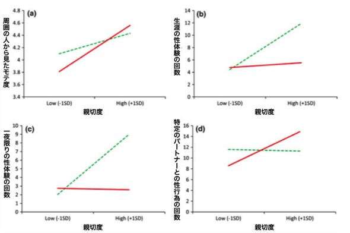
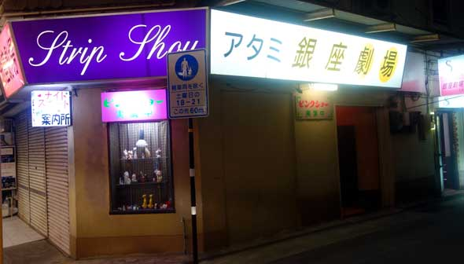
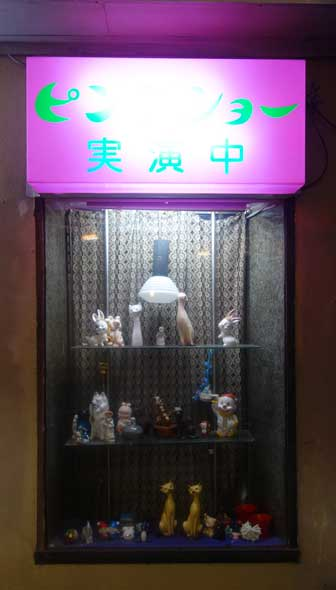
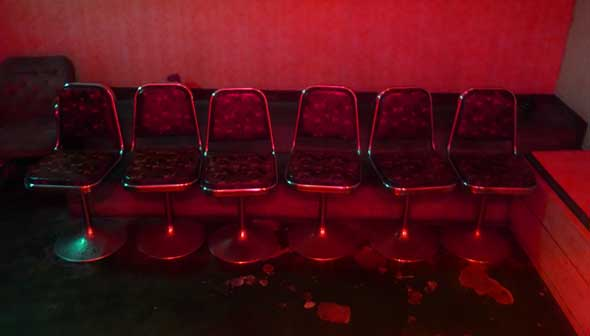

# パレオな男から削除されたヤバいエントリのサルベージ集#2

何度か書いてますが、「パレオな男」はグーグル様の広告費で運営されてまして、これが途切れると持続が不可能になるわけです。

が、グーグル様は過激な表現に厳しいので、いままでにブログから削除されてしまったエントリがいくつかあるんですよ。そのなかには、いまから見ても「役に立つなー」ってのもありまして、死蔵させておくのももったいないんですよね。

というわけで、今回は、「パレオな男」から削除されちゃったエントリから、使えそうなものや勉強になるもの（ならなそうなものも）をサルベージして再掲しておきます。

---

## **長続きするパートナーを選ぶ方法は？**

「**長続きする彼氏／彼女を見つけるにはどうすればいいの？**」っていう問題について調べたデータがたまったんでまとめておききます。「いまの相手とこのまま付き合っていいの？」とか、「どの相手と付き合うのがいいの？」って問題にお悩みの方はご参考までに。

さて、ここでご紹介する論文は４つで、いずれも「特定の相手と長続きするためにはどうすればいいのか？」って問題を調べてくれております。

１個ずつ説明すると長大になるんで、まずは大きな結論から言っちゃいます。

- **長続きする相手を探したければ、セルフコントロール能力、または誠実性が高い者を探せ！**

「パレオな男」を長くお読みの方であれば「あー、やっぱそれかー」って感想でしょうが、結局この２つに尽きますね（笑）

いちおうおさらいしておくと、[セルフコントロール](https://daigovideolab.jp/search?channel_owner=paleo&word=セルフコントロール)は言うまでもなく自分を律する能力のことで、[人生の幸せを左右](http://yuchrszk.blogspot.jp/2014/07/blog-post_18.html)する超大事な能力。また、[誠実性](https://daigovideolab.jp/search?channel_owner=paleo&word=誠実性)は[ビッグファイブ](http://yuchrszk.blogspot.jp/2014/11/blog-post_62.html)でいうところの「地道にやる能力」や「忍耐力」のことで、かなりセルフコントロールに近い概念です。つまり、誘惑に強くてコツコツやれる人が長期のパートナーとしてはいいよーってことですね。

では、具体的にどんなデータがあるのかざっくり紹介しますと、

- テネシー大学の研究([R](https://www.ncbi.nlm.nih.gov/pubmed/21280964))では、３つの実験により「浮気をしない相手」の条件としてもっとも重要なのはセルフコントロールだという結果に。事実、セルフコントロール能力が高い人ほど、魅力的な相手からの誘惑に強かった。

- ウィルフリッド・ローリエ大学の研究では([R](https://www.ncbi.nlm.nih.gov/pubmed/21244176))、セルフコントロールが高い相手と付き合うパートナーほど、互いの信頼レベルが高い傾向が見られた。そりゃそうでしょうな。

- ラドバウド大学の研究([R](https://www.ncbi.nlm.nih.gov/pubmed/21244181))では、セルフコントロール能力が高いカップルは、互いのミスを調整するモチベーションが高く、前向きに問題を解決していく傾向が強く、さらには２人の関係性の満足度も高かった。この傾向は、特に男性のセルフコントロール能力が高いほど効果が大きかった。

みたいな感じです。どれも当たり前といえば当たり前の話なんですが、みんな短期的には不良や悪女に惹かれがちだったりしますんで、誠実性の高い相手を選ぶのは意外と難しいんですよね。

続いて「誠実性」と「セルフコントロール」が高い相手を見抜く方法ですが、これは普段の行動を見てれば簡単に判断できるかと思います。たとえば、

- **目先の誘惑に強い**：セルフコントロールと忍耐力はニアリーイコールなので、具体的には貯金が多いほうがいいだろうし、怒りっぽい人はダメだろうし、太ってる人、タバコが止められない人なんかはツラいかも。あと、こちらのミスに対してすぐ不機嫌になる人もダメっすな。

- **計画を立てるのが上手い：**誠実性が高い人は、地道に計画を立ててこなすのが上手なんで、ここらへんも見極めのポイントになりましょう。つまり、時間にルーズな人、締切が守れない人、勘で行動する人なんかは辛いかも。まぁルーズな人って自由な印象も強いんで、短期的には魅力的に感じるケースもあったりするんですけどね。

- **集中力**：セルフコントロール能力が高い人は誘惑に勝つのが上手いんで、自然と注意力のコントロールも上手くなりがち。これを判断するには、「会話中に気がそれないか？」とか「デート中にスマホばっか触ってないか？」とか、そのへんを見ておけばいいかと思われます。

といったところでしょうな。まぁ、実際のところ、誠実性の高い人は簡単に判断できるかと思いますんで、真の問題は「**ついつい悪い人に惹かれてしまう自分**」にありそうな気もしますな。

## ナンパの声のかけかたで成果は変わるか？

こちらはブルターニュ南大学の実験([R](https://www.ncbi.nlm.nih.gov/pubmed/21369773))で、通りがかった男女に「今晩エッチしませんか？」といきなり尋ねたらどうなるかを調べた凄い研究であります。具体的には、まず研究者は4タイプの男女を用意しまして、

1. イケメン
2. 冴えない男
3. 美女
4. 冴えない女

そのうえで、道ゆく男女に以下の2パターンで声をかけたんだそうな。

- 「家でお酒を飲みませんか？」
- 「今晩エッチしませんか？」

いやー、なかなか豪快な研究ですすが、最終的にどんな差が出たかと言いますと、

- 家でお酒を飲みませんか？の場合
  - イケメンには57％の女性がイエスと回答
  - 冴えない男性には23％がイエスと回答
  - 美女には97％の男性がイエスと回答
  - 冴えない女性には80％がイエスと回答

- 今晩エッチしませんか？の場合
  - イケメンには3％の女性がイエスと回答
  - 冴えない男性にはイエスの回答なし
  - 美女には83％の男性がイエスと回答
  - 冴えない女性には60％がイエスと回答

だったそうです。予想どおり、男のほうがホイホイ誘いに乗りやすい傾向がバッチリ出てますね。というか個人的には、**冴えない男が「家で飲みません？」と誘っても23％の女性がイエスと答えてる**ところに驚きましたが。

## **テストステロンと女性関係には関係があるの？**

日ごろから「

[テストステロン](http://yuchrszk.blogspot.com/2015/10/blog-post_3.html)

」についてよく書いております。テストステロンは男性性をつかさどるホルモンで、健康の維持に欠かせないのは当然ながら、

[人間の性格にも影響を与える](http://yuchrszk.blogspot.com/2017/02/blog-post_25.html)

わけです。

ってところで非常におもしろかったのが、近ごろ出た論文(

[R](https://link.springer.com/article/10.1007/s40750-016-0054-8)

)であります。なんでも「

****テストステロンが低い男ほど女性との関係が安定する****

」というんですな。

これは79人の男子学生を対象にした研究で、全員のテストステロンレベルと女性との交際状況を毎月チェックしていったんだそうな。それで何がわかったかというと、

- 彼女がいない人ほどテストステロンは高い

- 特定の相手がいる人ほどテストステロンは低い

みたいな感じです。テストステロンが低いとモチベーションも下がるので、これは納得の結果と申せましょう。さらに、

- 最初からテストステロンが低い男性ほど、女性と長期的な関係を築きやすい

- ただし、最初からテストステロンが高い男性も、長期的な関係になるとテストステロンは下がる

ってとこがありまして、どうも**交際ステータスがテストステロンレベルを左右する**面が大きいみたい。テストステロンが低い男のほうが子育てには有利なんで、そのように進化してきたんでしょうなぁ。

さらに、この論文では、テストステロンと性格に関するデータがいろいろ引用されてまして、これがまたおもしろい。とくに「へー」と思ったのが2012年の実験([R](http://journals.plos.org/plosone/article?id=10.1371/journal.pone.0046774))で、46人の男性にテストステロンクリームを塗ってもらい、性格がどう変わるかを調べたんだそうな。

具体的には、各自で自由にサイコロを振ってもらい「６が出た人には賞金をあげますよー」と自己申告してもらったところ、

- テストステロンクリームを塗った参加者のほうがズルをしなかった！

って傾向があったんだそうな。**テストステロンが高くなると、なぜか性格が正直になる**わけですな。

その原因はよくわかっとらんのですが、過去の研究では「テストステロン値が高いと社会に役立つ行動をするようになる」って結果も出てるとのこと。どうもテストステロンには、[プロソーシャル](http://yuchrszk.blogspot.com/2017/02/blog-post_20.html)なメンタルを高める働きがあるみたい。うーん、おもしろい。

そんなわけで人間の性格においては、テストステロンの量には一長一短があるみたい。まぁ女性と長くつきあってテストステロンが下がるのは自然の摂理なんで、[かつての私のように](http://yuchrszk.blogspot.com/2015/10/blog-post_3.html)必要以上な低下を防ぐように気をつければいいと思いますが。

## **親切な男ほどモテモテで性行為の回数も多い！という調査データ**

**親切な人は魅力的！**ってデータが[昔からいくつかあったりします](http://yuchrszk.blogspot.com/2016/01/blog-post_27.html)。どうやら老いも若きも男も女も、他人に優しい性格のほうが異性へのアピール度が増すようなんですな。

その理由は大きく２つありまして、

- 優しい人は長期的なパートナーとしてふさわしくみなされるから

- 他人のために自分の時間や労力を使える人は、それだけ裕福で健康な可能性が高いから

みたいな感じ。進化のプロセスで作られた、パートナー選びのシステムが働いてるわけですね。

で、新たに行われた研究([R](http://onlinelibrary.wiley.com/doi/10.1111/bjop.12208/abstract;jsessionid=2525D23455CA102F5C16B29C581FC0A3.f01t01?systemMessage=Wiley+Online+Library+will+be+unavailable+on+Saturday+30th+July+2016+from+08%3A00-11%3A00+BST+%2F+03%3A00-06%3A00+EST+%2F+15%3A00-18%3A00+SGT+for+essential+maintenance.Apologies+for+the+inconvenience.))では、「**親切な人が魅力的なのはわかったけど、実際のところ性行為にまでこぎつけてるの？**」っていう下世話なとこまでふみこんでいておもしろかったです。

これはニピシング大学の研究で、女性192名と男性105名を対象にしたもの。みんなの「親切度」をテストでチェックしたうえで、異性からのモテ度と、過去の性体験の回数を調べたんだそうな。

その結果を、まずはグラフでご覧ください。いずれも、青いラインが男性、赤いラインが女性を表しております。

というわけで、ここからわかることは、

- 男女を問わず親切な人はモテる

- 性体験の総数については、親切な男性ほど多くなりやすい

- 特に一夜限りの関係においては、親切な男性の回数の増え方は異常

- 逆に女性は親切と性行為の総数に相関はないが、特定のパートナーとの回数は増える

といったところ。予想どおりではありますが、全体的に男のほうが乱交ぎみですね（笑）

研究者いわく、

> 過去のデータによれば、狩猟採集民の生活でも、獲ってきた肉を親族以外にもわけあたえる男性ほど性交の回数は多い。
>
> 今回の研究では、初めて西洋の近代社会においても「親切はモテる」という明白な証拠が得られた。ただし、この効果には性差があり、女性よりも男性にとってより有利に働くようだ。

とのこと。

そんなわけで、モテない！とお悩みの諸兄におかれましては、ファッションや会話術なぞに時間を使うよりも、ボランティアや募金などに精を出したほうがいいのかもしれません。どうぞよしなに。

## **熱海のツインピークス「アタミ銀座劇場」にて日本最高齢のストリッパーと語らった話**

熱海観光のラストは「静岡最強」と噂の「**銀座劇場**」さんへ。熱海銀座通り沿いに建つ老舗のストリップ小屋なんですが、浅草のように豪華なショーが見られるわけでもなく、初老のオーナーと老婆の踊り子がひっそりと営んでおりまして、それはそれは趣深いスポットなんだとか。

場所は銀座通りの商店街に入ってすぐ右手。年季の入ったビルの1階にたたずんでおります。かなりの好立地。

表には「ピンクショー実演中」の看板と、謎の猫オブジェがズラリ。ピンク要素ゼロですね。入館料は4,000円なんですが、オーナーと交渉したら3,000円にまけてくれました。

店内は12畳ほどの小ささで、すえた臭いがプンプン。赤い照明がギラギラ。「[ツインピークス](http://ja.wikipedia.org/wiki/%E3%83%84%E3%82%A4%E3%83%B3%E3%83%BB%E3%83%94%E3%83%BC%E3%82%AF%E3%82%B9)」に出てくる「[赤い部屋](http://static1.squarespace.com/static/5077d75de4b05b0a979420be/t/52576e29e4b06d33f3fd0efd/1381461546957/fwwm1566B.jpg)」を思い出しました。火よ、我とともに歩め！

客席はこんな感じ。やっぱりデビッド・リンチっぽいですね。

で、残念ながら踊り子さんの撮影は禁止だったんですが、御年は70代の半ばごろでしょうか。**見た目は[淡谷のり子](http://pds.exblog.jp/pds/1/201112/21/92/a0140592_15513568.jpg)先生にそっくり**で、頭は豊かな黒い長髪。つねにハーフトーンのサングラスをかけておられました。

場内にいたのは60分ぐらいで、客はわたしだけ。ステージの流れは、おおよそ以下のとおりです。

1. キャミソール姿の淡谷先生が登場。ラジカセの操作に手間どり、5分ほど曲が流れないハプニングが起きる。
2. ようやくムーディな昭和歌謡が流れだし、太極拳をスロー再生にしたようなテンポで淡谷先生がダンス開始。全体的にストレッチのような動きが多く、Eテレの朝の健康番組を見ている気分に。
3. 5分ほどで疲れたのか淡谷先生がステージに座り込み、客と雑談開始。
4. 15分ほど雑談のあと、おもむろに健康体操を再開。5分後にまた雑談の繰り返し。

といった感じで、**全ステージのおよそ70％が雑談**でした。なんだ、この時間。

とはいえ、雑談も非常に味わい深いものでして、その内容を記憶の限りに再生してみますと、

> あたしは商売が好きでの。昔は六本木と銀座でバーを経営しててね。お客さんは、そうねぇ、吉行淳之介とか梶山季之とか遠藤周作とか。遠藤先生には気に入られちゃって、よくおそばにいたから「娘さんですか？」なんて言われちゃって。そのあとは洋服屋をやったりもしたのよ。でも、やっぱり健康が第一でしょう？ それで**プラプラしてるうちに誘われちゃって**、ここで働くことになったのよ。

人生の前半から後半への急展開がハンパじゃありません。具体的にどう「プラプラしてた」のかは、怖くて聞けませんでした。

さらに現在の仕事について。

> この建物はオーナーの持ちビルなの。お客さんは多いときで1日30人ぐらい。平均で1日10人ぐらいね。いまは昔と違って夫婦でいらっしゃる方が多いわねぇ。勉強になりますよ。いろんな方がコンコンといらっしゃるから。昨日は南アフリカの女性がね、日本人の旦那さんと一緒にやってきたの。南アフリカの方は真面目よね。子どもを産まずに働くんですって。でも、仕事が終わったら、**子どもをドロドロ産んでねぇ**。あたしは、自慢じゃないけど、子どももないし、結婚をしたこともないの。戸籍は処女。ウフフフ。
>
> でも、ほら、いま駅前にビルを作ってるでしょ？ 将来はあそこに喫茶店を開くの。それで、**みんなに勇気とファイトをあげようと思ってね**。ウフフフフ。

言葉のはしばしに飛び出す独特の擬音がたまりません。そして、発言は全体的に前向きでポジティブ。

> こないだはね、これ、名前は言えないんだけど、**一億の株を持っているっていう男の方**が酔ってぷらりと入ってきたの。それで「キミ、踊らなくてもいい。僕はキミと話がしたいんだ」って言うから、手相を見てさしあげてね。あたし、その人の過去とかぜーんぶ当てちゃって、「うわーっ！」って。ウフフフフ。
>
> お客さんが来ると、手相を見ることが多いの。よく当たるから、もうみんな「オレも見てくれオレも見てくれ」って。でも、やりすぎるとオーナーに怒られちゃうから。ウフフフフ。

というわけでわたしも手相を見てもらったんですが、こちらの手の平をしばらく見つめたあとで「**うん、キレイな手ね**」とだけ一言。昭和のコントかと。

その後も特にこれといった発言はなく、「ほら、タテにシャッシャッシャッと線があるでしょ？」と繰り返すばかりで、くわしくは何も教えてくれず。最後は「でもね、やっぱり大事なのは自分自身よね。結局はどう行動するかだから」と、手相の意義を根本からくつがえす発言をしておられました。

ちなみに、淡谷先生の手相診断によれば、わたしの職業は「建築関係でしょ？」とのことで大ハズレ。少し慌てたのか、すばやく「建築の仕事は儲かるらしいわねー」と別の話に切り替えたあたりが、ちょっと可愛かったです。

そんなわけで、噂の「銀座劇場」は、完全にデビッド・リンチの世界でした。建物の非日常感もそうですが、**現実と幻想がつねに地続き**なトークも、まさに「ツインピークス」さながらであります。

そこに3,000円の価値があるのか？と問われれば、「**美味いものでも食べたほうがいいですよ**」とお答えするでしょうが、栄光と没落と妄想が交じり合ったステージの内容に、わたしは映画「[マルホランド・ドライブ](http://ja.wikipedia.org/wiki/%E3%83%9E%E3%83%AB%E3%83%9B%E3%83%A9%E3%83%B3%E3%83%89%E3%83%BB%E3%83%89%E3%83%A9%E3%82%A4%E3%83%96)」にも似た感傷をおぼえました。これが熱海だ！（違う）
