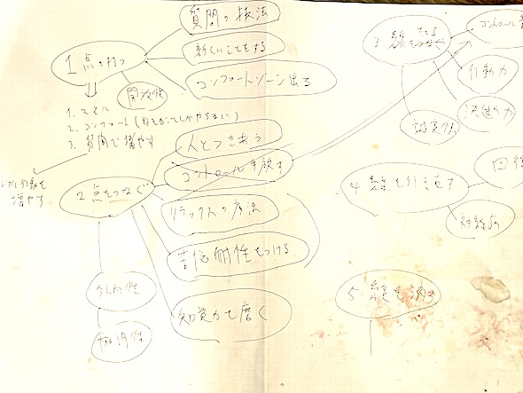
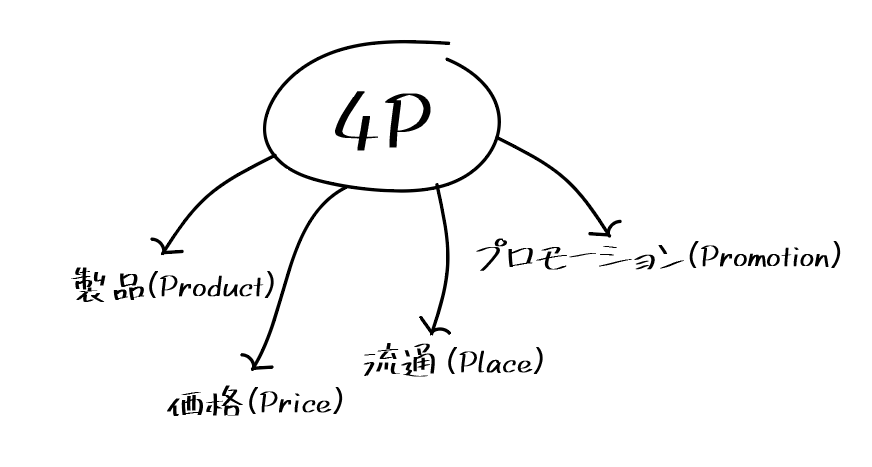
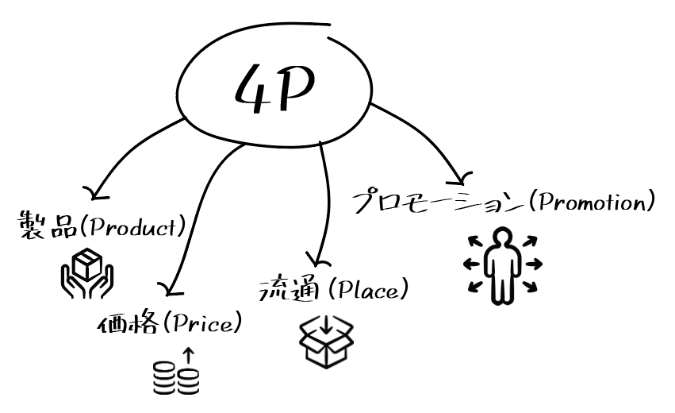
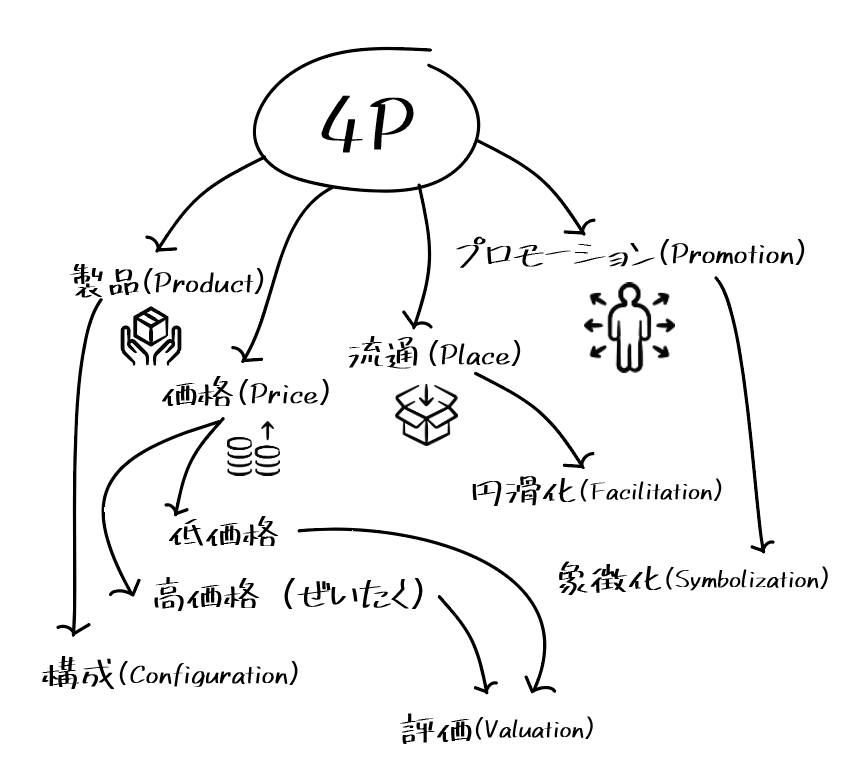

# 学習の効率を激上げするための「脳環境」設定ガイド#6「情報を脳内に叩き込むためのノート術」

「**学習の効率を激上げするための「脳環境」設定ガイド**」の続きです！([#1](https://daigovideolab.jp/blog/2114454),[#2](https://daigovideolab.jp/blog/2116006),[#3](https://daigovideolab.jp/blog/2116010),[#4](https://daigovideolab.jp/blog/2120061),[#5](https://daigovideolab.jp/blog/2120527))

---

このシリーズでは、「効率よく勉強するためには脳に優しいやり方をする必要があるぞ！」って考え方をもとに、最適な勉強法について考えおります。

前回からは「**情報を脳に叩き込むにはどうすればいいのか？**」というポイントをお伝えしてまして、教科書やレクチャーから得た情報を、いかにうまい具合に摂取していくかを見てみました。今回も「情報をいかに取り込むか？」の話は続きまして、「**知識を獲得するためのノートのとり方**」をチェックしていきます。

情報を得るには文章を読むのが基本ですが、それだけではなかなか頭に入らないのも事実。せっかく取り込んだデータをちゃんと理解しつつ記憶に収めるには、やっぱり自分の手を動かすのが一番なんですよ。

といっても、世の中には複数のノート術があるので、どの手法を使うか困ってしまう方が多いでしょう。コーネル式とかクイズ式ノートとか、有名なノート術だけでもかなりの数がありますからね。

そんななかで、私がよく使っているのが「****流動ノート****」ってやり方です。詳しくは後述しますが、現時点で精度が高めな学習理論を応用したノートのとり方で、個人的に使う限りでは「この方法が最も理解が進むなぁ」とか思っております。

ただし、念のため申し上げておきますと、現状の研究では「どのノート術がベストか？」って疑問には答えようがありません。いまんとこノートのとり方を比べたデータなどはないので、最終的には「理論的にどれが良さそうか？」で判断するしかないんですよねぇ。

その意味で、流動ノートを使うかどうかは、最終的にはあなたの好みの問題になります。決して今回の方法がベストって話ではございませんので。

### **獲得テク4. 流動ノート**

ってことで、まずは流動ノートのサンプルを見てみましょう。以下のノートは、いま書いている「幸運本」のために作ったものです。

といっても、私の字が汚すぎるせいで、これだけだと意味不明だと思いますんで、もう少し詳しく説明します（右下についてるのはブルーベリーの汁です）。

たとえば、あなたが「**マーケティングの4つのP**」を学ぶ講義に参加していて、教師が「4Pは、製品（Product）、価格（Price）、プロモーション（Promotion）、流通（Place）からなる」と言ったとしましょう。この場合は、ノートに以下のように書き始めます。

まずは中心にメイントピックを置き、そこから矢印で「4つのP」につなげていくわけですね。余裕があれば、さらにここからイラスト、図などでノートを装飾します（面倒ならやらなくてもよい）。

そこから、講師がそれぞれのアイデアを膨らませたら、さらにそのアイデアをつなぐ矢印を作成します。

ってことで、流動ノートの基本は以上です。もうおわかりの通り、これはマインドマップにかなり近い方法でして、すでに近いやり方をしている人も多いでしょう。マインドマップをさらにゆるくした感じですね。

ただ、流動ノートには、マインドマップとは異なるポイントがいくつかあるので、そこをまとめておきましょう。

1. **あくまで内容の理解を重視**：マインドマップはおもに発想法として使われる技法ですが、流動ノートの効果はあくまで内容の理解に特化しております。この方法で情報を書き残すためには、「このテーマで重要なものはなにか？」や「コアな情報はどれなのか？」といった疑問について考える必要が出てくるため、自然と脳の働きがアクティブになるんですよ。
   一方で、講義の内容をすべてを書き留めようと思うと、なにも脳を使わずにただ書き写すだけに終わっちゃうので、どれだけ大量にノートを書き出しても脳に残りづらかったりします。これは非常に大事なポイントですね。
2. **あくまで情報の整理を重視**：流動ノートでは、できるだけノートに書く情報量を減らし、そのデータを整理することに重点を置いております。ヒトの脳ってのは、自分で取捨選択した情報ほど記憶に残りやすくなるんですよね。そのため、流動ノートでは、せいぜい数個ぐらいの単語だけを使い、メモ書きのような感覚で情報をまとめていくのが重要となります。
3. **さらに自由度が高い**：マインドマップを使う際は、ひとつのアイデアから複数の枝を伸ばしていくのが基本。一方で流動ノートはさらに自由度が高く、関連する情報はどんどん矢印でつなげちゃっていいし、上の作例のように、いったん別れた枝を再びひとつに合流させても問題ありません（「価格」から「低価格」と「高価格」が分かれているところ）。
   言い換えれば、流動ノートでは、マインドマップのようにアイデアの階層は重視せず、**情報の関係性のほうに重きを置いてます**。アイデアを網の目みたいにつなげていくことで、脳に情報のつながりを見せてあげるのが最大のポイントですね。
   なので、メモを書きながら、何か新たなつながりが思い浮かんだら、別の矢印を描いてどんどんつなげていってください。もちろん、後で書いた情報が最初に書いた情報とつながっていることに気づいたら、逆向きに矢印を書いてもOKです。

以上の点を理解しておけば、流動ノートの使い方はそこまで間違えないはず。学びたい情報を自分の言葉でシンプルにまとめ、大量の情報につながりをつくっていくのが大事ってことだけ押さえておけば十分です。

### **流動ノートの弱点**

なにごとにも完璧なテクニックはないもので、流動ノートにも弱点が存在しております。流動ノートの問題点を一言でまとめると、

- 講義で講師が言ったことをそのまま書き写すのは不可能

って感じになります。そのため、ノートを講義のバックアップ用に使いたい時には、流動ノートを使うのは難しいんですな。また、「講義の内容がさっぱりわからん！」って状況で流動ノートを使っちゃうと、あとからノートを見直して復習するのも難しくなってしまうのも問題ですね。その場合は、従来どおりの「講義を丸写しする」タイプのノートを取り、その後の復習で流動ノートに変換するのがおすすめです。

また、流動ノートを使う際には、以下のポイントにも注意してくださいませ。

- 流動ノートに慣れるには、しばらく時間がかかるかもしれません。特にマジメな人ほど、最初のうちは「こんな適当な書き方でいいんだろうか？」って気分になるでしょう。しかし、流動ノートってのは脳に優しいノート術を目指して作られた技法なので、「これぐらいゆるほうが逆にいいのだ！」と考えながら取り組んでみてください。[前々回にお伝えした](https://daigovideolab.jp/blog/2120061)とおり、ヒトの脳ってのは情報をネットワークで学習しますんで、かっちり構造化されたノートよりは、情報をゆるくつなげたノートのほうが頭に入りやすいんですよ。

- 流動ノートを復習すると、「あれ？こっちの情報もつながってるな？」とか「こんな考え方もあるな？」みたいに思うことが多々あるはず。そんなときのために、ノートには1/3ぐらいの余白をつねに取っておくといいでしょう。復習の時点で情報のつながりを新たに見つけると、脳が大喜びで情報を脳に格納してくれますんで。

- 流動ノートは、あくまで情報理解の中間ステップに過ぎないことを忘れないようにしましょう。いくら大量の流動ノートを作っても、次回にお伝えする「理解する」の段階を深めないと、あんま意味がないので。このステップについては、次回から詳しくお伝えしていくので、しばしお待ち下さい。

## **今回の宿題**

というわけで、今回は情報摂取の効率を高めるノートの取り方を見てみました。これらの知識は練習しなければ意味がないので、実践の際は、以下のような手順をふんでみてください。

1. 別のノートを購入し、一番上に「流動ノートの練習」と書いてください。
2. 1日1回、勉強した内容を流動ノートで記録することを2週間続ましょう。授業を録音した音声を使い、それを15分間だけ聞きながら流動ノートを作成してもOK。

ってことで今回は以上です。次回からはステップ２の「理解する」のフェーズに進みます。ではまた！
