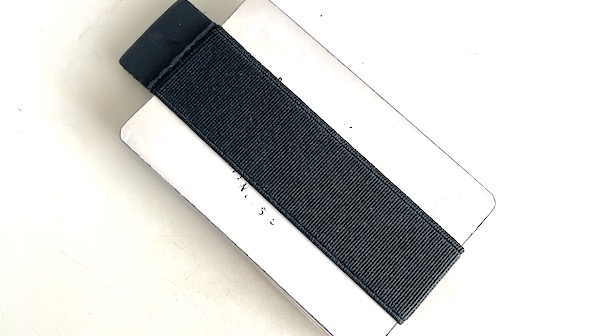

# 2022年に「買って良かったもの」11選

年末！というわけで、[毎年恒例](https://daigovideolab.jp/search?channel_owner=paleo&word=買ってよかった)の「今年買ってよかったもの」を並べておきまーす。

###### AirPods Pro（第2世代）

(function(b,c,f,g,a,d,e){b.MoshimoAffiliateObject=a; b\[a\]=b\[a\]||function(){arguments.currentScript=c.currentScript ||c.scripts\[c.scripts.length-2\];(b\[a\].q=b\[a\].q||\[\]).push(arguments)}; c.getElementById(a)||(d=c.createElement(f),d.src=g, d.id=a,e=c.getElementsByTagName("body")\[0\],e.appendChild(d))}) (window,document,"script","//dn.msmstatic.com/site/cardlink/bundle.js?20220329","msmaflink"); msmaflink({"n":"Apple AirPods Pro（第2世代） ​​​​​​​","b":"Apple(アップル)","t":"MQD83J\\/A","d":"https:\\/\\/m.media-amazon.com","c\_p":"\\/images\\/I","p":\["\\/2110TEYPKnL.\_SL500\_.jpg","\\/31PbPujVDrL.\_SL500\_.jpg","\\/21yN7r6nkYL.\_SL500\_.jpg","\\/11HqPOkX7kL.\_SL500\_.jpg","\\/11XSPNc7wOL.\_SL500\_.jpg"\],"u":{"u":"https:\\/\\/www.amazon.co.jp\\/dp\\/B0BDJGFWP4","t":"amazon","r\_v":""},"v":"2.1","b\_l":\[{"id":1,"u\_tx":"Amazonで見る","u\_bc":"#f79256","u\_url":"https:\\/\\/www.amazon.co.jp\\/dp\\/B0BDJGFWP4","a\_id":790466,"p\_id":170,"pl\_id":27060,"pc\_id":185,"s\_n":"amazon","u\_so":1},{"id":2,"u\_tx":"楽天市場で見る","u\_bc":"#f76956","u\_url":"https:\\/\\/search.rakuten.co.jp\\/search\\/mall\\/Apple%20AirPods%20Pro%EF%BC%88%E7%AC%AC2%E4%B8%96%E4%BB%A3%EF%BC%89%20%E2%80%8B%E2%80%8B%E2%80%8B%E2%80%8B%E2%80%8B%E2%80%8B%E2%80%8B\\/","a\_id":790464,"p\_id":54,"pl\_id":27059,"pc\_id":54,"s\_n":"rakuten","u\_so":2}\],"eid":"xq5Kq","s":"s"});

リンク

詳細は「[あれ？『AirPods Pro（第2世代）』めちゃ良くないか？](https://daigovideolab.jp/blog/6395955159840981362)」に書いたとおり、前世代のエアポッドよりもノイズキャンセリング機能が格段に進化しててビビりました。これを使っていれば、地下鉄でもそこそこ快適に過ごすことができまして、私のような神経症傾向マンには非常によろしいかと存じます。前世代のAirPods Proを持っていたので死ぬほど購入を迷ってたんですが、買ってよかったですねー。

###### MacBook Air（2022）

(function(b,c,f,g,a,d,e){b.MoshimoAffiliateObject=a; b\[a\]=b\[a\]||function(){arguments.currentScript=c.currentScript ||c.scripts\[c.scripts.length-2\];(b\[a\].q=b\[a\].q||\[\]).push(arguments)}; c.getElementById(a)||(d=c.createElement(f),d.src=g, d.id=a,e=c.getElementsByTagName("body")\[0\],e.appendChild(d))}) (window,document,"script","//dn.msmstatic.com/site/cardlink/bundle.js?20220329","msmaflink"); msmaflink({"n":"2022 13インチMacBook Air: 8コアCPUと8コアGPUを搭載したApple M2チップ, 256GB SSD - ミッドナイト","b":"Apple(アップル)","t":"","d":"https:\\/\\/m.media-amazon.com","c\_p":"\\/images\\/I","p":\["\\/41TlcM9CLjL.\_SL500\_.jpg","\\/31otr1gkveL.\_SL500\_.jpg","\\/31b5WvNfwjL.\_SL500\_.jpg","\\/51D+rXdn0-L.\_SL500\_.jpg","\\/51nWYnyVK+L.\_SL500\_.jpg","\\/31u1lM8aMuL.\_SL500\_.jpg","\\/41r5eUihz4L.\_SL500\_.jpg"\],"u":{"u":"https:\\/\\/www.amazon.co.jp\\/dp\\/B0B3BZC883","t":"amazon","r\_v":""},"v":"2.1","b\_l":\[{"id":1,"u\_tx":"Amazonで見る","u\_bc":"#f79256","u\_url":"https:\\/\\/www.amazon.co.jp\\/dp\\/B0B3BZC883","a\_id":790466,"p\_id":170,"pl\_id":27060,"pc\_id":185,"s\_n":"amazon","u\_so":1},{"id":2,"u\_tx":"楽天市場で見る","u\_bc":"#f76956","u\_url":"https:\\/\\/search.rakuten.co.jp\\/search\\/mall\\/2022%2013%E3%82%A4%E3%83%B3%E3%83%81MacBook%20Air%3A%208%E3%82%B3%E3%82%A2CPU%E3%81%A88%E3%82%B3%E3%82%A2GPU%E3%82%92%E6%90%AD%E8%BC%89%E3%81%97%E3%81%9FApple%20M2%E3%83%81%E3%83%83%E3%83%97%2C%20256GB%20SSD%20-%20%E3%83%9F%E3%83%83%E3%83%89%E3%83%8A%E3%82%A4%E3%83%88\\/","a\_id":790464,"p\_id":54,"pl\_id":27059,"pc\_id":54,"s\_n":"rakuten","u\_so":2}\],"eid":"TDSOr","s":"s"});

リンク

Intel版のMacBookAirからの買い替えました。噂には聞いていたものの、バッテリーの持続時間がかなり良くてびっくり。以前のIntel版は、作業をはじめてから1時間でバッテリーが70％ぐらいまで減ってドキドキしてたもんですが、今回は丸1日使っても50％ぐらいは残量が残ってまして、「これなら電源アダプターを持ち歩かなくてもすむ！」ってレベルですね。おかげで出張先での仕事が一気に楽になりまして、まことにありがたいことです。

###### モダンキャリー クイックドロー

(function(b,c,f,g,a,d,e){b.MoshimoAffiliateObject=a; b\[a\]=b\[a\]||function(){arguments.currentScript=c.currentScript ||c.scripts\[c.scripts.length-2\];(b\[a\].q=b\[a\].q||\[\]).push(arguments)}; c.getElementById(a)||(d=c.createElement(f),d.src=g, d.id=a,e=c.getElementsByTagName("body")\[0\],e.appendChild(d))}) (window,document,"script","//dn.msmstatic.com/site/cardlink/bundle.js?20220329","msmaflink"); msmaflink({"n":"モダンキャリー クイックドローミニマリスト財布 メンズ \\u0026 レディース ゴムバンドミニマルクレジットカードホルダー レザータブ付き カードグラバー ロングネイル用 マネークリップ代替 (ブラック), ブラック, One Size, モダン","b":"Modern Carry","t":"","d":"https:\\/\\/m.media-amazon.com","c\_p":"\\/images\\/I","p":\["\\/31tqDLwUe0L.\_SL500\_.jpg","\\/31u-I-ya4nL.\_SL500\_.jpg","\\/412dGxdJo3L.\_SL500\_.jpg","\\/313bEP7amkL.\_SL500\_.jpg","\\/41+ieOHW3PL.\_SL500\_.jpg","\\/51VGFGCt5NL.\_SL500\_.jpg"\],"u":{"u":"https:\\/\\/www.amazon.co.jp\\/dp\\/B084BQQLRY","t":"amazon","r\_v":""},"v":"2.1","b\_l":\[{"id":1,"u\_tx":"Amazonで見る","u\_bc":"#f79256","u\_url":"https:\\/\\/www.amazon.co.jp\\/dp\\/B084BQQLRY","a\_id":790466,"p\_id":170,"pl\_id":27060,"pc\_id":185,"s\_n":"amazon","u\_so":1},{"id":2,"u\_tx":"楽天市場で見る","u\_bc":"#f76956","u\_url":"https:\\/\\/search.rakuten.co.jp\\/search\\/mall\\/%E3%83%A2%E3%83%80%E3%83%B3%E3%82%AD%E3%83%A3%E3%83%AA%E3%83%BC%20%E3%82%AF%E3%82%A4%E3%83%83%E3%82%AF%E3%83%89%E3%83%AD%E3%83%BC%E3%83%9F%E3%83%8B%E3%83%9E%E3%83%AA%E3%82%B9%E3%83%88%E8%B2%A1%E5%B8%83%20%E3%83%A1%E3%83%B3%E3%82%BA%20%26%20%E3%83%AC%E3%83%87%E3%82%A3%E3%83%BC%E3%82%B9%20%E3%82%B4%E3%83%A0%E3%83%90%E3%83%B3%E3%83%89%E3%83%9F%E3%83%8B%E3%83%9E%E3%83%AB%E3%82%AF%E3%83%AC%E3%82%B8%E3%83%83%E3%83%88%E3%82%AB%E3%83%BC%E3%83%89%E3%83%9B%E3%83%AB%E3%83%80%E3%83%BC%20%E3%83%AC%E3%82%B6%E3%83%BC%E3%82%BF%E3%83%96%E4%BB%98%E3%81%8D%20%E3%82%AB%E3%83%BC%E3%83%89%E3%82%B0%E3%83%A9%E3%83%90%E3%83%BC%20%E3%83%AD%E3%83%B3%E3%82%B0%E3%83%8D%E3%82%A4%E3%83%AB%E7%94%A8%20%E3%83%9E%E3%83%8D%E3%83%BC%E3%82%AF%E3%83%AA%E3%83%83%E3%83%97%E4%BB%A3%E6%9B%BF%20(%E3%83%96%E3%83%A9%E3%83%83%E3%82%AF)%2C%20%E3%83%96%E3%83%A9%E3%83%83%E3%82%AF%2C%20One%20Size%2C%20%E3%83%A2%E3%83%80%E3%83%B3\\/","a\_id":790464,"p\_id":54,"pl\_id":27059,"pc\_id":54,"s\_n":"rakuten","u\_so":2}\],"eid":"P2dHJ","s":"s"});

リンク

わたくし、[小さな財布を見つけると買っちゃう性癖](https://daigovideolab.jp/blog/4514680163500921393)があるんですが、今年もいろいろと試したうえで、結局一番よく使っているのがモダンキャリー社のクイックドローでした。

いわゆるマネーバンドの一種で、カードとお札を束ねるゴムでしかないんだけど、強度が絶妙に調整されていて出し入れしやすいんですよね。もはやこれ以上ミニマルな財布はないだろうから、これを死ぬまで使うことになるのかな……。

ちなみに、「マネーバンドだと小銭が入らないからなぁ……」とお悩みの諸兄は、[ワイルドテックのミニマルウォレット](https://amzn.to/3FUDhzn)もありでしょう。アウトドア用のミニマル財布で、マネーバンドほどコンパクトにはならないものの、十分な使いやすさだったので。

###### サロモン センスライド 4

(function(b,c,f,g,a,d,e){b.MoshimoAffiliateObject=a; b\[a\]=b\[a\]||function(){arguments.currentScript=c.currentScript ||c.scripts\[c.scripts.length-2\];(b\[a\].q=b\[a\].q||\[\]).push(arguments)}; c.getElementById(a)||(d=c.createElement(f),d.src=g, d.id=a,e=c.getElementsByTagName("body")\[0\],e.appendChild(d))}) (window,document,"script","//dn.msmstatic.com/site/cardlink/bundle.js?20220329","msmaflink"); msmaflink({"n":"\[サロモン\] トレイルランニング SENSE RIDE 4 (センス ライド 4) メンズ Copen Blue\\/Black\\/Evening Primrose 26.0 cm","b":"\[サロモン\]","t":"L41210400","d":"https:\\/\\/m.media-amazon.com","c\_p":"\\/images\\/I","p":\["\\/41a+FFfEzlL.\_SL500\_.jpg","\\/41qNyOlUS2L.\_SL500\_.jpg","\\/41GpXBTByuL.\_SL500\_.jpg","\\/41+tZjMVquL.\_SL500\_.jpg","\\/41YAE+ODZIL.\_SL500\_.jpg","\\/51xizfF1VEL.\_SL500\_.jpg","\\/41jYcflMFIL.\_SL500\_.jpg","\\/41mApFTaP0L.\_SL500\_.jpg"\],"u":{"u":"https:\\/\\/www.amazon.co.jp\\/dp\\/B08C7Y82DN","t":"amazon","r\_v":""},"v":"2.1","b\_l":\[{"id":1,"u\_tx":"Amazonで見る","u\_bc":"#f79256","u\_url":"https:\\/\\/www.amazon.co.jp\\/dp\\/B08C7Y82DN","a\_id":790466,"p\_id":170,"pl\_id":27060,"pc\_id":185,"s\_n":"amazon","u\_so":1},{"id":2,"u\_tx":"楽天市場で見る","u\_bc":"#f76956","u\_url":"https:\\/\\/search.rakuten.co.jp\\/search\\/mall\\/%5B%E3%82%B5%E3%83%AD%E3%83%A2%E3%83%B3%5D%20%E3%83%88%E3%83%AC%E3%82%A4%E3%83%AB%E3%83%A9%E3%83%B3%E3%83%8B%E3%83%B3%E3%82%B0%20SENSE%20RIDE%204%20(%E3%82%BB%E3%83%B3%E3%82%B9%20%E3%83%A9%E3%82%A4%E3%83%89%204)%20%E3%83%A1%E3%83%B3%E3%82%BA%20Copen%20Blue%2FBlack%2FEvening%20Primrose%2026.0%20cm\\/","a\_id":790464,"p\_id":54,"pl\_id":27059,"pc\_id":54,"s\_n":"rakuten","u\_so":2}\],"eid":"MkR5A","s":"s"});

リンク

今年からはじめたトレイルランニングのために購入。サロモンのセンスライド4はクイックレースという独自の機構を使っていて、ヒモを引っ張りながらストッパーを下げるだけでOKなのが特徴っすね。いちいちヒモを結ばなくていいし、走っているうちにヒモがゆるむ心配もないのもナイスですね。

実際に使ってみるとクッション感が絶妙だし、ホールド感もよかったので、山道を安心して走ることができております。

###### EcoFlow ポータブル電源 RIVER

(function(b,c,f,g,a,d,e){b.MoshimoAffiliateObject=a; b\[a\]=b\[a\]||function(){arguments.currentScript=c.currentScript ||c.scripts\[c.scripts.length-2\];(b\[a\].q=b\[a\].q||\[\]).push(arguments)}; c.getElementById(a)||(d=c.createElement(f),d.src=g, d.id=a,e=c.getElementsByTagName("body")\[0\],e.appendChild(d))}) (window,document,"script","//dn.msmstatic.com/site/cardlink/bundle.js?20220329","msmaflink"); msmaflink({"n":"EcoFlow ポータブル電源 RIVER 2 6倍長寿命 256Wh容量 60分満充電 \\/ リン酸鉄リチウムイオン電池 \\/ 充放電サイクル3,000回以上 \\/ 高耐久 \\/ BMS電池保護機能 \\/ 液晶大画面 \\/ アプリ遠隔操作 \\/ 軽量化デザイン \\/ AC(定格300W サージ600W X-Boostで450W）\\/ USB-A \\/ USB-C キャンプ 車中泊 アウトドア 電力確保 停電対策 防災グッズ (エコフロー リバー2)","b":"EF ECOFLOW","t":"","d":"https:\\/\\/m.media-amazon.com","c\_p":"\\/images\\/I","p":\["\\/312gyZr0EpL.\_SL500\_.jpg","\\/41B6uzDLQ+L.\_SL500\_.jpg","\\/51RqvHJlRvL.\_SL500\_.jpg","\\/51erUzfE3nL.\_SL500\_.jpg","\\/41bp0pZIxEL.\_SL500\_.jpg","\\/51NXwrdzDYL.\_SL500\_.jpg"\],"u":{"u":"https:\\/\\/www.amazon.co.jp\\/dp\\/B0BFK8N8S9","t":"amazon","r\_v":""},"v":"2.1","b\_l":\[{"id":1,"u\_tx":"Amazonで見る","u\_bc":"#f79256","u\_url":"https:\\/\\/www.amazon.co.jp\\/dp\\/B0BFK8N8S9","a\_id":790466,"p\_id":170,"pl\_id":27060,"pc\_id":185,"s\_n":"amazon","u\_so":1},{"id":2,"u\_tx":"楽天市場で見る","u\_bc":"#f76956","u\_url":"https:\\/\\/search.rakuten.co.jp\\/search\\/mall\\/EcoFlow%20%E3%83%9D%E3%83%BC%E3%82%BF%E3%83%96%E3%83%AB%E9%9B%BB%E6%BA%90%20RIVER%202%206%E5%80%8D%E9%95%B7%E5%AF%BF%E5%91%BD%20256Wh%E5%AE%B9%E9%87%8F%2060%E5%88%86%E6%BA%80%E5%85%85%E9%9B%BB%20%2F%20%E3%83%AA%E3%83%B3%E9%85%B8%E9%89%84%E3%83%AA%E3%83%81%E3%82%A6%E3%83%A0%E3%82%A4%E3%82%AA%E3%83%B3%E9%9B%BB%E6%B1%A0%20%2F%20%E5%85%85%E6%94%BE%E9%9B%BB%E3%82%B5%E3%82%A4%E3%82%AF%E3%83%AB3%2C000%E5%9B%9E%E4%BB%A5%E4%B8%8A%20%2F%20%E9%AB%98%E8%80%90%E4%B9%85%20%2F%20BMS%E9%9B%BB%E6%B1%A0%E4%BF%9D%E8%AD%B7%E6%A9%9F%E8%83%BD%20%2F%20%E6%B6%B2%E6%99%B6%E5%A4%A7%E7%94%BB%E9%9D%A2%20%2F%20%E3%82%A2%E3%83%97%E3%83%AA%E9%81%A0%E9%9A%94%E6%93%8D%E4%BD%9C%20%2F%20%E8%BB%BD%E9%87%8F%E5%8C%96%E3%83%87%E3%82%B6%E3%82%A4%E3%83%B3%20%2F%20AC(%E5%AE%9A%E6%A0%BC300W%20%E3%82%B5%E3%83%BC%E3%82%B8600W%20X-Boost%E3%81%A7450W%EF%BC%89%2F%20USB-A%20%2F%20USB-C%20%E3%82%AD%E3%83%A3%E3%83%B3%E3%83%97%20%E8%BB%8A%E4%B8%AD%E6%B3%8A%20%E3%82%A2%E3%82%A6%E3%83%88%E3%83%89%E3%82%A2%20%E9%9B%BB%E5%8A%9B%E7%A2%BA%E4%BF%9D%20%E5%81%9C%E9%9B%BB%E5%AF%BE%E7%AD%96%20%E9%98%B2%E7%81%BD%E3%82%B0%E3%83%83%E3%82%BA%20(%E3%82%A8%E3%82%B3%E3%83%95%E3%83%AD%E3%83%BC%20%E3%83%AA%E3%83%90%E3%83%BC2)\\/","a\_id":790464,"p\_id":54,"pl\_id":27059,"pc\_id":54,"s\_n":"rakuten","u\_so":2}\],"eid":"Ksz0B","s":"s"});

リンク

ソロキャンプと防災の両方に使えるだろうと思い、アマゾンのブラックフライデーでポータブル電源を購入。このタイプのアイテムとしては軽量（3.5kg）で、6つの出力ポートが使えるナイスな商品であります。とりあえずノートPCも複数回にわたって満充電できるし、電気毛布も余裕で一晩使えるしで、防災アイテムとしてよろしいのではないでしょうか。まだキャンプでは使えてないんですが、そのうち冬キャン用に持参してみるつもり。

###### コールマン 寝袋 マルチレイヤースリーピングバッグ

(function(b,c,f,g,a,d,e){b.MoshimoAffiliateObject=a; b\[a\]=b\[a\]||function(){arguments.currentScript=c.currentScript ||c.scripts\[c.scripts.length-2\];(b\[a\].q=b\[a\].q||\[\]).push(arguments)}; c.getElementById(a)||(d=c.createElement(f),d.src=g, d.id=a,e=c.getElementsByTagName("body")\[0\],e.appendChild(d))}) (window,document,"script","//dn.msmstatic.com/site/cardlink/bundle.js?20220329","msmaflink"); msmaflink({"n":"コールマン(Coleman) 寝袋 マルチレイヤースリーピングバッグ 2000034777","b":"コールマン(Coleman)","t":"2000034777","d":"https:\\/\\/m.media-amazon.com","c\_p":"\\/images\\/I","p":\["\\/41xZoimaT6L.\_SL500\_.jpg","\\/41yCzyao5pL.\_SL500\_.jpg","\\/31Mne5b2wcL.\_SL500\_.jpg","\\/41okpOvVPhL.\_SL500\_.jpg","\\/51rsLrF7KHL.\_SL500\_.jpg","\\/4125xvP0LoL.\_SL500\_.jpg"\],"u":{"u":"https:\\/\\/www.amazon.co.jp\\/dp\\/B07M7D4Y5D","t":"amazon","r\_v":""},"v":"2.1","b\_l":\[{"id":1,"u\_tx":"Amazonで見る","u\_bc":"#f79256","u\_url":"https:\\/\\/www.amazon.co.jp\\/dp\\/B07M7D4Y5D","a\_id":790466,"p\_id":170,"pl\_id":27060,"pc\_id":185,"s\_n":"amazon","u\_so":1},{"id":2,"u\_tx":"楽天市場で見る","u\_bc":"#f76956","u\_url":"https:\\/\\/search.rakuten.co.jp\\/search\\/mall\\/%E3%82%B3%E3%83%BC%E3%83%AB%E3%83%9E%E3%83%B3(Coleman)%20%E5%AF%9D%E8%A2%8B%20%E3%83%9E%E3%83%AB%E3%83%81%E3%83%AC%E3%82%A4%E3%83%A4%E3%83%BC%E3%82%B9%E3%83%AA%E3%83%BC%E3%83%94%E3%83%B3%E3%82%B0%E3%83%90%E3%83%83%E3%82%B0%202000034777\\/","a\_id":790464,"p\_id":54,"pl\_id":27059,"pc\_id":54,"s\_n":"rakuten","u\_so":2}\],"eid":"hz1Ke","s":"s"});

リンク

今年から冬キャンに手を出したので、「0℃でも快適な寝袋が欲しい！」と思って購入したものです。3つの寝袋が組み合わさった形状をしていて、中のレイヤーを切り離せば夏用シュラフとしても使えるのが売り。氷点下まで対応できるシュラフとしてはお値段も手頃で、性能と価格のバランスが良いのではないでしょうか。

さっそく12月の群馬で使ってみたところ、0℃の環境でも快適に眠ることができまして、Tシャツとジャージだけでも朝までぐっすりでした。まー、重さが4.9kgもあるのが難点ですが、これは高機能シュラフだと仕方ないですからねぇ。

###### サーモス アイスコーヒーメーカー

(function(b,c,f,g,a,d,e){b.MoshimoAffiliateObject=a; b\[a\]=b\[a\]||function(){arguments.currentScript=c.currentScript ||c.scripts\[c.scripts.length-2\];(b\[a\].q=b\[a\].q||\[\]).push(arguments)}; c.getElementById(a)||(d=c.createElement(f),d.src=g, d.id=a,e=c.getElementsByTagName("body")\[0\],e.appendChild(d))}) (window,document,"script","//dn.msmstatic.com/site/cardlink/bundle.js?20220329","msmaflink"); msmaflink({"n":"サーモス アイスコーヒーメーカー 0.66L ディープロースト ECI-661 D-RST","b":"サーモス(THERMOS)","t":"ECI-661 D-RST","d":"https:\\/\\/m.media-amazon.com","c\_p":"\\/images\\/I","p":\["\\/31op8U1V3SL.\_SL500\_.jpg","\\/41nYz-83xSL.\_SL500\_.jpg","\\/51Ebgan5D8L.\_SL500\_.jpg","\\/31JOY8Qi3zL.\_SL500\_.jpg","\\/31T50ud3IFL.\_SL500\_.jpg","\\/31yCOqZlMWL.\_SL500\_.jpg","\\/31fL7xvUNlL.\_SL500\_.jpg"\],"u":{"u":"https:\\/\\/www.amazon.co.jp\\/dp\\/B07NMG8YSX","t":"amazon","r\_v":""},"v":"2.1","b\_l":\[{"id":1,"u\_tx":"Amazonで見る","u\_bc":"#f79256","u\_url":"https:\\/\\/www.amazon.co.jp\\/dp\\/B07NMG8YSX","a\_id":790466,"p\_id":170,"pl\_id":27060,"pc\_id":185,"s\_n":"amazon","u\_so":1},{"id":2,"u\_tx":"楽天市場で見る","u\_bc":"#f76956","u\_url":"https:\\/\\/search.rakuten.co.jp\\/search\\/mall\\/%E3%82%B5%E3%83%BC%E3%83%A2%E3%82%B9%20%E3%82%A2%E3%82%A4%E3%82%B9%E3%82%B3%E3%83%BC%E3%83%92%E3%83%BC%E3%83%A1%E3%83%BC%E3%82%AB%E3%83%BC%200.66L%20%E3%83%87%E3%82%A3%E3%83%BC%E3%83%97%E3%83%AD%E3%83%BC%E3%82%B9%E3%83%88%20ECI-661%20D-RST\\/","a\_id":790464,"p\_id":54,"pl\_id":27059,"pc\_id":54,"s\_n":"rakuten","u\_so":2}\],"eid":"FqSuK","s":"s"});

リンク

美味いアイスコーヒーを作るためだけに考案されたマシンです。これまでは熱いコーヒーに氷を入れていたのが、こいつを使うと最適な濃さのアイスコーヒーを仕上げてくれるので重宝しております。値段も安いので、コーヒー愛飲家にはよろしいのではないでしょうか。ただし、そこそこ場所を取る商品なので、購入を検討の際はサイズ感にご注意ください。

###### Scrivener（スクリブナー）

[
Scrivener | Literature & Latte](https://www.literatureandlatte.com/scrivener/overview)

本の執筆用に開発された有名なアウトライナー。いままで原稿は「[egword Universal 2](https://www.monokakido.jp/ja/mac/egworduniversal2/)」で書いてたんですけど、使う資料が年々増えてきたもので、すべてを一元管理するために導入してみました。

で、いざ使うと、画面を分割しつつ「前の章を参考にしつつ次の章を書く」みたいなことができるし、文献のPDFも同じ原稿ファイルに放り込めるし、サイドバーにアイデアメモも書き込めるし、論文サイトへの直リンクも貼れるしで、本を書く人にはとても使えるアプリではないかと。

が、一方で執筆の快適さでは「[egword](https://www.monokakido.jp/ja/mac/egworduniversal2/)」のほうが格段に上で、「スクリブナー」には独特のもっさり感と、日本語レイアウトの乱れが目立つんですよねー。これは判断が難しいとこですけど、「とにかくノーストレスで書きたい！」という方には、「[egword](https://www.monokakido.jp/ja/mac/egworduniversal2/)」がオススメで、私のように大量の資料を整理＆参照しつつ書きたい方には「スクリブナー」が良いでしょうね。

###### PORTER SMOKY スモーキー ショルダーバッグ

(function(b,c,f,g,a,d,e){b.MoshimoAffiliateObject=a; b\[a\]=b\[a\]||function(){arguments.currentScript=c.currentScript ||c.scripts\[c.scripts.length-2\];(b\[a\].q=b\[a\].q||\[\]).push(arguments)}; c.getElementById(a)||(d=c.createElement(f),d.src=g, d.id=a,e=c.getElementsByTagName("body")\[0\],e.appendChild(d))}) (window,document,"script","//dn.msmstatic.com/site/cardlink/bundle.js?20220329","msmaflink"); msmaflink({"n":"\[ポーター\]PORTER SMOKY スモーキー ショルダーバッグ 2WAY 592-06369 ネイビー\\/50","b":"PORTER(ポーター)","t":"592-06369","d":"https:\\/\\/m.media-amazon.com","c\_p":"\\/images\\/I","p":\["\\/412slvq+doL.\_SL500\_.jpg","\\/51pypzvbOhL.\_SL500\_.jpg","\\/51dR8mDc2BL.\_SL500\_.jpg","\\/51A7jY4CrzL.\_SL500\_.jpg","\\/51-OccvjKJL.\_SL500\_.jpg","\\/31dJjDcU-wL.\_SL500\_.jpg","\\/41TSqA5i-sL.\_SL500\_.jpg","\\/51GwfyVO6kL.\_SL500\_.jpg","\\/41H+w5JROAL.\_SL500\_.jpg"\],"u":{"u":"https:\\/\\/www.amazon.co.jp\\/dp\\/B00OIGWM3K","t":"amazon","r\_v":""},"v":"2.1","b\_l":\[{"id":1,"u\_tx":"Amazonで見る","u\_bc":"#f79256","u\_url":"https:\\/\\/www.amazon.co.jp\\/dp\\/B00OIGWM3K","a\_id":790466,"p\_id":170,"pl\_id":27060,"pc\_id":185,"s\_n":"amazon","u\_so":1},{"id":2,"u\_tx":"楽天市場で見る","u\_bc":"#f76956","u\_url":"https:\\/\\/search.rakuten.co.jp\\/search\\/mall\\/%5B%E3%83%9D%E3%83%BC%E3%82%BF%E3%83%BC%5DPORTER%20SMOKY%20%E3%82%B9%E3%83%A2%E3%83%BC%E3%82%AD%E3%83%BC%20%E3%82%B7%E3%83%A7%E3%83%AB%E3%83%80%E3%83%BC%E3%83%90%E3%83%83%E3%82%B0%202WAY%20592-06369%20%E3%83%8D%E3%82%A4%E3%83%93%E3%83%BC%2F50\\/","a\_id":790464,"p\_id":54,"pl\_id":27059,"pc\_id":54,"s\_n":"rakuten","u\_so":2}\],"eid":"TFXDC","s":"s"});

リンク

「四六版ぐらいの単行本を2冊ぐらい持ってでかけたいときがあるなー」という欲望を満たすために買った商品。350ページ前後の四六版の本2冊をすっぽり収納できて、その他のスペースにもエコバッグやらスマホなどを持ち運べるので重宝しております。私は本を運ぶためだけに買いましたが、中の仕切りも多いので、ガジェットを仕分けて収納するためのバッグインバッグとして買うのもありでしょうな。

###### Belkin 3 in 1 MagSafe

(function(b,c,f,g,a,d,e){b.MoshimoAffiliateObject=a; b\[a\]=b\[a\]||function(){arguments.currentScript=c.currentScript ||c.scripts\[c.scripts.length-2\];(b\[a\].q=b\[a\].q||\[\]).push(arguments)}; c.getElementById(a)||(d=c.createElement(f),d.src=g, d.id=a,e=c.getElementsByTagName("body")\[0\],e.appendChild(d))}) (window,document,"script","//dn.msmstatic.com/site/cardlink/bundle.js?20220329","msmaflink"); msmaflink({"n":"【VGP 2022受賞】Belkin 3 in 1 MagSafe充電器 最大15W高速充電 ワイヤレス充電器 MagSafe公式認証 iPhone 14 \\/ 13 \\/ 12 \\/ Apple Watch \\/ AirPods 対応 ブラック WIZ009dqBK","b":"Belkin","t":"WIZ009dqBK","d":"https:\\/\\/m.media-amazon.com","c\_p":"\\/images\\/I","p":\["\\/41ZXfE1aKFL.\_SL500\_.jpg","\\/317U8aURibL.\_SL500\_.jpg","\\/41eA4XdBWOL.\_SL500\_.jpg","\\/41MozXtRbYL.\_SL500\_.jpg","\\/31O6wi+WLtL.\_SL500\_.jpg","\\/41Ndc2omyJL.\_SL500\_.jpg","\\/41Mtnzqgk0L.\_SL500\_.jpg","\\/41DRYi246IL.\_SL500\_.jpg","\\/41PAEngnCnL.\_SL500\_.jpg","\\/51IjRoalS1L.\_SL500\_.jpg"\],"u":{"u":"https:\\/\\/www.amazon.co.jp\\/dp\\/B08Y6DHQ9L","t":"amazon","r\_v":""},"v":"2.1","b\_l":\[{"id":1,"u\_tx":"Amazonで見る","u\_bc":"#f79256","u\_url":"https:\\/\\/www.amazon.co.jp\\/dp\\/B08Y6DHQ9L","a\_id":790466,"p\_id":170,"pl\_id":27060,"pc\_id":185,"s\_n":"amazon","u\_so":1},{"id":2,"u\_tx":"楽天市場で見る","u\_bc":"#f76956","u\_url":"https:\\/\\/search.rakuten.co.jp\\/search\\/mall\\/%E3%80%90VGP%202022%E5%8F%97%E8%B3%9E%E3%80%91Belkin%203%20in%201%20MagSafe%E5%85%85%E9%9B%BB%E5%99%A8%20%E6%9C%80%E5%A4%A715W%E9%AB%98%E9%80%9F%E5%85%85%E9%9B%BB%20%E3%83%AF%E3%82%A4%E3%83%A4%E3%83%AC%E3%82%B9%E5%85%85%E9%9B%BB%E5%99%A8%20MagSafe%E5%85%AC%E5%BC%8F%E8%AA%8D%E8%A8%BC%20iPhone%2014%20%2F%2013%20%2F%2012%20%2F%20Apple%20Watch%20%2F%20AirPods%20%E5%AF%BE%E5%BF%9C%20%E3%83%96%E3%83%A9%E3%83%83%E3%82%AF%20WIZ009dqBK\\/","a\_id":790464,"p\_id":54,"pl\_id":27059,"pc\_id":54,"s\_n":"rakuten","u\_so":2}\],"eid":"v59rM","s":"s"});

リンク

iPhone、Apple Watch、AirPodsをまとめて充電できるガジェット。ただそれだけの商品ですが、こなれたデザインで机をスッキリさせてくれるので、購入後の満足感は非常に高いです。

###### タイムタイマー

(function(b,c,f,g,a,d,e){b.MoshimoAffiliateObject=a; b\[a\]=b\[a\]||function(){arguments.currentScript=c.currentScript ||c.scripts\[c.scripts.length-2\];(b\[a\].q=b\[a\].q||\[\]).push(arguments)}; c.getElementById(a)||(d=c.createElement(f),d.src=g, d.id=a,e=c.getElementsByTagName("body")\[0\],e.appendChild(d))}) (window,document,"script","//dn.msmstatic.com/site/cardlink/bundle.js?20220329","msmaflink"); msmaflink({"n":"タイムタイマー(TIME TIMER) 勉強タイマー MOD モッド (カバー付き) チャコールグレイ 9cm 60分 学習アラーム 正規品 TTM9-W","b":"タイムタイマー","t":"TTM9-W","d":"https:\\/\\/m.media-amazon.com","c\_p":"\\/images\\/I","p":\["\\/41V7Q8futZL.\_SL500\_.jpg","\\/51RqVBUch-L.\_SL500\_.jpg","\\/515oHcOHjCL.\_SL500\_.jpg","\\/519Wnfa04gS.\_SL500\_.jpg","\\/51XsK5hwc0S.\_SL500\_.jpg","\\/51wZ4Cr2rhL.\_SL500\_.jpg","\\/51C4YjP3-wS.\_SL500\_.jpg","\\/41cr1oFt2vS.\_SL500\_.jpg","\\/41xVNDXPWJS.\_SL500\_.jpg"\],"u":{"u":"https:\\/\\/www.amazon.co.jp\\/dp\\/B013F7HXO0","t":"amazon","r\_v":""},"v":"2.1","b\_l":\[{"id":1,"u\_tx":"Amazonで見る","u\_bc":"#f79256","u\_url":"https:\\/\\/www.amazon.co.jp\\/dp\\/B013F7HXO0","a\_id":790466,"p\_id":170,"pl\_id":27060,"pc\_id":185,"s\_n":"amazon","u\_so":1},{"id":2,"u\_tx":"楽天市場で見る","u\_bc":"#f76956","u\_url":"https:\\/\\/search.rakuten.co.jp\\/search\\/mall\\/%E3%82%BF%E3%82%A4%E3%83%A0%E3%82%BF%E3%82%A4%E3%83%9E%E3%83%BC(TIME%20TIMER)%20%E5%8B%89%E5%BC%B7%E3%82%BF%E3%82%A4%E3%83%9E%E3%83%BC%20MOD%20%E3%83%A2%E3%83%83%E3%83%89%20(%E3%82%AB%E3%83%90%E3%83%BC%E4%BB%98%E3%81%8D)%20%E3%83%81%E3%83%A3%E3%82%B3%E3%83%BC%E3%83%AB%E3%82%B0%E3%83%AC%E3%82%A4%209cm%2060%E5%88%86%20%E5%AD%A6%E7%BF%92%E3%82%A2%E3%83%A9%E3%83%BC%E3%83%A0%20%E6%AD%A3%E8%A6%8F%E5%93%81%20TTM9-W\\/","a\_id":790464,"p\_id":54,"pl\_id":27059,"pc\_id":54,"s\_n":"rakuten","u\_so":2}\],"eid":"szIVl","s":"s"});

リンク

定番の勉強用タイマーです。「もう10分も過ぎた！」「あと5分しかない！」がひと目で判断できるんで、「[YOUR TIME ユア・タイム](https://amzn.to/3IjNSa7)」でいう「予期が薄い」タイプの人には、モチベーションアップになってよろしいのではないでしょうか。かつては、スマホで似たようなアプリを使ってたんですけど、やっぱ常に目に入る位置に置いておかないと効果が出にくいので、あらためてタイマーはアナログのほうがいいよなーと思った次第です。
