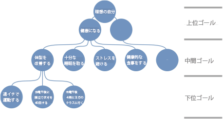
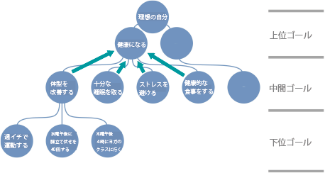
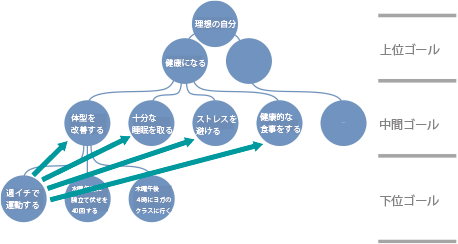

# 新年の目標を達成する確率を激しく上げる最強アプローチとは？#1「目標階層を使ってみよう！」

あけましておめでとうございます！ ということで今回は、「**目標を達成する方法**」についてあらためて考えてみましょう、

---

ご存じのとおり、パレオな男やパレオチャンネルでは、日ごろから「目標を達成する方法」をいろいろと書いているんですが、

1. 方法論がバラバラに点在していて、どれをやっていいかわかりづらい
2. 本当に効果があるテクニックを判断しづらい

といった問題が出てきてるんですよね。なので、新年を迎えたタイミングで、あらためて「**データの裏付けが多い****ガチの目標達成法**」を知っておくのは有用でありましょう。

## **「新年の抱負」には、やっぱり意味がある**

ってことで、まずは「**新年の抱負って本当に作る意味があるの？**」というポイントを見ておきましょう。新年に新たな目標を立てる人は多いでしょうが、このやり方は本当に効果があるのか？って話ですね。

ここで参考になるのは2002年に行われた調査([R](https://pubmed.ncbi.nlm.nih.gov/11920693/))で、研究チームは、12月末に434人の男女へランダムに電話をかけ、「新年の抱負を立てているか？」を尋ねたんですよ。でもって、それから1年後に、再びみんなに「どれぐらい新年の目標を達成しました？」と聞いてみたところ、

- 解決者の69％が連絡時にまだ成功していると自己申告した

- 46％は、この1年ずっと継続的に成功を維持していると報告した

- 12ヶ月後の自己申告の成功率は55％程度だった

って結論だったそうな。この調査は自己申告をベースにしているので、やや精度は低いものの、意外なほど多くの人が新年の豊富に満足していたのは間違いないでしょう。やはり**「新年に目標を立てる」のは、統計的にも正しい行為**だと言えますね。

新年の抱負を立てることで達成率が上がる理由はいくつかありまして、

- 大半の人は、新しい週、新しい月、新しい四半期、新しい年のような「目立った時間の区切り」を、自分の進歩や成功を確認するための基準として使う傾向があるから。

- 大半の人は、「現在の自分」と「未来の自分」とを分けて考える傾向があるから。つまり、2022年に運動できなかったとしても、それはあくまでも「2021年の自分がダメだっただけだ」と考え、「2023年の自分はまた別の人間だから大丈夫だろう」と考える心理傾向を持っている。

といったメカニズムが有力視されております。こういった心理現象は、一般的に「**再出発効果**」と呼ばれてまして、ざっくり言えば「人間は時間の区切りを見つけると、そこから新たな熱意を持ち、自己効力感を高めることができる」といった心の動きを意味してます。これは実感としてもわかりやすいですよね。

ってことで、せっかく年が明けたので、この「再出発効果」はぜひ活かして欲しいところであります。

## **SMARTゴールは本当に設定すべきなのか？**

もうひとつ、「**SMARTゴールを設定すべきなのか？**」という問題についても考えておきましょう。ご存じの方も多いでしょうが、SMARTは目標設定に関する定番のフレームワークで、いろんな企業で実際に使われてる定番の手法です。自己啓発本などでもよく紹介される手法で、ビジネスだけでなく、運動、食事、睡眠といった健康習慣の改善にSMARTを使っている方も多いんじゃないでしょうか。

ただし、このSMARTゴールについては[少し前にパレオな男に書いた](https://yuchrszk.blogspot.com/2022/11/smart.html)ことがありまして、「**いまいち信頼性が怪しいよねー**」などと結論づけたことがありました。実際のところ、SMARTのフレームワークってのは、既存の心理研究と食い違うポイントも多いので、何も考えずに使うと効果を得られない可能性が大きいんですよ。

また、そもそもの話を言うと、SMARTゴールってのは“**企業が従業員に仕事をさせるために作った**”フレームワークなので、私たちが日常的に抱く「目標を達成するぞ！」とか「行動を変えるぞ！」って問題に向けてデザインされたわけじゃないんですよ。これもまた、SMARTの信頼性を低くする一因になっております。

事実、2020年に行われた試験([R](https://pubmed.ncbi.nlm.nih.gov/33296385/))では、健康の改善にSMARTが役立つかを試してみたところ、「SMARTのフレームワークを使った参加者は、**逆にちょっとだけ健康習慣が身につかなかった**という報告も出てたりします。要するに、下手にSMARTを使うと逆効果になる可能性もあるわけで、SMARTを気軽に使うのは危険かもしれないっすね。

ってことで、以上の話をふまえたうえで、新年の抱負を達成するために役立つ、エビデンスに基づいたテクニックをまとめてみましょう。

## **あらゆる人におすすめできる目標達成テク、それは「目標階層」**

では、結論から申し上げましょう。現時点で、誰にとっても有用で強力だと思われる目標設定のアプローチは、ズバリ「**目標階層**」という考え方です。聞き覚えがない方もいるかもですが、「目標階層」ってのは目標設定理論の世界では、一貫して良い効果が認められている手法で、ベルン大学などによる2018年のレビュー([R](https://psycnet.apa.org/record/2018-50847-001))でも、かなり有効なテクニックとして推奨されております。

「目標階層」の考え方を簡単にまとめると、

- **ひとつの目標について、上位、中間、下位の要素を含む目標の階層を作ること。**

みたいになります。ある目標を単独であつかうのではなく、そこに結びつくいろんな目標をネットワーク化して考えていくのが「目標階層」です。

といっても意味不明だと思うので、具体例を挙げてみると、以下のようになります。

ご覧のとおり、ここでは上位ゴールの例として「理想の自分」と「健康になる」が挙げられています。さらに、その下の中間ゴールには、**より抽象度が低く、具体的で、上位の目標に向かうための目標**が並んでますね。具体的には、「健康になる」という上位ゴールに対して、「もっと眠る」「健康的な食事をする」「もっと効果的にストレスを管理する」などの中間ゴールが置かれております。

で、その最下層に置いてあるのが「下位ゴール」で、これは**中間ゴールを達成するために必要な目標を具体的に示したもの**です。たとえば、「もっと運動する」という中間ゴールに対して、「月・水・金の3日間、出勤前に職場の近くのジムで45分間筋トレをする」という具体的な計画を作るのが下位ゴールにあたります。

こんな感じで、ひとつの目標に3つのレイヤーを設定するのが「目標階層」の基本。このなかで**最も大事なのは「上位ゴール**」で、その重要性はいくら強調してもし足りないレベルです。上位ゴールってのは、**私たちのアイデンティティや自己意識と密接に結びついた目標**であり、中間ゴールや下位ゴールの背後にある「なぜそれをやるの？」を明確にしてくれるので、そのおかげで、どの中間ゴールや下位ゴールを追求すべきかの方向性を示してくれるんですよね。

それと同時に、上位ゴールがしっかりしていると、つねに目指すべき方向がはっきりするので、継続的に目標を達成するモチベーションもわくし、短期的な報酬と引き換えに長期的なゴール達成を犠牲にして、道を踏み外してしまう可能性が低くなるのもポイントであります。

また、ベルン大学のチームは、「**上位のゴールは、ゴールの階層に大きな等質性と多層性をもたらす**」とも指摘しておられます。

簡単に言えば、「等質性」ってのは、ある目標が、下位にある複数の明確な目標によってサポートされうることを意味してます。具体的には、「健康になる」という目標を達成するには、「健康的な食事をする」「十分な睡眠をとる」「ストレスを避ける」といった複数の目標を達成すればいいじゃないですか。

この状態の何が良いかというと、もしあなたが「運動をする気がおきない！」と思ったときでも、「それじゃあ食生活を改善すればいいや」と思い直すことで、上位ゴールに向かう行動をとれるじゃないですか。このように、目標階層を作ることで、ひとつの行動を取れないときでも選択に柔軟性が生まれ、長期的なゴール達成を後押しすることができるわけですね。

もうひとつ重要な「多面性」ってのは、1つの目標が、より高い階層にある複数の異なる目標をサポートできることを意味します。

具体的には、あなたが「週イチで運動する」という目標を決めたとしましょう。この目標が「体型を改善する」という中間ゴールの達成に役立つのは明らかですが、それと同時に「十分な睡眠を取る」や「ストレスを避ける」といったゴールにも良い影響を与えられるじゃないですか。このように、ひとつの下位ゴールを達成することで、上位に並ぶ複数のゴールを達成するのにも役立つのが「多面性」です。

こんな感じで「多面性」が働くと、下位の目標を達成する理由がいくつも生まれまして、これが強固なモチベーションの集合体となって、ひとつのゴールを達成しやすくなるわけです。これも重要な働きですね。

ってことで、話をまとめると、以下のようになります。

- たんに上位ゴールを決めるだけじゃダメ！

- 上位ゴール、中間ゴール、下位ゴールからなる目標階層をうまく構築することで、自分の目標に大きな価値が生まれるし、日々の目標をこなすための詳細な方法を理解できるし、「等質性」と「多面性」のおかげでさらにモチベーションが上がる！

いろいろ書いてきましたが、やるべきことは非常にシンプルなのが「目標階層」の良いところです。ひとつのゴールを上位、中間、下位の3つに分解していくだけなので、新年の抱負を作る際はぜひご利用ください。

でもって、目標達成の話はもうちょい続きまして、次回は「目標階層」の効果をさらに高めるのに重要なポイントを見ていきたいと思います。ではまた！
