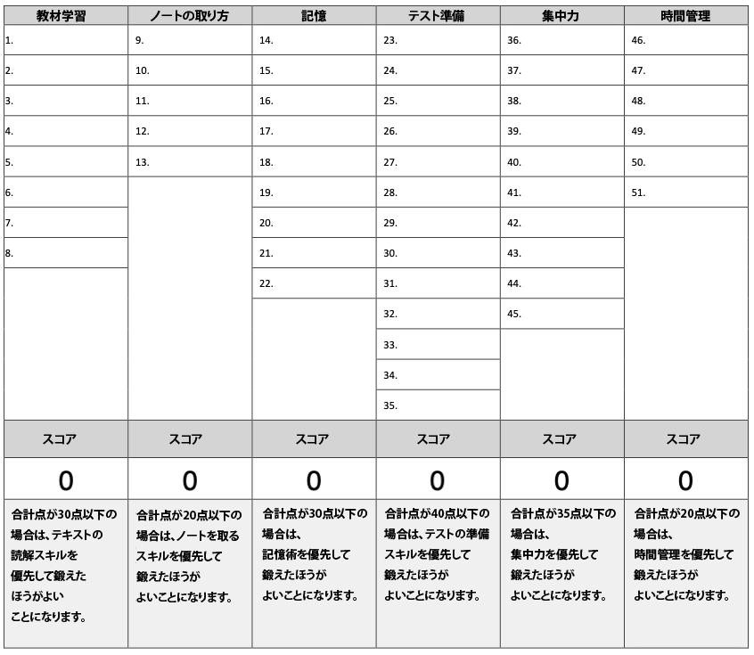

# 学習の効率を激上げするための「脳環境」設定ガイド#17「メタ認知を使った学習ができているかをチェックしようぜ！」

「**学習の効率を激上げするための「脳環境」設定ガイド**」の続きです！([#1](https://daigovideolab.jp/blog/2114454),[#2](https://daigovideolab.jp/blog/2114539),[#3](https://daigovideolab.jp/blog/2116010),[#4](https://daigovideolab.jp/blog/2120061),[#5](https://daigovideolab.jp/blog/2120527),[#6](https://daigovideolab.jp/blog/2122054),[#7](https://daigovideolab.jp/blog/2124212),[#8](https://daigovideolab.jp/blog/2124371),[#9](https://daigovideolab.jp/blog/2126672),[#10](https://daigovideolab.jp/blog/2126789),[#11](https://daigovideolab.jp/blog/2128412),[#12](https://daigovideolab.jp/blog/2128541),[#13](https://daigovideolab.jp/blog/2129183),[#14](https://daigovideolab.jp/blog/2131847),[#15](https://daigovideolab.jp/blog/2132569),[#16](http://ch.nicovideo.jp/article/ar2133453))

---

## メタ認知を使った学習ができているかをチェックしようぜ！

このシリーズでは、「効率よく勉強するためには脳に優しいやり方をする必要があるぞ！」って考え方をもとに、最適な勉強法について考えおります。

で、前回からは、正しく学習する際に欠かせない「**メタ認知**」を使いこなす方法の紹介に入っております。簡単におさらいすると、

- メタ認知ってのは「思考についての思考」のことで、学習の効率をブーストするには欠かせない

- 実際、メタ認知のスキルがある人ほど、仕事や学校でのパフォーマンスが高いこともわかっている

みたいな感じです。メタ認知がないと、「どのように学ぶのが最適か？」を判断できないため、どうしてもパフォーマンスは下がってしまうんですよ。いわば、すべての学習の土台になる能力なので、積極的に身に着けておきたい能力であるのは間違いないんですね。

そんなわけで、前回は自分のメタ認知レベルをチェックしていただいたんですが、今回はその続きで、

- **メタ認知を使った学習をちゃんと実践できているか？**

を調べてみましょう。前回は高次元のメタ認知スキルを計測しましたけども、今回は少しレベルを下げて、「**メタ認知を使った具体的な勉強法を使えているか？**」を調べてみます。

ここで使うのは「**メタ認知学習スキル調査**」という有名なチェックリストで、たとえばサウス・セントラル・カレッジやセントラルフロリダ大学などが、学生たちのメタ認知学習スキルを調べるために使っている、ガチのチェック法になります。

といっても、別に難しいリストではなくて、ここで取り上げられている勉強スキルは、

- 教材を読む前に目次をチェック
- ノートで図を使う
- 教材を何度も読む

といった超平凡なものです。あなたの普段の勉強で、これらの基本をどれぐらい押さえているかをチェックするのが「メタ認知学習スキル調査」であります。

というと、「もっと斬新な勉強法を知りたい……」とか「そんなことは知ってる……」とか感じる人も多いでしょうが、そう思った人は、ぜひ考え直していただきたいところです。それと申しますのも、そもそもメタ認知を使って学習するときは、

- 日常的に誰もが使う平凡なテクニックの組合わせである

- しかし、**そ****んな平凡なテクニックを、すべて実践できている人は少ない**

という罠にハマりがちだからです。メタ認知学習ってのは決して目新しい斬新なも手法はなく、あくまで地道なテクニックの積み重ねで構成されているものなんですね。しかし、そのせいで、たいていの人は「こんなことはよくわかっている！」と思い込み、**基本の積み重ねを怠ってしまいやすい**んですな。

そんな罠にハマらないためにも、ぜひここで紹介する「**メタ認知学習スキル調査**」を使い、「私は基本を怠っていないか？」をチェックしてみてください。このリストは50の文章で構成されてまして、そのすべてで「**この手法は学習の効率アップに欠かせない！**」ことが実証されてますんで。

## メタ認知を使った学習ができているかのチェックリスト

では、「**メタ認知学習スキル調査**」を紹介します。以下の50の文章を読みつつ、自分にどれぐらい当てはまるかどうかを、できる限り正直に答えてください。採点の要領は以下のとおりです。

- ほとんどいつもの勉強でやる＝5
- 勉強時間の半分以上はやっている＝4
- 勉強時間の半分くらいやっている＝3
- 勉強時間の半分以下しかやらない＝2
- ほとんどの勉強でやらない＝1

1. 教材を読み始める前には、これから読み進める章の内容を想像し、具体的な質問を作る（「この章は応仁の乱に関する内容だから、将軍の世継ぎ問題と家督争いがどうこじれたのかがわかるだろうか？」みたいな）。
2. 教材を読む前に、見出し、太字の部分、斜体の文字、質問文、要約文などに目を通す。
3. 学習中に新しく出てきた用語は、その意味をすぐに調べる。
4. 教材を読みながら、自分が考えた質問の答えを考える。
5. 教材を読みながら、「この章のメインの主張はなにか？」を考える。
6. 各章のメインの主張を読みながら、「この主張をサポートする証拠はどれだ？」を考える。
7. 教材を2〜3回くり返し読む。
8. [SOAR](https://daigovideolab.jp/blog/2025528)のような学習システムを使う。
9. 教材の練習問題を読みながらノートを取る。
10. 講義でノートをとる。
11. ノートを取った後は、他の章の学習に移る前に復習をする。
12. 講義ノートを週に1回は見直す。
13. 同じ学習をしている仲間とノートを比較して、完全性と正確さをチェックする。
14. 試験や小テストのために、1～2回以上ノートを見直す。
15. [なんらかの記憶術](https://daigovideolab.jp/blog/2126789)を使っている。
16. ノートを取る際は、スケッチ、マインドマップ、図、表など、視覚的な表現を使う。
17. 試験に出る可能性のある内容については、自分でクイズを作っている。
18. 教材の詳細な知識や主要なアイデアを、番号付きのリストや文字付きのリストに整理する。
19. 試験や講義の内容を、必ず自分の言葉に置き換えてノートに書いている。
20. 試験や小テストに出題される可能性のある内容について、定期的に考える。
21. 丸暗記に時間を使うよりも、ノートに書かれた内容の理解に時間を使う。
22. 教材の主なアイデアや詳細を、論理的または意味のある順序に整理する。
23. クラスメートやグループと一緒に勉強する。
24. わからないことがあったら、クラスメートや家庭教師、講師などに助けを求める。
25. 与えられた宿題はすべてやる（宿題がない場合も、自分で自分に宿題を与えている）。
26. すべての宿題は期限内に提出する。
27. テストを受ける前は、自分が何を学び、まだ何を学んでいないのかを簡単に確認する。
28. 授業に行く前に授業のノートを見直す。
29. 授業に行く前に、指定された教材に目を通す。
30. 講義がスタートした最初の週から、試験に向けた勉強を始める（試験がない場合でも、事前にセルフテストの期日を決めて、それに向けて準備をする）。
31. 授業が終わったらすぐに講義のノートを見直す。
32. 自分が抱えている課題や宿題を常に把握している。
33. 毎日バランスの良い食事をとっている。
34. 毎日運動をしている。
35. 自分がどの学習スキルを使っているかを、定期的に再確認している。
36. 何かを学んだり記憶したりしようとするときは、必ず静かでジャマされないところを選ぶ。
37. 長時間勉強した後は、必ず少し休んでからまた勉強する。
38. いつも同じ場所で勉強する。
39. 詰め込み勉強をしない。
40. 勉強に必要な道具は、すべて勉強場所に用意している（教材、ペン、紙、電卓など）。
41. 勉強をはじめる前には、「私はこれから勉強するのだ」と改めて自分に確認する。
42. 大きな課題に取り組むときは、必ず小さな単位に分割する。
43. 自然に興味が湧いてこないテーマには、どうにかして興味を持つ方法を探す学す。
44. 夜はなるべく勉強しない。
45. 学習や個人的な活動を記録するために、手帳などに毎日記録をつける。
46. 学業や個人的な活動を整理するために、毎日の「TO DO」リスト、優先順位リスト、課題リストなどのリストを使用する。
47. 仕事やクラブ活動など、毎月の決まった活動については、マスタースケジュールを立てている。
48. 短期と長期の学習目標を書き出している。
49. 特定の論文やプロジェクトを、締切の期限よりかなり前から始めている。
50. 授業が1時間ある場合は、それに対して2時間の勉強時間を取る。

リストのチェックが終わったら、以下の画像に従ってスコアを計算し、今の自分に足りない能力を判断してください。

これで自分に足りないスキルがわかったら、「**メタ認知学習スキル調査**」の文章を見直して、なかでも点数が低かったスキルをピックアップ。「今週はこのスキルを意識して使うぞ！」と決めたうえで、日常の学習に取り入れていくとよいでしょう。たとえば「教材学習」の合計点が低くて、そのなかでも「[SOAR](https://daigovideolab.jp/blog/2025528)のような学習システムを使う」の点数が低いなら、「**次の1週間はSOARだけに頑張って取り組むぞ！**」と考えてみるわけですね。

ひとつひとつのスキルを高めていくのは大変ですが、メタ認知の能力ってのは、身につけたスキルの数が増えるほど改善しやすくなり、どんどん楽になっていくはずであります。なので、最初は「なかなか進歩が見られんなぁ…」と思っても、がまんして続けていただければ幸いです。ではまた！
