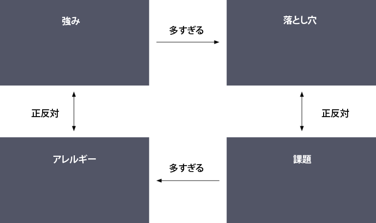
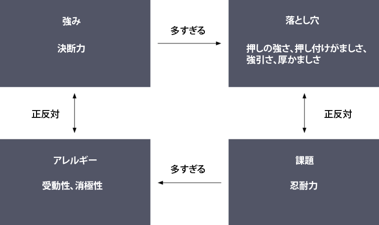
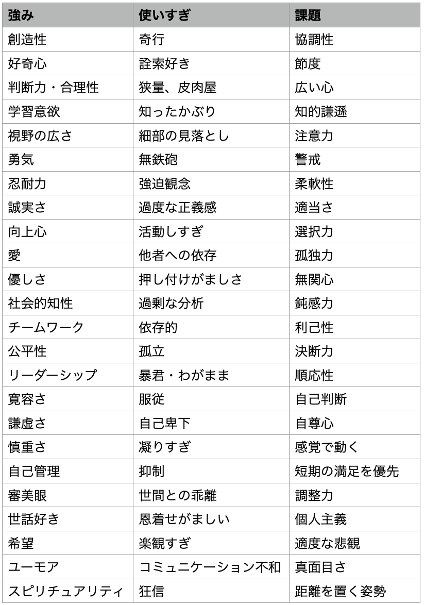

# 自分の才能をもっと活かしたい！あなたに送る「強みの四象限モデル」とは？

このブロマガでは、昔から「強みを活かすと良いことがあるぞ！」と主張していて、「[強み活用大全](https://daigovideolab.jp/blog/2091590)」といったシリーズも書いたりしてるんですよ。

---

『強み』ってのは、学問的には「広範かつ無努力に発揮できる資質」とされてまして、要するに、自分が意識しないでも人生のいろんな場面でスムーズに発揮できる能力だってことです。たとえば「決断力」という強みを持っている人は、日常生活、仕事、人間関係、自己啓発など、人生のあらゆる局面で決断力を発揮しやすいわけですな。

が、ここでよく耳にするのは、「強みを使うのが大事なのはわかるけど、いまいちうまくいかない……」というものです。自分の「強み」はわかったものの、いざ実践する段階になったら、どうしていいかわからなくなったというんですな。

このお悩みについては、昔からいろいろ解決策を考えてたんですが、近ごろ「これは使える！」と思ったのが「**強みの四象限モデル**」というものです。

これは、心理学者のダニエル・オフマン博士が提唱した「強み」のモデルで、その内容を簡単に申し上げますと、

- 人間の「強み」は同時に「弱み」になることもあるから、そこに注意しないと失敗するよ！

って感じになります。「強み」と「弱み」は表裏一体だったりすんで、そこを意識しておかないと、「強み」を使う際にトラブルが起きやすいわけですね。

そこで、オフマン博士の「強みの四象限モデル」は、自分の「強み」に対して、「落とし穴」「課題「アレルギー」という3つの異なる視点を理解できるように設計されております。自分の「強み」だけしか把握しておかないと、「強み」がもたらす欠点に意識が向かなくなり、そのせいで「強み」の活用も失敗しちゃうかもしれないですからね。

では、このモデルの概略を見てみましょう。「**強みの四象限モデル**」は、以下のような構成になっております。

まず右上の「落とし穴」は、「強みを発揮しすぎた」場合に起きる問題のことです。以下に挙げる事例では、「決断力」が多すぎると「強引さ」につながってしまいがちなので、右上に「強引さ」「押しの強さ」といった問題を書き込んでいます。

また、右下にある「課題」は、**落とし穴の正反対の特性**を意味してまして、あなたの「強み」から生まれる落とし穴に立ち向かうために発揮すべき能力になります。この事例では、強引さという欠点に対処するために、「忍耐力」を書き込んでまして、これが強引な人にとっての課題なわけですね。

最後に、左下の「アレルギー」には、**あなたの課題をたくさん持っている他人と出会った場合に起きる拒否感**を意味します。たとえば、いくら「自分の課題は忍耐だ！」と思っている人ってのは、この特性を発揮しすぎている人に対して嫌悪感を抱くものなんですよ。

具体的には、「受動的な態度」や「消極的な態度」のように、「忍耐」が多すぎる人にありがちな特徴に対して、「なんだこいつは！ウジウジしやがって！」みたいに感じがちなんですね。ただし、これはあくまで「自分が足りない能力を持っている人への嫉妬」にすぎず、これを放っておくと、いたずらに他者ともめたりすしますんで、「強み」を発揮したいときは常に念頭に置いておくべきでありましょう。

というわけで、このように自分の「強み」から派生する欠点と、そこで起きる問題を理解しておくと、自分の「強み」をよりよく発揮しやすくなるのは間違いないところ。以下に具体的なやり方をお伝えしておくので、ぜひお試しくださいませ。

### **ステップ1：自分のコアとなる「強み」を1つ特定する**

「強み」とは、あなたが生まれながらにして得意とするものです。たとえば、決断力、柔軟性、粘り強さ、慎重さなどの資質が「強み」の代表例。あなたの中核となる「強み」の一つを特定するためには、「[強みを活かして幸福度を激増させるための「ストレングスリスト」200](https://daigovideolab.jp/blog/1814829)」を使っていいし、以下の質問について考えてみてもOKであります。

- 私があまり努力を必要とせずに行えて、人からほめられる資質は何でしょう？
- 他人から評価されたり、ほめてられる私の資質は何でしょうか？
- 自分は他人にどのような属性を求め、期待しているのか。

思いついた「強み」は、上記の「**強みの四象限モデル**」の左上エリアに書き込んでおきましょう。

### **ステップ2：「落とし穴」をあきらかにする**

「落とし穴」は、自分の「強み」を「発揮しすぎた」ときに発生します。たとえば、「決断力」が「強引さ」に、「柔軟性」が「気まぐれさ」になる場合です。自分の落とし穴を発見するためには、次のことを考えてみてください。

- 私の「強み」が強すぎると、どのようなことが起きるのだろう？
- 他の人が私を非難したことはないだろうか？
- 自分自身について、何かを正当化する傾向はないだろうか？

思いついた「落とし穴」は、上記の「**強みの四象限モデル**」の右上エリアに書き込んでおきましょう。

### **ステップ3：「課題」を明らかにする**

「課題」は「落とし穴」の正反対で、あなたが意識して目指すべきポジティブな資質になります。たとえば、「決断力」という強みを持つ人の場合、課題は「我慢すること」であり、「柔軟性」を強みにする人の場合、課題は一貫性であると言えます。あなたが見つけた「落とし穴」に対する「課題」を発見するために、以下のことを考えてみてください。

- この落とし穴の反対語は何だろう？
- この落とし穴を避けるために、どんな行動を取るのが理想だろう？
- 私は他人のどんなところに憧れているだろうか？

思いついた「課題」は、上記の「**強みの四象限モデル**」の右下エリアに書き込んでおきましょう。

### **ステップ4：「アレルギー」を明らかにする**

「アレルギー」は、自分の「課題」を使いすぎている人に対して、無意識の反感を覚えてしまうことです。たとえば、

- 決断力がある人が、断固とした態度で人と接するのが苦手な人が、忍耐力を過剰に発揮しすぎて消極的になっているのを見てイラつく

- 柔軟性がある人が、過剰な一貫性を発揮して硬直的になっているのを見てイラつく

といった感じです。あなたのアレルギーは、あなたの「強み」と正反対のものであることに注意してください。あなたの「アレルギー」を判断するために、次のことを考えてみてください。

- 私の「強み」の反対は何だろうか？
- 私は他人の何を軽蔑しているのか？

思いついた「アレルギー」は、上記の「**強みの四象限モデル**」の左下エリアに書き込んでおきましょう。

ということで、「**強みの四象限モデル**」は以上です。最後に、それぞれの「強み」が引き起こす落とし穴や課題のリストを貼っておきます。「どうにも強みが活かしきれない…」という方は、ここらへんもふくめて自己分析すると成功率が上がるのはずです。それでは！

