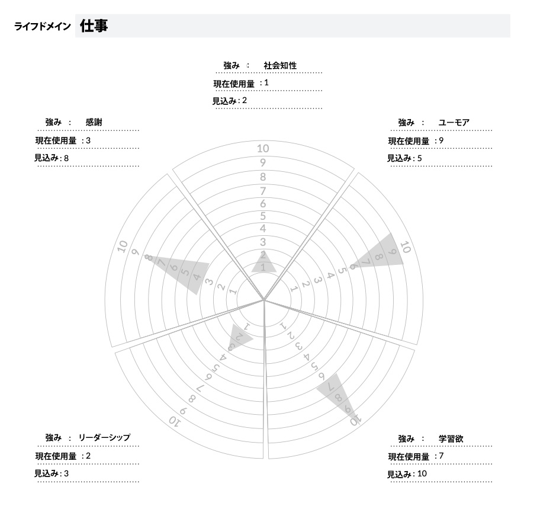

# あなたの才能を使い倒すために使える2つの技法「強み活用チャート」＆「強み自己効力感テスト」

[既報のとおり](https://www.blogger.com/u/1/blog/post/edit/8548524187315276735/7546021412158188422#)、いま**「才能」の本**を書くべく準備を進めてまして、強みとか遺伝とか天才といったテーマの文献ばかり読んでおります。そのせいで、いまは他ジャンルの論文を読みづらいい状態なので、これからのブロマガは、才能関連のデータをまとめていく感じにしようかと。

ただし、それだと「パレオな男」のブログと差別化できないので、ここでは「****超実用的****」な話に的を絞ってお送りします。「パレオな男」のブログでは、才能や強みに関する雑学が中心ですが、こっちではすぐに使える内容をいろいろと紹介していこうかと。

ってことで今回は、「強みの活用」に関する実践的な手法をいくつか紹介しましょう。「強み」の問題については、いままでもいくつか紹介してますが、近年もいろんな手法が開発されてますんで、そこらへんを押さえておくといろいろと便利ですんで。

---

## **1. 強み活用チャート**

「強み活用チャート」は、自分の強みをちゃんと活用できているかどうかを調べるテクニックです。ネタ元はポジティブ心理学の研究で有名なマット・ドライバー先生で、**強みの活用を最適化する**ために開発された手法なんですな([R](https://amzn.to/3HlGxpq))。つまり、このエクササイズは、すでにある程度まで自分の強みを見つけた人が使うものになります。

当然ながら、自分の「強み」がわかっただけでは人生は変わらず、ちゃんと日々の生活で「強み」を使っていかねばならないわけです。そのためには、「**自分はどんな状況でどの強みを使えているか？使えていないか？**」を認識するのが超大事。自分がどの「強み」を使っていないかを把握できないと、自分のポテンシャルを活かしきれないですからね。

ってことで、強み活用チャートでは、以下のようなイラストを使います。このチャート、ご覧のとおり、円の中心は「0点」、外周は「10点」を表しています。円は5つのセグメントに分かれていて、それぞれに自分の強みを書き込む形で使います。

では、チャートの使い方を見ていきましょう。

**ステップ1 ライフドメインの設定**

まずはチャートのトップに、ライフドメインを設定します。これは、「人生のどのエリアに自分の強みを活用するか？」って問題を意味してまして、「仕事」とか「育児」のように、あなたが人生で大事に思っている領域が入ります。

どのライフドメインを書き込むべきかわからないときは、ハーバードのタイラー・バンダーウィール先生が提唱する、「**人生で最も重要な5つのライフドメイン**」を使うのがおすすめです。バンダーウィール先生は、人間が幸せに暮らすためには、だいたい5つの領域が満たされていればOKと考えてまして([R](https://www.pnas.org/doi/10.1073/pnas.1702996114))、シンプルで分かりやすいモデルになっております。困ったときは、とりあえずこの5つを使うのが簡単でしょう。

1. **目的意識**：より高次の目標や意義に対して「強み」を発揮できているかどうか（「他人を救う」とか「世界を良くする」とか）
2. **家族**：自分のパートナー、子供、親、親類と良好な関係を築くために「強み」を発揮できているかどうか
3. **仕事**：自分の仕事でパフォーマンスを上げるために「強み」を発揮できているかどうか
4. **健康**：自分の肉体と精神を健やかに保つために「強み」を発揮できているかどうか
5. **コミュニティ**：友人や、近所のコミュニティ、趣味のコミュニティといった特定のコミュニティで「強み」を発揮できているかどうか

**ステップ2 ライフドメインの設定**

続いて、5つにわかれたセグメントのそれぞれに、自分が持つ上位5つの強みを書き込みます。まだ自分の強みが把握できていない人は、「[デイリー・ストレングス](https://daigovideolab.jp/blog/2090105)」などを使って、自己分析を試してみてください。

**ステップ3 10点満点で採点しよう**

続いて、それぞれのセグメントに、選択したライフドメイン（例えば仕事）について、以下のように考えます。

1. **現在使用量**：そのライフドメインのなかで、現在その強みを0から10の間でどれぐらい使用しているか？（まったく使ってないなら0点で、フル活用しているなら10点です）
2. **見込み**：そのライフドメインのなかで、その強みをもっと使ったら0から10の間でどれぐらいまで伸びしろがあるか？（まったくないなら0点で、めっちゃ伸びしろがあるなら10点です）

答えを考えたら、それぞれを10点満点で採点しましょう。あんまり深く考えても仕方ないので、直感で「これぐらいは伸びしろがありそうだな」と思えれば、そのまま点数をつけちゃってください。

**ステップ4 三角形を描く**

最後に、ステップ3で描いた2つのマークを結ぶ三角形を描きます。現在の「強み」の使い方のギャップが大きいほど三角形も大きくなり、その強みをもっと活かせる可能性があることを示します。

一例として、以下の画像は完成したグラフの例です。このグラフを見ると、「自分の仕事人生では、社会的知性とリーダーシップには成長の可能性があまりないんだな……」とかがわかるわけですね。多くの場合、このように成長の可能性がない「強み」が3つ以上ある場合は、現在の状況が理想とはかけ離れている可能性が高いと考えられます。このようなパターンは、自分の仕事が好きじゃない人によく見られるんですよね。

一方で、このグラフを見ると、「感謝」と「学習欲」が成長領域であることがよくわかります。どちらもそれなりに活用されてますが、グレーの三角形が大きいぶんだけ、もっと活用する余地があるってことですな。こんな感じで、自分の強みをプロットしていくと、現状を把握しやすくなるわけです。

ちなみに、この事例では、1つの矢印が逆方向を向いています。これは、「ユーモア」の強みが、「仕事」という文脈で**使われすぎている**可能性を示唆しております。どのような強みでも、使いすぎてしまったり、間違った文脈で使われたりすると、価値を失うことになるので注意してください。

## **2. 強み自己効力感テスト**

続きましては、「強み自己効力感テスト」（SSES）も紹介しましょう。これはミズーリ大学などのチームが開発したテスト([R](https://journals.sagepub.com/doi/abs/10.1177/1069072713493761))で、なんのために作られたかと言いますと、

- **私って日常で「強み」を発揮できているの？**

ってのをチェックするためです。というのも、「強み」をうまく使っている人ってのは、自尊心や生活満足度が高い傾向があるので、そのへんを掘り下げていくと「自分はちゃんと強みを使えているか？」を判断できるんですよ。なので、このエクササイズも、すでにある程度まで自分の強みを見つけた人が使うものになるので、ご了承ください。

事実、上記の研究では、SSESのスコアは自尊心や生活の満足度と中程度の関係があり、社会的な望ましさとは弱い関係があることが示されております。さらには、テストの信頼性分析により、SSESの得点は3週間にわたって安定していたんだそうな。

では、「強み自己効力感テスト」をやってみましょうー。まず、あなたの代表的な強みを5つ、以下に挙げてください。

1. \_\_\_\_\_\_\_\_\_\_\_\_\_\_\_\_
2. \_\_\_\_\_\_\_\_\_\_\_\_\_\_\_\_
3. \_\_\_\_\_\_\_\_\_\_\_\_\_\_\_\_
4. \_\_\_\_\_\_\_\_\_\_\_\_\_\_\_\_
5. \_\_\_\_\_\_\_\_\_\_\_\_\_\_\_\_

強みを挙げたら、以下の文章を見て、それぞれの項目に回答してください。正解も不正解もないので、直感的に思った点数をつけてください。採点は10点満点で、以下のように評価してください。

1.全く自信がない
2.
3.
4.
5. ほどほどに自信がある
6.
7.
8.
9.
10.非常に自信がある

あなたは、自分の能力にどの程度の自信がありますか？

1. 自分の強みを仕事に生かす
2. 苦労せずに自分の強みを活かせる
3. 自分の強みを毎日の仕事に生かす方法を見つけている
4. 自分の強みを活かして、多くのことを成し遂げている
5. 職場や学校で自分の強みを活かす
6. 自分の強みを生かせる場面が多い
7. 自分の強みを活かして成功している
8. 毎日、職場や学校で自分の強みを生かす方法を探している
9. いつでも自分の強みを生かすことができる
10. 人生の目標を達成するために、自分の強みを生かすことができる
11. 自分が得意な分野で、自分の強みを実践している

すべての採点が終わったら、すべての合計したあと項目数（11）で割って平均値を算出しましょう。この 得点が高いほど、強みを活用する自信があり、強みを活用できていることを示しております。

ってことで、「強み」を活かすのに役立つ代表的なエクササイズを2つ見てみました。「強み」の活用ってのは、よりよい人生を送るうえでは欠かせない視点なので、ぜひ気にしておいていただければ幸いであります。ではまた！
