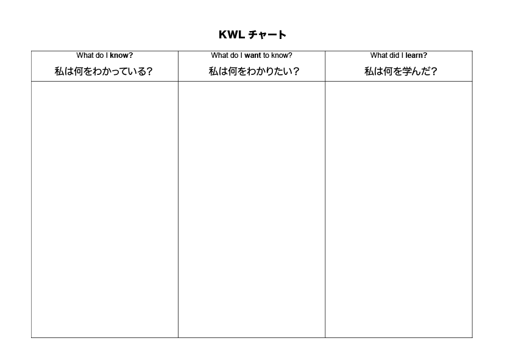

# 学習の効率を激上げするための「脳環境」設定ガイド#18「メタ認知で学習をブーストさせる３大技法」

「**学習の効率を激上げするための「脳環境」設定ガイド**」の続きです！([#1](https://daigovideolab.jp/blog/2114454),[#2](https://daigovideolab.jp/blog/2114539),[#3](https://daigovideolab.jp/blog/2116010),[#4](https://daigovideolab.jp/blog/2120061),[#5](https://daigovideolab.jp/blog/2120527),[#6](https://daigovideolab.jp/blog/2122054),[#7](https://daigovideolab.jp/blog/2124212),[#8](https://daigovideolab.jp/blog/2124371),[#9](https://daigovideolab.jp/blog/2126672),[#10](https://daigovideolab.jp/blog/2126789),[#11](https://daigovideolab.jp/blog/2128412),[#12](https://daigovideolab.jp/blog/2128541),[#13](https://daigovideolab.jp/blog/2129183),[#14](https://daigovideolab.jp/blog/2131847),[#15](https://daigovideolab.jp/blog/2132569),[#16](http://ch.nicovideo.jp/article/ar2133453),[#17](https://daigovideolab.jp/blog/2135359))

---

このシリーズでは、「効率よく勉強するためには脳に優しいやり方をする必要があるぞ！」って考え方をもとに、最適な勉強法について考えおります。

で、前々回からは、正しく学習する際に欠かせない「**メタ認知**」を使いこなす方法の紹介に入っていて、前回は「**メタ認知を使った学習をちゃんと実践できているか？**」をチェックしました。メタ認知学習を行う際は、とりあえず前回にまとめたリストが基本中の基本になりますんで、まずは普段の学習でこれらの作業を行っているかどうかを確かめるのが基本となります。

でもって、まだメタ認知の話は続きまして、今回は「**メタ認知で学習スキルを上げるための3大戦略**」を見てみます。前回もお伝えしたとおり、メタ認知学習ってのは細かい基本の積み重ねではありますが、いくつかの専門機関が、そのなかでも効果が大きい戦略をピックアップして体系立ててくれてたりするんですよ（ケンブリッジ、オックスフォード、アメリカ心理学会などが）。

ここらへんを知っておくと、「メタ認知を効かせたい！」と思ったときに便利なので、ぜひ押さえてほしいところです。では、具体的な戦略を見てみましょうー。

## **メタ認知戦略１ 「メタ認知トーーーク」**

「メタ認知トークは、私たちが勉強する際に考えていることを声に出して言う方法で、かつてお伝えした「[思考発話法](https://daigovideolab.jp/blog/1975022)」と根本は同じです。考えていることを声を出して話すと、学習の際の集中力が上がるし、自分の思考プロセスをモニターするのに役立つし、そのおかげで自分の学習レベルをつかむのがうまくなることが複数の研究でわかってるんですよね。

といっても、思考発話法ほど複雑に考える必要はなく、勉強の効率アップに使うだけなら、以下の質問さえ押さえておけば 十分です。 勉強の際には、ぜひ以下の質問を声に出しながら学習を進めてみてください。

**1. 学習前のひとりごと**

- このトピックについて自分は何を知っているか？

- 以前にも同じような学習を行ったことがあるか？

- 前回はどのような戦略が有効だったか？

**2. 学習中のひとりごと**

- 私は予定どおりうまくやれているか？
- 次に何をすればいいのだろうか？

- 別の戦略を試した方がよくないか？

**3.自分のパフォーマンスを評価するときのひとりごと**

- 自分はどれぐらいうまくやれただろうか？

- 期待どおりの結果が得られただろうか？

- まだ理解できていないことはなんだろうか？

- 次回はもっと違うことができるのはなんだろうか？

まー、最初のうちは、 思考を声に出すやり方は違和感があるでしょうが、慣れればこれほど手軽にメタ認知を起動できる方法は無いので、まずはこれから練習してみるのが良いかもしれません。

## **メタ認知戦略２ 「****KWLチャート」**

「**KWLチャート**」は、かのケンブリッジ大学でも使われている超定番のメタ認知学習法のひとつ。KWLってのは、以下の略です。

1. 私は何をわかっているか？（What do I **know**?）
2. 私は何をわかりたいか ？（What do I **want** to know?）
3. 私は何を学んだか？（What did I **learn**?）

このチャートの目的は、学習前、学習中、学習後に手に入れた情報を、メタ認知の視点から整理するのを助けることです。KWLチャートを使った人は、新しいトピックに興味を持ち、すでに持っている知識をうまく使うことができ、いまの学習状況を把握するのがうまくなることがわかってるんですな（じゃないとケンブリッジで使いませんわな）。

KWLチャートの実践は簡単で、以下のような用紙を使って行います。

この用紙に、以下の内容を書き込んで行きましょう。

1. 勉強するトピックについて「私は何をわかっているか？」と考えて、その答えを書き込みましょう。この最初の質問により、あなたがすでに持っている知識が活性化され、いまの自分の理解度がよくわかるようになり、それゆえにこれから勉強する内容にちゃんと取り組めるようになるわけです。
2. 次に、勉強するトピックについて「私は何をわかりたいか ？」と考えて、その答えを書き込みましょう。この質問について考えることで、自分が何に興味を持ち、何を既に知っているかを確認することができます。ここで しっかり考えておくと、今後の学習計画もバッチリ決まりやすいのでお勧めです。
3. で、学習が一段落したら、「私は何を学んだか？」という質問について考え、 チャートの最後の欄に記入しましょう。このときに重要なのは、勉強したことで「私は何をわかりたいか ？」って疑問に ちゃんと答えることができたかもチェックしておくことです。
   その際には、「どのような戦略を使う予定だったか？」「何がうまくいかなかったか？」「うまくいったことは何か？」「他にどのような戦略を使うことができるか？」 などの答えも、合わせて書き込んでおくと非常に良い感じです。

## **メタ認知戦略３ 「****試験評価チャート」**

「試験評価チャート」は、 名前の通り、特定のテストや試験のために使うテクニックで、アメリカ心理学会等が推奨する由緒ある勉強法の1つです([R](https://www.sciencedirect.com/science/article/abs/pii/S1877129718301023))。具体的な 試験の予定が決まっている方は、こちらをお試しください。

「試験評価チャート」は、 以下のような、具体的な指示に従う形で進めていきます。

### **試験前の計画**

試験の前に、以下の空欄を埋めてください。

- 私が最も得意とする内容は、\_\_\_\_\_\_\_\_\_\_\_\_\_\_\_\_\_\_\_\_\_\_\_\_\_\_\_\_\_\_\_\_\_\_\_\_\_\_です。
- 私がまだ混乱している、または理解が怪しい内容は、\_\_\_\_\_\_\_\_\_\_\_\_\_\_\_\_\_\_\_\_\_\_\_\_\_\_\_\_\_\_\_\_\_\_\_\_\_\_です。

もしいますぐに試験を受けねばならないとしたら、今のあなたはどのようなレベルでしょうか？

- 用語の定義がわからない
- 他の人に内容を説明できる
- 知識を別の状況にも応用できる

いまから試験本番までの時間の間に、具体的にどのような対策をする予定ですか？ 最低でも３つ書き出してください。

1.
2.
3.

### **試験後の評価**

試験が終わったら、間違えた問題をピックアップして、それぞれの原因を以下のように分類にしてください。

- **記憶違い**：事実を間違えて覚えていた。

- **準備不足**：そのコンセプトやスキルを十分に勉強、復習、練習していなかった。

- **理解不足**：内容をうまくつかめていなかった。

- **誤読**：問題を読み違えた、または指示に従わなかった。

分類が終わったら、間違えた問題の数を以下に記録しておきましょう。

<table border="1"><tbody><tr><td> </td><td>記憶違い</td><td>準備不足</td><td>理解不足</td><td>読み間違い</td></tr><tr><td>間違えた問題の数</td><td> </td><td> </td><td> </td><td> </td></tr></tbody></table>

試験準備のために、自分がなにを行ったかを具体的に振り返ってみましょう。 該当するものをチェックしてください。

- **復習ノート**
  - 勉強ノートを見ずに完成させた
  - 勉強ノートを見て完成させた
  - 完成しなかった
  - そもそもやってない

- **復習の方法**
  - 誰かにクイズを出してもらう
  - 勉強仲間に会う
  - フラッシュカードを作る
  - 誰かに内容を教える
  - なんらかの記憶術を作る
  - その他のメタ認知的な手段を使う： \_\_\_\_\_\_\_\_\_\_\_\_\_\_\_

- 試験の準備のために勉強したことは、試験の内容と一致していましたか？ 一致しなかった場合は、その理由はなんですか？

- 以上をふまえて、次の試験に向けて、私が具体的に行う3つのことを書き出しましょう。

1.
2.
3.

ということで、 メタ認知学習法の代表的なテクニックを3つ見てみました。繰り返しになりますが、どのテクニックも、世界の名だたる学術機関が推奨するものばかりであり、どれか1つを学ぶだけでも大きな効果が得られるはず。個人的にはメタ認知トークを愛用してますけど、このへんは好みがあるので、自分ができそうだと思ったものから手をつけてください。ではまた！
