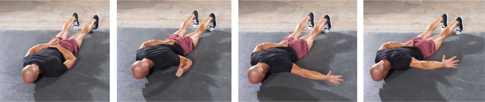
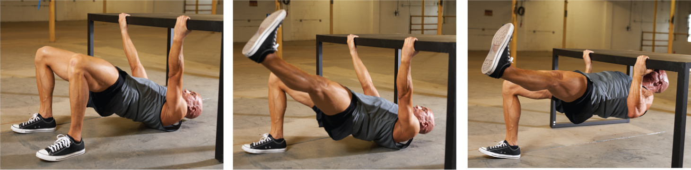

# 1日たった9分で【かっこいい機能的な肉体】を作るためのローレン式エクササイズ＃4「サイクル3編」

というわけで、「1日たった9分で【かっこいい機能的な肉体】を作るためのローレン式エクササイズ」の続きです([#1](https://daigovideolab.jp/blog/2138248),[#2](https://daigovideolab.jp/blog/2138482),[#3](https://daigovideolab.jp/blog/2138850))。軽くおさらいすると、このシリーズでは、「機能的で見た目がいい体」を作ることを目指してまして、**1日たった9分のエクササイズを週3だけ行う**のがポイントであります。

---

というと、うさん臭い感じがしそうですが、もちろんアンチエイジングを狙う場合は、このレベルの運動量だけでは厳しいのでそこは注意してください。ただし、あくまでも日常の活動に必要な筋肉を鍛えるだけなら、私のように、1回90分のジム通いを週3もやる必要はないわけです。

ってことで、今回は「サイクル3」のメニューを紹介します。

## **サイクル3のメニューはこんな感じ**

## **1週目：月曜日のウォームアップ**

月曜日のメニューです。サイクル3のウォームアップはサイクル2と同じですが、いちおう再掲しておきます。

### **ウォームアップ1. ジャンピングジャック**

<iframe src="https://www.youtube.com/embed/wxfa0HVPYBY" width="560" height="315" frameborder="0"></iframe>

まずは60秒間のジャンピングジャックからスタート。両足を平行に保ち、腕を頭上に振るときに背中が反らないようにご注意を。リラックスした状態で、呼吸を整え、リズムに意識を集中させましょう。

### **ウォームアップ2. レッグ・リフト**

<iframe src="https://www.youtube.com/embed/jgh6sGwtTwk" width="560" height="315" frameborder="0"></iframe>

大臀筋と股関節の内転筋を活性化させるウォームアップです。 横向きに寝た姿勢でスタートし、そのまま片足をできるだけ高く上げましょう。このとき、股関節の屈筋ではなく、お尻の筋肉の上部でこの動きを感じるように意識してください。左右それぞれ8回ずつ行って終了です。

### **ウォームアップ3. インナー・****レッグ・リフト**

<iframe src="https://www.youtube.com/embed/_BR4ZodkJ2M" width="560" height="315" frameborder="0"></iframe>

寝た状態で足を交差させ、息を強く吐きながら下の足をゆっくりと上げていきます。左側に寝た状態で8回、右側に寝た状態で8回行います。

### **ウォームアップ4. バックストローク**

<iframe src="https://www.youtube.com/embed/Y_07AoY9uKE" width="560" height="315" frameborder="0"></iframe>

腕は完全に伸ばしながら、後方に向かって大きな円を8回描く。ゆっくりと呼吸を整え、リラックスした状態で大きな円を描くようにします。

## **1週目：月曜日のワークアウト**

ウォームアップが終わったら本番です。それぞれのエクササイズは、**40秒行ってから、20秒休む**ようにしてください。

### ******エクササイズ1.****ダイブ ボンバー・プッシュアップ**

<iframe src="https://www.youtube.com/embed/mvNcSF-nXg4" width="560" height="315" frameborder="0"></iframe>

- **鍛えられる部位**：大胸筋、三角筋、上腕三頭筋、腹筋、股関節屈筋、ハムストリングス、ふくらはぎ、すねの筋肉、脊柱起立筋、前腕、大腿四頭筋、大臀筋、肋骨筋、首筋

- 腕立て伏せの姿勢からスタートしたら、お尻を上に思い切り上げていきます。ふくらはひがよく伸びるのを感じてください。その状態から、息を吸いつつ腕立て伏せをして地面まで体を下げましょう。続いて息を吐きながらスタートポジションまで体を戻して1セット終了です。腕立て伏せができない場合は、できるところまでヒジを曲げてください。

### ****エクササイズ2. レット・ミー・イン****

<iframe src="https://www.youtube.com/embed/7T0QVmvb-Hk" width="560" height="315" frameborder="0"></iframe>

- **鍛えられる部位**：背筋、三角筋後部、トラップ、上腕二頭筋、前腕、大臀筋、ハムストリングス、脊柱起立筋、大腿四頭筋、すねの筋肉、腹筋、腹斜筋、首筋

- ポールなどにひっかけたタオルをつかみ、体を後ろに傾けた状態からスタート。そのままタオルを引っ張り、ポールに体を近づけましょう。体を近づけるときは、肩甲骨を寄せるようにしてください。また、ここで足をさらに前に出して後傾姿勢をとると、よりハードなエクササイズになります。適当な場所がないときは、[ダンベルロウ](https://www.youtube.com/watch?v=dFzUjzfih7k)で代用してください。

### ****エクササイズ3. 自重******ルーマニアン・デッドリフト**

<iframe src="https://www.youtube.com/embed/fucEkgO3_4E" width="560" height="315" frameborder="0"></iframe>

- **鍛えられる部位**：大臀筋、ハムストリングス、大腿四頭筋、脊柱起立筋、脛骨筋、三角筋、ふくらはぎ、腹筋、上腕三頭筋、前腕、首筋

- 足を平行にし、肩幅に開いて背筋を伸ばした状態からスタート。息を吸いながら、背筋を伸ばしたまま上体を傾け、ハムストリングスに伸びを感じるまで下げていきます。ハムストリングスが伸びたと感じたら、息を吐きながらもとの状態に戻ります。

### **クールダウン：スパイダーマン・ストレッチ**

<iframe src="https://www.youtube.com/embed/oOZIjw75TKs" width="560" height="315" frameborder="0"></iframe>

ここからはクールダウン用のエクササイズです。ふくらはぎ、ハムストリングス、尻の筋肉を伸ばしておきましょう。

動画のように、腕立て伏せの姿勢をとり、左右の足を顔の方に引き寄せ、ふくらはぎとハムストリングに伸びを感じるようにしてください。ゆっくりとリラックスし、各ポジションで少なくとも1回、十分に呼吸をしましょう。6回行った後、左右を入れ替えます。

## **1週目：火曜日**

サイクル3も火曜日にエクササイズを行います。それぞれのエクササイズは、月曜日と同じウォームアップを行ってから取り組みましょう。こちらも、それぞれのエクササイズは、**50****秒行ってから、10秒休む**ようにしてください。

### ****エクササイズ1. シングル******・レッグ・ブリッジ**

<iframe src="https://www.youtube.com/embed/paJOVi2Tt7A" width="560" height="315" frameborder="0"></iframe>

- **鍛えられる部位**：臀部、ハムストリングス、股関節屈筋、腹筋、すねの筋肉、腹斜筋、脊柱起立筋、三角筋、前腕部。

- 仰向けに寝て、両腕を横に置き、手のひらを上にした姿勢でスタート。片足を挙げたら、息を吐きつつ腰をできるだけ高く上げ、息を吸いながらお尻を下げます。これを2回繰り返した後、脚を入れ替えましょう。

### ****エクササイズ2.******ハイキック**

<iframe src="https://www.youtube.com/embed/qybOKlh5vxU" width="560" height="315" frameborder="0"></iframe>

- **鍛えられる部位**：三角筋、上腕三頭筋、前腕、腹筋、股関節屈筋、腹斜筋、脊柱起立筋、裏筋、ふくらはぎ、ハムストリングス、大臀筋、大腿四頭筋、脛の筋肉、股関節内旋筋、肋筋、トラップ、首筋

- よつんばいの姿勢から足を思い切り蹴り上げ、そのあとで体を回転させながら、振り下ろした足をサイドにキックします。これを片足ずつ交互に行いましょう。

### ****エクササイズ3.**ストークスタンス**

<iframe src="https://www.youtube.com/embed/WdcdFmclbNw" width="560" height="315" frameborder="0"></iframe>

- **鍛えられる部位**：大臀筋、股関節外転筋/内転筋、ハムストリングス、大腿四頭筋、ふくらはぎ、股関節屈筋、腹筋、腹斜筋、脊柱起立筋、三角筋、すねの筋肉、股関節

- 両腕をT字の位置に置き、背伸びをした両膝立ちの姿勢でスタート。息を吸いながら左足を前に出し片膝立ちの姿勢をキープしたら、息を吐きながら片膝立ちの姿勢になり、この動作を1回ごとに左右を入れ替えて続けます。

### ****クールダウン：**スパイダーマン・アーム・サークル**

<iframe src="https://www.youtube.com/embed/xYDc5CphM6A" width="560" height="315" frameborder="0"></iframe>

ふくらはぎ、ハムストリングス、尻の筋肉を伸ばしつつ、さらに股関節、背骨、肩の可動性を向上させておきましょう。動画のように、腕立て伏せの姿勢をとり、左右の足を顔の方に引き寄せ、息を吐きつつ左手を床から離し、左腕で大きな円を描きます。両側とも8回ずつ行ってください。

## **1週目：水曜日**

サイクル3は水曜日にもエクササイズを行います。それぞれのエクササイズは、月曜日と同じウォームアップを行ってから取り組みましょう。こちらも、それぞれのエクササイズは、**50****秒行ってから、10秒休む**ようにしてください。

### **エクササイズ1. パラレルレッグクランチ**

<iframe src="https://www.youtube.com/embed/BC7zn_UXcAU" width="560" height="315" frameborder="0"></iframe>

- **鍛えられる部位**：腹筋、股関節屈筋、腹斜筋、首、三角筋、すねの筋肉、大腿四頭筋、股関節、肋骨筋、わき腹筋

- 仰向けに寝て両足を高く上げ、腰、膝、足首を90度に曲げます。足首は組まないでください。息を吸いながら両腕をできる限り高く伸ばしたら、腰は床につけたまま、息を吐きながら両腕をY字の位置までゆっくりと下ろします。

### ****エクササイズ2. プッシュアップ****・ローテーション

<iframe src="https://www.youtube.com/embed/_s2uscBILA0?start=54" width="560" height="315" frameborder="0"></iframe>

- **鍛えられる部位**：三角筋、大胸筋、上腕三頭筋、前腕、裏筋、脊柱起立筋、腹筋、腹斜筋、肋骨筋、股関節屈筋、大臀筋、すねの筋肉、ふくらはぎ、大腿四頭筋、股関節外転筋/内転筋、上腕二頭筋、首

- プランクローテーションに腕立て伏せを加えたバージョンです。もし完璧な腕立て伏せができない場合は、浅くても構わないので、できるだけヒジを曲げましょう。

### ****エクササイズ3.******Tスクワット**

<iframe src="https://www.youtube.com/embed/AooIUuZAMhA" width="560" height="315" frameborder="0"></iframe>

- **鍛えられる部位**：大臀筋、ハムストリングス、大腿四頭筋、脊柱起立筋、脛骨筋、ふくらは、腹筋、首筋、三角筋

- 両腕をT字の位置まで伸ばした状態でスタート。息を吸いながらスクワットを行い、息を吐きながら立ちます。その間、両腕はTの状態をキープしましょう。

### ****クールダウン：サン・サルテーション****

<iframe src="https://www.youtube.com/embed/FPjppcOquE4" width="560" height="315" frameborder="0"></iframe>

ヨガの定番ポーズですね。詳細は動画を見ていただくとして、全身の筋肉を刺激しつつ適度にクールダウンできるナイスなルーチンです。これを、ゆっくり8回やったらクールダウン終了です。

## **1週目： 木曜日**

続いて木曜日のメニューです。それぞれのエクササイズは、月曜日と同じウォームアップを行ってから取り組みましょう。こちらも、それぞれのエクササイズは、**50秒行ってから、10秒休む**ようにしてください。

### ******エクササイズ1.****Tアーム**

- **鍛えられる部位**：三角筋後部、肋骨筋、肩回転筋、すねの筋肉、大腿四頭筋、大臀筋、腹筋、脊椎起立筋、裏筋、首、上腕三頭筋、前腕部

- 両手を背中に回し、前向きに寝ます。息を吸いつつ左手を体と垂直になるようにT字の位置まで伸ばします。そのまま、息を吐きながら左手の親指をできる限り高く上げましょう。続いて、息を吸いつつ腕を下げたら、息を吐きながら、伸ばした腕を腰の後ろまでもどしましょう。この動作を、左右を入れ替えながら繰り返します。背骨を安定させたまま、腕の可動域と運動能力を高めるためのエクササイズです。

### **エクササイズ2. ローテーション・キック**

<iframe src="https://www.youtube.com/embed/RCJjpl7ihxI" width="560" height="315" frameborder="0"></iframe>

- **鍛えられる部位**：三角筋、上腕三頭筋、前腕、腹筋、股関節屈筋、腹斜筋、脊柱起立筋、裏筋、大腿四頭筋、脛の筋肉、ふくらはぎ、ハムストリング、大臀筋、股関節内旋筋、肋骨筋

- 両手を膝の数センチ前に出し、這うような姿勢でスタート。膝は床から少し浮かせておきます。息を吸いつつ体を回転させ、息を吐く瞬間に足を完全にキックします。あまり急がずに、確実に１回のキックで足を伸ばすように注意してください。

### **エクササイズ3. サイドスクワット**

<iframe src="https://www.youtube.com/embed/4Oq6WXBmsUg" width="560" height="315" frameborder="0"></iframe>

- **鍛えられる部位**：すねの筋肉、大臀筋、ヒップローテーター、股関節外転筋/内転筋、ハムストリングス、大腿四頭筋、腹斜筋、脊柱起立筋、股関節屈筋、腹筋、三角

- 左右に重心をかたむけるタイプのスクワットです。動画のように左右に重心を乗せつつ、片方の足は完全に伸ばし切るようにしましょう。足を曲げるときも、背中を曲げずに胸を張り続けてください。

### **クールダウン：ストラドル・リーチ**

<iframe src="https://www.youtube.com/embed/YzUxCv2uMgg" width="560" height="315" frameborder="0"></iframe>

最後に内ももをストレッチしましょう。床に座って両足を広げ、右手で左足に手を伸ばし、背中を少し丸めて伸ばします。その位置を保持したまま、完全に息を吐き出しましょう。左右8回ずつやって終了です。

## **1週目： 金曜日**

続いて金曜日のメニューです。それぞれのエクササイズは、月曜日と同じウォームアップを行ってから取り組みましょう。こちらも、それぞれのエクササイズは、**40秒行ってから、20秒休む**ようにしてください。

### ****エクササイズ1. サイドプランク・アップダウン****

<iframe src="https://www.youtube.com/embed/a4TdTXDNO1Y" width="560" height="315" frameborder="0"></iframe>

- **鍛えられる部位**：三角筋、上腕三頭筋、脊柱起立筋、腹筋、腹斜筋、肋骨筋、股関節屈筋、大臀筋、すね筋、ふくらはぎ、ハムストリング、大腿四頭筋、股関節外転筋/内転筋、大胸筋、上腕二頭筋、前腕、頸部

- 肩ひじをついたままサイドプランクの姿勢になったら、息を吸いつつお尻を床に下ろし、息を吐きつつ腰を上げる動作をくりかえします。10回やったら左右を入れ替えましょう。

### ****エクササイズ2. レット・ミー・アップ****

<iframe src="https://www.youtube.com/embed/DNWGAFpka2o" width="560" height="315" frameborder="0"></iframe>

- **鍛えられる部位**：背筋、三角筋後部、上腕二頭筋、前腕、大臀筋、ハムストリングス、脊柱起立筋、大腿四頭筋、脛の筋肉、腹筋、腹斜筋、首筋

- 丈夫な机やテーブルなど、下に寝転んで体を引き上げられる高さのものが必要なエクササイズです。仰向けに寝たままテーブルの端などをつかみ、自分の体を引き上げましょう。このエクササイズが難しすぎる場合、適当な家具がないときは、上のレット・ミー・インを使っても構いません。 レット・ミー・インもできないときは、[ダンベルロウ](https://www.youtube.com/watch?v=dFzUjzfih7k)で代用してください。

### **エクササイズ3. プッシュアップ・スラスト**

<iframe src="https://www.youtube.com/embed/F6n-8e3nWXg" width="560" height="315" frameborder="0"></iframe>

- **鍛えられる部位**：すねの筋肉、大臀筋、ヒップローテーター、ハムストリングス、大腿四頭筋、ふくらはぎ、腹斜筋、脊柱起立筋、三角筋、前腕部、腹筋、股関節屈筋、大胸筋、上腕二頭筋、首筋

- 上述のスクワット・スラストに腕立て伏せを組み合わせたバージョンです。腕立て伏せができないときは、できるだけヒジを曲げるとこまで体を沈めましょう。

### **クールダウン：ヒップロール**

<iframe src="https://www.youtube.com/embed/oprYBFtPfOY" width="560" height="315" frameborder="0"></iframe>

股関節と背骨を回転させるストレッチです。仰向けに寝て膝を90度曲げ、足を肩幅より少し広めに開いた状態からスタート。まずは両膝を左に倒、2～3回呼吸します。続いて両膝を右に倒して2～3回呼吸します。背中が曲がらないよう、腹筋に力を入れましょう。これを左右各8回ずつ行って終了です。

## **2週目：月曜日**

ここからは2週目月曜日のメニューです。それぞれのエクササイズは、サイクル1の1週目月曜日と同じウォームアップを行ってから取り組みましょう。こちらも、それぞれのエクササイズは、**50秒行ってから、10秒休む**ようにしてください。

### **ウォームアップ1. マーチング**

<iframe src="https://www.youtube.com/embed/u1gmWFvEluM" width="560" height="315" frameborder="0"></iframe>

まず始めに、60秒間その場で行進して心拍数を上げましょう。無理のない程度に行い、姿勢、呼吸、リズムを意識してください。

### **ウォームアップ2. ヒップサークル**

<iframe src="https://www.youtube.com/embed/fVCy9op6GRU" width="560" height="315" frameborder="0"></iframe>
腰を開き、大腰筋を活性化させるウォームアップです。下の動画のように這うような体勢になったら、左ひざを90度に曲げたまま左足を床から浮かせた後、膝をできるだけ高く上げながら足をまわしましょう。1セットは左側で8回、右側で8回ずつ。これを2セット繰り返します。

### **ウォームアップ3.****ツイスト＆リーチ**

<iframe src="https://www.youtube.com/embed/vn-LY3Pb6KM" width="560" height="315" frameborder="0"></iframe>

肩と胸椎の可動性を向上させるウォームアップです。下の動画のように、ヒザをついた状態から、左腕を体の下から右側に伸ばし、支えている腕を床に押し付けながら、できるだけ高く手を伸ばす運動になります。手を伸ばすときに息を吐きながら行いましょう。こちらも1セットは左側で8回、右側で8回ずつ。これを2セット繰り返します。

### **ウォームアップ4.****ポインター**

<iframe src="https://www.youtube.com/embed/oGgb5Ik30tU" width="560" height="315" frameborder="0"></iframe>

腰、背骨、肩の動きを上げるためのウォームアップです。這うような姿勢から、背中が弓なりになるまで、左腕と右足の両方を上に伸ばします。手を伸ばすときに息を吐きながら行いましょう。8回行ったら左右を入れ替えて、さらにもう1セット行います。

### **エクササイズ1. パラレルレッグクランチ**

同上。

### ****エクササイズ2.******ハイキック**

同上。

### ****エクササイズ3. スクワット・スラスト****

<iframe src="https://www.youtube.com/embed/fysU2ldlXSY?start=54" width="560" height="315" frameborder="0"></iframe>

- **鍛えられる部位**：脛の筋肉、大臀筋、ヒップローテーター、ハムストリングス、大腿四頭筋、ふくらはぎ、腹斜筋、脊柱起立筋、三角筋、前腕部、腹筋、股関節屈筋、大胸筋、上腕二頭筋、首筋

- バーピージャンプから、ジャンプを抜いたバージョンです。息を吸いつつ両手を床について、一気に腕立て伏せの姿勢になったら、息を吐きつつスクワットのポジションまで戻る作業を繰り返しましょう。

### **クールダウン：ヒップロール**

同上。

## **2週目：火曜日**

ここからは2週目月曜日のメニューです。それぞれのエクササイズは、2週目月曜日と同じウォームアップを行ってから取り組みましょう。こちらも、それぞれのエクササイズは、**50秒行ってから、10秒休む**ようにしてください。

### ****エクササイズ1. シングル******・レッグ・ブリッジ**

同上。

### ******エクササイズ2.****Tアーム**

同上。

### ****エクササイズ3.**ストークスタンス**

同上。

### **クールダウン：スパイダーマン・ストレッチ**

同上。

## **2週目：水曜日**

ここからは2週目水曜日のメニューです。それぞれのエクササイズは、2週目月曜日と同じウォームアップを行ってから取り組みましょう。こちらも、それぞれのエクササイズは、**40秒行ってから、20秒休む**ようにしてください。

### ******エクササイズ1.****ダイブ ボンバー・プッシュアップ**

同上。

### ****エクササイズ2. レット・ミー・イン****

同上。

### ****エクササイズ3. スクワット・自重デッドリフト****

<iframe src="https://www.youtube.com/embed/auKErFGL_78" width="560" height="315" frameborder="0"></iframe>

- **鍛えられる部位**：大臀筋、ハムストリングス、大腿四頭筋、ラット、トラップ、脊柱起立筋、脛の筋肉、三角筋、ふくらはぎ、腹筋、上腕三頭筋、前腕、首、ヒップローテーター

- 上の動画ではダンベルを使ってますが、とりあえずは自重だけでOK。自重ルーマニアン・デッドリフトにスクワットを組み合わせたエクササイズになります。つねに足が平行であることと、膝がまっすぐ前を向いていることを確認してください。

### ****クールダウン：**スパイダーマン・アーム・サークル**

同上。

## **2週目：木曜日**

ここからは2週目木曜日のメニューです。それぞれのエクササイズは、2週目月曜日と同じウォームアップを行ってから取り組みましょう。こちらも、それぞれのエクササイズは、**50秒行ってから、10秒休む**ようにしてください。

### ******エクササイズ1.****アーム・ホーラー**

<iframe src="https://www.youtube.com/embed/P4SBXSIwNpc" width="560" height="315" frameborder="0"></iframe>

- **鍛えられる部位**：三角筋、肋骨筋、大臀筋、腹筋、首、すねの筋肉、大腿四頭筋、裏筋、背筋、上腕三頭筋、前腕部

- 腹ばいの状態で両腕を頭上に伸ばし、手のひらを下にしたポジションからスタート。息を吸いながら両腕を体の横に振ったら、息を吐きつつ腕をもとの位置まで戻します。できるだけ体を伸ばすようにしてください。

### ******エクササイズ2.****ダブル ドロップ**

<iframe src="https://www.youtube.com/embed/LgaYt4Hi6-g?start=54" width="560" height="315" frameborder="0"></iframe>

- **鍛えられる部位**：三角筋、上腕三頭筋、前腕、裏筋、脊柱起立筋、腹筋、腹斜筋、肋骨筋、股関節屈筋、大臀筋、すねの筋肉、ふくらはぎ、ハムストリング、大腿四頭筋、股関節外転筋/内転筋、大胸筋、上腕二頭筋、頸部

- 基本の動きはハイドロップと同じです。ただし、ハイドロップはお尻の上げ下げを1回ごとに左右をスイッチしたのに対して、ダブルドロップではお尻の上げ下げを2回やってから左右を入れ替えます。

### ****エクササイズ3. グルート****・ブリッジ****

<iframe src="https://www.youtube.com/embed/wPM8icPu6H8" width="560" height="315" frameborder="0"></iframe>

- **鍛えられる部位**：大臀筋、ハムストリングス、腹筋、すねの筋肉、脊柱起立筋、三角筋、前腕部

- 両腕を横に置き、手のひらを上にして仰向けに寝る。息を吐きながらお尻をできるだけ高く上げ、膝から首の付け根までが真っすぐになるようにします。上半身は大臀筋と腹筋に力を入れましょう。続いて、息を吸いつつ体を下げて終了です。

### ****クールダウン：サン・サルテーション****

同上。

## **2週目：金曜日**

ここからは2週目金曜日のメニューです。それぞれのエクササイズは、2週目月曜日と同じウォームアップを行ってから取り組みましょう。こちらも、それぞれのエクササイズは、**50秒行ってから、10秒休む**ようにしてください。

### ****エクササイズ1.******Y カフ**

<iframe src="https://www.youtube.com/embed/wZrkeJiB4TY" width="560" height="315" frameborder="0"></iframe>

- **鍛えられる部位**：三角筋、肋骨筋、肩回し、すねの筋肉、大腿四頭筋、大臀筋、腹筋、脊柱起立筋、裏筋、首、下腿三頭筋、前腕部。

- うつぶせの状態で両腕を完全に伸ばした姿勢でスタート。動画のように、呼吸しながら両手をまわしていきましょう。

### ****エクササイズ2.****プランク・ローテーション

<iframe src="https://www.youtube.com/embed/VBd6DBVNUYg" width="560" height="315" frameborder="0"></iframe>

- **鍛えられる部位**：三角筋、上腕三頭筋、前腕、裏筋、脊柱起立筋、腹筋、腹斜筋、肋骨筋、股関節屈筋、大臀筋、脛の筋肉、ふくらはぎ、ハムストリング、大腿四頭筋、股関節外転筋/内転筋、大胸筋、上腕二頭筋、首筋

- 足は腰幅に開き、腕立て伏せのポジションからスタート。息を吸い込みつつサイドプランクの姿勢になり、右腕を空に向かってまっすぐ伸ばしたら、息を吸い込みつつ腰を回転させ、再び腕立て伏せのポジションにもどります。ここで重要なのは、肩とは別にしっかり腰も回転させることです。反対側も同様に行いましょう。

### ****エクササイズ3. コサック・スクワット****

<iframe src="https://www.youtube.com/embed/dhDjKmTX8tU" width="560" height="315" frameborder="0"></iframe>

- **鍛えられる部位**：ハムストリングス、大臀筋、大腿四頭筋、ヒップローテーター、ヒップフレクサー、脊柱起立筋、腹斜筋、ふくらはぎ、脛の筋肉、三角筋、腹筋

- サイドスクワットから、さらに深く沈み込むバージョンです。サイドスクワットの姿勢をとりつつ、できるだけ腰を沈めるようにしましょう。お尻を沈めるときは、胸を張るようにしてください。

### **クールダウン：ストラドル・リーチ**

同上。

## **3週目：月曜日**

ここからは3週目月曜日のメニューです。それぞれのエクササイズは、1週目月曜日と同じウォームアップを行ってから取り組みましょう。こちらも、それぞれのエクササイズは、**45秒行ってから、15秒休む**ようにしてください。

### ******エクササイズ1.****ジャンピング****・****プッシュ・アップ**

<iframe src="https://www.youtube.com/embed/lFRpdjHh8gA" width="560" height="315" frameborder="0"></iframe>

- **鍛えられる部位**：三角筋、大胸筋、上腕三頭筋、前腕、裏筋、脊柱起立筋、腹筋、腹斜筋、肋骨筋、股関節屈筋、大臀筋、脛の筋肉、子牛、ハムストリング、大腿四頭筋、股関節外転筋/内転筋、上腕二頭筋、頸部

- プッシュアップをしつつ、体が地面まで着いたら、できるだけ速く腕を上げてジャンプします。ジャンプの際は、空気を吸いながら行いましょう。これができない場合は、通常の腕立て伏せを行ってください。

### ****エクササイズ2. レット・ミー・アップ****

同上。

### ****エクササイズ3. スクワット・自重デッドリフト****

同上。

### **クールダウン：ピジョン・ストレッチ**

<iframe src="https://www.youtube.com/embed/2msg4jdu0vk" width="560" height="315" frameborder="0"></iframe>

股関節の屈筋と大臀筋を伸ばすストレッチです。動画のような姿勢を、片足10秒×8回行いましょう。

## **3週目：火曜日**

ここからは3週目月曜日のメニューです。それぞれのエクササイズは、1週目月曜日と同じウォームアップを行ってから取り組みましょう。こちらも、それぞれのエクササイズは、**50秒行ってから、10秒休む**ようにしてください。

### ****エクササイズ1. シングル******・レッグ・ブリッジ**

同上。

### ****エクササイズ2.**ストークスタンス**

同上。

### ****エクササイズ3. ハイニーラン****

<iframe src="https://www.youtube.com/embed/oDdkytliOqE?start=54" width="560" height="315" frameborder="0"></iframe>

- **鍛えられる部位**：すねの筋肉、大臀筋、股関節屈筋、股関節回転筋、ハムストリングス、大腿四頭筋、ふくらはぎ、腹筋、腹斜筋、脊柱起立筋、三角筋、股関節外転筋/内転筋、上腕二頭筋、首筋

- その場で思い切り腕を振りつつ、太ももを腰の高さまであげて走ります。呼吸と脚のあがるペースは一定に保ちましょう。

### **クールダウン：ヒップロール**

同上。

## **3週目：水曜日**

ここからは3週目水曜日のメニューです。それぞれのエクササイズは、1週目月曜日と同じウォームアップを行ってから取り組みましょう。こちらも、それぞれのエクササイズは、**50秒行ってから、10秒休む**ようにしてください。

### ******エクササイズ1.****アーム・ホーラー**

同上。

### ****エクササイズ2.******ハイキック**

同上。

### ****エクササイズ3. スクワット・自重デッドリフト****

同上。

### **クールダウン：スパイダーマン・ストレッチ**

同上。

## **3週目：木曜日**

ここからは3週目木曜日のメニューです。それぞれのエクササイズは、1週目月曜日と同じウォームアップを行ってから取り組みましょう。こちらも、それぞれのエクササイズは、**50秒行ってから、10秒休む**ようにしてください。

### **エクササイズ1. パラレルレッグクランチ**

同上。

### ******エクササイズ2.****ダブル ドロップ**

同上。

### **エクササイズ3. ハイニー・スキップ**

### <iframe src="https://www.youtube.com/embed/GKMOJgDsdu0" width="560" height="315" frameborder="0"></iframe>

- **鍛えられる部位**：すねの筋肉、大臀筋、股関節屈筋、股関節回転筋、ハムストリングス、大腿四頭筋、腹筋、腹斜筋、脊柱起立筋、三角筋、股関節外転筋/内転筋、上腕二頭筋、首筋

- ももを高く上げながらスキップするエクササイズです。上達したら、膝をできるだけ高く上げ、腕の振りを強くしてみましょう。どうしてもハイニースキップができない場合は、ハイニーランやハイニーマーチで代用してください。

### ****クールダウン：**スパイダーマン・アーム・サークル**

同上。

## **3週目：金曜日**

ここからは3週目金曜日のメニューです。それぞれのエクササイズは、1週目月曜日と同じウォームアップを行ってから取り組みましょう。こちらも、それぞれのエクササイズは、**45秒行ってから、15秒休む**ようにしてください。

### **エクササイズ1.****片足プッシュアップ**

<iframe src="https://www.youtube.com/embed/cM9Fc-Lfv0A" width="560" height="315" frameborder="0"></iframe>

- **鍛えられる部位**：大胸筋、三角筋、上腕三頭筋、腹筋、腹斜筋、股関節屈筋、股関節回転筋、股関節外転筋、脛の筋肉、大臀筋、ハムストリング、ふくらはぎ、大腿四頭筋、脊椎起立筋、裏筋、前腕、胸筋、胸筋、首筋

- 腕立て伏せの姿勢になり、まずは左足を床から上げた状態で腕立て伏せをします。左足を上げた状態で2回、右足を上げた状態で2回ずつ繰り返しましょう。この運動は、足を高く上げるほど難易度が上がるので、ここで難易度のコントロールをしましょう。

### ****エクササイズ2. レット・ミー・イン****

同上。

### ****エクササイズ3. コサック・スクワット****

同上。

### ****クールダウン：サン・サルテーション****

同上。

## **4週目：月曜日**

ここからは4週目月曜日のメニューです。それぞれのエクササイズは、2週目月曜日と同じウォームアップを行ってから取り組みましょう。こちらも、それぞれのエクササイズは、**50秒行ってから、10秒休む**ようにしてください。

### ****エクササイズ1. シングル******・レッグ・ブリッジ**

同上。

### ****エクササイズ2.******ハイキック**

同上。

### ****エクササイズ3. スクワット・スラスト****

同上。

### **クールダウン：ストラドル・リーチ**

同上。

## **4週目：火曜日**

ここからは4週目火曜日のメニューです。それぞれのエクササイズは、2週目月曜日と同じウォームアップを行ってから取り組みましょう。こちらも、それぞれのエクササイズは、**50秒行ってから、10秒休む**ようにしてください。

### ****エクササイズ1. グルート****・ブリッジ****

同上。

### ******エクササイズ2.****ハイドロップ**

<iframe src="https://www.youtube.com/embed/LgaYt4Hi6-g?start=54" width="560" height="315" frameborder="0"></iframe>

- **鍛えられる部位**：三角筋、上腕三頭筋、前腕、裏筋、脊柱起立筋、腹筋、腹斜筋、肋骨筋、股関節屈筋、大臀筋、すね筋、ふくらはぎ、ハムストリング、大腿四頭筋、股関節外転筋/内転筋、大胸筋、上腕二頭筋、首筋

- 手のひらを地面につけて、高い位置でのサイドプランクの姿勢からスタート。そのまま息を吸いつつお尻を床に下ろしたら、息を吐きながらお尻を上げます。1回ごとに左右を入れ替えて行いましょう。

### ****エクササイズ3.**ストークスタンス**

同上。

### **クールダウン：ピジョン・ストレッチ**

同上。

## **4週目：水曜日**

ここからは4週目水曜日のメニューです。それぞれのエクササイズは、2週目月曜日と同じウォームアップを行ってから取り組みましょう。こちらも、それぞれのエクササイズは、**45****秒行ってから、15秒休む**ようにしてください。

### ******エクササイズ1.****ダイブ ボンバー・プッシュアップ**

同上。

### ******エクササイズ2.****トライポッド・レットミー・アップ**

- **鍛えられる部位**：三角筋後部、上腕二頭筋、前腕、大臀筋、ハムストリングス、脊柱起立筋、大腿四頭筋、脛の筋肉、ヒップローテーター、股関節外転筋/内転筋、腹筋、腹斜筋、首筋

- レット・ミー・アップを片足で行うバージョンです。腰は水平に保ち、腰が脚を伸ばした側に回転しないように注意しましょう。レット・ミー・アップができないときは、レット・ミー・インか[ダンベルロウ](https://www.youtube.com/watch?v=dFzUjzfih7k)で代用してください。

### ****エク********ササイズ3. スクワット・自重デッドリフト****

同上。

### **クールダウン：ヒップロール**

同上。

## **4週目：木曜日**

ここからは4週目木曜日のメニューです。それぞれのエクササイズは、2週目月曜日と同じウォームアップを行ってから取り組みましょう。こちらも、それぞれのエクササイズは、**50****秒行ってから、10秒休む**ようにしてください。

### ****エクササイズ1.******Y カフ**

同上。

### ****エクササイズ2. サイドプランク・アップダウン****

同上。

### ****エクササイズ3. ニー・スクワット****

<iframe src="https://www.youtube.com/embed/2omQUg--GTU" width="560" height="315" frameborder="0"></iframe>

- **鍛えられる部位**：すねの筋肉、大臀筋、股関節外転筋/内転筋、ハムストリングス、大腿四頭筋、ふくらはぎ、腹斜筋、脊柱起立筋、股関節屈筋、腹筋、三角筋

- 両膝立ちの姿勢でスタート。息を吸いつつ左足を前に出して片膝立ちになったら、息を吐きつつ右足も上げてスクワットの姿勢をとります。続いて普通に呼吸をしつつ両膝立ちの姿勢にもどりましょう。
  このエクササイズは、右、左、右、左とリズミカルに左右に体重を移動させまるのがポイント。姿勢を良くし、強い土台を作るために最適な運動になります。

### **クールダウン：スパイダーマン・ストレッチ**

同上。

## **4週目：金曜日**

ここからは4週目金曜日のメニューです。それぞれのエクササイズは、2週目月曜日と同じウォームアップを行ってから取り組みましょう。こちらも、それぞれのエクササイズは、**50****秒行ってから、10秒休む**ようにしてください。

### **エクササイズ1. パラレルレッグクランチ**

同上。

### ******エクササイズ1.****Tアーム**

同上。

### ****エクササイズ3. コサック・スクワット****

同上。

### ****クールダウン：**スパイダーマン・アーム・サークル**

同上。

## **5週目：月曜日**

ここからは5週目月曜日のメニューです。それぞれのエクササイズは、1週目月曜日と同じウォームアップを行ってから取り組みましょう。こちらも、それぞれのエクササイズは、**50秒行ってから、10秒休む**ようにしてください。

### ******エクササイズ1.****ジャンピング****・****プッシュ・アップ**

同上。

### ****エクササイズ2. レット・ミー・イン****

同上。

### ******エクササイズ3. ジャンプ・********スラスト******

<iframe src="https://www.youtube.com/embed/JxE_K0Ez48Y" width="560" height="315" frameborder="0"></iframe>

- **鍛えられる部位**：脛の筋肉、大臀筋、ヒップローテーター、ハムストリングス、大腿四頭筋、ふくらはぎ、腹斜筋、脊柱起立筋、三角筋、前腕、腹筋、股関節屈筋、大胸筋、二頭筋、頸部

- スクワットスラストを行いつつ、最後ジャンプを付け加えます。足を平行にし、膝をまっすぐ前に向け、腰を落とした状態では胸を張りましょう。

### ****クールダウン：サン・サルテーション****

同上。

## **5週目：火曜日**

ここからは5週目火曜日のメニューです。それぞれのエクササイズは、1週目月曜日と同じウォームアップを行ってから取り組みましょう。こちらも、それぞれのエクササイズは、**50秒行ってから、10秒休む**ようにしてください。

### ******エクササイズ1.****Tアーム**

同上。

### ****エクササイズ2. シングル******・レッグ・ブリッジ**

同上。

### ****エクササイズ3. スクワット・自重デッドリフト****

同上。

### **クールダウン：ストラドル・リーチ**

同上。

## **5週目：水曜日**

ここからは5週目水曜日のメニューです。それぞれのエクササイズは、1週目月曜日と同じウォームアップを行ってから取り組みましょう。こちらも、それぞれのエクササイズは、**50秒行ってから、10秒休む**ようにしてください。

### ****エクササイズ1.******Y カフ**

同上。

### ******エクササイズ2.****ダイブ ボンバー・プッシュアップ**

同上。

### **エクササイズ3. ハイニー・スキップ**

同上。

### **クールダウン：ピジョン・ストレッチ**

同上。

## **5週目：木曜日**

ここからは5週目木曜日のメニューです。それぞれのエクササイズは、1週目月曜日と同じウォームアップを行ってから取り組みましょう。こちらも、それぞれのエクササイズは、**50秒行ってから、10秒休む**ようにしてください。

### **エクササイズ1. パラレルレッグクランチ**

同上。

### ****エクササイズ2. シングル******・レッグ・ブリッジ**

同上。

### ******エクササイズ3. ジャンプ・********スラスト******

同上。

### **クールダウン：ヒップロール**

同上。

## **5週目：金曜日**

ここからは5週目金曜日のメニューです。それぞれのエクササイズは、1週目月曜日と同じウォームアップを行ってから取り組みましょう。こちらも、それぞれのエクササイズは、**50秒行ってから、10秒休む**ようにしてください。

### ******エクササイズ1.****ハイドロップ**

同上。

### ******エクササイズ2.****トライポッド・レットミー・アップ**

同上。

### ****エクササイズ3. コサック・スクワット****

同上。

### **クールダウン：スパイダーマン・ストレッチ**

**同上。**

## **6週目：月曜日**

ここからは6週目月曜日のメニューです。それぞれのエクササイズは、2週目月曜日と同じウォームアップを行ってから取り組みましょう。こちらも、それぞれのエクササイズは、**50秒行ってから、10秒休む**ようにしてください。

### ******エクササイズ1.****ダイブ ボンバー・プッシュアップ**

同上。

### **エクササイズ2. パラレルレッグクランチ**

同上。

### ******エクササイズ3. ジャンプ・********スラスト******

同上。

### ****クールダウン：**スパイダーマン・アーム・サークル**

同上。

## **6週目：火曜日**

6週目火曜日のメニューです。それぞれのエクササイズは、2週目月曜日と同じウォームアップを行ってから取り組みましょう。こちらも、それぞれのエクササイズは、**50秒行ってから、10秒休む**ようにしてください。

### ****エクササイズ1. グルート****・ブリッジ****

同上。

### ****エクササイズ2.******ハイキック**

同上。

### **エクササイズ3. ハイニー・スキップ**

同上。

### ****クールダウン：サン・サルテーション****

同上。

## **6週目：水曜日**

6週目水曜日のメニューです。それぞれのエクササイズは、2週目月曜日と同じウォームアップを行ってから取り組みましょう。こちらも、それぞれのエクササイズは、**50秒行ってから、10秒休む**ようにしてください。

### **エクササイズ1.****片足プッシュアップ**

同上。

### ****エクササイズ2. レット・ミー・イン****

同上。

### ****エクササイズ3. コサック・スクワット****

同上。

### **クールダウン：ストラドル・リーチ**

同上。

## **6週目：木曜日**

6週目木曜日のメニューです。それぞれのエクササイズは、2週目月曜日と同じウォームアップを行ってから取り組みましょう。こちらも、それぞれのエクササイズは、**50秒行ってから、10秒休む**ようにしてください。

### ******エクササイズ1.****Tアーム**

同上。

### ******エクササイズ2.****ダブル ドロップ**

同上。

### ****エクササイズ3. スクワット・自重デッドリフト****

同上。

### **クールダウン：ピジョン・ストレッチ**

同上。

## **6週目：金曜日**

6週目金曜日のメニューです。それぞれのエクササイズは、2週目月曜日と同じウォームアップを行ってから取り組みましょう。こちらも、それぞれのエクササイズは、**50秒行ってから、10秒休む**ようにしてください。

### ****エクササイズ1.******Y カフ**

同上。

### ****エクササイズ2. サイドプランク・アップダウン****

同上。

### ****エクササイズ3. スクワット・スラスト****

同上。

### **クールダウン：ヒップロール**

同上。
