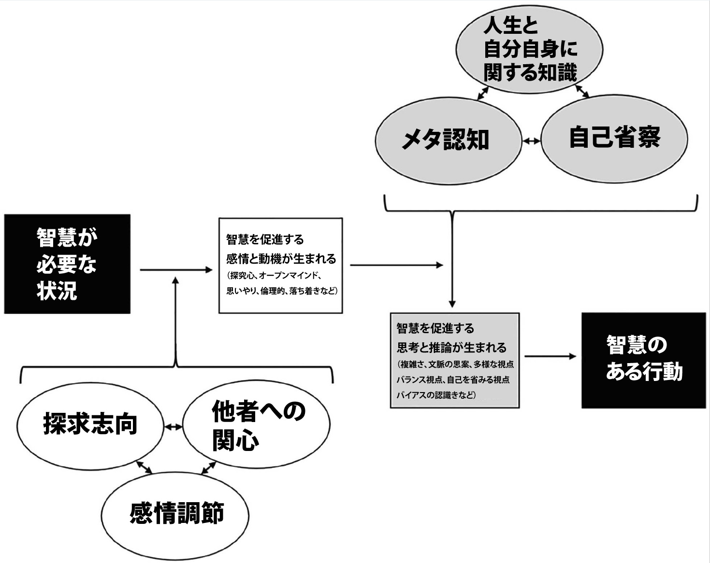

# 現代人が持つべき究極スキル『智慧』ってどんな状態なの？#1「『智慧』を身につけるのに欠かせないスキルとは？」

「**智慧（ちえ）**」に関する最新論文([R](https://indigo.uic.edu/articles/journal_contribution/The_Wisdom_Researchers_and_the_Elephant_An_Integrative_Model_of_Wise_Behavior/21610662))が、要点をめっちゃよくまとめてくれていたので、内容をチェックしておきましょう。智慧ってのは「[無(最高の状態)](https://amzn.to/3TLhDnE)」でも取り上げたポイントで、「**無我にいたった者がいたる境地**」として紹介しております。

---

「智慧」そのものは1,990年代ぐらいから研究がスタートしたジャンルで、すごーくざっくり申し上げますと、

- **人生の難しい場面で適切な対処ができる能力**

みたいな感じです。「部署内でモメてる！」とか「パートナーと分かれるべきか迷う！」とか「肉親とうまくいかない！」など、データ分析では容易に解決できないような問題について、バシッと答えを出せるような能力を意味しているわけです。めっちゃ難しい能力ですが、これが身についたらすごいですわな。

「智慧」の研究が進みはじめた理由は簡単で、1990年代ごろから、「知性が高いだけじゃダメだよねぇ」や「データ分析だけだと良い答えを出すのって難しいよねー」ってコンセンサスが出てきたからです。世の中の多様性が広まるごとに社会問題や環境問題が複雑化してきまして、情報をうまく処理できるだけだと、良い答えが出なくなってきたんですよね。

たとえば、昨今のマイノリティ問題にしても、「差別はいけない」って認識は誰もが共通しているのに、過激派が出てきたり、それへのカウンターが出てきたり、それを利権化する人が出てきたり、それでも一時的な特権の必要性は認めざるを得なかったり……みたいに事態が複雑化するじゃないですか。こういった複雑した立場をすべてひっくるめて、さらに高い段階で統一して解決する能力を「智慧」と呼んでるわけです（いわゆるアウフヘーベン）。

## **「智慧」がある人に特徴的な３つの要素**

それでは、果たして「智慧」ってのはどんな能力なんでしょうか？ この問題を考えるにあたり、クラーゲンフルト大学などの先生方は、30年におよぶ「智慧」の研究をガッツリと調査したうえで、「智慧」を構成する要素を、以下のようにピックアップしてくれております。

### **「智慧」の要素1. 問題状況を偏りなく理解する**

第一に、「智慧」のある行動には、複雑な問題についてのファクトだけじゃなくて、感情の問題、社会的な問題、歴史的な問題もふくむ知識を可能な限り多く集めることがふくまれる。そのため、「智慧」がある人は、**精神的に「一歩引いた」視点に立ち、問題の全体像とその詳細な背景の両方を客観的に把握する**のがうまい。

この能力には、通常、冷静なまま対象に心を開き、対象に敬意を払い、相手に共感し、関係する人々やグループの視点に耳を傾けるスキルがふくまれる。

### ****「智慧」の要素2. みんなが可能な限り幸せになる解決策を考える****

第二に、「智慧」がある人は、問題が複雑にからみ合っていることを明確に把握したあとで、そこに関連する知識や専門知識を活用して、関係するさまざまな利害のバランスを取り、みんなにとって共通するメリットを最大化できるような解決策に取り組む方法を考える。これには、他人に相談して助言を得ることも含まれる。

そのため、「智慧」がある人は、**難しい問題に関われば関わるほど、自らのバイアスを振り返る回数が増え、自らの感情をコントロールする**ようになる。また、複雑な問題については「解決策を特定するのが最初の目標ではない！」って気持ちが強いため、短期的および長期的な結果の両方を考慮して、解決策に向けた実行可能な経路を考え出す方向にリソースを投入する。

### ****「智慧」の要素******3. 最良の解決策を提案し実行する**

（そこそこ）最善の解決策が見つかったら、「智慧」がある人たちは、それを確実に追求しようとする。もちろん、複雑で不確実な問題においては、唯一ベストな解決策などめったに存在せず、試行、評価、改良、反復のプロセスが必要になることのほうが多い。そのため、**「智慧」がある人は、通常は人々に何をすべきかを指示することはなく、経験、道徳、誠実さ、社会的スキルを駆使して、指導と支援を行う**。

ということで、「智慧」を持っている人は、複雑な問題をそのまま受け止めて、感情的なバイアスに気をつけつつ、なるべくすべての人たちの幸福を増やす解決策がうまい人だと申せましょう。かなりの最強キャラですね。

## **「智慧」がある人はどんな行動を取るのか？**

では、これらの能力を持ち合わせた「智慧者」は、具体的にどんな行動を取るのか？ってことで、研究チームはくわしい特徴をまとめてくれております。以下のような行動が多く見られる人は、おそらく「智慧」を持った人なんだろうなーと考えられるわけです。

### **「『智慧』の要素1. 問題状況を偏りなく理解する」を持った人に特徴的な行動**

- 聞き上手
- 複雑な問題を複雑なままに理解する
- 複雑な物事を切り分ける
- 自分が何を考えているかに自覚的
- つねに物事を疑う
- 他者の状況・生活背景を考慮する
- 問題と自分の感情を切り離す
- 問題のすべての側面に耳を傾ける
- 複数の原因のつながりを見つける
- 客観性がある
- ものごとを観察する
- 全体を見る
- 情報を求める
- すべての視点を理解して考慮する
- 状況の本質を見抜く
- 物事をより大きな文脈でとらえる
- 複雑な状況を一目で把握する
- 他者の視点を取り入れる
- 異なる価値観を受け入れる
- 人の感情を理解しようとする
- 知識を応用する
- 知識を日常生活に柔軟に／創造的に応用する
- 状況に応じてすべての選択肢を考える

### ****「『智慧』の要素2. みんなが可能な限り幸せになる解決策を考える****」を持った人に特徴的な行動****

- 自分自身の感情を認識してコントロールする
- 問題のなかにある不確実性を認識して受け入れる
- ファクトと手続き上の知識への信頼がある
- 他人からアドバイスを受ける
- 物事をじっくりと考える
- 普通の人が考えるよりもさらに多く考える
- あいまいなものを可能な限り明確にしようと試みる
- 最後には自分自身と直感を信じる

### ******「『智慧』の要素******3. 最良の解決策を提案し実行する」****を持った人に特徴的な行動****

- 目標を達成するための戦略を作る
- 誠実である
- 責任感がある
- リスクを取ることをいとわない
- 物事に時間をかけることをいとわない
- コミュニケーションがうまい
- 思いやりをもって他人にアドバイスする
- 知識や経験を活かしたアドバイスをする
- アドバイスを提供する際に道徳を重視する
- アドバイスを与えるときと与えないときがわかる
- 妥協点を探るのがうまい
- 問題に対する代替案を提示する
- 真実でなくとも、近似の解決策を提示する
- 知識・スキルを実践の場面で使える
- つねに机上の空論でない解決策を模索する
- 問題焦点型または感情焦点型のサポートを提供する
- 誠実で温厚な性格
- 日常的なことを行うのもうまい
- 自分の社会的な能力への信頼感がある
- 自分の価値観や目標に忠実である
- 状況のなかで、コントロールできることとできないことの見極めがうまい

と、こうして見ると、「これがすべてできたら確かに完璧超人だな！」って気がしますし、いかにも幸福な人生を送れそうな感じがするわけです。うらやましいキャラですなぁ。

## **『智慧』を身につけるのに欠かせないスキルとは？**

こうなると、「**『智慧』を身につけるのに欠かせないスキルとは？**」ってところが気になりますが、研究チームは大きく6つのスキルを挙げてくれてます。

1. **探索志向**：人生を理解し、経験から学び成長しようとする基本的な動機。
2. **他者への関心**：他人の気持ちを理解し、他人の幸福に気を配る。
3. **感情調節**：困難な状況でも感情のバランスを保つことができる。
4. **人生と自分自身に関する知識**：自分や他者の経験に関する深い知識。
5. **メタ認知**：自分の知識の限界への気づきや、より広い文脈や他者の視点への配慮。
6. **自己省察**：自分の感情、思考、行動を振り返る。

それぞれの能力と、その鍛え方については次回お伝えしますけど、個人的にも「必要な能力をうまくまとめてくれてありがとう！」って感じでして、ここを押さえておけば、かなり「智慧」開発がはかどるんじゃないでしょうか。

でもって、これら6つの能力が「智慧」とどう関わるかについて、研究チームは1枚の図解にまとめてくれてます。

この図解をふまえ、次回は「智慧に欠かせない6つの能力を伸ばす方法」を見ていきましょうー。ではまた！
