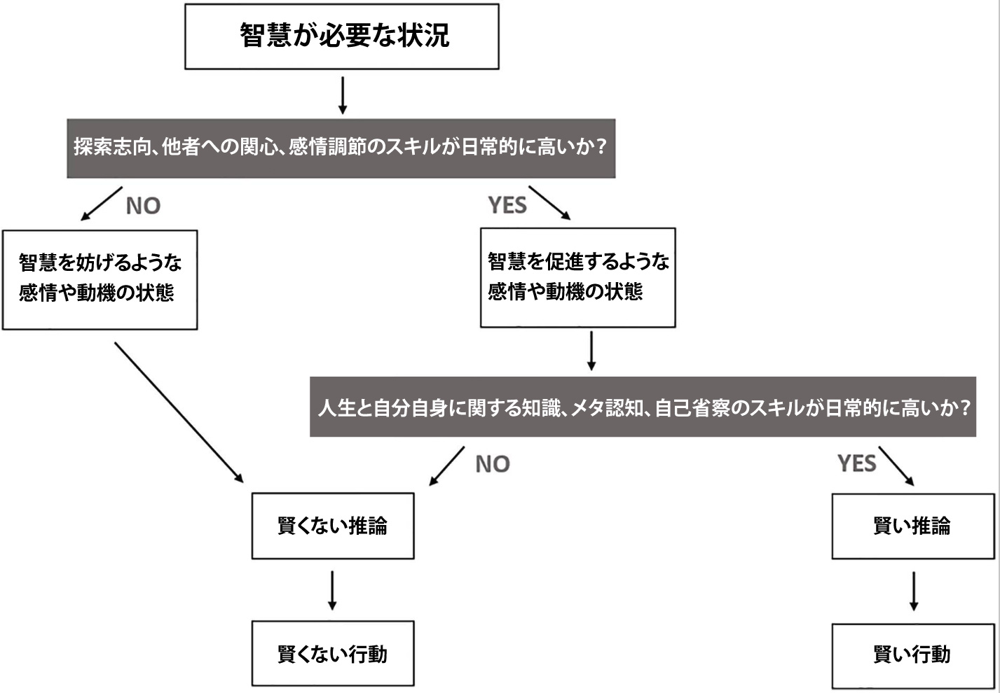

# 現代人が持つべき究極スキル『智慧』ってどんな状態なの？#2「智慧スキル1. 探索志向」

『智慧』シリーズの続きでーす([#1](https://daigovideolab.jp/blog/2144443))。

---

このシリーズでは、クラーゲンフルト大学などのレビューをもとに、「智慧（ちえ）」を養うのに欠かせないスキルをチェックしております。そこで[前回](https://daigovideolab.jp/blog/2144443)は「智慧」がある人の特徴を紹介しつつ、具体的な行動の例も見てみたわけです。

## **なぜ6つのスキルで智慧が生まれるのか？**

そこで大事なのが「**『智慧』を身につけるのに欠かせない6つのスキル**」で、簡単におさらいすると以下のようなものでした。

1. **探索志向**：人生を理解し、経験から学び成長しようとする基本的な動機。
2. **他者への関心**：他人の気持ちを理解し、他人の幸福に気を配る。
3. **感情調節**：困難な状況でも感情のバランスを保つことができる。
4. **人生と自分自身に関する知識**：自分や他者の経験に関する深い知識。
5. **メタ認知**：自分の知識の限界への気づきや、より広い文脈や他者の視点への配慮。
6. **自己省察**：自分の感情、思考、行動を振り返る。

これらの能力が「智慧のある行動」とどう関わるかについては以下の図解を見れば理解しやすく、智慧に必要なスキルが、現実の世界で良い意思決定をするためにどう役立つのかをまとめてくれてます。

簡単に言いますと、まず最初に「友人とケンカした！」みたいな「智慧が必要な状況」があって、そこで最初に欠かせないのが「探求志向」「他者への関心」「感情調節」の３つ。これらの３つは、いずれも私たちの感情やモチベーションに関わるスキルで、**これができないと、トラブルに慌てまくっちゃうし、無闇に他人を攻撃しちゃうし、自分の意見にこりかたまっちゃう**しで、よりよい判断などできるはずもなくなるわけです。

でもって、以上３つのスキルで感情の状態を整えたら、今度は「人生と自分自身に関する知識」「メタ認知」「自己省察」の出番。こちらの３つは、いずれも脳の理性的な働きに関わるスキルで、バイアスから離れたバランスの取れた結論を出すのに役立つわけです。その結果、最後に「場面に応じた最適な決断＝智慧のある行動」ができるようになるわけです。

さらに、以上の流れをチャートにすると、以下のようになります。いずれにせよ、最初に「探求志向」「他者への関心」「感情調節」で智慧のベースを整え、それをもとに認知系のスキルで最適な意思決定を行うのがポイントであります。

ってことで、以上をふまえたうえで、今回は智慧に欠かせない６つのスキルのうち、「**感情のベースを作る３つのスキル**」を見てみましょうー。

## **感情的なスキルを鍛えよう！**

感情的なスキルは、智慧に欠かせない３つのスキルを養うのに重要で、「異なる意見も受け入れるマインド」「トラブルにもパニクらないマインド」などを作り出すのに役立ってくれます。各スキルの内容は、以下のようになります。

## **智慧スキル1. 探索志向**

智慧のある人は、人生を理解し、経験から学んで成長しようとする基本的な動機を持っております。対処が難しい状況のなかにいても、現実的で錯覚のない理解を目指すわけですね。そのため、智慧者にとっては、自分とは異なる視点は困難や脅威にならず、興味深くて有益なものだって印象になるんですな。

そのために欠かせないのが探索志向で、このスキルは、大きく2つの構成要素でできております。

## **「探索志向」の構成要素1. 理解への欲求**

智慧者は「人間」という存在に深い好奇心を持ち、その魅力に取り付かれる傾向が大きめ。こういった理解への欲求が大きいせいで、問題を深く理解して、異なる視点から問題を見て、文脈を考慮するモチベーションが高まるわけです。さらに、この傾向のおかげで、人間に関する事柄について専門性が高まっていくんですな。

ちなみに、一部の智慧研究では、「理解への欲求」を「智慧に対する重要度は9段階評価で平均8.0」だと評価してたりします。また、いくつかの研究でも、智慧の高さは、理解への欲求を示す指標と相関があることが分かってるんですね。その点で、かなり重要なスキルなのは間違いないでしょう。

このスキルを成長させるには、「[運の方程式](https://amzn.to/3zm9Zqr)」で紹介した好奇心アクションリストが有効ですが、加えて以下のトレーニングもお試しください。

### **理解への欲求トレーニング1. 「実はよく知らないこと****リスト****」を作る**

どんなに物知りな人でも、自分があまり知らないことに日々たくさん出会っているはず。ネットで見かけた平凡なニュースひとつをとっても、よくよく考えてみると、自分があまりよく分かっていないことに気づくケースはいくつもあるはずです。

このような「実はよく知らないこと」に注意を向け、見つけたらリストに追加しておきましょう。そのうえで、リストの内容を自分で自分に説明してみると、理解への欲求が高まっていくはずであります。たとえば、今朝のSNSで「インフレ懸念から日銀が金利を引き上げるかも？」といったニュースを見たら、「なぜ金利を上げるとインフレが抑えられるのか？」を自分で説明してみるわけです。

ここで大事なのは、「これは重要だ！」と思えるものだけをリストに使いしてはいけないことです。たいていの研究では、創造的な人ほど「どうでもいい知識」「変な雑学」を持っている傾向が強くあるもんですから。なので、重要だと思わない項目もたくさんリストに入れておいてください。

### ****理解への欲求トレーニング2.**学習しやすいようにする**

私たちの多くは、数ある選択肢のなかから、最も簡単なことをしたがる傾向があります。スマホのゲームについ時間を浪費しがちなのは、それがすぐ手元にあり、いつでも利用できるからです。そのため、新しいことを学びたいなら、新しい情報をすぐ利用できるようにする必要があります。

そこでおすすめなのが、上のトレーニングで作ったリストを、つねに手元に置いておくこと。仕事中に時間が余ったとき、長い列に並んでいるときなどにリストのトピックを調べてみてください。トピックを理解し終えたら、自分でクイズにして説明し直してみましょう。自分で納得のいく説明ができるまで、これを続けましょう。

もちろん、気になる電子書籍やオーディオブックをつねに保存しておいたり、ベッドサイドに本を置いておいたりという昔ながらの方法も十分役立ちますんで、こちらも合わせてお使いください。

### ****理解への欲求トレーニング3.**バディアップ**

もし、あなたが根本的に理解への欲求がないなら、手本になるような好奇心を持つ人を見つけるのがベストです。そのような人と週1回ぐらいは会話を交わし、新しいことを教え合いましょう。そうすることで、仲間に何か新しいものを紹介するという定期的な目標ができますし、新しい情報を他の人に効果的に説明できるようになることで、知識の質を高めることができますんで。

もし、新しい勉強仲間になってくれる人が見つからない場合は、ブログを始めてみるのもいいでしょう。これはフォロワーをたくさん作るのが目的ではなく、自分が発見した新しいことを説明するためのアウトプットを提供するのが目的になります。

## ****「探索志向」の構成要素2.**オープンマインド**

智慧者は、自分のものとは異なる信念や価値観、世界観を広げるような経験、複雑で不快な体験もオープンな傾向があります。そのおかげで、難しい決断が必要な状況においても、多様な視点を認めて許容して、深く考えることができるんですな。

智慧の専門家を対象にした2010年の調査では、「オープンマインド」は「智慧に対する重要性が9段階中8.2ポイント」だったそうな。これを見ても、オープンマインドは、智慧の一貫した予測因子だと言えましょう。

つまり、智慧者ってのは、人生に対する好奇心が強く、学習と成長を志向し、新しいアイデアや視点、内外の経験に対してオープンであることが特徴なわけですね。このような特徴により、智慧者は、困難な状況でも理解志向でオープンマインドに対応することができるのです。

このスキルを成長させるには、以下のトレーニングをお試しください。

### **オープンマインド・トレーニング1. 中立的な立場の人に相談する**

新しいことを受け入れるには、誰かと一緒にその状況を話し合うのが最も効果的。ここで推奨したいのは「[動機づけ面接](https://yuchrszk.blogspot.com/2021/09/FunctionalImagery.html)」と呼ばれる手法で、新しいアイデアに対する不安や葛藤を、信頼できる相手に話し、聞いたことを繰り返してもらうというものです。このプロセスにより、自分がオープンマインドになれない理由を深く理解でき、客観性を得ることができます。

さらにくわしくは、「[動機づけ面接を身につける](https://amzn.to/42VXKhW)」などをご参照ください。

### ****オープンマインド・トレーニング2.**ネガティブな思考をリフレームする**

新しいアイデアを聞くと、私たちの多くは「これは絶対にうまくいかない！」といったネガティブな結論に飛びつきがち。でもって、このようなネガティブな思考は、ポジティブな行動を妨げる傾向があるのでご注意ください。

その代わりに、このような反射的なネガティブ思考に対して、より現実的な言葉で返すように脳を訓練し、状況をリフレーミングしてみましょう。「誰も雇ってくれないから転職なんて無理」と思ったときは、「いや、一生懸命仕事を探し続ければ、雇ってもらえる可能性が高まる」といった現実的な思考を呼び起こすわけですね。

次に、よりバランスの取れた文章で、新しい思考を書き直しましょう。たとえば、「うまくいかない可能性もあるが、成功する可能性もある。私にできることは、自分のベストを尽くすことだけだ」みたいな感じっすね。

### ****オープンマインド・トレーニング3.**コンフォートゾーンから抜け出す**

「[運の方程式](https://amzn.to/3zm9Zqr)」で紹介した「コンフォートゾーンの脱出法」も、オープンマインドを養うには良い方法です。週に一度は違うジャンルの音楽を聴いたり、新しい種類の映画を見たり、食べたことのない食べ物を食べてみたりするわけっすな。その他にも、政治的な立場が異なるメディアに触れてみて、特定の見解だけを見たり読んだりしてはいけないかをチェックするのも重要であります。

さらには、人種、文化、政治、年齢など多様な友人と時間を共有し、輪を広げることを心がけるのも、オープンマインドを養うには最適な方法です。

ってことで今回は、「智慧スキル1. 探索志向」を養う手法を見てみました。このシリーズはまだ続きまして、次回は「智慧スキル2.他者への関心」を掘り下げてみましょう。
