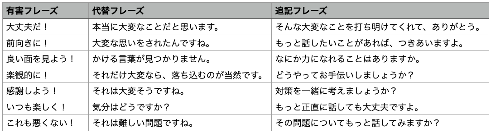

# 人生を台無しにする大問題「有害ポジティブ」に対策しておこうぜ！

久々に「有害ポジティブ」の話です。この考え方については[以前に紹介したことがありまして](https://yuchrszk.blogspot.com/2022/05/blog-post_14.html)、ざっくりまとめると、

- どんなに辛いときでも、ポジティブな考え方をするべきだ！ ポジティブに振る舞うべきだ！

みたいな考え方のことです。もちろん、[前向きな姿勢には良いことが多い](https://yuchrszk.blogspot.com/2016/12/blog-post_23.html)んだけど、本当は辛いのに強引にポジティブでいようとすると、いろいろと問題が出てくるわけですな。

---

この問題は2010年代から言われ始めたものですが、近年では「**先進国の人って有害なポジティブで無駄に苦しんでいるケースが多いのでは？**」って風潮が高まり、さらに研究が進みはじめたんですよ。経済が発展した国ほど「前向きでいなければ！」「幸せでいなければ！」みたいな考え方が強く、そのせいで無闇に苦しむ人が多いというんですな。

ちなみに、有害ポジティブを持つ人が使いがちなフレーズには、以下のようなものがあります。

- 人生の明るい面を見よう！
- すべての出来事には意味がある！
- 心配しなくていい！
- きっとうまくいく！
- ただ考え方を変えればいい！
- きっと乗り越えられる！
- そんなの永遠には続かない！

このような言葉は、一見すると正しいように聞こえるものの、実際にはネガティブな感情を抑えつけているだけに過ぎず、そのせいで、苦痛、恥、孤立、消極性などがブーストしやすいんですよ。まぁ、ただネガティブを否定しまくって、物事の厳しさを認めなかったら、そうなるのは当たり前ですよね。

## **有害ポジティブはどんな問題を引き起こすのか？**

有害ポジティブの内容がわかったところで、続いて具体的にどんな問題が起きるのかを見てみましょう。

### **1.有害ポジティブはネガティブ感情のリバウンドをもたらす**

ケンタッキー大学で感情コントロールについて研究しているスザンヌ・C・セガーストロム博士([R](https://psychology.as.uky.edu/users/scsege0))によると、有害ポジティブを持ち続けることの最大の問題は、「自分の本当の気持ちを過小評価するようになることだ」とのこと。通常、抑圧された感情は強くなって戻ってくるものでして、いわば空気でパンパンのビーチボールを水中に沈めようとがんばってるようなイメージですね。

事実、COVID-19時の医療従事者を調べた2022年の研究([R](https://www.sciencedirect.com/science/article/pii/S0165178122004553?via%3Dihub))では、有害ポジティブを持つ人の多くは、抑うつや神経症が増えてしまう傾向が見られたとのこと。これもリバウンドが原因なんでしょうなぁ。

### **2.有害ポジティブは「恥」をブーストする**

有害ポジティブをよく使う人は、自分の脳に対して「私がいま抱いている感情は間違っている！」というメッセージを送り続けるため、罪悪感や恥ずかしさの感情に悩まされるケースが多め([R](https://www.takingcharge.csh.umn.edu/survivorship/toxic-positivity))。[「恥」の感情がメンタルヘルスを大きく損なうのは有名](https://yuchrszk.blogspot.com/2023/05/blog-post_30.html)で、摂食障害([R](https://onlinelibrary.wiley.com/doi/abs/10.1002/eat.23583))や 心的外傷後ストレス障害（PTSD）([R](https://onlinelibrary.wiley.com/doi/abs/10.1002/jts.22411))などにつながる事実が指摘されてまして、これもまた辛いところです。

### **3.有害ポジティブは「本当の自分」を見失わせる**

有害ポジティブは、「いまの私は本来の自分でない！」って感覚をブーストしがち。不自然な状況で無理にポジティブになってしまうと、「自分がいまなにを感じているのか？」「自分は本当は何をしたかったのか？」などがわからなくなり、アイデンティティがどんどん崩壊していくわけですな。感情をずっと抑圧していたせいで、生きている感覚が失われるケースはほんと多いですからねぇ。

### **4.有害ポジティブは「孤立」の気分をブーストさせる**

「心配するな！」「小さなことにくよくよするな！」「未来は明るい！」と言われ続けると、私たちはつい「こんな問題で苦しんでいるのは自分だけだ！」「私は弱い！」と思い込むようになりがち。そのせいで、有害ポジティブを持つ人ほど、他人に相談できなくなり、周囲からもどんどん孤立していき、最後は孤独感に悩んでしまうわけですな。

### **5.有害ポジティブは問題の解決を遅らせる**

ケベック大学トロワ・リヴィエール校などの研究によれば、「困難な状況でも笑顔を保たねばならない！」と考えている人ほど、眼の前で起きている問題の本質から目をそらし、その問題を乗り超えるために必要な行動を取らなくなってしまいがち。有害ポジティブな人は、「この問題は大丈夫！」と自分に言い聞かせ続けるせいで、実際のトラブルに取り組むモチベーションを失ってしまうわけですな。

### **6.有害ポジティブは健康に悪い**

有害ポジティブは、私たちの健康状態を悪化させ、身体のストレスを増やすことがわかっております。例えば、2014年の研究([R](https://www.ncbi.nlm.nih.gov/pmc/articles/PMC3939772/))では、参加者が普段からどのように感情をコントロールしているのかを調べ、それから12年後の健康記録と比べたところ、

- 自分の感情を抑制して対処する人（「他の人が怒らないように、自分の気持ちを殺して楽しく過ごそう」みたいな）は、調査期間中に癌を含むあらゆる原因で死亡する可能性が高かった。

みたいな結論だったんですな。有害ポジティブの健康被害を確定するにはさらなるデータが必要ですが、とにかく常にポジティブであろうとするよりも、ネガティブな感情を受け入れる方が健康なのは間違いないでしょう。

## **有害ポジティブにどう対処する？**

というわけで、以上をふまえたうえで、有害ポジティブの問題に対処するための方法を見ておきましょう。有害ポジティブについては、「他人から有害ポジティブをぶつけられる場合」と「自分が有害ポジティブにハマっている場合」の2パターンがありますので、それぞれに対処する方法をチェックしておきましょう。

### **他者からの有害ポジティブに対処する場合**

まずは、他人から有害ポジティブをぶつけられた場合の対処から。有害ポジティブな言葉をかけてくる相手には、以下の戦略を使ってみましょう。

- シンプルに無視するか、または「どうもー」という簡単な言葉をかけるのがベスト。

- しかし、親しい相手から有害ポジティブを使われて、冷淡な対応がしづらい場合は、相手に「こちらのためを思って言ってくれてるんですねー」ぐらいの表現をしてみるのが吉。

- さらに、「そう言ってくれるのはありがたいんだけど、そういう言葉って意外と傷つくんですよー」のように、相手の無邪気なセリフが自分にどのような影響を与えるかを冷静に説明するのも吉。有害ポジティブを使う人は、自分の言葉がどれほどイラッとさせるものなのかを理解していないことが多いので、その点を説明するのも効果がある。

- さらには、「こっちは、はげまして欲しいんじゃなくて、ただ話を聞いてほしいんですよ」「もっと具体的なアドバイスがほしいんですよ」ように、こちらの希望を具体的に伝えてあげると、相手に恥をかかせずに、スムーズに対応しやすくなる。

### **自分の中の有害なポジティビティに対処する**

次は自分が、他人または自分自身に向かって有害ポジティブを使っている場合です。もしも自分が有害ポジティブを使っていることに気づいたら、以下のようなアプローチを取ってみてください。

### **有害フレーズの言い換え**

もし自分が、他人に有害ポジティブをぶつけそうになったら、ぜひ有害フレーズの言い換えを考えてみてください。相手の言葉に反射的な返事をするのではなく、いったん立ち止まり、以下の表のように言い換えてみるわけですな。

これを見ればおわかりのように、有害フレーズの言い換えってのは、基本的に「相手のトラブルに共感し、そこから感謝か提案をする」って構成になってます。この手順を行うことにより、相手を無駄にイラつかせずにコミュニケーションを進めることができますんで。

### **セルフ・バリデーション**

セルフ・バリデーションは、自分が有害ポジティブの罠にはまっていないかどうかを自分でチェックするために開発されたテクニックです([R](http://galaxyjeevandhara.com/index.php/IJSS/article/view/116))。こちらは、自分が自分に有害ポジティブを使っている場合と、自分が他人に有害ポジティブを使っている場合の両パターンで使えますので、「自分になんらかのトラブルが起きたとき」または「他人からトラブルを相談されたとき」には、いったん深呼吸してから、以下の質問の答えを考えてみてください。

- **レベル1：傾聴チェック**
  - 私は、相手の話（または自分の思考）に共感を持つことができているか？
  - 私は、自分の反射的な言葉や思考を止めて、相手の話（または自分の思考）へ完全に注意を払えているか？

- **レベル2：内容チェック**
  - 私は、相手の話（または自分の思考）の内容を正確に理解できているか？
  - 私は、相手の話（または自分の思考）の内容で、理解ができないところはないか？

- **レベル3：言語外チェック**
  - 私は、相手の話（または自分の思考）のなかで、言葉にされていない他の感情、思考、行動に気づくことができるか？
  - 私は、相手の話（または自分の思考）のなかで、言葉にされていない他の感情、思考、行動を掘り下げるためのフォローアップの質問ができているか？

- **レベル4：大局観チェック**
  - 私は、相手（または自分）に起きた問題をより広い視点から見ることができているか？（「この人は、過去に辛いことがあったから、いまこんなネガティブな態度になってるんだな」とか「上司は悪い人ではないが、いまプレッシャーが大きすぎて、自分にキツい態度になってるんだな」とか）
  - 私は、相手（または自分）の過去の体験が、いまの問題にどのようにつながっているかを考慮できているか？

- **レベル5：普遍性チェック**
  - 私は、いまの相手（または自分）に起きた悩みを、より普遍的な視点からとらえられているか？（「過去に同じ悩みを持った人はいるか？」「この悩みを持っている人は自分だけなのか？」みたいな感じ）

- **レベル6：現実チェック**
  - 私は、相手（または自分）に起きた問題について、ちゃんと長所と短所をまとめて認識できているか？
  - 私は、相手（または自分）に平等と尊敬の念を持って接することができているか？
