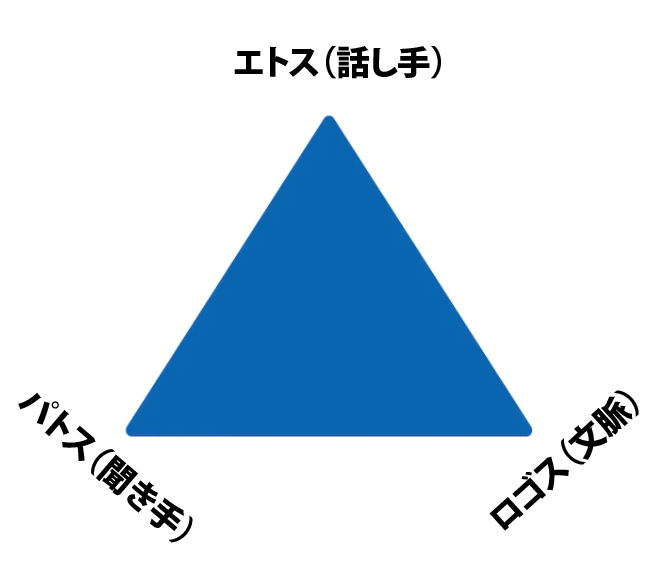
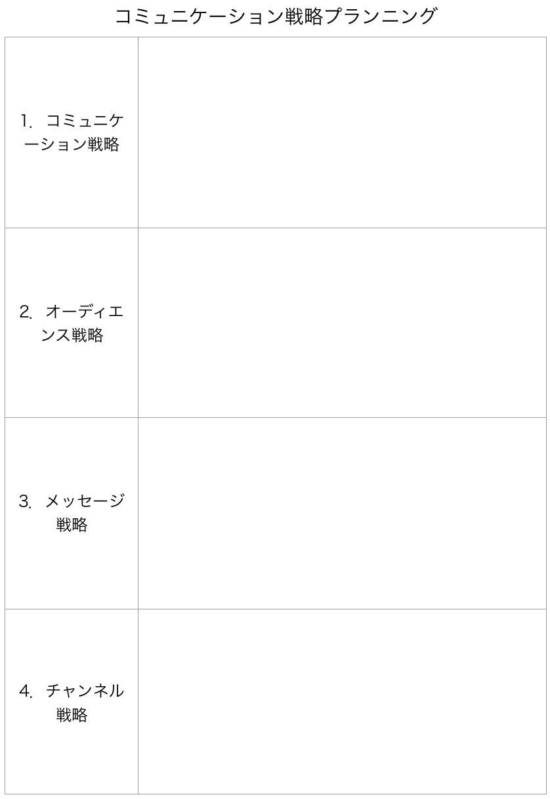
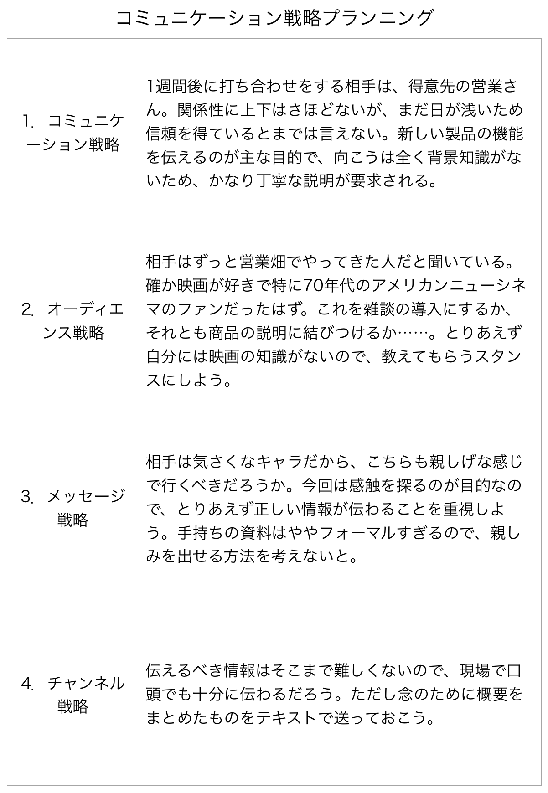

# 最強ソフトスキル「アクティブ・リスニング」を学ぶ#12「レトリックの三角形」

アクティブ・リスニングの続きでーす([#1](https://daigovideolab.jp/blog/2154975),[#2](https://daigovideolab.jp/blog/2155064),[#3](https://daigovideolab.jp/blog/2155244),[#4](https://daigovideolab.jp/blog/2156319),[#5](https://daigovideolab.jp/blog/2156366),[#6](https://daigovideolab.jp/blog/2156367),[#7](https://daigovideolab.jp/blog/2156762),[#8](https://daigovideolab.jp/blog/2157227),[#9](https://daigovideolab.jp/blog/2157643),[#10](https://daigovideolab.jp/blog/2157888),[#11](https://daigovideolab.jp/blog/2158221))。

---

このシリーズでは、私たちのコミュニケーションに欠かせないソフトスキルである「**アクティブ・リスニング**」の身につけ方をまとめていて、アクティブ・リスニングを鍛える「**個別トレーニング編**」を進めております。

で、前回から「**難しい議論にどう対応するか？**」ってとこに入っていきまして、相手から責められたり、議論がヒートアップしたりと、ケンカに発展しそうな議論に役立つトレーニングを紹介しております。今回もその続きを見てみましょう。

## **トレーニング35．レトリックの三角形**

相手に伝えるにはレトリックが大事！ってのは、よく聞く話でしょう。レトリックは自分の考えを説得力を持って表現する技術のことでして、言い換えるなら、議論とは「何を言うか」のテクニックであり、レトリックとは「どのように言うか」のテクニックだと言えるでしょう。

レトリックのテクニックは無数にあるため、本気で取り組もうとすると莫大な時間が必要になります。そこで、ここでは最もシンプルなフレームワークである「**レトリックの三角形**」を押さえておきましょう。

「レトリックの三角形」は、コミュニケーションの際に考慮すべき3つのポイントを意味し、以下のような図形で表されます。

これらの要素ってのは、

1. **エトス**：信頼性と権威を確立することで信頼を築く（話し手）。
2. **パトス**：聴衆の価値観や関心を通じて聞き手とつながることで、感情に訴える。
3. **ロゴス**：よく構成され、明確に整えられたアイデアで聞き手の知性に訴えかける（文脈）。

って感じになってまして、この3つの要素によって、あなたの言葉の説得力が決まります。あなたが発する言葉は、この3つすべてを考慮する必要があるんですね。それでは、3つの要素を、もう少し詳しく見てみましょう。

### **1. エトス（話し手）**

エトスは話し手の信頼性のことで、

- あなたはどういう人間なのか？
- なぜあなたがその問題について発言する資格があるのか？
- あなたの権威はどこから来るのか？

を明確にすることを意味しております。話し手に信頼性がないと、聞き手は「この人は自分を攻撃しようとしてるのでは？」や「この人は自分を操ろうとしているのでは？」みたいに警戒してしまい、メッセージがちゃんと伝わりませんからね。

聞き手は、常にあなたの動機、信念、価値観 、仮定を理解しようと試み、それによってあなたの信頼性を評価しますんで、話し手のエトスは超大事なんですよ。

### **２．パトス（聞き手）**

コミュニケーションをする際には、こちらのメッセージを聞く相手を理解し、その感情に訴えかける必要があります。これはパトスとして知られる要素で、「聞き手は私に何を期待しているのか？」「聞き手は私の発言から何を得ようとしているのか？」「そもそも、なぜこの聞き手とコミュニケーションをとるのか？」といったポイントを明確にし、相手のことを念頭に置きつつ 、事前にコミュニケーションの方法を計画しておくのがポイントです。

あらかじめ聞き手のことを知っておかないと、専門用語を使いまくって相手を混乱させちゃったり、相手が望まないスタイルで話しかけてしまったりして、いろいろと問題が起きやすくなりますんで。

### **3. ロゴス（文脈）**

最後に、大半の聞き手は、あなたのメッセージを文脈に当てはめて分析することを覚えておきましょう。ここで大事なのは、論理と理性、すなわちロゴスです。

ここで聞き手が求めるのは、あなたが使った議論の種類、その妥当性、論理の一貫性といったポイントです。当然ながら、あなたのメッセージに、論理性とエビデンスがふくまれていなかったら、聞き手も受け入れてくれませんからね。

## **「**レトリックの三角形**」を使ってみよう！**

それでは、実際に「**レトリックの三角形**」を使ってみましょう。誰かと話をするときや、文書やスピーチ、プレゼンテーションを準備する時などは、事前に「レトリックの三角形」を考慮しつつプランニングしてみてください。この3つの要素のどれかが欠けていると、メッセージ全体のインパクトが弱くなっちゃいますんで、以下のステップで思考を進めましょう。

### **ステップ1.信頼性（エトス）を確立する**

メッセージに説得力を持たせるためには、まずは、あなたがいかに信頼できる人間であるかを示す必要があります。どんな聞き手も、無意識のうちに「この人は信頼できるのか？」と思っているものなので、手はじめにこの疑問に答えないと、どれだけ良いことを言っても受け入れてもらえませんからね。

というわけで、まずは自分という人間の信頼性を確立してみましょう。具体的には、以下のポイントを明らかにしてください。

- 自分の意見にすべて明確な根拠があるかをチェックする。
- 自分が相手に伝える知識が、どんなリソースから来ているのかを確かめる
- 自分のメッセージと同じことを言っている専門家がいれば、その発言も利用できるようにしておく。
- 自分が得意の話題にくわしいなら、その事実をアピールできるような理由を考えておく。

これらのポイントを考えたら、次にコミュニケーションの目的を考えてみましょう。

- 相手の行動を変えたいのか？
- 相手に情報を提供したいのか？
- 相手を教育したいのか？
- 相手を説得したいのか？ 視点を変えさせたいのか？
- 相手にアイデアを伝えたいのか？
- 相手を単に楽しませたいのか？

このようなコミュニケーションの目的があいまいだと、相手に「なんだか会話がフワフワしてて、この人は信頼できないなー」って印象になっちゃうので、そこはご注意ください。

### **ステップ2. 観客の感情に訴える（パトス）**

続いて、自分のメッセージを相手の感情に響かせるための作業を行いましょう。パトスの準備をするときは、以下のポイントを明確にしておきましょう。

- 聞き手は誰なのか？
- 聞き手はこちらに何を期待しているのか？
- 聞き手が私の話を聞く（読む）理由はなにか？
- 彼らはこの情報をどのように使うのだろうか？
- 私は聞き手にどうなってもらいたいのか？

これらのポイントを明確にしたら、続いて相手と感情的につながることができるかを考えていきます。

- 私は聞き手にどんな感情を呼び起こしたいのか？
- その感情を呼び起こすために、どのようなエピソードや個人的な話を使えるだろうか？

### **ステップ3. 文脈を考える（ロゴス）**

最後は、あなたが伝えたいメッセージのを、理性に訴えかける伝え方について考えましょう。以下のポイントを明確にしてください。

- このメッセージは、どのような順番で提案するのがベストか？
- 自分の意見が正しいことをどうやって証明できるか？統計？エビデンス？観察？
- どのようなトーンで話すほうがいいか？ 硬い口調か、それともカジュアルな口調か？
- メッセージを伝える最善の方法は？ プレゼンテーション? 電子メール? ブログ? 対面のトーク？
- メッセージを理解してもらうために、どのような背景情報を提供する必要があるか？
- 相手が言ってくるだろう重要な反論はあるか？ それに対してどう対処すべきか？
- 私のコミュニケーションの方法や場所は、そのメッセージに合っているか？

これらを明確にしておくと、レトリックの三角形が組み込まれ、聞き手が賛同しやすいように自分の主張をカスタマイズできるようになりますんで。

### **レトリックの三角形の使用例**

では、基本を押さえたところで、レトリックの三角形を実際に使っている例を見てみましょう。ここでは、新しく企業の副社長になった人が、自分のスピーチにレトリックの三角形を使った事例を紹介します。

「皆さん、おはようございます。私がA社の新しい副社長です。自己紹介をさせていただくとともに、近々社内で予定されている組織再編について簡単にお話ししたいと思います。

**\[エトスのパート］**
私は電気通信業界の出身で、いくつかの大企業で大規模な組織再編成の管理を担当してきました。それ以前は、学習開発マネジャーとして訓練を受け、大規模な組織再編成が自分の職務に及ぼす影響を、良くも悪くも目の当たりにしてきました。

この話を皆さんにする目的は、私たちのフィードバックとコミュニケーション戦略を紹介することです。私は、このプロセスに対する皆さんの理解を深めるとともに、皆さんがどのようにこの成功の一翼を担うことができるかを示したいと考えています。

**\[パトスのパート］**
組織が変わるような状況では、誰もが不安になり、不安定になるものです。私は以前、会社の合併を経験したので、そのことは理解しています。また、不安が不正確な噂を生み、それが損害を与える可能性がも理解しています。そこで私は、管理職が質問を受け、できる限り率直かつ正直に答える一連のフォーラムを実施しているのです。

**\[ロゴスのパート］**
しかし、組織を再編するのメリットは非常に大きいものがあります。これにより、重要な役割をより効果的に調整し、機能を合理化し、生産性を向上させることができるからです。

私たちの目標は、皆さんがより効率的に仕事をこなし、より仕事を楽しめるようになることです。そのために重要なことは、皆さんにこの取り組みを理解してもらい、支持してもらうことです。ぜひ率直なご意見をお聞かせください！

### **予備：コミュニケーション戦略プランニング**

「レトリックの三角形」を実践する方法として、もうひとつ有効なのが「コミュニケーション戦略プランニング」という技法です。これは、「レトリックの三角形」をスムーズに実践すべく、ウエスタン大学のマイケル・J・ラウズ教授らが開発したもの。もとはビジネス用に開発されたテクニックで、いろいろな相手と正しくコミュニケーションするために、事前に準備をしておくように設計されています。

このトレーニングでは、４つのエリアで構成された記録用紙を使います。自分がコミュニケーションを取りたい相手や、自分がメッセージを伝えねばならない聴衆のことを思い浮かべつつ、次のように記入してください。

### **1・コミュニケーター戦略**

この記入欄では、「メッセージの送り手」としてのあなたに焦点を当てて、以下のポイントについて考えていきます。

- 自分が伝えたいメッセージはなんだろうか？ なぜ自分は、そのメッセージを相手に伝えたいのだろうか？
- コミュニケーションの相手、またはオーディエンスにとって、自分はどのような存在だろうか？ 向こうにとっては、どのような立場の人間だろうか？ どれぐらいの信頼を得ているだろうか？
- このコミュニケーションにより、自分はどのような結果を得たいのだろうか？
- コミュニケーションの相手、またはオーディエンスとのあいだで、自分はどれぐらい背景的な知識を共有しているだろうか？（伝えたい内容に関する専門知識や価値観など） もし何も共有できていないなら、どうすれば相手はこちらのことを簡単に理解できるだろうか？
- もし自分が相手から信頼されていない場合は、もっと信用を勝ち取るために何をすればいいだろうか？

### **2・オーディエンス戦略**

次の記入欄には、「メッセージの受け手」である相手やオーディエンスに焦点を当てて、以下のポイントについて考えていきます。

- コミュニケーションの相手、またはオーディエンスについて自分が知っていることは何だろうか？ どのような知識を持っているだろうか？
- コミュニケーションの相手、またはオーディエンスのモチベーションがもっとも上がりそうな情報や行動はどのようなものだろうか？
- （複数の聴衆が相手の場合は）オーディエンスの中に、どのようなサブグループ（会社の違う部署など）がいるだろうか？ そのサブグループは、メイングループと別の欲求を持っていないだろうか？
- コミュニケーションの相手、またはオーディエンスは、こちらが提示したい話題について何を知っているだろうか？
- コミュニケーションの相手、またはオーディエンスが、こちらについて知っていることは何だろうか？
- 自分のコミュニケーションの相手、またはオーディエンスはどのような人物なのだろうか？

### **3．メッセージ戦略**

3番目の記入欄では、自分が伝えたい内容そのものに焦点を当て、具体的なメッセージの伝え方について考えていきます。以下のポイントを考えてみてください。

- メッセージの目的を達成するには、どのようなスタイルと話し方を使うのが良いだろうか？ 親しげな態度がいいか？ それとも冷静さ強調したトーンがいいのだろうか？
- 自分のメッセージの目的は相手の説得だろうか？ それとも楽しませることだろうか？コンサルティングだろうか？ 情報を伝えることだろうか？
- そのスタイルやトーンに対して、相手はどんなリアクションを取ると予想できるだろうか？
- 自分が伝えたいメッセージは、フォーマルであるべきか？ それともインフォーマルであるべきだろうか？

### **4．チャネル戦略**

最後のエリアには、もっとも効果的なコミュニケーションのチャネルについて考えていきます。効率的にメッセージを伝えるには、どんな手段やメディアを使った方がいいのかを、あらためて確かめてみましょう。以下の質問に答えてみてください。

- コミュニケーションの相手、またはオーディエンスへ的確にメッセージを伝えるには、どのような手段を使うべきだろうか？ テキストだろうか？ 動画や画像だろうか？ 対面だろうか？
- コミュニケーションの相手、またはオーディエンスは、特定のチャンネルを好む文化ではないだろうか？ このコミュニケーションは、記録しておく必要があるだろうか？
- 特定のチャネルを使うに当たって、コストや時間の面で考慮することはあるだろうか？

あらかじめこれらの質問を考えておけば、いろんなコミュニケーションに正しく備えることができますんで。特に重要なコミュニケーションの前は、これらの質問で作戦を立てておきましょう。

