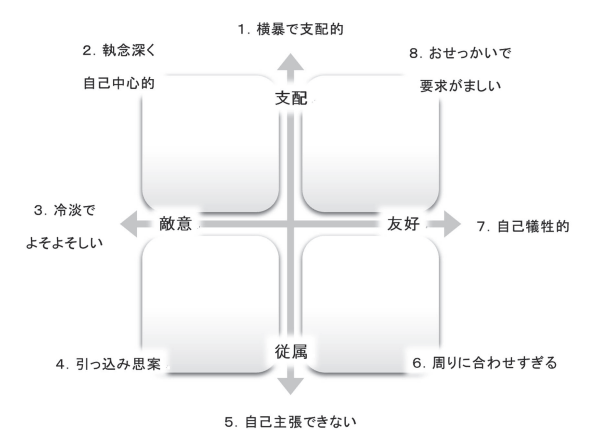

# 「なぜ私は人間関係がうまくいかないのか？」を判断する64問

「どうにも人間関係がうまくいかない！」って悩みは、誰もが抱くものでしょう。「なんか上司とうまくいかない……」「なぜか友人ができない……」って問題は、人間なら一度は思う悩みじゃないでしょうか。

---

ってことで、今回は、「**なぜ私は人間関係がうまくいかないのか？**」を判断するためのテストをご紹介しましょう。コミュニケーションが下手な人には一定のパターンがありまして、自分がどれにあてはまるのかを知るだけでも、かなり対人関係は改善することがわかっているんですよ。

## **「なぜ私は人間関係がうまくいかないのか？」を判断する64問**

では、細かい説明をする前に、さっそく具体的なテストに取り組んでみましょう。以下に並ぶ64問には、人がとる行動を表現したさまざまな文章が載っています。それぞれの文章はあなたがとる行動にどれくらい当てはまるでしょうか？

答えを考えるときは、将来どうなりたいかではなく、普段の行動について お答えください。あなたと同性で同じくらいの年齢の知り合いと接する時のあなた自身の態度を考えてみると、一番わかりやすいでしょう。それぞれの文章を注意深く読みつつ、5点満点で答えてください。

- 非常にあてはまる……5点
- あてはまる……………4点
- どちらともいえない…3点
- あてはまらない………2点
- 全くあてはまらない…1点

1. 相手の見解に理解を示すことが苦手である
2. 上の人の指示に従うことが苦手である
3. 私は自分の思い通りにやり過ぎる
4. 私は他者に対して攻撃的過ぎる
5. 私は他者をコントロールしょうとし過ぎる
6. 私は他者を変えようとし過ぎる
7. 私は自分が望む方向へと、他者を操作し過ぎる
8. 私は他者と口論し過ぎる
9. 他者を信頼することが苦手である
10. 相手の人生の目標達成を支援することが苦手である
11. 他者の問題について、心から心配することが難しい
12. 自分の要求よりも，他者の要求を優先させることが苦手である
13. 人の幸せを快く思うことが難しい
14. 私は他者と争い過ぎる
15. 私は他者のことを疑い過ぎる
16. 私は他者に対して仕返しをしたいと思い過ぎる
17. 相手と長い期間にわたる関わりあい（コミット）を持つことが苦手である
18. 他者に愛情を示すことが苦手である
19. 他者とうまくやっていくことが苦手である
20. 誰かに愛情を感じることが難しい
21. 他者に親密さを感じることが難しい
22. 他者に贈り物をすることが苦手である
23. 怒ったあと相手を許すことが難しい
24. 私は他者との距離をとり過ぎる
25. グループに加わることが苦手である
26. 初対面の人に、自分を紹介することが苦手である
27. 他者と社交的に付き合うことが苦手である
28. 他者に自分の感情を率直に表現することが難しい
29. 周りとの関係を築くために声をかけることが苦手である
30. 他者に対して、自分の心を開き、気持ちを伝えることが苦手である
31. 私は他者と関わる際に怖がり過ぎる
32. 私は他者の前で恥ずかしいと感じ過ぎる
33. 自らの要求を他者に知らせることが苦手である
34. 自分をわずらわせるのを止めて欲しいと，他者に伝えることが苦手である
35. 問題が生じた時に、人と対決することが苦手である
36. 他者に対して自己主張することが苦手である
37. 上司のように上に立って指示を与えることが苦手である
38. 必要なときでも，他者に対して攻撃的になることが難しい
39. 必要な場合には、断固とした態度をとることが苦手である
40. 他者と一緒にいる時に、自分に自信を感じることが難しい
41. 人に「No」と言うことが苦手である
42. 自分が怒っていることを、他者に伝えることが苦手である
43. 他者と言い合いをすることが苦手である
44. 他者に対して怒りを感じることが苦手である
45. 他者の気持ちを傷つけることを怖れずに、自己主張することが苦手である
46. 私は他者の説得にあまりにも簡単に応じ過ぎる
47. 私はあまりにもだまされやすい
48. 私は他者によって利用され過ぎる
49. 他者に制限を課すことが苦手である
50. 好きな人に対して怒りを感じることが難しい
51. 誰かが苦しい生活をしている時に，自分は快適な春らしのために精を出すことは難しい
52. 私は他者を喜ばせようとし過ぎる
53. 私は他者を信用し過ぎる
54. 私は自分の要求よりも他者の要求を優先し過ぎる
55. 私は他者に親切過ぎる
56. 私は他者の不幸に形響され過ぎる
57. プライベートを他者に知られないようにすることが難しい
58. ひとりで時間を過ごすことが苦手である
59. 人のおせっかいを焼かないでいることが難しい
60. 他者の問題の解決に，私は責任を感じ過ぎる
61. 私は他者に心を開き過ぎる
62. 私は道化役（自分を笑いの種にする）を演じ過ぎる
63. 私は注目されたいと思い過ぎる
64. 私は他者に個人的な事柄をしゃべり過ぎる

## **対人関係の問題を把握するための採点法**

すべての採点が終わったら、以下の質問ごとに平均点を出してください。

1. **横柄で支配的**…………………質問1〜8の平均点を出す。
2. **執念深＜，自己中心的**………質問9〜16の平均点を出す。
3. **冷淡でよそよそしい**…………質問17〜24の平均点を出す。
4. **引っ込み思案**…………………質問25〜32の平均点を出す。
5. **自己主張が出来ない**…………質問33〜40の平均点を出す。
6. **周りに合わせすぎる**…………質問41〜48の平均点を出す。
7. **自己犠牲的**……………………質問49〜56の平均点を出す。
8. **おせっかいで要求がましい**…質問57〜64の平均点を出す。

ってことで、以上の中で点数が最も高かったものが、あなたが対人関係に抱える問題点です。「何点以上だったら問題ない」って基準はないんだけど、平均が3.5を超えた項目は『割と高め』だと言えるでしょう。

では、それぞれの項目を、もうちょい詳しく見てみましょう。以上のテストは、70年代から心理学の世界で使われる「**対人関係の円環モデル**」を応用したものです。

このモデルは、『人間関係がうまくいかない人』の特徴を理論化したもので、私たちが日常で使うコミュニケーションのスタイルを、以下のような四象限で捉えます。たいていの人は、この四象限のどこかにあてはまり、その要素が強くなるほど人間関係に問題ができると考えているわけですね。

（[Wiggins, 1979](https://psycnet.apa.org/record/1980-23392-001): [Wiggins, Trapnell & Phillips, 1988](https://psycnet.apa.org/record/1989-14181-001))

### **1：横柄で支配的**

この点数が高い人は、基本的に『偉そうな人』と思われがち。「皆の関心の中心は私であるべきだ 」「私の言動にみな注目すべきだ 」といつも思っているため、集団の中では、大きな声で目立つように話をして、他人の話を奪いやすかったりします。そのため、周囲から「横柄な人だ」と思われているのに、本人は「自分が話の中心になることが多いなぁ」とか考えてたりします。これじゃ対人関係がうまくいくわけもないですな。

### **2：執念深＜，自己中心的**

この点数が高い人は、基本的に『怖い人』と思われがち。プライドが高くて共感力が低いため、相手をめちゃくちゃに言い負かす言葉を使うし、相手を否定する言葉も平気で使ったりします。この場合は、人にがみがみと文句を言ったり、人にきついことを言ったりするのを、意識して抑えましょう。

### **3：冷淡でよそよそしい**

この点数が高い人は、基本的に『冷たい人』と思われがち。「人のことはあてにできない 」と思っているため、かわいそうな話を聞いても相手に同情する気持ちがわかないし、ものごとを親身になって深く考えたりもしないところがあります。「相手が困っていても所詮自分には関係ないことだ 」という気持ちも強いので、意識的に相手を助けるようにしてみましょう。

### **4: 引っ込み思案**

この点数が高い人は、基本的に『人嫌いな人』と思われがち。知らない人が近くにいると無口になり、たいていの場では黙り込む傾向が強かったりします。そのせいで、周囲からは「人嫌いなんだな……」「あんま話しかけないようにしよう……」と思われがちなんで、少しずつでいいから自分の感情を自己開示していく訓練が必須。

### **5：自己主張が出来ない**

この点数が高い人は、基本的に『臆病な人』と思われがち。注目されて目立ってしまうことをことさらに避けるようにしており、できるだけ穏やかに話し、他の人が話をしている時はその話が終わるまで待ち、自慢して目立たないようにすることが多いでしょう。その点で、あまり他人から嫌われるタイプじゃないんですが、たほうで「よくわからないヤツ」とも思われがちなので、少しずつ自分の意見を述べるトレーニングをするのが必須。

### **6：周りに合わせすぎる**

この点数が高い人は、基本的に『情けない人』と思われがち。大抵のことは許すことができるし、何があっても相手のことを第一に考えるし、めったに嘘をついたりしないので、他人から嫌われるタイプではないないんだけど、あまりに周囲の意見に合わせようとしすぎるため、相手がイライラされたり、「お前はなにがしたいんだ！」と言われやすいでしょう。そのため、自分のニーズをちゃんと把握し、それを少しずつ表に出すトレーニングが必要になります。

### **7：自己犠牲的**

この点数が高い人は、基本的に『恩着せがましい人』と思われがち。いつも周りの人の様子を気にかけ、相手に安心してもらえるよう努めているのは良いんだけど、そのぶんだけ自分の気持ちや欲望を押さえつけるので、怒りのエネルギーを溜め込んでしまう傾向があるでしょう。また、相手がひとりでいたいときにも調子を尋ねるため、良い人のわりに「あの人は面倒くさい」とも思われていたりします。このタイプも、自分のニーズを明確にし、それを第一にする態度を養うのが吉。

### **8：おせっかいで要求がましい**

この点数が高い人は、基本的に『ずうずうしい人』と思われがち。 人の集まっているところにいても心地よくいられ、自ら人にガンガン話しかけていく陽キャなのは良いんですが、あまりに他人に干渉しようとするので、「この人と話すとしんどいな……」と周囲から思われてしまうことも多いでしょう。このタイプは、ひとりでいる時間を楽しめるようにトレーニングしていくと吉。
