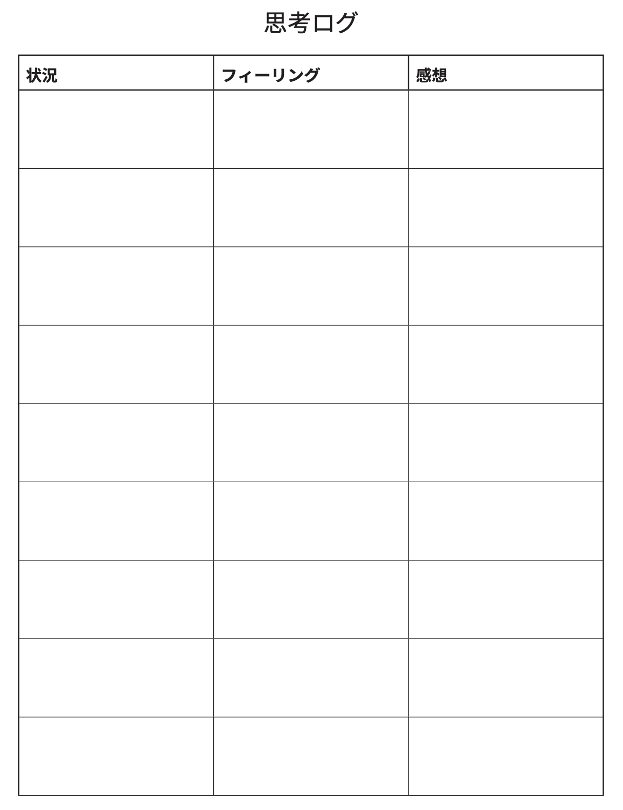
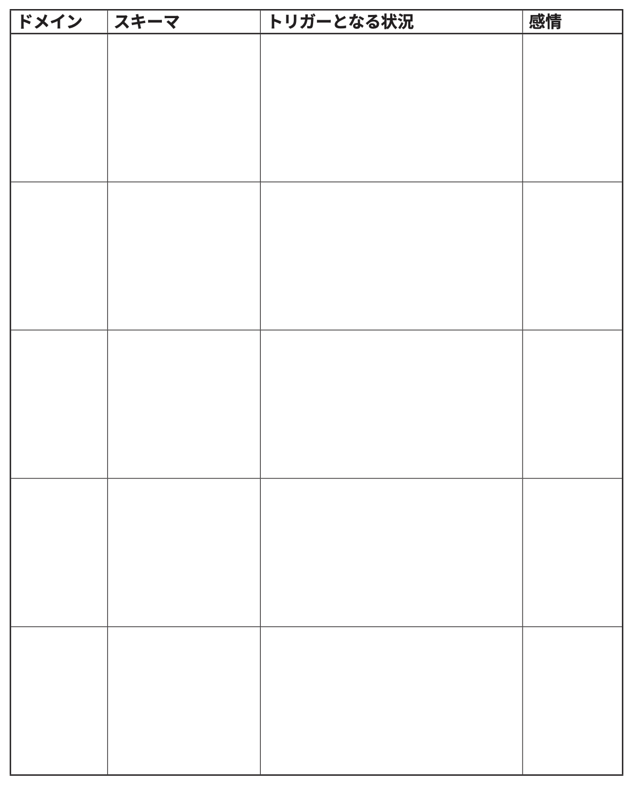

# 人生を破壊する「悪いスキーマ」をチェックしようぜ！ #12「思考ログをつけようぜ！」

「人生を破壊する『悪いスキーマ』をチェックしようぜ！」の続きでーす([#1](https://daigovideolab.jp/blog/2161566),[#2](https://daigovideolab.jp/blog/2161730),[#3](https://daigovideolab.jp/blog/2163260),[#4](https://daigovideolab.jp/blog/2164192),[#5](https://daigovideolab.jp/blog/2165742),[#6](https://daigovideolab.jp/blog/2165743),[#7](https://daigovideolab.jp/blog/2166125),[#8](https://daigovideolab.jp/blog/2166486),[#9](https://daigovideolab.jp/blog/2166652),[#10](https://daigovideolab.jp/blog/2167417),[#11](https://daigovideolab.jp/blog/2168117))。

---

このシリーズでは、「やるのは大変だけど実践すれば効果は抜群」でおなじみの心理セラピーである「**スキーマ療法**」の基本を述べてまして、前回までで全てのスキーマの説明は終了。ここまで来れば、皆さまも自分がどんなスキーマを持っているのか、ある程度のあたりはついたんじゃないでしょうか。

ということで、今回からは「解決編」に進みます。スキーマ対策については、「[自分でできるスキーマ療法ワークブック](https://amzn.to/3Q7AnxB)」という名著が存在しますが、これはガッツリスキーマを正す趣旨で書かれていまして、実践が大変なところもあったりします。

そこで今回は、スキーマ療法の研究で有名なマシュー・マッケイ先生らの調査をベースに、もうちょい手軽だけど、十分な効果を見込めるエクササイズをご紹介します。まぁトラウマレベルのスキーマであれば、「[自分でできるスキーマ療法ワークブック](https://amzn.to/3Q7AnxB)」に取り組むべきでしょうが、中程度の対人トラブルや社交不安の方であれば、いい具合に使っていただけるのではないかと。

では、ステップ形式で、やるべきことを見ていきましょうー。

## **ステップ1. 思考ログ**

スキーマに立ち向かうにあたり、まずやって欲しいのが「**思考ログ**」です。いつもの暮らしで、あなたがどのような感情や思考を抱いてるかを、以下のログを****2週間ほど****使って記録していきましょう。

その期間中は、アナタが行ったすべての社会的コミュニケーションに注意を払いましょう。その上で、不安、 恥ずかしさ、怒り、悲しみなど、苦痛をともなうネガティブな感情が出てきたら、できるだけ早くその状況と感情を書き留め、その時に考えていたことを簡単に書いてください。

### 思考ログの書き方の例

- **状況**：上司に「もっとチームプレイを大事にしろ」と言われた。
- **フィーリング**：不安
- **感想**：上司は私をクビにするためにこんなことを言っているのだろう。大失敗だ。こんないい仕事は二度とない。

- **状況**：娘に数学の宿題をやらせようとしたら、抵抗された。
- **フィーリング**：落ち込み、怒り
- **感想**：こんな反応には耐えられない！

- **状況**：妻が母親の家から電話をかけてきて、一泊して明日帰ることにしたと言う。
- **フィーリング**：怖れ
- **感想**：僕と別れるつもりなのではないか。

## **ステップ2.****ドリルダウン**

思考ログが終わったら、続いて記録の内容をチェックしてみましょう。といっても、いざ思考ログを取ってみると分かりますが、記録した思考が、**あなたのスキーマを明確に表現してくれている可能性は低い**はず。

このログに書き込んだ思考ってのは、あなたの脳内に浮かぶ日常的なフレーズを抽出したもので、そこには独自の解釈や記憶のエラーが入り混じっているので、あなたのスキーマを超ざっくり表しているにすぎないんですよ。

そんなわけで、このステップでは、あなたの表面的な思考から、その下にあるスキーマを掘り下げていきましょう。具体的には、以下のように自問してみてください。

1. もし「〇〇（思考ログに書いた考え）」が事実だとしたら、その原因は何だろう?
2. もし「〇〇（上で考えた答え）」が事実だとしたら、その原因は何だろう?

こんな感じで、トヨタの「[なぜなぜ分析](https://amzn.to/3ZMiuHS)」よろしく、自分の表面的な思考について「その原因は何か？」を何度も考えていき、「もうこれが底の底にある事実だ！」と感じられる文章ができあがるまでドリルダウンしてみましょう。それが、あなたのスキーマを最もよく表現する文章である可能性が高いので。

### **ドリルダウンの例**

- **表面の思考**「娘の数学の宿題をやらせようとしたら抵抗されたので、『こんな反応には耐えられない！』と考えた」
- **ドリルダウン1**：「もし私が娘の反応に耐えられないというのが本当なら、その原因は何だろう?」→「つまり、私のしてほしいことを子どもに無視されたからだ」。
- **ドリルダウン2**：「もし娘が私のしてほしいことを無視したのが本当なら、その原因は何だろう?」→「つまり、私には子育てのスキルがないということだ」。
- **ドリルダウン3**：「もし私には子育てのスキルがないというのが本当だとしたら、その原因は何だろう?」→「つまり、私は親として失格だということだ」

といったように、「なぜ？」を重ねていき、「底についた！」と感じるまで続けましょう。どこで底につくかは人それぞれですが、だいたいは5回もくり返せば最下層まで達するんじゃないでしょうか。ここで大事なのは、あくまで自分の感覚を信用することで、スキーマに直結するような思考を理解すると、たいていは「うわー、これだ」って感じになるはずです（私の場合も、かなり嫌な気分になりました）。

## **ステップ3. イメージ分析**

ドリルダウンは優秀なエクササイズながら、「そもそも自分の思考をつかむのが苦手なんだよなぁ……」という方には、いまいち向いていないこともあります。その場合は、こちらの「イメージ分析」を使ってみてください。

具体的なやり方は、以下のようになります。

1. 10分間、誰にも邪魔されない静かな場所を見つけ、足と腕を組まずに横になるか座る。目を閉じて、ゆっくりと深呼吸を数回したら、最近あなたがネガティブな感情を経験した 社会的コミュニケーションを思い出してください。
2. 時間をかけて、そのシーンをできるだけリアルに再現してください。色や形、音や匂い、 質感や色調など、周囲の環境まで思い出すのがポイントです。さらには、自分が言ったこと、自分が聞いたこと、自分がしたことなどを思い出していきましょう。もちろん、あまりに辛い思いでだとネガティブな感情に飲み込まれるので、自分がコントロールできるレベルの記憶を使ってください。
3. そのシーンで、あなたは何が起こることを恐れていますか ? そのシーンで、相手はあなたをどう見ていますか? この場面を見て、あなたは自分自身について何を感じましたか? 恥ずかしさ、気恥ずかしさ、緊張、恐れ、苛立ち、怒り、恥、罪悪感など、その時感じたのと同じ気持ちを自分にも感じてみてください。
4. その時と同じネガティブな感情がわいたら、その感情に名前をつけて声に出してみましょう。

### **イメージ分析の例**

1. **ネガティブなイメージの開始**：パートナーが仕事から帰ってきて、 自分が洗濯をしているところに近づいてくるところを想像した。ブーンという蛍光灯の音が聞こえ、洗剤のかすかな良い匂いがする。近づいてきたパートナーは、いきなり「2週間も洗濯をほっといただろう」と言ってきたため、私はすぐに罪悪感とパニックを感じて涙ぐむ。私は洗濯機に目を落としつつ 「たまにはあなたがやってもいいんじゃないの？」と言ってみたところ、「僕は14日間ずっと残業しているんだ」とだけ言ってためいきをつき、それ以上何も言わなくなる。そのせいで、私はただ落ち込んだままだまり続けた。
2. **イメージ分析の開始**：この場面で私が恐れているのは、パートナーが私にうんざりすることだ。私は、相手に依存しすぎていると思われたくない。あらためて嫌な場面を想像してみると、私は、自分のことを無能で、不完全で、自分では何もできない無力な人間だと感じている。これは、無能や見捨てられるのを嫌がるスキーマが働いているように思う。

こんな感じで、あなたにとってストレスフルだったコミュニケーションをイメージし、それを脳内で追体験し、ゆっくりと時間をかけて自分の感情や思考を観察＆分析しましょう。

## **ステップ5.****スキーマ・トリガーを認識する**

私たちが持つスキーマには、それぞれ典型的なトリガーがあったりします。要するに、あなたのスキーマを刺激する外的な要因のことですな。

これらのトリガー種類は本当に人によってさまざまで、あらゆる人間関係の領域（仕事、友人、家族、親密な関係、子育て、コミュニティ）に現れます。そこで、このエクササイズでは、あなたのスキーマを刺激するトリガーをチェックし、どのスキーマがどのような環境で現れやすいのかを認識していきましょう。

スキーマのトリガーを認識するには、以下のようなワークシートを使います。

こちらのワークシートでも、いつもの暮らしであなたがネガティブな感情を抱いた出来事をチェックし、上記のログに**2週間ほど**記録を続けていきましょう。各項目には、以下の情報を書いていきます。

- **ドメイン：**ネガティブな感情が起きた大まかな状況を記入。
- **スキーマ：**自分の中で活性化したと思われるスキーマを記入。
- **トリガーとなる状況**：ネガティブな感情が引き起こされた状況を記入。
- **感情**：その状況で引き起こされた感情を記入。

### スキーマ・トリガーの書き方の例

- **ドメイン**：仕事
- **スキーマ**：孤立／欠陥・恥／見捨てられ
- **トリガーとなる状況**：みんながランチに出かけたが、私は誘われなかった。
- **感情**：怒り、悲しみ、怒り、恥、怒り

- **ドメイン**：友達
- **スキーマ**：自己犠牲／服従／欠陥・恥／見捨てられ
- **トリガーとなる状況**：友人たちが私を含めずに一緒に何かをしたと知ったとき。からかわれたり、批判されたりしたとき。電話をしても折り返しの電話がないとき。
- **感情**：不安、憤り、怒り、悲しみ

- **ドメイン**：家族
- **スキーマ**：自己犠牲／服従／欠陥・恥／見捨てられ
- **トリガーとなる状況**：母は私が結婚していないことに文句を言う。家族が集まるときは話をしてくれるが、普段は私とは話をしない。
- **感情**：不安、憤り、怒り

- **ドメイン**：親密な関係
- **スキーマ**：自己犠牲／服従／欠陥・恥
- **トリガーとなる状況**：デートではいつも、相手の望むことをしなければならないと思っている。デート中に批判されると、特に問題が起きる。
- **感情**：不安、憤り、怒り、恥

このような感じで、人生のいろんな場面で発生するスキーマのトリガーを特定していきましょう。たいていの場合は、上の例のように、ひとつの人間関係で複数のスキーマがトリガーされることが多かったりします。これを続けていくと、自分がどのような場面で特にスキーマの問題に悩まされがちなのかが分かりますんで。
