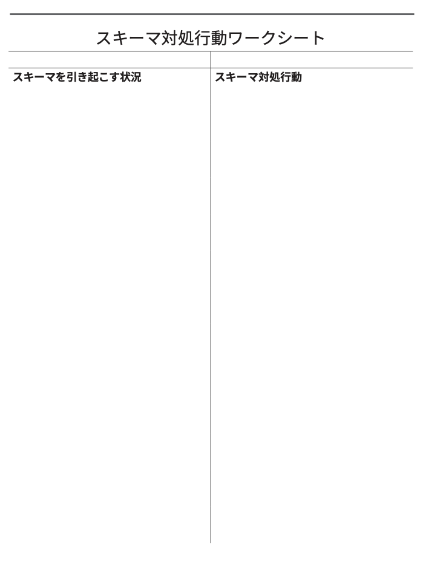

# 人生を破壊する「悪いスキーマ」をチェックしようぜ！ #13「スキーマ対処行動ワークシート」

「人生を破壊する『悪いスキーマ』をチェックしようぜ！」の続きでーす([#1](https://daigovideolab.jp/blog/2161566),[#2](https://daigovideolab.jp/blog/2161730),[#3](https://daigovideolab.jp/blog/2163260),[#4](https://daigovideolab.jp/blog/2164192),[#5](https://daigovideolab.jp/blog/2165742),[#6](https://daigovideolab.jp/blog/2165743),[#7](https://daigovideolab.jp/blog/2166125),[#8](https://daigovideolab.jp/blog/2166486),[#9](https://daigovideolab.jp/blog/2166652),[#10](https://daigovideolab.jp/blog/2167417),[#11](https://daigovideolab.jp/blog/2168117),[#12](https://daigovideolab.jp/blog/2168526))。

---

このシリーズでは、「やるのは大変だけど実践すれば効果は抜群」でおなじみの心理セラピーである「**スキーマ療法**」の基本を述べてまして、現在は「解決編」に入っております。スキーマ対策については、「[自分でできるスキーマ療法ワークブック](https://amzn.to/3Q7AnxB)」という名著が存在しますが、これはガッツリスキーマを正す趣旨で書かれていまして、実践が大変なところもあったりします。

そこでこのシリーズでは、スキーマ療法の研究で有名なマシュー・マッケイ先生らの調査をベースに、もうちょい手軽だけど、十分な効果を見込めるエクササイズをご紹介します。まぁトラウマレベルのスキーマであれば、「[自分でできるスキーマ療法ワークブック](https://amzn.to/3Q7AnxB)」に取り組むべきでしょうが、中程度の対人トラブルや社交不安の方であれば、いい具合に使っていただけるのではないかと。

さて、前回までのステップで、あなたは自分のスキーマが起動するトリガーについて学びました。

簡単におさらいすると、人間関係の中で突然ネガティブな感情が発生したときは、あなたのスキーマが活性化した可能性が大。そこで重要なのは、スキーマやつらい感情をコントロールすることではなく、スキーマやスキーマの感情が活性化した瞬間を認識することであります。

人間である以上、誰しも痛みから逃れたいと思うもので、苦しい感情を避けようとして必死になるのが普通の反応でしょう。しかし、そのような反応をしちゃうと、これまでのシリーズで取り上げて来たような間違った対策を取りやすく、そのせいで人間関係のトラブルが起きちゃう可能性が高いんですよ。

つまり、ストレスの多いコミュニケーションがスキーマの引き金になり、それが苦痛な感情を発生させ、こいつが逃げ出したい衝動を生み、最終的に誤った回避戦略につながるってことですな。その点で、スキーマ対策において最も重要なのは、「いまトリガーが発生した！」「そのトリガーでスキーマが起動した！」と気づくことでして、ここまでのステップをこなした時点でも、だいぶスキーマの悪影響から逃れやすくなっているはずであります。

そこで、このステップからは、ここまでの知識を使 って、あなたがスキーマにどう反応し、それが人間関係にどう影響しているのかをさらに深掘りしてみましょう。

## **ステップ6. スキーマ対処行動ワークシート**

さて、あなたがスキーマに反応して行う無意識の対策は、「**スキーマ対処行動(SCBs)**」と呼ばれます。SCBsは、あなたに一時的な安らぎを与えてくれるものの、長い目で見ればスキーマの痛みを悪化させるだけ でなく、しばしば人間関係を破壊することも多いんですよ。

SCBsは自分の家族を見て学ぶことが多く、たとえば、スキーマが起動した父親が激しく他人を攻撃したり、スキーマに乗っ取られた母親が世間から引きこもってしまったりとか、そんな様子を見ているうちに、「なるほど！嫌な感情が出たら他人を攻撃すれば良いんだ！」見たいに、脳が無意識の反応を学んじゃうわけですな。

しかし、たいていのSCBsってのは他人を傷つける傾向がありまして、あなたが引きこもったり、攻撃モードに入ったりするたびに、人間関係が悪化するのは当然の話。これを放っておくと、多くの人は、あなたの反応についていけなくなり、その結果、いよいよ他人から嫌われていくんですよ。

ということで、このステップでは、自分のSCBsを見極める方法を見ていきましょう。主なSCBsは全部で10種類ありまして、大きく3つのカテゴリーに分けられます。

- **過剰補償**：スキーマを引き起こす出来事に対して攻撃的になるパターン。

- **降伏**：スキーマの引き金となる出来事に直面して受動的になるパターン。

- **回避** ：スキーマの引き金となる出来事から完全に逃れようとするパターン。

このカテゴリーをふまえて、10種類のSCBsを説明すると、以下のようになります。

- **過剰保障系SCBs**
  - **１．攻撃性／敵意**：スキーマの引き金となる出来事に対して、非難したり、批判したり、挑発したり、抵抗したりと、ガンガンに反撃する。
  - **２．支配／過剰な自己主張**：自分の目標を達成するために、他人を支配しようとする。
  - **３．承認探求／権利探求**：他人を感心させようとしたり、高い業績や地位によって注目を集 めようとしたりして、スキーマを過剰に補う。
  - **４．操作／搾取**：自分のしていることを他人に知られることなく、他人をこっそり操って、自分の欲求を満たそうとする。誘惑を使ったり、他者に対して完全に真実を語らなかったりする。
  - **５．受動的攻撃性／反抗**：意見すると従順に見える が、実は反抗した行動を取るパターン。先延ばしする、不平を言う、遅刻する、わざと能力を発揮しない、などがある。

- **降伏系****SCBs**
  - **６．コンプライアンス、依存：**スキーマを誘発する出来事に反応して、他者に依存し、屈服し、依存し 、受動的に振る舞い、衝突を避け、他者をひたすら喜ばせようとする。

- **回避系SCBs**
  - **７． 社会的引きこもり／過剰な自律：**この対処行動をとると、社会的に孤立し、他人から切り離され、引きこもるようになる。他者との関わりが少ないため、傍目からは過度に自律しているように見えることもある。読書、テレビ観賞、コンピュータの使用、孤独な作業など、より孤独な活動をするようになる。
  - **８． 強迫的刺激追求：**スキーマを誘発する出来事に反応して、買い物、セックス、危険な遊びにのめり込むパターン。ひたすら刺激の強いアクティビティを求めて、ひたすら動き続けるようになる。
  - **９． 中毒性の自己鎮静：**薬物、アルコール 、食べ物、過剰な自己刺激などで興奮を求めるパターン。
  - **10. 心理的ひきこもり：**この対処行動をとると、解離、否認、空想、または他の方法で現実から逃避を始める。

スキーマによる対処行動がどのようなものかわかったところで、今度は、それをあなたの反応と結びつけてみましょう。スキーマが活性化するような出来事があったら、その場面ごとに、あなたがどのように対処しているのかを確かめるのが、このワークの重要なポイントになります。

このステップに進むには 、[前のステップで記入したスキーマ・トリガー・ワークシート](https://daigovideolab.jp/blog/2168526)が必要になります。ここに書き込んだ「トリガーとなる状況」の欄を見て、これらの項目を次のSCBワークシートの「スキーマ対処行動ワークシート」に再記入してください。

次に、「スキーマ対処行動」の欄に、それぞれのトリガーごとにあなたが使ったSCBsを考えて、書き込んでみましょう。もしどんな対処行動をしたのかを正確に思い出すのが難しい場合は、特定のトリガーとなる状況をイメージしつつ、その上で、

1. スキーマが発動したときの状況を思い出し、どんな感情を感じていたかをシミュレートする。
2. 「この感情は、私に何をさせようとしているのか？」「私は、この痛みにどう対処したいのか?」と自問する。
3. 上にあげた 10種類のスキーマ対処行動のリストを振り返り、どのSCBsを使用したかを確認する。

って手順をふむと良いでしょう。具体的な記入例は、以下のようになります。

- **スキーマを引き起こす状況 →****スキーマ対処行動**
  - みんなが自分を誘わずランチに行く。 → 引きこもり、誰とも話をしない。 他のプロジェクトの手伝いを断る。
  - 批判／否定的なフィードバック → 批判してきた相手を攻撃して、でたらめだと言う。
  - 自分のニーズと相手のニーズに違いがある。 → 少し不機嫌になって押し黙る。
  - 私のいないところで友人たちがコソコソ何かをしている。 → その人の悪いところを見つけて攻撃する。
  - 強めのイジリをされた。 → その人の悪いところを見つけて攻撃する。
  - 誰かが電話に出ない。 → 他の人に文句を言ったり、冷たい態度を とったり、その人を見たら黙ってしまう 。
  - 母は私が結婚していないと文句を言う。→「時代遅れな考えだ！」と怒り狂う。
  - パートナーが私がやりたくないことをするよう求めてくる。 → 言われたことを、あえて手を抜いて行う。
  - 付き合っている人から批判された。 → 引きこもり、話すことを拒否する。
  - 仕事で相手の望むことをしなければならないというプレッシャー。 → 相手の要求を受けるが、あえて手を抜く。
  - ミーティングで誰も私に話しかけてこない。 → ミーティングに行くのをやめて、家でテレビを見る。
  - 自分の政治信条に反する書き込みをネットで見た。 → その人物への罵詈雑言を書き込む。

と、こんな感じで対処行動を記しておくと、たいていの人は「特定のトリガーに対して同じようなSCBsを使う傾向があるな……」ってところに気づくはずであります。上の例だと、批判されると攻撃し返すけど、グループから排除されると引きこもるし、何かをするようにプレッシャーを欠けられると受動的な攻撃に出やすいな……みたいな感じですね。

スキーマ対処行動ワークシートは、１〜２週間をかけて行い、自分のSCBsにパターンがないかをチェックしてみてください。このワークで自分の対処行動に気づければ、

1. トリガーをリアルタイムで認識できるようになる。
2. 自分の対処反応に気づくことができ る。

という２つの超重要スキルが身につきますんで。日常生活の中で自分のSCBsに気付くと、恥ずかしくなったり、自分をダメな人間であるかのように感じちゃうかもですが、SCBｓに気づくのはスキーマ対処の偉大なる一歩ですんで、ぜひ自分をほめてあげてください。ではまた！
