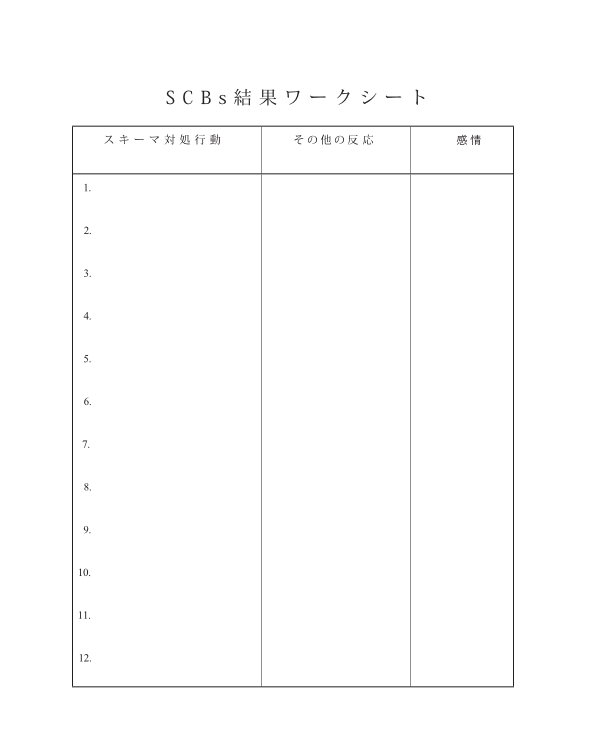

# 人生を破壊する「悪いスキーマ」をチェックしようぜ！ #14「SCBs結果ワークシート」

「人生を破壊する『悪いスキーマ』をチェックしようぜ！」の続きでーす([#1](https://daigovideolab.jp/blog/2161566),[#2](https://daigovideolab.jp/blog/2161730),[#3](https://daigovideolab.jp/blog/2163260),[#4](https://daigovideolab.jp/blog/2164192),[#5](https://daigovideolab.jp/blog/2165742),[#6](https://daigovideolab.jp/blog/2165743),[#7](https://daigovideolab.jp/blog/2166125),[#8](https://daigovideolab.jp/blog/2166486),[#9](https://daigovideolab.jp/blog/2166652),[#10](https://daigovideolab.jp/blog/2167417),[#11](https://daigovideolab.jp/blog/2168117),[#12](https://daigovideolab.jp/blog/2168526),[#13](https://daigovideolab.jp/blog/2169057))。

---

このシリーズでは、「やるのは大変だけど実践すれば効果は抜群」でおなじみの心理セラピーである「**スキーマ療法**」の基本を述べてまして、現在は「解決編」に入っております。スキーマ対策については、「[自分でできるスキーマ療法ワークブック](https://amzn.to/3Q7AnxB)」という名著が存在しますが、これはガッツリスキーマを正す趣旨で書かれていまして、実践が大変なところもあったりします。

そこでこのシリーズでは、スキーマ療法の研究で有名なマシュー・マッケイ先生らの調査をベースに、もうちょい手軽だけど、十分な効果を見込めるエクササイズをご紹介します。まぁトラウマレベルのスキーマであれば、「[自分でできるスキーマ療法ワークブック](https://amzn.to/3Q7AnxB)」に取り組むべきでしょうが、中程度の対人トラブルや社交不安の方であれば、いい具合に使っていただけるのではないかと。

さて、前回のステップで、あなたは自分のスキーマによって、どんな行動を取らされているかを理解しました。自分が反射的に取っている「スキーマ対処行動（SCBs）」を、おおまかに把握したわけです。

それでは、次のステップに進みましょうー。

## **ステップ7. SCBs結果ワークシート**

このステップでは、ステップ6で理解したSCBsが、自分の人間関係にどのような影響を与えているかを具体的に認識する作業を行います。

当然ながら、SCBsを使えば、周囲の人たちもそれに反応して、こちらに怒り返してきたり、こちらを無視し始めたりと、あなたにとって良くない結果が起きやすくなるはず。これを見極めるのが、このステップの目的なわけですな。

要するに、スキーマで人生が壊れる時ってのは、

- 嫌なことが起きてスキーマの引き金がひかれる→スキーマが起動する→SCBを使う→嫌な結果が起きる

って流れになっているので、「****スキーマが働いた結果として、******私は******自らの人生を******どのように******ハードモードに変えているのか？****」というあたりを把握するのが、このステップで行うエクササイズのポイントです。

ここで言うSCBsがもたらす結果ってのは、自分の行動に恥ずかしさを覚えたり、他人からの視線がさらに気になったり、人間関係が終わって孤独が増したり、落ち込んだりと、人によってさまざま。場合によっては、SCBsのせいで他人から利用されてしまうケースもあったりします（消極的な態度に目をつけたナルシシストやサイコパスが寄ってくることが多い）。これは注意したいですね。

### SCBs結果ワークシートをやってみよう！

それでは、具体的なエクササイズに移りましょう。このステップでは、以下のようなワークシートを使います。

SCBsが引き起こした結果を探るために、ステップ6の「スキーマ対処行動ワークシート」に、あなたがリストアップしたすべてのSCBsを振り返ってください。その上で、

- SCBsによって、あなたの身の回りに起きた変化（あなたがそのSCBsを行ってから、1時間後から1週間後までに起きた変化を振り返って書き出します）。
- その出来事について、あなたが抱いた感情。

という2つの要素を書き込んでください。記入例はこんな感じになります。

- **スキーマ対処行動 →****その他の反応****→**私の感情****
  - 内に引きこもって誰とも話さない(仕事) → みんな最初は「どうしたの？」と聞いてくるが、やがて私を無視する。→ 憂鬱、孤独
  - 他のプロジェクト(仕事) の手伝いを拒否する。 → 同僚が怒り、私から離れていく。→職場で孤独になるのを恐れる。
  - 私を批判した相手を攻撃し、でたらめだと言う(友人たち) 相手がこちらに怒り返し、その後で2人の友人を失った。→憂鬱、孤独、 無関心 →
  - 降伏する、屈服する、少し 不機嫌になる(友人たち)→その後の私の要求を無視される。→ 落ち込み、憤慨
  - 引きこもる、電話をやめる 他人に愚痴を言う(消極的攻撃的)(友人)→ 電話がかかってこなくなった。私が彼のことを愚痴っているのを聞いた友人が、電話を切ってくれた。→憂鬱、孤独
  - 相手の悪いところを見つけて攻撃する(友達) → ユーモアのセンスがないと文句を言われ、さらにからかわれる。 → 憂鬱、孤独
  - 他人に愚痴をこぼしたり、 冷たい態度をとったり、心を閉ざしてしまう(友人) → 関係が終わる。→ 人間関係を失うことへの恐怖
  - 母親を攻撃する（「あなたは最低の人間だ！」） → 母も怒って、私を「ダメな人間だ」と罵る。→心痛、孤独
  - 降伏する、屈服する、不機嫌になる(母親) → 母親は私の反応を「いつものことだ」と考えて、何もしない。→落ち込み、憤慨
  - 引きこもる、話さなくなる（親密な関係） → 彼女はこちらへの関心を失ったようで、電話にも出ない。→ 落ちこぼれのように感じ、自分にも彼女にも嫌気がさす
  - 降伏する、付き合う、親切にしようとする、やがて引きこ もる、関心を持たなくなる( 親密な関係) → 周囲と無視しあうようになる。→憂鬱、無関心、孤独
  - 引きこもる、家に帰ってテレビを見る、ミーティング に行かなくなる(コミュニティ) → 私が何をしようと誰も気にしない。→ 憂鬱、孤独
  - 相手に「お前の考え方は差別的だ」と罵る書き込みをする(コミュニティ) → 罵った相手のファンからも攻撃された。→ 虚無感、孤独

このように記録をしてみると、いかにSCBsが精神的に大きな負担になっているのかが一目瞭然。人間関係を絶って引きこもったり、逆に批判してきた相手を攻撃をすればするほど、孤独や虚無感の悪化を招いているのがわかりやすくなったかと思います。上の例だと、攻撃と引きこもりのSCBsは、どちらも対人関係にダメージを与え手間して、2人の友人を失ってるし、他の人々からも避けられるようになっちゃってますからね。

また、ここで注目したいのは、SCBsが、しばしば**元のスキーマを強化する結果**を生み出しているところです。 上の例では、欠陥・恥スキーマ、自己犠牲スキーマ、孤立スキーマ、服従スキーマが働いていますが、SCBsによって友人や仕事の仲間を失い、そのせいで孤独や恥を感じた結果として、**さらに欠陥や自己犠牲スキーマが強化されていく**んですな。

要するに、拒絶されるたびに自分の価値が下がったように思われ、その結果として、「常に他人を喜ばせなければならない！」という信念が強くなっていくわけです。常に「孤独感」や「怒り」を抱えた人の根源には、このようなスキーマの悪循環があることが多いんですよ。

このように、SCBsは自己増殖する性質がありまして、人間関係でSCBsを使えば使うほど、あなたの周囲の人間は遠ざかり、さらにスキーマの影響は強くなっていきます。こういった負のスパイラルから降りるために、自分が普段から行っているSCBsの結果を認識するのが、このステップの最大の目的です。この点を認識しないと、**人生の進路は変えられない**ですからね。

### スキーマとの闘いを止めようぜ

このワークにより、あなたのスキーマがもたらす負のスパイラルが、なんとなく把握できたんじゃないかと思います。

あなたは、人生の多くの期間、スキーマがもたらす痛みを止めようとして、そのトリガーとなる状況や人々から逃れようとしてきたものの、うまくいかなかったはず。その結果、恐怖、不安、羞恥心、悲しみ、傷みは残り続け、事態はさらにに悪化していきます。たとえば、

- 人間関係を失い、他人から疎外される。
- 職を失ったり、職場の同僚のサポートを失う。
- 親密でいたい人と何度も衝突し、苦悩することになる。
- あなたが好きな人たちが、精神的なダメージを負う。
- 帰属意識や自尊心を失う。

といったあたりが代表的な例ですね。でもって、その間、スキーマの痛みはさらにひどくなり、自分自身に対するネガティブな思い込みもより強くなっていくはず。私の場合も、このメカニズムを知るまでは、延々と無駄な対処をしてきたなーと、痛感しております。

で、ここで最も重要なのは、**スキーマに闘いを挑んではいけない**って点です。スキーマがもたらす痛みには2種類ありまして、

1. 避けられる痛み
2. 避けられない痛み

って感じに分けられますが、スキーマの痛みを避けるのは無理な話。ここまでさんざん見てきたように、SCBsを使ってスキーマの痛みを避けようとしても、さらに事態が悪化するだけであります。人生における深い苦しみってのは、「避けられない痛みを感じないようにすることから派生しますんで（これは「[無（最高の状態）](https://amzn.to/46IqThW)」で強調したことっですね）。

あなたは、自分のスキーマを作り出した世界で育ったのだから、スキーマのトリガーとなるものについては何もできないのが当たり前。あなたがコントロールできるのは、 トリガーに対する反応だけなんですよね。そして、このポイントこそが、このシリーズの主題になります。

これをメタファーで説明してみると、**スキーマってのは「流砂」のようなもの**です。砂の中でもがけばもがくほど、または暴れれば暴れるほ ど、あなたはより奥に引きずり込まれていくはず。

これと同じように、人間関係から引きこもったり 、相手を攻撃したりするたびに、スキーマの痛みに深く沈んでいくものなんですな。それぞれのSCBsは、あなたの人間関係や自分自身への感情を傷つけていくので、スキーマと格闘したり、スキーマをブロックしたり、スキーマを抑圧しようとしたりすることは、解決策には ならないんですよ。

スキーマの対策も流砂と同じで、その中でもがくのではなく、横になってドロドロの中を泳ぐのが正解。とにかくスキーマの痛みとは闘わず、 泳いで通り抜けるのが一番なんですよね。

ってことで、今回はここまで。SCBsが人生におよぼす悪影響を理解したところで、次のステップでは、いかにスキーマの流砂を泳ぎ切るかを見ていくことにします。ではまた！
