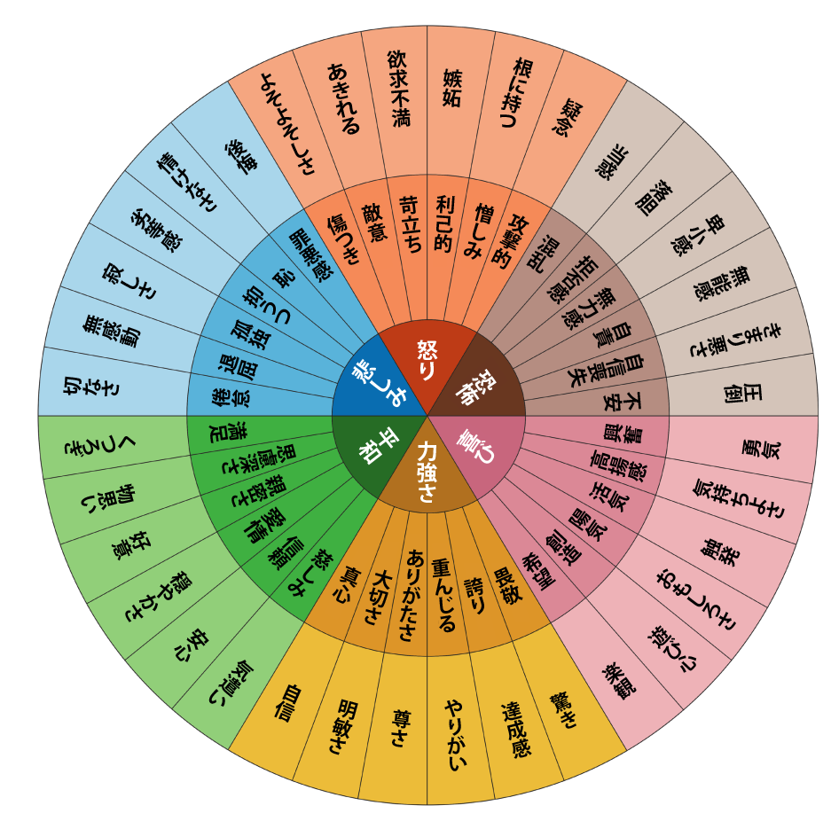

# 豆腐のメンタルを激しく強化する「感情の輪」エクササイズをやってみようぜ

---

日ごろから、「**感情の粒度を上げようぜ！**」みたいな話をしているわけです。これは「[無（最高の状態）](https://amzn.to/3tPB9X9)」で強調したポイントで、その内容を引用すると、

> 「感情の粒度」は心理学の概念で、あいまいな感情をくわしい言葉で表現できるスキルのことです。このスキルが高い人と低い人の違いはこうなります。
>
> - **感情の粒度が低い** ：何か嫌なことがあった際に、すべてを「むかつく」や「気持ち悪い」など１〜２つのボキャブラリーだけで表現する
>
> - **感情の粒度が高い** ：気分が悪いことに対して、「癇にさわる」「憤る」「いらつく」といった複数の表現を思いつき、その中から一番しっくりくる言葉を選ぶことができる
>
> ささいなスキルのように思えるかもしれませんが、ここ数年の研究で「感情の粒度」がメンタルの安定に大きく関わることがわかってきました。「感情の粒度」が高い人たちを調べたジョージ・メイソン大学などのチームは、彼らは総じてセルフコントロールがうまく、アルコールやドラッグに依存しにくいうえに病気にもかかりにくいと報告しています。その理由は、感情の粒度が高いほど脳が混乱しづらくなるからです。
>
> ひとくちに「嫌な気分」と言っても、そこには必ず無数の濃淡が存在します。状況によって私たちの内側には複数の感情が入り混じり、「怒り」や「悲しみ」といった特定の感情にまとめられるほうが珍しいでしょう。悲しみの混ざった怒りや、焦りにかき立てられた怒り、期待の裏に潜むイラつきといったように、似た感情のなかにもさまざまな気持ちが入り混じるのが普通なはずです。この感情の違いは肉体にも反映され、発汗量の違いや筋肉のこわばりの差となって現れます。
>
> ところが、ここで複雑な感情を「むかつく」だけでとらえると、脳が混乱を始めます。肉体のセンサーは微妙に異なる感覚データを届けてくるのに対し、あなたの意識は常に単一の感情として情報を処理するため、そこに食い違いが生まれてしまうからです。
>
> 悩んだ脳は情報をうまく処理できなくなり、いつまでもストレス反応を引きずった結果、あなたは「なんだかイライラする」などと微妙な気分を延々と味わうことになります。上司から「明日までに書類を３枚仕上げてくれ」と言われれば困らないのに、ただ「うまくやっておいてくれ」とだけ言われたら途方に暮れてしまうのと似た状態です。

ということで、自分の感情を細かく表現できる人は、とにかくメンタルが強いし、トラブルにも強いってことが分かっているんですよ。個人的には、逆境に強い精神を鍛えるためには、かなり重要なスキルのひとつではないかと思っている次第です。

また、感情の粒度が高い人の特徴としては、

- 感情的知性も非常に高く、コミュニケーションがうまい傾向がある([R](https://citeseerx.ist.psu.edu/viewdoc/download?doi=10.1.1.385.4383&rep=rep1&type=pdf))。

- ストレスがあっても酒やお菓子、ゲームなどに逃げ込む可能性が低い([R](https://journals.sagepub.com/doi/abs/10.1177/0956797610379863),[R](https://journals.sagepub.com/doi/abs/10.1177/0963721414550708))。

- 自分を傷つけた人に対して、攻撃的に反応する可能性も低い([R](http://citeseerx.ist.psu.edu/viewdoc/download?doi=10.1.1.389.4600&rep=rep1&type=pdf))。

- 感情の語彙を増やし、それを柔軟に使えるように訓練することで、感情をより効果的に調節できるようになるという証拠もある([R](https://www.scn.ucla.edu/pdf/Kircanski%282012%29PsychSci.pdf))。

みたいな結果も出ていたりします。とにかく感情の粒度ってのは、メンタルを改善するためにかなり役立つ改善だと思うわけです。

で、感情の粒度を高める方法のひとつとして有効なのが、今回お伝えする「**感情の輪**」というエクササイズです。

これは心理療法家のグロリア・ウィルコックス博士が開発したツールで([R](https://journals.sagepub.com/doi/abs/10.1177/036215378201200411))、私たちが感情のボキャブラリーを増やすのを助けるためにデザインされたもの。以下のような画像を使って、感情を掘り下げていきます。

ご覧のとおり、この輪では、72の感情を円グラフに整理し、中心部には「悲しみ」「怒り」「恐怖」「喜び」「力強さ」「平和」という6つの大きな感情が配置されております。これをどのように使うかと言いますと、

1. 自分がなにか感情の変化を経験したら、この画像をさっと確認する。
2. もし「悲しみ」を経験している場合は、中心部の「悲しみ」を見つつ、そこから輪の外側に配置された感情をチェック。自分が、具体的にどのような悲しみを感じているのかを細かく掘り下げる。
3. 逆に、円の外側にある「無感動」を感じている場合は、その中核にある「悲しみ」が隠されているかも？と考えてみる。

みたいになります。これをやってみると、「自分が感じているのはただの『悲しみ』じゃなくて『無視されたことに対する孤独感」を持っているんだなー」ってのがわかるはずであります。こんな感じで、自分の感情を掘り下げていくのが、「感情の輪」のポイントになります。

その他の使い方としては、

- **現時点での直接の反省**：感情の輪を使って、一日の適当な瞬間に感じている感情を探ってもOK。たとえば、誰かと楽しい会話をした後、「なんかうれしいなー」と感じたのであれば、すかさず感情の輪を取り出して、「自分は今どんな喜びを感じているのだろう？」と自問し、これは『興奮、創造、活気』のミックスだなー」などと掘り下げてみるわけですね。

- **日々の振り返り**：感情の輪を見ながら、「今日わたしはどんな感情を経験したのだろう？」と自問してみるやり方です。たとえば、一日のどこかで「罪悪感」を感じたのであれば、関連する核となる感情（中心に近い方）は 「悲しみ」であり、より具体的でニュアンスのある感情（円の外側の方）は「後悔」だろうと推測できるわけです。

- **長期的な反省**：感情の輪は、自分に影響を及ぼしているかもしれない、より深くて長期的な感情を探るのにも使えます。たとえば、職を失ったあとでしばらく「恐怖」と感じていたなら、輪の内側にある「恐怖」という核の感情から、外側の2つの帯にある感情を見て、「この恐怖には、『きまり悪さ』『無力感』が混ざってるな」といった当たりをつけられるわけですね。これが理解できれば、人生のゴールに向かって具体的な行動を起こすのに役立つはずであります。

- **セルフ・コンパッションを高める**：セルフ・コンパッションを育むためには、適切で思いやりのある行動をとるために、今自分が体験している感情に注意を向ける作業が必須。たとえば、「いま自分は劣等感を抱いている」と気づくことができれば、自分に対して「劣等感を経験するのは普通のことだ。私は人間だから間違いを犯す。この劣等感から学んで、次回は違うやり方をすることができる」みたいに言えますからね。要するに、自分の感情が特定できないと、セルフ・コンパッションもはかどらないわけですね。

なんてのがありまして、定期的にこの画像を使って、自分の細かな感情を探ってみると、どんどん感情の粒度が高くなっていくわけですな。かくいう私も、「スキーマのせいで自分の感情がいまいちわからん！」って問題に悩まされていたので、似たような作業はよく行っておりました。

ちなみに、感情の輪を使う際は、以下のポイントに注意してください。

- 「感情の輪」に描かれている感情は、人間が持つすべての情動を完全に網羅しているわけではないのでご注意を。これは、自分の感情を掘り下げるための出発点にすぎないので、さらに細かな感情に分類できるのであれば、自分で思いついた語彙を採用してください。

- このエクササイズはいろいろな方法で使えますが、自分のなかになんらかの感情がわきあがったときに使うのがベターです。あとから記憶を思い出しながら行うと、記憶の改ざんや体験の（不正確な）認知がジャマになってしまい、うまく感情を言葉にできなくなる可能性がありますんで。

- その場で感情をさっと掘り下げるために、スマホとかに画像を保存して、いつでもアクセスできるようにしておくとわりと便利。

- 異なる感情を同時に経験することもよくあるので、その点も注意。ポジティブとネガティブな感情を同時に経験することもあるので、先入観にとらわれずに、「真逆の感情を抱いていないか？」と考えてみるのも大事。

ってことで、以上をふまえた上で、自分の感情を掘り下げて見てくださいませー。
