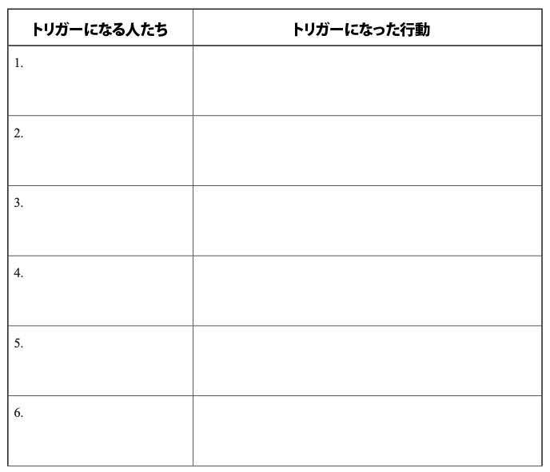

# 人生を破壊する「悪いスキーマ」をチェックしようぜ！ #15「対人関係トリガー・ワークシート」

「人生を破壊する『悪いスキーマ』をチェックしようぜ！」の続きでーす([#1](https://daigovideolab.jp/blog/2161566),[#2](https://daigovideolab.jp/blog/2161730),[#3](https://daigovideolab.jp/blog/2163260),[#4](https://daigovideolab.jp/blog/2164192),[#5](https://daigovideolab.jp/blog/2165742),[#6](https://daigovideolab.jp/blog/2165743),[#7](https://daigovideolab.jp/blog/2166125),[#8](https://daigovideolab.jp/blog/2166486),[#9](https://daigovideolab.jp/blog/2166652),[#10](https://daigovideolab.jp/blog/2167417),[#11](https://daigovideolab.jp/blog/2168117),[#12](https://daigovideolab.jp/blog/2168526),[#13](https://daigovideolab.jp/blog/2169057),[#14](https://daigovideolab.jp/blog/2169261))。

---

このシリーズでは、「やるのは大変だけど実践すれば効果は抜群」でおなじみの心理セラピーである「**スキーマ療法**」の基本を述べてまして、現在は「解決編」に入っております。スキーマ対策については、「[自分でできるスキーマ療法ワークブック](https://amzn.to/3Q7AnxB)」という名著が存在しますが、これはガッツリスキーマを正す趣旨で書かれていまして、実践が大変なところもあったりします。

そこでこのシリーズでは、スキーマ療法の研究で有名なマシュー・マッケイ先生らの調査をベースに、もうちょい手軽だけど、十分な効果を見込めるエクササイズをご紹介します。まぁトラウマレベルのスキーマであれば、「[自分でできるスキーマ療法ワークブック](https://amzn.to/3Q7AnxB)」に取り組むべきでしょうが、中程度の対人トラブルや社交不安の方であれば、いい具合に使っていただけるのではないかと。

さて、前回のステップで、あなたは自分の「スキーマ対処行動（SCBs）」によって、人生にどんな悪いことが引き起こされているのかを理解しました。自分が反射的に取っている不適応な行動を把握したわけです。

ということで、今回からは、不適応なスキーマが引き起こす苦痛な感情を、根本的に対処していくことにします。これまでの対処法は、スキーマと闘ったり、スキーマの痛みを無視したり、抑えつけたりしていたと思いますが、このやり方を根っこから変えていこうって話ですな。

## **ステップ8. 対人関係トリガー・ワークシート**

このステップでは、あなたがスキーマによる痛みや苦しみを感じたときに、抵抗することなく自分の経験を観察する方法を学びます。「[無（最高の状態）](https://amzn.to/3QgNyeC)」で言うところの「観察」「降伏」にあたる能力で、いわゆるマインドフルネスですな。このブロマガをお読みの方であれば、マインドフルネスの説明は不要でしょう。

ただし、マインドフルネスのスキルをスキーマ対策に使うときは、ちょっとしたコツがありますので、このステップではそのあたりを見ていきましょう。スキーマによるダメージってのは、主に対人関係の中で起きるので、そこらへんに特化したトレーニングをしたほうが良いことが多いので。

もっとも、「まだマインドフルネスが苦手だなー」「観察する感じがよく分からないなー」という方は、とりあえず以下の「30セカンズ法」トレーニングだけは意識してやっておきましょう。

### **トレーニング１．30セカンズ法**

このトレーニングは、あなたのマインドフルネスのスキルを高めるためには、もっとも手軽で効果的な手法です。エクササイズの時間は2分半で、以下のステップを読みつつ、指示に従ってみてください。

1. **サウンド30セカンズ**：まずは**30秒だけ**音に注意を向けましょう。冷蔵庫やエアコンの音声など、いま聞こえている周囲の音に意識を向けましょう。人の声、鳥の鳴き声、風の音、通り過ぎる車のモーター音、自分の呼吸音、ツバを飲み込む音などです。気が散ったり、他の考えが浮かんだりしたら、今聞こえている音にそっと注意を戻します。
2. **スメル30セカンズ**：続いて、**30秒だけ**香りに注意を向けます。いま、どんな香りや匂いがするかに意識を向け、かすかなにおいでも意識できるかどうか確かめましょう。もし他のことに意識が向いてしまったら、匂いの感覚に注意を戻してください。
3. **サイト30セカンズ**：今度は周りを見渡して、**30秒だけ**周囲にある物体の色や形を観察します。大きなもの、小さなもの、遠くにあるもの、近くにあるものなど、目に映るものをただひたすら観察しましょう。もし気が散ってしまったら、すぐに見ているものに意識を戻します。
4. **テイスト30セカンズ**：今度は、自分の味覚にどんな感覚があるかを**30秒だけ**注目してみます。さっき飲んだり食べたりしたものの痕跡 があるかもしれないし、よくわからないけどかすかな甘味や酸味を感じるかもしれません。もし他のことに意識が向いてしまったら、味覚の感覚に戻してください。
5. **タッチ30セカンズ** ：最後に、**30秒だけ**触覚に意識を向けます。空気の温度、自分の体が椅子や床に触れている場所の感覚などを、じっくりと観察してみましょう。滑らかな手触り、ざらざらした手触りなど、触覚が感知しているものを意識しましょう。もし気が散ってしまったら、感じたことに意識を戻してください。

すべてやり終えたら、軽く反省をして終了です。「頭の中は考え事でいっぱいだったか?」「それとも、ほとんど今この瞬間に意識を向けることができたか?」といったあたりを振り返ってみましょう。

マインドフルネスのトレーニングとしてはめっちゃ入門編なんだけど、これだけでも自分の感覚をただ観察する感覚はつかめるはずなんで、ひたすらこれを試してみるのも良いでしょう。

### ****トレーニング２．****会話の観察****

こちらは、実際に会話のなかでマインドフルネスを鍛えるエクササイズです。あくまでトレーニングのために行うので、会話のなかでトラブルが起きそうな人は選ばず、あなたが普通にコミュニケーションを取れる人を選んでください。

で、観察の対象を選んだら、実際にその人と会話をしながら、以下のポイントに意識を向けてみてください。

- 自分の思考（相手に対する判断や思い込みを含む）
- 自分の感情（楽しみ、悲しみ、退屈、苛立ちなど）
- 相手の口調、姿勢、表情

このトレーニングのゴールは、自分と相手の間にある**「事実」と「反応」の区別をすること**です。事実とは、あなたが観察した口調 、姿勢、表情、そして会話相手が発した言葉です。一方で、あなたが相手の言葉や表情に対して「怒ってそう」「困っている」と考えたのであれば、それはあなたの反応です。

これらはあくまで自分の解釈でしかないので、現実のものでもなければ、必ずしも真実とも限らないはず。それにも関わらず、多くの人は、「いま怒ったみたい」という自分の反応を真実だと思い込み、無駄にスキーマを起動させたりしてるんですよね。

なので、スキーマに弱い人は、まずは会話を観察しながら「これは私の反応にすぎない」ってところを、脳にたたき込んでいく必要があるんですな。非常にシンプルなトレーニングではありますが、スキーマ対策としてはわりと効果が大きくて、「事実」と「反応」の区別がうまくなるだけでも、対人コミュニケーションが劇的に改善するケースもあったりします。

実際、私もかつてこのトレーニングをよくやってた時期が合ったんですけど、1週間ほどやってみたところ、

- **相手としている会話と、自分が脳内で行っている会話が、同時に2本走っている！**

って感覚になってビックリしました。事実と反応を区別する作業を続けるうちに、「事実の会話」（相手が話した内容）と、「脳内の会話」（自分の解釈）がハッキリと分離して、あたかも一度に2つの会話を行っているような感覚が生まれたわけですな。

この状態になると、自分の解釈はほっといて、相手との会話にだけ集中しやすくなりますんで、よりマインドフルにコミュニケーションを進められるようになるわけです。これは割とオススメ。

### **トレーニング３．対人関係トリガー・ワークシート**

上の「会話の観察」に慣れたら、マインドフルネスのスキルを使って、あなたにとって問題になりやすい人間関係を観察してみましょう。スキーマの痛みが激増してコントロールできなくなる前に、それを正確に把握して対応する方法を学ぶトレーニングであります。現在の人間関係を調べ、不適応なスキーマの引き金となるコミュニケーションを特定していくわけですな。

そのために使うのが、以下の「対人関係トリガー・ワークシート」であります。

このワークシートを使うには、まずは、あなたがネガティブな感情を抱きやすい人をすべて列挙することから始めてください。仕事、家族、子ども、パートナー、友人など、あなたの人生のさまざまな領域を思い浮かべつつ、あなたのなかに羞恥心、怒り、罪悪感、恐れ、悲しみなどの感情を引き起こす人がいないかどうかをチェックしましょう。でもって、思い浮かべた人たちは、すべて「トリガーになる人たち」の欄に記入します。

それが終わったら、続いて右側の欄に、その人たちが何をしたときにスキーマが活性化するのかを書き込みましょう。「私が怒ったり、動揺してしまう行動とは何だろうか?」と考えて、トリガーとなる行動を思いつく限り列挙してくださいませ。

- **対人関係トリガー・ワークシートの例**
  - **トリガーとなる人々→トリガーになった行動**
    - ボーイフレンド→彼の考えがわからないとき、彼が忙しくて一緒にいる時間を作れないとき、何かに腹を立てているとき、私の子育てや生活管理を批判するとき。
    - 母→彼女が私のライフスタイルを批判したとき、会話中に気が散っているように見えたり、興味がないように見えたりしたとき。
    - 元夫→電話口で彼が冷たかったり、そっけなかったりしたとき、、私の子育ての決断を批判したとき。
    - 息子(13歳)→私を無視して自分の部屋に閉じこもるとき、私が何 かしようと誘っても拒否するとき、私のルールや家の運営方法に腹を立てるとき。
    - 上司→毎月のミーティングで問題点を指摘される。
    - 生徒→宿題や成績、教室での問題などについて文句を言うとき。
    - 友人→電話に出ないとき、私の子育てを批判するとき、遅刻するとき、引っ越しの話をするとき。

このような記録をつけると、「いまスキーマのトリガーが引かれた！」「スキーマのせいでネガティブな感情が出た！」ってタイミングがわかりやすくなり、どんどん人間関係への観察力が磨かれていきますんで。

また、この記録で自分のスキーマ発動タイミングが分かれば、次に問題のある人物と接する際に前 もって計画を立てておけるでしょう。たとえば、

- 母親と電話をするときは観察に徹する。
- 息子を迎えに行くときには、あらかじめ自分がどこまで許容するかを決めておく。
- 校長との月例会議で反応を観察する。

みたいな感じですね。こちらも、やればやるほどスキーマの理解が進みますんで、ぜひお試しください。
