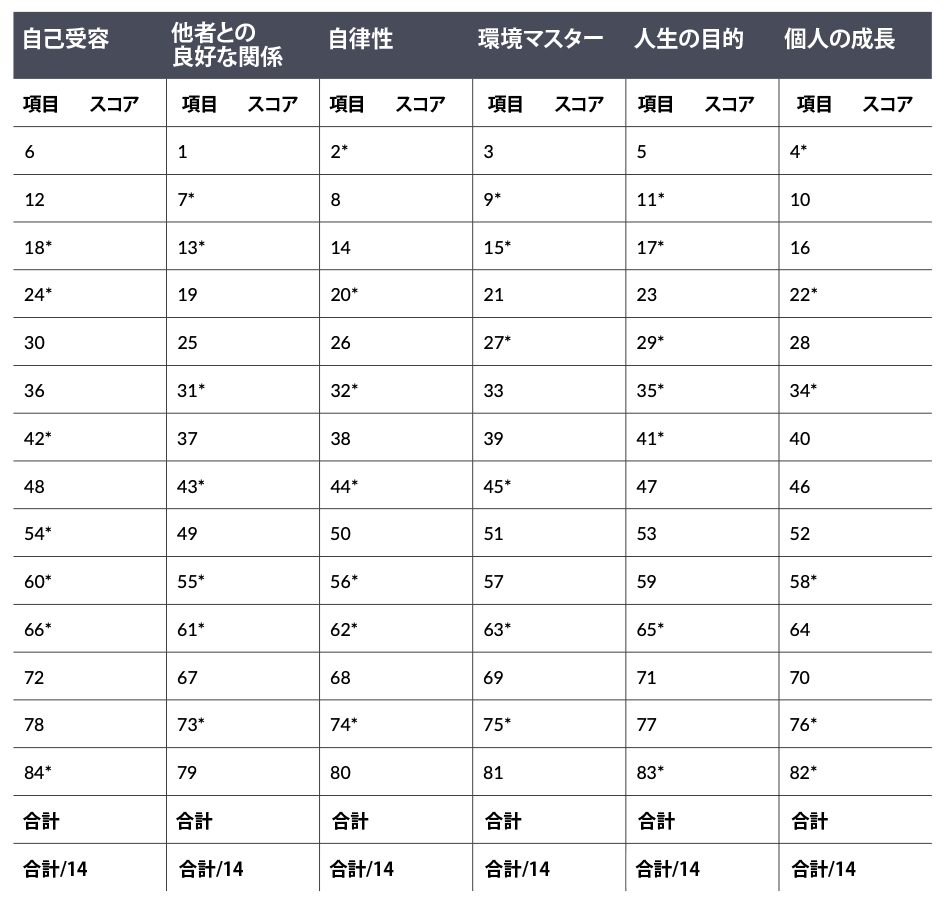

# 私たちの幸福に足りないものを高精度で判断できるベストな84問に答えてみよう

---

「ヒトの幸福ってなんだろう？」ってのは、心理学で昔から議論が続いているテーマのひとつ。ポジティブな感情が多ければ良いのか？ 生活の満足度が大事なのか？ とにかく楽しい気持ちがあれば良いのか？などなど、ポジティブ心理学の世界でも意見が分かれるところだったんですよ。当然、「幸福」って概念を上手く捕まえられないと、幸福度を上げる方法なんて研究しようがありませんから、これはかなり大きな問題だったわけです。

が、そこで現れたのがウィスコンシン大学マディソン校のキャロル・リフ博士なる人物。先生は「**私たちの幸福（ウェルビーイング）は6つの中核要素から構成されている！**」と主張した人で、この考え方をチェックする診断テストを開発したところ、「人間の幸福をうまくとらえることができる！」として大評判になったんですな([R](https://psycnet.apa.org/record/1996-08070-001))。

その後、この検査は「リフのウェルビーイング尺度」と呼ばれて学問の世界に広まり、現在までに400以上の研究で使用される定番のテストの地位を築いたんですよ。個人的にも、リフ博士が提唱する6つの項目には納得感があるなーと思ってまして、

- いまの自分に足りないものはなにか？
- いまの自分の幸福で強化できるものはなにか？

といったあたりを診断するのに有効だと思っております。人生を見直すチェックリストとして、めっちゃ有効だと思うんですよね。

では、リフ博士は、人間のウェルビーイングに欠かせない要素を、どう考えたんでしょうか？ 具体的な分類を見ていきましょう。

1. **自己受容****良い人**：自己に対して肯定的な態度を持ち、良い面も悪い面も含めて自己の多面性を認め、受け入れている、過去の人生について肯定的に感じている。
   **悪い人**：自己に不満を感じており、過去に起こったことに失望している。特定の個人的な特徴や能力について悩み、今の自分とは違う自分になりたいと願っている。
2. **他者との良好な関係****良い人**：他者との間に温かく満足できる信頼関係があり、他者の幸福に関心があり、強い共感、愛情、親密さを持つことができる。人間関係のギブ・アンド・テイクを理解している。
   **悪い人**：他者との親密な信頼関係がほとんどない。温かく、オープンになり、他者に関心を持つことが難しい。対人関係において孤立し、フラストレーションを感じる。他者との重要な絆を維持するために妥協することをいとわない。
3. **自律性
   良い人**：自分でものごとを決めて自立しており、特定の考え方や行動を押しつけてくる社会的圧力に抵抗できる。
   **悪い人**：他人の期待や評価を気にし、重要な決定を他人の判断に頼る。
4. **環境マスター
   良い人**：周囲の環境や状況をコントロールするのがうまく、外から来たチャンスを活用できる。ニーズや価値観に合ったコンテクストを選択したり、創造したりできる。
   **悪い人**：日常的な事柄を管理するのが難しく、周囲の状況を変えたり改善したりすることができない。周囲のチャンスに気づかず、外界をコントロールする感覚に欠ける。
5. **人生の目的
   良い人**：人生に目標があり、方向性を持っている、現在と過去の人生に意味があると感じている、生きる目的や目標だけでなく、生きがいを与える信念を持っている。
   **悪い人**：人生の意義が感じられないし、目標や目的がほとんどなく、どこに向かっていくべきかが分からない。過去の人生に意義を見出せなず、人生に意味を与える展望や信念がない。
6. **個人の成長
   良い人**：継続的に成長しているという実感があり、自分が拡大している感じがある。新しい経験に対してオープンで、自分の可能性についての実感がある。時間の経過とともに自分が改善されていると感じている。
   **悪い人**：個人的な成長の停滞感があり、時間すぎても自分が改善したり拡大したという実感がない。

ってことで、この6つが「良い人」の定義に当てはまる人は、人生のウェルビーイングを存分に味わっているのだと考えられましょう。非常に納得感のあるラインナップですね。

ちなみに、この中で言うと、私の場合は「人生の目的」「他者との良好な関係」に問題を抱えてまして、時に激しい虚無感を感じたりしております。これは自分の中にあるスキーマが働いているせいなのは理解してるんですが、なかなか脳がついていかないものなんですよねぇ（なんせ激烈回避型人間なんで）。

では、以上をふまえたうえで、実際にテストをやってみましょう。全部で84問もあるんでちょっと大変なんですが、それだけあなたのウェルビーイングを計測する精度は高いので、年に1回ぐらいのペースでやってみて、いまの自分に足りないんものをチェックした上で、それに応じた対策を考えてみてはいかがかと思います。

### **リフのウェルビーイング尺度**

以下の質問は、あなたが、自分自身や自分の人生についてどのように感じているかを判断するのものです。正解も不正解もないので、文章を読んで直感的に6点満点でお答えください。

1. まったく当てはまらない
2. そんなに当てはまらない
3. やや当てはまらない
4. やや当てはまる
5. わりと当てはまる
6. かなり当てはまる

1.ほとんどの人は、私を愛情深くて優しい人間だと見ている。
2.私は時々、周りの人たちと同じ行動や考え方をするように、自分の気持ちと動きを変えることがある。
3.だいたいの場合、私は自分の人生を管理できていると感じる。
4.自分の視野を広げてくれるような活動には興味がない。
5.過去にやりとげたことや、未来にやってみたいことを考えると気分がいい。
6.自分の人生を振り返ってみると、物事がうまくいったことに満足している。

7.親密な人間関係を維持することは、私にとって困難であり、フラストレーションを感じる。

8.たとえそれが多くの人の意見と対立するものであっても、私は自分の意見を言うことを恐れない。

9.日常生活でやることが多すぎて、しばしば落ち込むことがある。

10.だいたいの場合、私は時間が経つにつれて、自分自身の内面について学び続けていると感じる。

11.一日一日を生きているだけで、将来のことはあまり考えない。

12.だいたいの場合、私は自分に自信があり、前向きだと感じている。

13.悩みを分かち合える親しい友人が少ないので、孤独を感じることが多い。

14.私の決断は、他の人がしていることに影響されることはない。

15.私は周りの人々やコミュニティにあまりなじめない。

16.私は新しいことに挑戦するのが好きなタイプだ。

17.未来にはいつも悪いことが起きるので、私は現在に集中しようとする傾向がある。

18.私の知り合いのほとんどは、私よりも人生から多くのメリットを得ているように感じる。

19.家族や友人との個人的な会話を楽しむことができる。

20.私は他人の評価を気にする傾向がある。

21.私は日常生活で発生する責任を管理するのが得意である。

22.いまの人生で十分なので、私は新しいやり方を試したくない。

23.私には人生の方向性と目的意識がある。

24.機会があれば、自分について変えたいことがたくさんある。

25.親しい友人から悩みを相談されたとき、聞き役になることは私にとって重要である。

26.自分自身に満足していることは、他人に認めてもらうことよりも重要である。

27.私はよく、自分の責任に押しつぶされそうになる。

28.自分自身や世界についての考え方を変えるような、新しい経験をすることは大切だと思う。

29.自分の日々の活動は、些細で重要でないように思えることが多い。

30.私は自分の性格のほとんどの面が好きだ。

31.私が話したいときに、話を聞いてくれる人はあまりいない。

32.私は意見の強い人に影響される傾向がある。

33.自分の生活環境に不満があれば、それを変えるためになんらかの良い手段を考えるだろう。

34.考えてみれば、私はここ数年、人間としてあまり成長していない。

35.自分が人生で成し遂げようとしていることが何なのか、よく分かっていない。

36.過去には失敗もあったが、全体としてはすべてうまくいっていると感じている。

37.友人関係から多くのものを得ていると感じている。

38.私がやりたくないことを、無理にやらされることはめったにない。

39.私は一般的に、自分の個人的な金銭面や身の回りのことによく気を配っている。

40.私の考えでは、どの年齢の人も成長し発展し続けることができる。

41.以前は自分のために目標を設定していたが、今では時間の無駄に思える。

42.いろいろな意味で、自分の人生でやってきたことに失望を感じている。

43.ほとんどの人は私より友達が多いように思う。

44.私にとって、自分の主義を貫くことよりも、他人に「合わせる」ことの方が重要である。

45.毎日やるべきことが多すぎて、ストレスを感じる。

46.時間が経つにつれて、私は人生について多くの洞察を得て、より強くより有能な人間になったと思う。

47.将来の計画を立て、それを実現するために努力するのは楽しい。

48.たいていの場合、私は自分自身と自分の人生を誇りに思っている。

49.周囲の人は、私のことを「与える人間」や「時間を他人と分かち合う人間」だと表現するだろう。

50.たとえそれが皆の意見とは異なっていても、私は自分の意見に自信を持っている。

51.私は時間をやりくりするのが得意で、やるべきことをすべてこなすことができる。

52.私は時間をかけて人間として大きく成長したという実感がある。

53.私は自分で決めた計画を積極的に実行するタイプだ。

54.多くの人の生き方がうらやましい。

55.私は他人との温かい信頼関係をあまり経験したことがない。

56.物議を醸すような事柄について、自分の意見を言うのは難しい。

57.日常生活は忙しいが、何事にも追われることで満足感を得ている。

58.これまでの慣れ親しんだやり方を変えなければならないので、新しい状況に置かれるのは嬉しくない。

59.人生をあてもなくさまよう人がいるが、私はそういう人間ではない。

60.私が自分自身に抱いているイメージは、他の人が自分自身に抱くイメージほどポジティブではないだろう。

61.友人と一緒にいるときに、私はしばしば外部の人間のように感じる。

62.友人や家族に反対されたら、決断を変えることが多い。

63.やろうと思ったことが達成できないことが多いので、日々の活動を計画しようとするときにイライラする。

64.私にとって、人生は学び、変化し、成長し続けるプロセスである。

65.私は時々、人生でやるべきことをやり尽くしたように感じることがある。

66.自分の生き方に落胆して目覚める日が多い。

67.私は友人を信頼できるし、友人も私を信頼できると知っている。

68.私は社会的な圧力に屈して、特定の考えや行動をとるような人間ではない。

69.自分に必要なアクティビティや人間関係を見つける努力をしていて、それはかなり成功している。

70.自分の考え方が、何年もかけてどのように変化し、成熟してきたかを見るのは楽しい。

71.人生における目標があることは、私にとっては不満よりも満足の源である。

72.過去には浮き沈みがあったが、全般的に変えたいとは思わない。

73.他人と話すときに、本当に心を開くのは難しいと思う。

74.自分の人生の選択を、他人がどう評価するか気になる。

75.自分の人生を納得のいくようにアレンジするのが難しい。

76.自分の人生に大きな改善や変化をもたらすことは、ずいぶん前にあきらめた。

77.人生で成し遂げたことを考えるのは、満足感がある。

78.友人や知人と自分を比較してみても、自分という人間について満足感を抱くことが出来る。

79.友人と私はお互いの問題に共感し合っている。

80.私は他人が大切だと思う価値観ではなく、自分が大切だと思う価値観で自分を判断する。

81.私は、自分好みの家庭とライフスタイルを築くことができた。

82.「年を取ったら何も学べない」という言葉には真実があると思う。

83.最終的に、自分の人生があまりプラスになるとは思えない。

84.誰にでも弱点はあるが、私にはそれ以上に大きな弱点があるようだ。

## **採点**

すべての採点が終わったら、以下の採点表に従って計算してみましょう。アスタリスク(\*)がついた項目は、1点なら6点、2点なら5点というように、項目の元の値を反対の値に変換して計算してください。

リフ先生は、これらの点数をどこから「低得点」で「高得点」と判断できるかを示すグローバルなカットオフ値を公表していないんですが、ざっくりと考えて、

- 平均が3.5よりも上か下か

ぐらいで判断していただければと思います。これより高ければ「まぁまぁ大丈夫」で、これより下なら「改善の余地あり」って感じですね。まぁあくまでも目安なので、定期的にチェックして、自分の数値の変化を見てみるやり方が一番良いかと思いますが。
