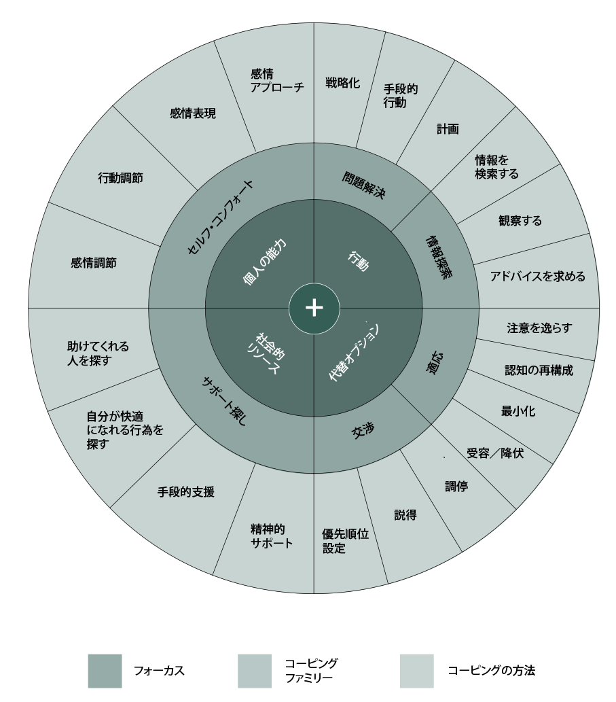
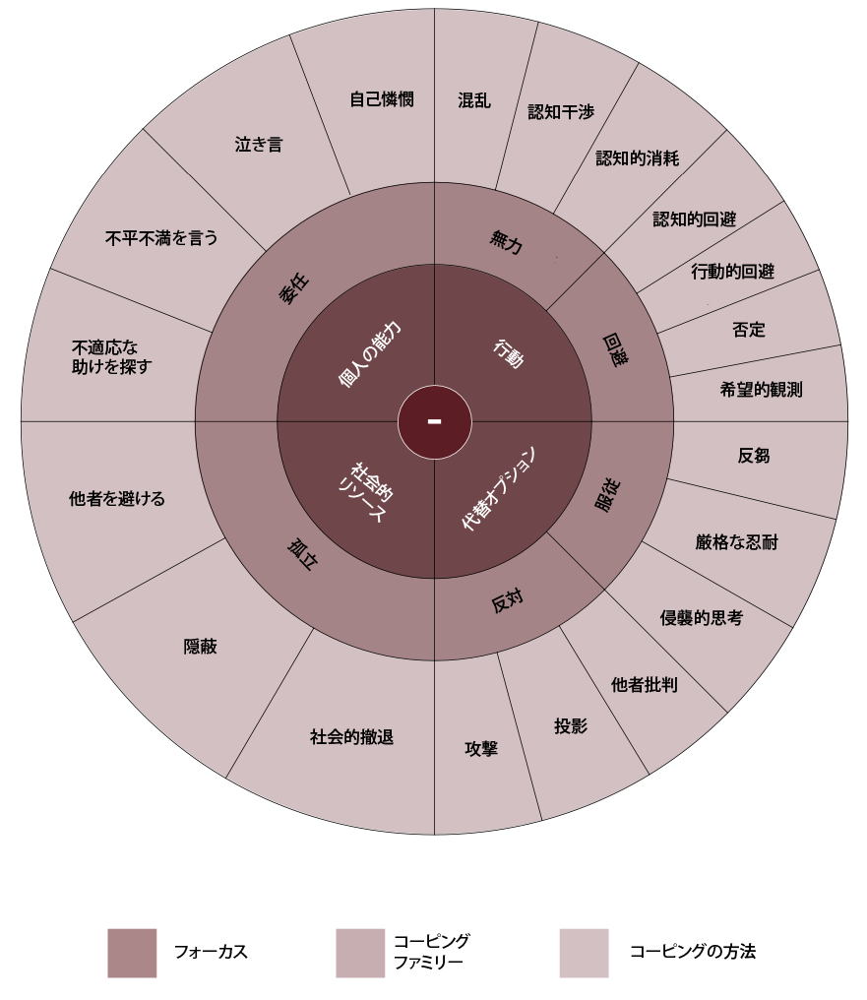

# あなたに最適なストレス対策が見つかる「コーピングの車輪」を試してみよう！

---

## **コーピングの車輪ってなに？**

「[超ストレス解消法](https://amzn.to/40j9x9m)」では、「**コーピング・レパートリーを作ろうぜ！**」みたいな提案をしております。

「コーピング」ってのは「**現実の問題と闘う際にストレスにどのように対応するか**」というのが正確な定義で、本人が「これでストレスが減った！」と思えるなら、どんなものでもコーピングに該当します。猫と遊ぶでも、ガムを嚙むでも、運動をするでも何でも良いわけですな。

ただし、ひとくちにコーピングと言っても、長期的に「良いもの（適応的）」と「悪いもの（非適応的）」の2つがあるわけです。「猫と遊ぶ」コーピングが長期的に悪影響が出ちゃう可能性は低いでしょうが、「ギャンブルをする」ってコーピングばかりに頼っていたら、そのうち破産しますからねぇ。

まぁ「ギャンブル」なら長期的な害がわかりやすいから良いんですけど、なかには「悪いコーピングをやりすぎて、もはや『悪いこと』だと気づけなくなっている」って状態が少なからず存在するんですよ。たとえば、友人の前で恥をかいたときに「しばらく他人を避けて引きこもる」ってコーピングを何度も続けていると、いつしかそれが習慣のようになってしまい、自分でも気づかないうちに悪いコーピングを発動してしまった上に、本人もそれに気づきすらしない……みたいな状態ですね。

これを続けていると、短期的には『恥の感覚』を避けられるものの、長い目で見たら友人関係が壊れていくのは当然でしょう。このような問題を防ぐためにも、ぜひ「適応的なコーピング」と「非適応的なコーピング」をより分けておきたいわけです。

で、そこで使えるのがポートランド州立大学のエレン・スキナー先生が行ったレビュー([R](https://www.scirp.org/%28S%28i43dyn45teexjx455qlt3d2q%29%29/reference/ReferencesPapers.aspx?ReferenceID=1682920))で、この研究では、コーピング戦略に関する44の研究をレビューし、大勢の人が使うコーピング法を構造化して、頻出するコーピングの階層的カテゴリーを特定したんですな。というと分かりづらいかもですが、要するに、みんなが最もよく使うコーピングを分類して、私たちに使いやすくしてくれたわけです。ありがたいですねぇ。

この考え方を使うことで、どのようなメリットを得られるのかと言いますと、

- あなたが普段使っているストレス対策が、長期的に良いものか悪いものかをすぐに判断できる。

- よく使うストレス対策が悪いものだった場合に、その代わりにどのような方法を使えば良いのかがすぐに判断出来る。

みたいになります。自分でも知らないうちに、ついつい悪いストレス対策を取ってしまう人は多いので、そこらへんが理解できるだけでもかなりメンタルの改善がはかどるはずであります。

では、まずはスキナー先生が作成した「**コーピングの車輪**」を見てみましょう。これは、スキナー先生が分類したコーピングを、グループごとに円形のチャートにまとめたものです。細かい使い方は後述するので、とりあえずざっくり眺めてみてください。

### **良いコーピングの車輪**

### **悪いコーピングの車輪**

では、以上の車輪を見つつ、具体的な使用方法をご説明しましょう。ご覧の車輪には、41の一般的なコーピング(車輪の外側の縁)と、これらのコーピングが属する12のファミリー(車輪の2番目の縁)が配置されています。それぞれを説明しましょう。

## **コーピングってなに？**

あらためて説明すると、「コーピング」とは、ストレスに対処するために私たちがとる具体的な行動のこと。たとえば、ストレスにうまく対処する方法を学ぶためにストレス解消法の本を読むのもコーピングの一種出し、ケンカばかりする両親から気をそらすために「テトリス」で遊ぶのもコーピングの一種です。このように、コーピングとは、「ネガティブな状況に対処するために、具体的に何をしたのか?」という質問に対する答えとなるものだと言えます。

その点で、「コーピングの車輪」は、具体的なコーピングの行動を、より広いカテゴリーにまとめたものです。たとえば、ストレス対策の 本を読むことは、「良いコーピングの車輪」における「情報を検索する」に該当しますし、テトリスで遊ぶのは「良いコーピングの車輪」における「注意を逸らす」に該当します。

## **コーピングファミリーってなに？**

コーピング・ファミリーは、一般的なコーピングをさらに大きくまとめたものです。たとえば、「情報を検索する」「観察する」「アドバイスを求める」はすべて「情報を求める」という行動パターンが一緒なので、「情報探索」というコーピング・ファミリーに属します。12のコーピング・ファミリーは、車輪の2番目の縁に表示されています。

さらに、車輪の一番内側は、12のコーピングをさらに大きくまとめたものです。たとえば、コーピング・ファミリーの 「情報探索」に属する行動は、すべて何らかの行動をともなうため、「行動」というグループにまとめられています。このようなグルーピングをすることで、自分が使うストレス対策が把握しやすくなるわけですね。

## **良いコーピングの解説**

コーピング・ファミリーには、6つの「適応的」な対策と、6つの非適応的な対策が存在します。これらのファミリーについて、詳しく説明していきましょう。

### **セルフ・コンフォート**

- **説明**：感情の受容、セルフケア、適切なタイミングで建設的な感情を表現するトレーニングなどを通じて、積極的に苦痛をコントロールする。
- **フォーカス**：個人の能力。

- **キーワード**：自己集中、責任感、積極性、自己奨励、セルフケア、感情コントロール、リラックス、本物の感情表現

- **例**：
  - 自分の行動に責任を持つ（行動調節）。
  - 自分の感情をメタ認知で認識し、感情のままに行動するのを防ぐ（行動調節）。
  - 自分の感情を、そのままに受け入れて放置しておく（感情アプローチ）。
  - 自分の感情を効果的にコントロールする（感情調節）。
  - 何かに失敗したとき、自分に対して思いやりをもって行動できる（感情表現）。

### **問題解決**

- **説明**：目の前の問題を効果的に解決するために行動を起こす。

- **フォーカス**：行動

- **キーワード**：能動的な対処、見て学ぶ、習得、自己効力感、優先順位、修復
- **例**：
  - 「SWOT 分析」「5 つのなぜ」など、一般的な解決のフレームワークを使ってみる（戦略化）。
  - 解決すべき問題を分割し、問題の解決につながる行動をリストアップする（計画）。
  - すぐにできる解決策を並べて、最もすぐに取りかかれるものから手をつける（手段的行動）

### **情報探索**

- **説明**：問題への対処に役立つ情報を求める。ストレスの多い状況について、その経過、原因、結果、意味などを詳しく知ろうとする。

- **フォーカス**：行動

- **キーワード**：好奇心、興味、勉強好き

- **例**：
  - どうしたらいいか、誰かにアドバイスをもらう（アドバイスを求める）。
  - 私は問題のある状況についてもっと知るために読んだ（情報を検索する）。
  - 同じような経験をした人たちを観察して、彼らが何をしたかを学ぶ（観察する）。

### 適応

- **説明**：ストレスの多い状況下でも、自分の内面を柔軟に調整する。これにより、どうしてもストレスを避けられないような状況でも、内面の自由を保つことが出来る。

- **フォーカス**：代替オプション

- **キーワード**：現実主義、心理的な柔軟性、思考の捉え直し、受容

- **例**：
  - このようなトラブルが起こったこと、そしてそれを変えることができないことを受け入れる（受容／降伏）。
  - いま利用可能な選択肢を現実的に検討して絞り込み、それに基づいて選択する（最小化）。
  - なにか嫌なことが起きた時に、自分の意識を他の対象に向けて維持する（注意を逸らす）。
  - 自分が不合理な思考を持っているときに、それを観察して放置し続ける（受容／降伏）。
  - 問題に直面したとき、私は「世の中にはもっと悪いことがある」と自分に言い聞かせる（認知の再構成）。

### **交渉**

- **説明**：交渉とは、難しい状況と自分の希望の間に妥協点を見出そうとする行為のこと。そのために、新しい選択肢を見つけたり、嫌な相手と積極的にコミュニケーションを行う。

- **フォーカス**：代替オプション

- **キーワード**：優先順位の設定、妥協案の提案、説得、建設的な抵抗、目標の擁護、毅然と した態度、要求の削減、トレードオフ

- **例**：
  - 誰かと議論するとき、双方にとってうまくいく解決策を見つけようとする（調停）。
  - 予想と違う状況になったとき、利用可能な選択肢をすべて検討し、それでも自分が望むものを得るための最も最適な方法を考える（優先順位設定）。
  - 自分のビジョンと他人のビジョンが異なるときに、喜んで相手の言葉に耳を傾け、その状況でもできるだけ自分の目標を追求できるような形で交渉する（説得）。

### サポート探し

- **説明**：ストレスの多い出来事に直面したとき、他の人に頼る。利用可能な社会的リソースを探す。

- **フォーカス**：社会的リソース

- **キーワード**：親しい人を探す、他の人と同盟を結ぶ、慰めを求める、 助けを求める、精神的なサポートを求める

- **例**：
  - この問題に対して具体的に何かしてくれそうな人に相談する（助けてくれる人を探す）。
  - 自分の気持ちを誰かに相談する（精神的サポート）。
  - 自治体のサポート組織や専門家に助けを頼む（手段的支援）。
  - サウナに入ったり読書をしたりと、自分が楽になれるアクティビティを探す（自分が快適になれる行為を探す）。

## **悪いコーピングの解説**

### 委任

- **説明**：ストレスフルな状況に対処する際に、他人に過度に依存すること。他人に負担を与えるだけでなく、本人の能力が十分に伸ばせなくなるという欠点がある。状況のネガティブな側面に集中し、自己憐憫にひたってしまうケースも多い。

- **フォーカス**：個人の能力

- **キーワード**：圧倒的な自己陶酔、状況の苦しい側面に集中する、自己憐憫

- **例**：
  - ストレスの多い状況には、自分ひとりでは対処できないと感じる（泣き言）。
  - 困難な感情を経験したらすぐに友人に電話をかけ、自分の経験を共有することで、安心させてもらうる（不平不満を言う）。
  - 私の問題は、普通の人が対処しなければならない問題よりも深刻だと感じる（自己憐憫）。
  - ギャンブルや酒など、長期的に自分にデメリットがある助けを探す（不適応な助けを探す）。

### 無力

- **説明**：無力感の特徴は、「あきらめ」あるいは「コントロールの放棄」の２つ。コントロールできない状況に直面してあきらめることは一般的に適応的だが、無力感には、落胆やあきらめを伴って、状況を変えようとする積極的な試みを取りやめるという心理が含まれる。

- **フォーカス**：行動

- **キーワード**：集中力の欠如、モチベーションの欠如、消極性、混乱、認知障害または疲労、自信喪失、落胆、憂うつ、悲観主義

- **例**：
  - もはや何をしていいのかサッパリ分からず、とほうに暮れる（混乱）。
  - あらゆることを試したが、この状況に対処するために何か違うことを試しても無駄だと考える（認知的干渉）。
  - 私は過去の犠牲者であり、これからも犠牲者であり続けるだろうと考える（認知的消耗）。

### 回避

- **説明**：恐怖の感情とストレス要因から離れたいという欲求が強く、ストレスの多い状況から遠ざかろうとする。ただし、回避は、危険な環境から身を守るという適応的な機能を果たす場合もある。

- **フォーカス**：行動

- **キーワード**：回避、逃避反応、否認

- **例**：
  - 上司が嫌いなので、できるだけ避けようとする（行動的回避）。
  - 悲惨な体験が再びよみがえラ内容に、テレビを見てできるだけ気を紛らわす（認知的回避）。
  - 「もし上司が死んだら」と考えて、ネガティブな感情をやわらげる（希望的観測）。
  - 「こんな状況はあり得ない」と考えて、現実を否定しようとする（否定）。

### 服従

- **説明**：服従は、状況をコントロールしようとしすぎるか、どうにもならないことをグダグダ考えることを意味する。この状態には、「ネガティブなことを考える」だけでなく、逆に「自分の欲求を追求して徹底的な努力をする」ことも含まれる。

- **フォーカス**：代替オプション

- **キーワード**：否定的思考、ネガティブ思考、不安の増幅、自己顕示欲、非難、恐れ

- **例**：
  - 自分の行動はうまくいくに違いないので、一歩も引く気はないし、これを実現させるためにさらに努力しなければならないと考える（厳格な忍耐）。
  - なぜこんな嫌なことが起きたのかを、何度も考えてみる（反芻）。
  - 自分で考えようと思わなくても、嫌なことが何度も頭に浮かぶ（侵襲的思考）。

### 反対

- **説明**：ストレスの原因と思われるものを攻撃したり、闘ったりすることに重点を置くコーピング。怒りや敵意を伴いながら、障害を排除しようと立ち向かう。

- **フォーカス**：代替オプション

- **キーワード**：攻撃性、投影、対立、反抗、復讐、他人を責める

- **例**：
  - 自分の意見に反対する人に、強い言葉で威圧する（攻撃）。
  - 自分にネガティブな感情を与えてくる人は、自分と関係がなくても批判する（他者批判）。
  - 私がストレスを感じるようなことを他の人がしたら、同じことを他の人にもするようにする（投影）。

### 孤立

- **説明**：物理的あるいは心理的に他者から引きこもる、あるいは遠ざかるタイプのコーピング。嫌な相手との接触から個人を守るというメリットもあるが、サポートしてくれる人から遠ざかってしまう。

- **フォーカス**：社会的リソース

- **キーワード**：消極性、引きこもり、羞恥心、隠れたり消えたりしたい願望

- **例**：
  - ストレスフルな出来事を経験した後は、その出来事やそれが自分に与えた感情的影響を他人に知られないようにする（隠蔽）。
  - ストレスが多いときは、他人とのコミュニケーションを避ける（他者を避ける）。
  - ストレスが多いときは、できるだけ自分の部屋にこもる（社会的撤退）。

## **コーピングの車輪の使い方**

ってことで、コーピングの車輪の説明は以上です。こいつを具体的に使う時は、

- 「良いコーピングの車輪」は「悪いコーピングの車輪」の対になっている。

と考えるとわかりやすいでしょう。たとえば、良いコーピングの「個人の能力」に割り当てられた対処法は、どれも「自分で自分の対処を決める！」という形をとっ ているのに対し、悪いコーピングの「個人の能力」に割り当てられた対処法は、どれも自立の反対である「人任せ」の形をとっております。このように、車輪のなかの各エリアには、それぞれ真逆のソリューションが配置されているわけです。

なので、まずは自分がいつも使っているコーピングをチェックしてみて、たとえば「あ、自分は上司に怒られたときに『厳格な忍耐』（どう考えても良い結果が出ないと分かっているのに、頑張り続けること）を使いがちだ！」と気づいたとしましょう。そこで良いコーピングの車輪を見ると、『厳格な忍耐』と同じ場所にあるのは『適応』なので、そのファミリーである「注意を逸らす」「認知の再構成」「最小化」「受容／降伏」のどれかを使うように心がけると、メンタルが良い方向に向かいやすくなるはずであります。

こんな感じで、悪いコーピングに気づいたら、その正反対に位置するコーピング・ファミリーを使ってみるのが「コーピングの車輪」の使い方の基本。あなたにとって効きやすいコーピングを探すのに役立ちますんで、ぜひ積極的にご利用ください。
