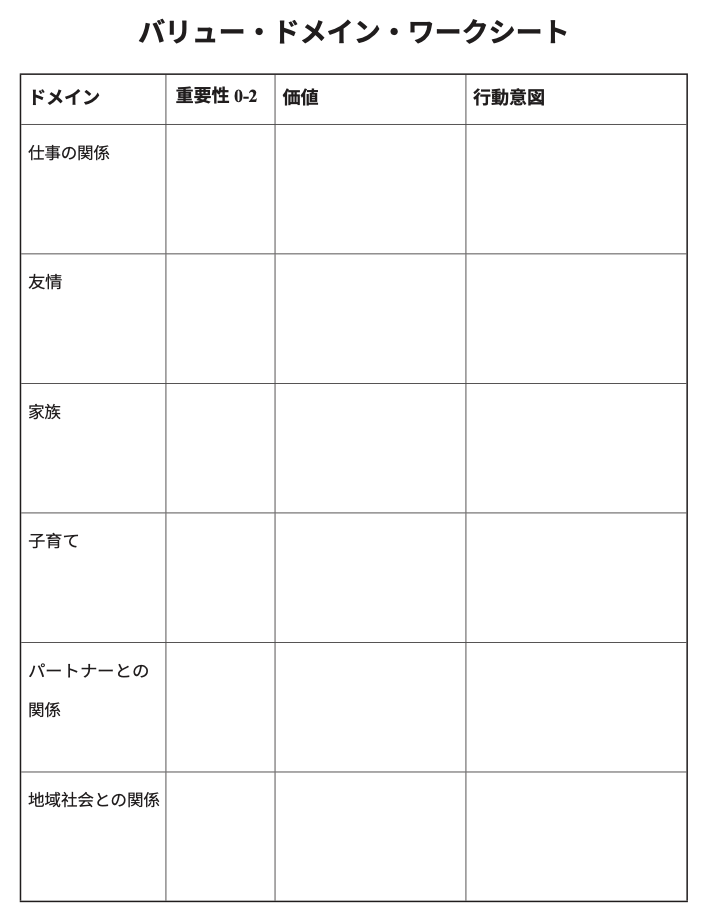

# 人生を破壊する「悪いスキーマ」をチェックしようぜ！ #17「バリュー・ドメイン・ワークシート」

「人生を破壊する『悪いスキーマ』をチェックしようぜ！」の続きでーす([#1](https://daigovideolab.jp/blog/2161566),[#2](https://daigovideolab.jp/blog/2161730),[#3](https://daigovideolab.jp/blog/2163260),[#4](https://daigovideolab.jp/blog/2164192),[#5](https://daigovideolab.jp/blog/2165742),[#6](https://daigovideolab.jp/blog/2165743),[#7](https://daigovideolab.jp/blog/2166125),[#8](https://daigovideolab.jp/blog/2166486),[#9](https://daigovideolab.jp/blog/2166652),[#10](https://daigovideolab.jp/blog/2167417),[#11](https://daigovideolab.jp/blog/2168117),[#12](https://daigovideolab.jp/blog/2168526),[#13](https://daigovideolab.jp/blog/2169057),[#14](https://daigovideolab.jp/blog/2169261),[#15](https://daigovideolab.jp/blog/2170446),[#16](https://daigovideolab.jp/blog/2171935))。

---

このシリーズでは、「やるのは大変だけど実践すれば効果は抜群」でおなじみの心理セラピーである「**スキーマ療法**」の基本を述べてまして、現在は「解決編」に入っております。スキーマ対策については、「[自分でできるスキーマ療法ワークブック](https://amzn.to/3Q7AnxB)」という名著が存在しますが、これはガッツリスキーマを正す趣旨で書かれていまして、実践が大変なところもあったりします。

そこでこのシリーズでは、スキーマ療法の研究で有名なマシュー・マッケイ先生らの調査をベースに、もうちょい手軽だけど、十分な効果を見込めるエクササイズをご紹介します。まぁトラウマレベルのスキーマであれば、「[自分でできるスキーマ療法ワークブック](https://amzn.to/3Q7AnxB)」に取り組むべきでしょうが、中程度の対人トラブルや社交不安の方であれば、いい具合に使っていただけるのではないかと。

さて、前回のステップでは、「対人体験日記」ってトレーニングを行いつつ、自分のスキーマを観察する能力を養っていただきました。このトレーニングを続けることで、あなたは自分のスキーマが引き起こすヤバい変化について、リアルタイムで把握できるようになっていくはずであります。まー、私自身が、まだこの能力を開発中なので大きなことは言えないんですけど、かなり人生の改善に役立つスキルだってのは断言できるので、鍛えておくのが激しくオススメです。

ということで、今回もまた、スキーマへの対処能力をアップさせるトレーニングを見ていきましょうー。

## **ステップ10. バリュー・ドメイン・ワークシート**

ここまでのステップで、私たちは、自分のヤバいスキーマが生み出すネガティブ感情を特定し、それがいろんな人間関係のなかで、どのようなヤバい思考と感情を生み出すのかを観察するスキルを養い、さらにはこれらの否定的な思考や感情が、どのようにしてあなたの人生を壊していくのかも理解しました。

おそらく、この時点で、軽度なスキーマなら克服できてしまう人は多いはず。「いまスキーマが問題を起こした！」と気づけるだけで、かなり対処はしやすくなるはずなんですよ。

しかし、これが根強いスキーマになると、たんに観察スキルを養っただけでは解決できないことがあります。スキーマが引き起こすヤバい行動に立ち向かうには、もっとよい行動を行うためのプランを立てておく必要があるんですよ。

ってことで、このステップでは、さらに根強いスキーマに立ち向かうために、くわしい行動変容のテクニックを考えていきましょう。その方法はいくつかありますが、まずやって欲しいのが「バリュー・ドメイン・ワークシート」であります。

これは、名前のとおり「**人間関係の価値観を明確にすること**」を意味してまして、両親、パートナー、子供、友人、上司との関係において、あなたにとって最も重要なものは何かを考えていく作業を意味します。

というのも、あなたのスキーマが「最も重要なことは『正しいこと』だ！」とか「最も大事なのは『批判を避けることだ！』」とささやいてくるにもかかわらず、実際により深い内面では、あなたの本当の自己は「正直さ」「愛」「尊敬」のような、より肯定的で強力な他の価値観を持っていることがよくあるんですよ。これらの根底にある価値観を見抜くと、行動変容を成功に導くエンジンとして働いてくれやすいんですな。まさに、行動変容を成功させる第一歩だと言えましょう。

そこで「バリュー・ドメイン・ワークシート」では、あなたの人間関係の核となる価値観を明らかにするために、以下の6つの人生の領域を探っていきます。

1. 仕事の関係
2. 友情
3. 家族
4. 子育て
5. パートナーとの関係
6. 地域社会との関係

具体的には、以下のようなワークシートを使って、自分の価値観を掘り下げていきましょう。

- **重要性**：その人間関係の重要度を０〜２点の間でつける。めっちゃ重要なら２点。
- **価値**：その人間関係において、自分がどのような人間でありたいかを考えて記入。
- **行動意図**：その価値を実現するために、どのような行動を具体的に取りたいのかを考えて記入。

これだけだと分かりづらいので、さらに詳しい記入例は、以下のようになります。

- **バリュー・ドメイン・ワークシートの記入例１**
  - 仕事の関係
    - 重要性：２
    - 価値：正直な(意地悪ではない)フィードバックをする。同僚の創造性をサポートする。
    - 行動意図：私たちの新しいソフトウエア・プロジェクトについて、正直に、でもやさしく感想を言う。新しいアイデアのひとつひとつに真剣に取り組み、ポジティブな面を見つけて褒める。
  - 友情
    - 重要性：２
    - 価値：思いやりのある友人でいること。
    - 行動意図：家に引きこもるのではなく、少なくとも週に1回は友人と連絡を取る。
  - 家族
    - 重要性：１
    - 価値：母の支えとなれる愛情深い娘でいること。
    - 行動意図：母にしてほしいことに焦点を当てるのではなく、私が感謝していることについて母を褒める。
  - 子育て
    - 重要性：０
  - パートナーとの関係
    - 重要性：２
    - 価値：相手を支えられる人間になる。
    - 行動意図：相手への批判に集中するのではなく、毎日1つ声に出して感謝することを探す 。
  - 地域社会との関係
    - 重要性：１
    - 価値：地域の子供たちを助ける。
    - 行動意図：ボランティア団体に参加する。

上記の例を見ると、この人物の価値観の中心は、いずれも他者を愛し、思いやり、サポートすることにあるのだと考えられるでしょう。しかし、この人は批判的で否定的な傾向があり、他人の考え方の欠点を探してしまうことがわかりますね。そのため、行動意図の文章に「〇〇ではなく」という表現が多くなっている。

- **バリュー・ドメイン・ワークシートの記入例２**
  - 仕事の関係
    - 重要性：１
    - 価値：信頼性、誠実さ
    - 行動意図：仮病で欠勤する電話をやめ、給料分のまっとうな仕事をする。
  - 友情
    - 重要性：２
    - 価値：信頼性
    - 行動意図：友人に借りた金を返す。仕事をやり遂げる。
  - 家族
    - 重要性：０
  - 子育て
    - 重要性：２
    - 価値：堅実で頼れる父親になる
    - 行動意図：週末に子供たちと楽しく適切な活動を計画する。
  - パートナーとの関係
    - 重要性：１
    - 価値：妻とその家族と友達でいること。
    - 行動意図：扶養料の支払いを期日通りに行い、家の維持に協力する。
  - 地域社会との関係
    - 重要性：１
    - 価値：価値ある社会の一員と なる。
    - 行動意図：学校の募金活動や春の旅行を手伝う。

上記の例を見ると、この人物は良い価値観を持っているんだけど、時間通りに出社したり、養育費を支払ったり、子供と楽しいことをしたりすることを妨げる“何か”のせいで、十分に行動ができていないことがわかるはず。そこで、具体的な行動意図を書き出すことで、どのように行動すべきかがより明確になるはずであります。

で、「[最高の体調](https://amzn.to/3StNbA2)」でも強調しましたが、このワークシートを行う際は、価値観と目標を混同しないように注意してください。「価値観」ってのは、人生で進みたい方向性のことであり、達成したい具体的な目標ではありませんので 。

たとえば、あなたが「会社で良い成績を取る」と思ったとしましょう。これは実際に「良い成績」を取ったら終わるので、あくまで目標であります。その根底にある価値観は、「より自立した人間になる」かもしれませんし、「みんなのために貢献する」かもしれません。

また、「友人のキッチンのペンキ塗りを手伝 いたい」と思ったとしましょう。こちらも達成可能な目標であり、実際にペンキを塗ったらそれで終わりです。 その背景には、「友人が助けを求めて頼れる人になる」って価値観があるのかもしれません。こちらは時が経っても持続するし、何かを達成したら終わるわけではないため、価値観だと言えます。

このように、あなたが生涯を通じて一貫して進む方向を示してくれるのが価値観の定義。この方向に向かって、「ボランティア活動をする」「友人に車を貸す」といった個々の目標を組み立てていくのが、価値観エクササイズの基本であります。これによって、スキーマの衝動に左右されない、良いアクションが可能になるわけですね。ちなみに、このブロマガでは、過去に価値観を探すためのエクササイズを大量に紹介してますんで、「そもそも価値観が判断できない！」という方は、そちらも合わせて試してみてください。

このエクササイズを行うと、価値観にもとづいたあなたの行動が明確となり、やがてはあなたが無意識に使ってきたスキーマ対処行動をに手を出さずに済むようになるはず。これをくり返すことで、人間関係を損なう代わりに、あなたの人間関係はガッツリ改善するはずであります。

では、長くなったのこで今回はこのへんで。次のステップでは、今回チェックした行動意図を実践するための方法を見ていきましょうー。
